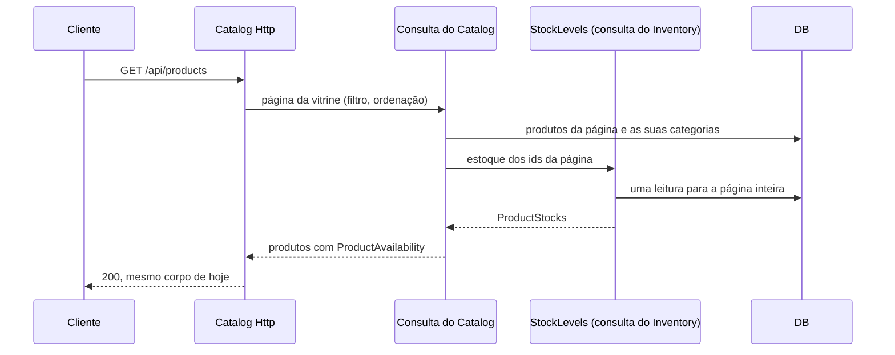
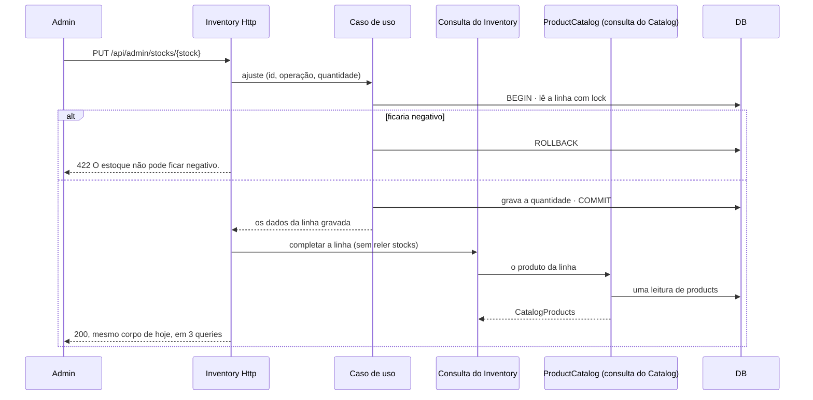

# Lado de leitura: consultas que compõem os módulos pelos contratos

> Faça o plano a partir deste documento. Cada slice abaixo já traz a sua forma: copie, não derive de novo.
> Status: confirmed by diashelter, 2026-10-16

## Situation

- Project: em construção. É um projeto de estudo, sem produção e sem usuários, e o banco é recriado por `make fresh`.
- Decision: decidida por diashelter em 2026-10-08, na [HEL-6](https://linear.app/helter/issue/HEL-6/utilizar-comand-e-query-cqrs-para-leitura-de-dados), que os designs da HEL-7, da HEL-10 e da HEL-11 já apontavam como a rodada que remove as exceções de leitura. Esta discovery decidiu o objetivo, o alcance e onde mora a regra de disponibilidade.
- In flight: segue o `ModuleBoundariesTest` da HEL-7 e o vocabulário calculado da HEL-10, em que uma travessia nova se resolve com um contrato e uma lista tipada, nunca com uma exceção. A HEL-12 (layout Core, Persistence e Http por módulo, rotas e migrations por módulo, `internachi/modular`) e a HEL-14 (k6) ficam de fora, mas a HEL-12 vai mover as consultas criadas aqui.
- At stake: baixo. São cerca de 30 arquivos, sem dados, e errar custa só retrabalho. O que pesa são os contratos de leitura e o lugar da regra, porque a HEL-12 vai ser construída sobre eles.

## Problem

Construção. A HEL-7 e a HEL-10 fecharam as fronteiras, mas deixaram três leituras como exceção até a HEL-6: o dashboard do admin, a vitrine com o cadastro de produto do admin e a lista de estoque do admin. Sem esta rodada, o teste continua com uma lista de travessias permitidas. O Catalog e o Inventory dependem do Ordering, que depende dos dois. O dashboard quebra com qualquer mudança em quatro repositórios de outros módulos. E não existe um lugar para uma leitura nova que junte módulos, então a próxima copiaria a relação do Eloquent. Fazer depois da HEL-12 significaria mover as nove exceções para as pastas novas e reescrevê-las lá.

Contagem de 2026-10-16 no `ModuleBoundariesTest`: são 9 exceções. Cinco são do dashboard (os repositórios do Catalog, do Identity, do Inventory e do Ordering, mais o `ProductStatus`), duas são das relações `Product::stock` e `Stock::product`, e duas são do `PurchaseAvailabilityService` usado pelo `Http` do Catalog e pelo do Inventory. Elas servem 10 rotas.

## Success

- Worked if:
  - o `ModuleBoundariesTest` não tem lista de exceções e falha se qualquer uma das 9 travessias voltar, o que é conferido com uma violação de propósito para cada uma;
  - as 10 rotas e as do carrinho e do checkout devolvem os mesmos códigos, corpos e mensagens, e os testes de feature atuais passam sem mudar nenhuma expectativa de corpo (a única diferença é o default 1 do ProductResource, que nenhum teste cobre hoje);
  - a listagem da vitrine e a lista de estoque fazem o mesmo número de queries com 1 e com uma página cheia de itens;
  - as contagens que a HEL-11 cobra não mudam: 3 queries para abrir o produto (na vitrine e no admin), 10 para editar, 4 para mudar o status e 3 para ajustar o estoque;
  - `make test` e o Pint passam.
- Going wrong:
  - uma página de consulta leva models dentro do paginator (o teste vê só os tipos nativos, não o tipo dos itens);
  - a regra "ativo e com unidades" aparece escrita fora do Catalog;
  - uma consulta lê a tabela de outro módulo em vez de chamar o contrato do dono;
  - uma exceção volta ao teste para fazer uma leitura passar.
- Review: quando a HEL-12 começar. diashelter confere onde as consultas ficam no layout novo e se os contratos de leitura ainda são o que as telas pedem.

## Boundary

In:
- As leituras de `GET /api/products`, `GET /api/products/{product}`, `/api/admin/products` (listar, abrir, criar, editar e mudar o status), `GET /api/admin/stocks`, `PUT /api/admin/stocks/{stock}` e `GET /api/admin/dashboard`.
- A regra de disponibilidade e os seus usuários no carrinho (`POST /api/cart/validate`) e no checkout (`POST /api/orders`).
- O `ModuleBoundariesTest` sem exceções, com as regras das consultas.
- O README, a análise de domínio e o `AGENTS.md`, que hoje dizem "até a HEL-6".

Out:
- As outras leituras (pedidos, clientes, endereços, categorias, pagamento): elas não cruzam módulo, e mudam para consultas quando forem tocadas.
- O modelo de leitura projetado pelos eventos do outbox: nenhuma leitura lenta foi medida, e a projeção pede eventos que não existem (ver Shape).
- O layout de pastas da HEL-12 e o k6 da HEL-14.
- O frontend: os corpos não mudam.

Unchanged:
- As rotas, os códigos HTTP, os corpos e as mensagens: `Produto indisponível.`, `Estoque insuficiente. Disponível: N.` e `O estoque não pode ficar negativo.`.
- As tabelas e a chave estrangeira `stocks.product_id`, com a exclusão em cascata.
- O `StockInitializer` e o `StockReservation`, no `StockRepository`, e o lock e a transação do checkout.
- O `StockQuantities` respondendo zero para o produto sem linha de estoque.
- Os contratos `CustomerOrderHistory`, `ProductOrderHistory`, `CustomerAccounts`, `DeliveryAddressBook`, `PayableOrders`, `ShippingQuoter` e `PaymentGateway` e as suas implementações.
- Os eventos e o outbox.
- O `DashboardService`, que continua montando os números a partir de contagens.

## Shape

As leituras da vitrine, do cadastro de produto, da lista de estoque e do dashboard passam a ser consultas do módulo que serve a rota. Cada consulta devolve dados, nunca models, e pede ao dono, pelo contrato de leitura dele e por ids, o que não é seu, uma vez por página. A regra "pode ser comprado" sai do Ordering e vira um value object do Catalog, que a vitrine, a lista de estoque, o carrinho e o checkout leem do mesmo lugar. A porta são os contratos de leitura e o lugar da regra: a HEL-12 vai construir sobre essas assinaturas, e mudar a regra de módulo de novo significa mudar os quatro lugares que a leem. Diferente da regra atual, um contrato de leitura passa a ser implementado por uma consulta, e não por um repositório (Key decision 3).

A alternativa mais pesada é um modelo de leitura projetado: tabelas próprias para a vitrine e o dashboard, atualizadas por consumidores dos eventos do outbox. Ela só ganha se uma dessas leituras ficar lenta numa medição (a HEL-14 é o lugar) ou se um módulo ganhar banco próprio, e hoje nenhuma das duas coisas é verdade. Ela também pediria eventos de produto, de estoque e de cliente que não existem, e deixaria a vitrine alguns segundos atrasada.

Fora da comparação, só para referência:
- Uma consulta que junta num SQL só as tabelas de outro módulo: faz uma query a menos por página, mas o Catalog passaria a depender do esquema de `stocks` sem contrato, e uma migration do Inventory quebraria a vitrine sem aviso do teste.
- Declarar o Backoffice um read model que pode ler os repositórios de todos: é o que a exceção já permite, só que escrito como regra. O dashboard continuaria preso a métodos de quatro repositórios, o acoplamento que a HEL-7 existe para impedir.
- Manter a regra no Ordering: o Catalog e o Inventory dependeriam do Ordering, que depende dos dois, e o contrato seria uma regra pura sem nenhum dado por trás.

## Key decisions

1. **Toda leitura desta rodada é uma consulta do módulo que serve a rota e devolve dados: value objects e listas tipadas, nunca um model nem uma coleção do Eloquent.** As consultas ficam numa pasta privada nova, `Queries`, ao lado de `Repositories`, e leem só as tabelas do próprio módulo. Os resources passam a formatar os dados da consulta. A leitura é sempre exata: nada é projetado nem fica atrasado.
2. **O que uma consulta precisa de outro módulo vem pelo contrato de leitura do dono, por ids, com uma leitura por módulo para a página inteira.** O tamanho da página nunca muda o número de queries, como o eager loading garante hoje. Nenhuma relação do Eloquent atravessa módulo: `Product::stock` e `Stock::product` deixam de existir, e a chave estrangeira entre as duas tabelas continua, porque o banco segue compartilhado.
3. **Um contrato de leitura é implementado por uma consulta do dono. Um contrato que grava ou trava continua implementado pelo repositório.** Isso vale para os contratos que esta rodada cria (`CatalogMetrics`, `StockMetrics`, `CustomerMetrics` e `OrderMetrics`) e para os dois que ela altera, `ProductCatalog` e `StockLevels`, que saem dos repositórios. O `StockInitializer` e o `StockReservation` ficam no `StockRepository`. Os outros contratos de leitura só mudam quando forem tocados. Isso muda a frase do `AGENTS.md` que diz que todo contrato é implementado por um repositório.
4. **Um caso de uso de escrita devolve os dados do registro que gravou, num value object e nunca no model, e a consulta completa a resposta sem reler esse registro.** A consulta lê só o que é de outra tabela ou de outro módulo: as categorias e o estoque do produto, ou o produto da linha de estoque. Vale para criar, editar e mudar o status do produto e para ajustar o estoque. Nenhuma rota faz uma query a mais, como a HEL-11 deixou cobrado nos testes: editar o produto com 10, mudar o status com 4 e ajustar o estoque com 3, com uma única leitura de `stocks`, travada. Não copie o padrão atual de carregar as relações no caso de uso antes de devolver o model. Registrado em 2026-10-16, no planejamento: a primeira versão desta decisão devolvia só o id e relia o registro, o que somava uma query a cada uma dessas rotas.
5. **A regra "pode ser comprado" (produto ativo e com unidades em estoque) é escrita uma vez só, no `ProductAvailability`, um value object do Catalog alcançado pelo `CatalogProduct`.** A vitrine, o cadastro do admin, a lista de estoque, o carrinho e o checkout leem a regra dali. O Ordering fica só com as mensagens do carrinho e do checkout, montadas sobre ela, e o `PurchaseAvailabilityService` deixa de ser o dono da regra. A parte "sem linha de estoque é zero" continua no `StockQuantities` do Inventory. Isso desfaz de propósito o passo 1 do plano de evolução, que pôs a regra no Ordering: com ela lá, o Catalog e o Inventory precisavam depender de um módulo que depende deles.
6. **O `ProductStatus` entra no vocabulário do Catalog porque o `CatalogProduct` passa a carregá-lo.** A lista de estoque mostra o status e o rótulo do produto, e o dashboard conta os produtos por status. A HEL-10 recusou fazer um contrato crescer só para expor o enum. Aqui ele cresce porque duas telas mostram o status.
7. **O `ModuleBoundariesTest` deixa de ter lista de exceções.** As 9 entradas e o código que as trata saem, o Backoffice perde a licença de usar o `StockRepository`, e cada travessia removida é conferida com uma violação de propósito. Entram duas regras: uma consulta não declara model nem coleção do Eloquent em nenhuma assinatura pública, e uma consulta não usa repositório nem caso de uso do próprio módulo.

## Work

| Slice | Delivers | Status |
|---|---|---|
| [ModuleBoundariesTest](#moduleboundariestest) | A fronteira sem exceções e as regras das consultas, provadas por violação de propósito | clear |
| [ProductAvailability](#productavailability) | A regra de disponibilidade no Catalog, lida pelo carrinho e pelo checkout | clear |
| [ProductResource](#productresource) | A vitrine e o cadastro de produto do admin lidos por uma consulta do Catalog que pede o estoque pelo `StockLevels` | open — 1 default taken |
| [StockResource](#stockresource) | A lista de estoque do admin lida por uma consulta do Inventory que pede os produtos pelo `ProductCatalog` | open — 1 default taken |
| [Dashboard](#dashboard) | O dashboard montado por uma consulta do Backoffice a partir de quatro contratos de métricas | clear |

Order: ModuleBoundariesTest → ProductAvailability → ProductResource → StockResource → Dashboard. O teste é escrito primeiro, falha nas 9 travessias, e cada slice zera a sua parte. A regra vem antes das telas porque as duas telas de produto e de estoque a leem.

Already handled by existing code: carrinho e checkout recusando produto indisponível ou quantidade maior que o estoque → as mensagens do Ordering, inalteradas; venda concorrente no checkout → o lock do `StockReservation`, inalterado; série do dashboard sem pedidos num dia ou num mês → o `DashboardService`, que já preenche com zero.

Derivable from the repository, left to the plan:
- Tamanho de página (12 na vitrine, pelo `shop.products_per_page`, 15 no cadastro de produto e 20 na lista de estoque), filtros e ordenação: todos como hoje.
- Listas tipadas para os resultados dos contratos: como o `CatalogProducts`, o `OrderSummaries` e o `StockQuantities` já fazem.
- Uma expectativa por namespace ou por classe, a prova por violação de propósito e a leitura das assinaturas por reflexão: como o `ModuleBoundariesTest` e o teste de contratos que falam em dados já fazem.
- A ligação de cada contrato no service provider do dono: como os contratos de hoje.
- A atualização do README, da análise de domínio (as pendências da vitrine, das relações e do dashboard marcadas com ✅, o termo "Disponível" passando do Ordering para o Catalog na linguagem ubíqua, o termo novo "Consulta" e o passo concluído no plano de evolução) e do `AGENTS.md`: como o próprio `AGENTS.md` pede.

### ModuleBoundariesTest

**Delivers** a fronteira como `Contracts`, `Events` e o vocabulário calculado, sem nenhuma exceção, mais as regras das consultas. **Status: clear.** Key decisions 3 e 7.

| State | What should happen |
|---|---|
| Um módulo usa `Models`, `Repositories`, `Services`, `UseCases` ou `Queries` de outro, inclusive o Backoffice | O teste falha, sem exceção |
| O Catalog ou o Inventory usam o `PurchaseAvailabilityService`; o Catalog usa o `Stock`; o Inventory usa o `Product` | O teste falha |
| O Backoffice usa o `ProductStatus` | Permitido: o enum agora é vocabulário (Key decision 6) |
| Uma consulta declara um model ou uma coleção do Eloquent numa assinatura pública | O teste falha e nomeia a consulta e o método |
| Uma consulta usa um repositório ou um caso de uso do próprio módulo | O teste falha |
| O container resolve `ProductCatalog`, `StockLevels` e os quatro contratos de métricas | Para as consultas dos donos; o `StockInitializer` e o `StockReservation` continuam no `StockRepository` |
| Uma violação de propósito em cada uma das 9 travessias | O teste falha; isso é conferido antes da entrega |

### ProductAvailability

**Delivers** a regra "pode ser comprado" num value object do Catalog, que o carrinho (`POST /api/cart/validate`) e o checkout (`POST /api/orders`) leem pelo `CatalogProduct`. **Status: clear.** É a porta da regra (Key decision 5).

| State | What should happen | Caller sees |
|---|---|---|
| Produto ativo com unidades | Disponível, com a quantidade do estoque | `is_available: true`, `available_quantity: N` (inalterado) |
| Produto inativo com unidades | Indisponível | `is_available: false` (inalterado) |
| Produto ativo sem linha de estoque ou com zero unidades | Indisponível, com quantidade 0 | `is_available: false`, `available_quantity: 0` (inalterado) |
| Carrinho ou checkout com produto indisponível | Recusado | `Produto indisponível.` (inalterado) |
| Carrinho ou checkout pedindo mais que o disponível | Recusado | `Estoque insuficiente. Disponível: N.` (inalterado) |

O teste do `PurchaseAvailabilityService` passa a ser o teste do value object. As mensagens continuam sendo testadas pelo carrinho e pelo checkout.

### ProductResource

**Delivers** `GET /api/products`, `GET /api/products/{product}` e o cadastro de produto do admin (`GET` e `POST /api/admin/products`, `GET` e `PUT /api/admin/products/{product}` e `PATCH /api/admin/products/{product}/status`) lidos por uma consulta do Catalog, que pede o estoque da página pelo `StockLevels`. **Status: open — 1 default taken.** Key decisions 1, 2 e 4.

| State | What should happen | Caller sees |
|---|---|---|
| A vitrine lista uma página, com filtro por categoria e ordenação | Produtos ativos e inativos, com categorias, estoque e disponibilidade; uma leitura de estoque para a página inteira | `200` com o mesmo corpo e a mesma paginação |
| Produto sem linha de estoque (não acontece pelas rotas: a linha nasce junto com o produto) | Sem estoque e indisponível, pela regra (default 1) | `200` com `stock: null`, `is_available: false`, `available_quantity: 0` |
| Página de um produto indisponível | Recusada | `404` `Produto indisponível.` |
| Id desconhecido, na vitrine ou no admin | Recusado | `404` |
| O admin cria, edita ou muda o status | O caso de uso grava e devolve os dados do produto; a consulta completa com as categorias e o estoque (Key decision 4) | `201` ou `200` com o mesmo corpo, com `stock`, e a mesma contagem de queries |
| Listagem com 1 produto e com uma página cheia | Mesmo número de queries | — |

Nenhuma rota nova. O `StockLevels` passa a responder também o id da linha de estoque de cada produto (`ProductStocks`), que o cadastro do admin usa para ajustar o estoque. O carrinho continua lendo só as quantidades.

Alternatives considered: o caso de uso devolver só o id e a consulta reler o produto depois do commit. Seria o CQRS mais literal, mas soma uma query a cada escrita e reabre a contagem que a HEL-11 deixou cobrada.

Open, default taken:
1. O produto sem linha de estoque responde `is_available: false` e `available_quantity: 0`, como o carrinho já responde. Hoje os três campos saem `null`, porque o resource não preenche nada quando a relação vem vazia. É a única diferença de corpo da rodada, e só aparece num estado que as rotas não produzem.

### StockResource

**Delivers** `GET /api/admin/stocks` e `PUT /api/admin/stocks/{stock}` lidos por uma consulta do Inventory, que pede os produtos da página pelo `ProductCatalog`. **Status: open — 1 default taken.** Key decisions 2, 4 e 6.

| State | What should happen | Caller sees |
|---|---|---|
| O admin lista o estoque | Ordenado pela quantidade, com nome, imagem, status, rótulo e disponibilidade do produto; uma leitura do Catalog para a página inteira | `200` (inalterado) |
| O admin aumenta ou reduz o estoque | A linha é travada e gravada como hoje; o caso de uso devolve os dados da linha gravada, e a consulta completa com o produto (Key decision 4) | `200` com o mesmo corpo, em 3 queries |
| A redução deixaria o estoque negativo | Recusada, nada é gravado | `422` `O estoque não pode ficar negativo.` (inalterado) |
| Id desconhecido | Recusado | `404` |
| Um checkout vende unidades logo depois do commit do ajuste | A resposta mostra a quantidade que o ajuste gravou, como hoje; a venda aparece na próxima leitura | `200` |
| Um produto é excluído entre a leitura da página de estoque e a do Catalog | A linha continua na página, sem o produto, como hoje (default 1) | `200` com `product: null` |

Open, default taken:
1. A linha de estoque cujo produto some entre as duas leituras: ela fica na página com `product: null`, que é o que o resource devolve hoje quando o eager loading não encontra o produto. Tirar a linha da página mudaria o corpo, e o corpo fica idêntico.

### Dashboard

**Delivers** `GET /api/admin/dashboard` montado por uma consulta do Backoffice, que lê quatro contratos de métricas e não grava nada. **Status: clear.** Key decisions 3 e 6.

| State | What should happen | Caller sees |
|---|---|---|
| Loja vazia | Todos os cartões zerados, e as séries de 30 dias e de 12 meses preenchidas com zero | `200` (inalterado) |
| Produtos por status | Total, ativos e inativos vindos do `CatalogMetrics` | inalterado |
| Estoque | Produtos com unidades e total de unidades vindos do `StockMetrics`; os produtos sem estoque são o total menos os que têm unidades | inalterado |
| Clientes e pedidos | Totais do `CustomerMetrics` e do `OrderMetrics`, e a contagem de pedidos por dia e por mês desde o início de cada série | inalterado |

Os contratos, cada um no dono e implementado pela consulta dele:
- `CatalogMetrics` (Catalog): a contagem de produtos por `ProductStatus`, numa lista tipada (`ProductCountsByStatus`).
- `StockMetrics` (Inventory): quantos produtos têm unidades e o total de unidades (`StockTotals`).
- `CustomerMetrics` (Identity): o total de contas de cliente.
- `OrderMetrics` (Ordering): o total de pedidos e a contagem por dia e por mês desde uma data (`OrderCountsByPeriod`).

O dashboard deixa de ser um caso de uso (`GetAdminDashboardUseCase`) e passa a ser uma consulta do Backoffice, porque só lê.

Alternatives considered: a contagem de clientes como um método novo do `CustomerAccounts`. Ganha se outro consumidor além do dashboard precisar dela; hoje o `CustomerAccounts` é o papel do Customers (cadastro e perfil), e o dashboard é outro papel.

## Sources

- [HEL-6](https://linear.app/helter/issue/HEL-6/utilizar-comand-e-query-cqrs-para-leitura-de-dados): a decisão de usar CQRS nas leituras.
- [Facades dos módulos](module-facades.md): a Key decision 7, que declarou as exceções da HEL-6, e a regra de que um contrato só existe para uma travessia real.
- [Vocabulário público dos módulos](module-vocabulary.md): as Key decisions 2 e 5, com a lista tipada no lugar da exceção e o `ProductStatus` até a HEL-6.
- [Ids UUID v7](uuid-record-ids.md): os ids em texto e nenhuma rota resolvendo registro, que as consultas seguem.
- [Outbox transacional](transactional-outbox.md): os eventos que existem hoje, de que a projeção dependeria.
- [Análise de domínio](../docs/domain-analysis.md): as pendências depois do plano, os problemas 1 e 2 e o passo 1 do plano de evolução.
- HEL-12 e HEL-14 no Linear: o que vem depois e o que fica de fora.
