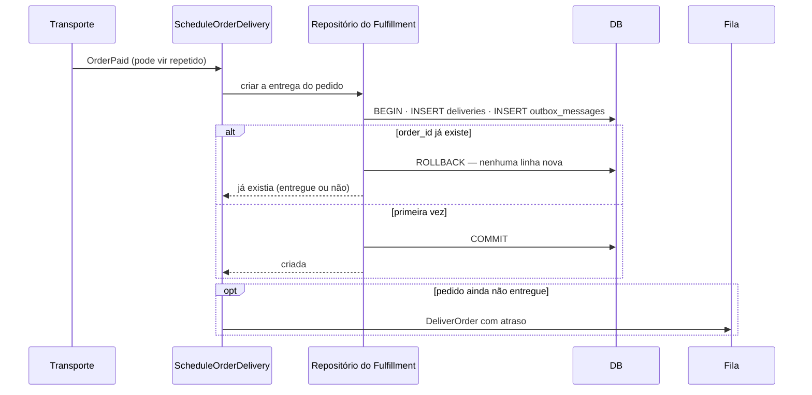

# Idempotência dos eventos assíncronos (HEL-16)

> Plan from this document. Each slice below carries its own shape - copy it, do not re-derive it.
> Status: confirmed by diashelter, 2026-10-20, com a resposta padrão da pergunta aberta do slice `Delivery`.

## Situation

- Project: em construção ativa. Projeto de estudo (Loja Demo), sem produção; existem bancos de desenvolvimento e testes já migrados em cada checkout.
- Decision: committed por diashelter em 2026-10-20, na [HEL-16](https://linear.app/helter/issue/HEL-16/verificar-idepotencia-dos-eventos-assincronos) (Backlog); o veredito "construir o menor" foi confirmado na conversa de descoberta.
- In flight: segue o desenho do outbox transacional (HEL-9) e do transporte de eventos (HEL-13), que declaram a entrega "ao menos uma vez, sem inbox, as guardas dos consumidores bastam". Fica de fora o layout modular da HEL-12, ainda não integrado: este design só cita classes, tabelas e rotas por nome, e o código sai depois do merge dela.
- At stake: baixo. Sem dados em risco, reversível por commit; o único custo duradouro é uma tabela nova no Fulfillment.

## Problem

Construção. A entrega ao menos uma vez é uma decisão fixa do projeto (relay que cai depois de o transporte aceitar, `basic_reject` com requeue no RabbitMQ, `queue:retry` dias depois), então toda mensagem pode chegar mais de uma vez. O pedido pediu para verificar se isso duplica informação ou deixa estado inconsistente. A auditoria dos cinco eventos e dos seis consumidores (quatro no Ordering, um no Fulfillment, mais o job `DeliverOrder`) deu: os quatro consumidores do Ordering são idempotentes por uma escrita condicional em `orders`, e o Fulfillment não é. Cada reentrega de `OrderPaid` grava outro `DeliveryScheduled` (com a data recalculada) e enfileira outro `DeliverOrder`, e cada retry de `DeliverOrder` grava outro `OrderDelivered`. O estado de `orders` fica certo porque o Ordering absorve as duplicatas; o que se multiplica são as linhas de `outbox_messages` e os jobs, em cadeia. A garantia que o README promete ("os consumidores são idempotentes") é falsa para o Fulfillment, e nenhum teste reentrega um envelope pelo caminho real.

Número que decidiu: 2 de 6 consumidores sem guarda, 0 testes que reentregam a mesma mensagem pelo `EventDelivery` (contados no repositório em 2026-10-20). Não há métrica de produção: o projeto não tem produção.

## Success

- Worked if: os seis consumidores têm um teste que entrega o mesmo envelope duas vezes e confere que o estado do banco e a contagem de linhas em `outbox_messages` não mudam na segunda; o `make test` e o `make load-test TYPE=smoke` passam; o README deixa de prometer o que o código não fazia.
- Going wrong: um consumidor novo precisa de deduplicação e não tem chave natural (o inbox genérico volta à mesa); o `load` de carga sai do ruído da linha de base de 2026-10-16.
- Review: quando a HEL-16 for integrada - diashelter roda `make load-test` antes e depois.

## Boundary

In: o `ScheduleOrderDelivery` e o `DeliverOrder` do Fulfillment; a tabela `deliveries`; um teste de reentrega por consumidor pelo `EventDelivery`; a atualização do README (linhas sobre inbox e idempotência), de `docs/domain-analysis.md` e do `AGENTS.md`.

Out: um inbox genérico (mensagens processadas por consumidor) - só pagaria com um consumidor sem chave natural, e hoje nenhum tem. Idempotência de rotas HTTP, como o clique duplo em `POST /api/orders` - não é evento assíncrono. Ordem de entrega entre mensagens - o README já a trata como melhor esforço, e nenhum consumidor depende dela. Mudar o relay, os transportes ou a flag `event-transport`.

Unchanged: as escritas condicionais do `OrderRepository`, os quatro consumidores do Ordering, os nomes de evento e de consumidor, as versões e os payloads de `DeliveryScheduled` e `OrderDelivered`, e o atraso configurado do `DeliverOrder`. O Fulfillment continua sem alterar o status do pedido.

## Prior art

Não houve pesquisa externa; o padrão é conhecido e o repositório já o escolheu.

- Escrita condicional ou chave única por chave natural no consumidor - já é o padrão do Ordering e do Payment (`payments_order_id_approved_unique`); levamos o mesmo ao Fulfillment.
- Falha clássica: gravar a mensagem de saída antes de o estado que a justifica, ou gravar o estado e perder o disparo do trabalho seguinte - a Key decision 2 existe para impedir os dois.

## Shape

O Fulfillment passa a guardar uma linha por pedido em `deliveries`, com a data prevista e o instante da entrega. Agendar a entrega e entregar o pedido só anunciam o evento quando a escrita muda essa linha (insert na primeira vez, `delivered_at` preenchido na primeira vez), na mesma transação do evento. A porta é a tabela: uma coluna a menos ou a mais custa uma migration numa base de estudo. A versão pesada seria um inbox genérico por mensagem e consumidor; ganha se aparecer um consumidor sem chave natural, e nenhum aparece no horizonte.

## Key decisions

1. **O Fulfillment ganha estado próprio: uma linha em `deliveries` por pedido, única por `order_id`.** É a chave natural que o Fulfillment não tinha e que torna os dois eventos dele decidíveis sem olhar o outbox nem o Ordering. A linha referencia `orders` com a mesma restrição que `payments` usa (precedente do projeto), e o Fulfillment continua sem alterar o status do pedido.
2. **No máximo um `DeliveryScheduled` e um `OrderDelivered` por pedido, e cada um é gravado na mesma transação da escrita que o justifica.** A linha e o evento nascem juntos ou nenhum dos dois. O enfileiramento do `DeliverOrder` roda depois do commit e **pode se repetir**: uma falha entre o commit e o enfileiramento é reparada pela reentrega, e o job duplicado é inofensivo porque o `OrderDelivered` só sai uma vez. Não copie o desenho de hoje, que grava o evento e enfileira sem estado algum.
3. **A primeira data prevista vale e vive em `deliveries.estimated_delivery_on`.** Uma reentrega nunca recalcula nem reanuncia a data; o Ordering continua guardando a primeira que recebe, e as duas pontas concordam por construção.
4. **A guarda do Fulfillment é a linha, não o status do pedido.** Consultar o Ordering para decidir seria uma leitura entre módulos com corrida (a data só chega ao pedido de forma assíncrona). A linha responde sozinha.
5. **Nenhum inbox genérico, e a regra passa a ser escrita.** Todo consumidor novo declara a sua chave natural (a guarda condicional ou a linha única) e ganha o teste de reentrega; o `EventDelivery` não deduplica por id de mensagem. Se um consumidor não tiver chave natural, o inbox volta como a próxima decisão, não como atalho.

## Work

| Slice | Delivers | Status |
|---|---|---|
| [Delivery](#delivery) | A tabela `deliveries` e o agendamento que só anuncia `DeliveryScheduled` uma vez | open — 1 default taken |
| [DeliverOrder](#deliverorder) | O job que só anuncia `OrderDelivered` uma vez e é seguro de repetir | clear |
| [Redelivery tests](#redelivery-tests) | Um teste de reentrega pelo `EventDelivery` para cada um dos seis consumidores | clear |

Order: Delivery → DeliverOrder → Redelivery tests.

Already handled by existing code: reentrega de `OrderPlaced`, `PaymentApproved`, `DeliveryScheduled` e `OrderDelivered` → a escrita condicional de `orders` (inclui `OrderPaid` anunciado uma só vez); `queue:retry` de uma mensagem já podada do outbox → o `DeliverEvent` carrega o envelope inteiro; dois relays na mesma mensagem → `for update skip locked`.

Derivable from the repository, left to the plan: model, factory, repository, id UUID v7 e logs do Fulfillment - tudo como `Payment` faz (nenhuma rota nova, então não há `Route::pattern`). A documentação segue o checklist do `AGENTS.md`.

### Delivery

**Delivers** a tabela `deliveries` e o agendamento idempotente de `OrderPaid`. **Status: open.** É a porta: a tabela e as Key decisions 1 a 4.

| State | What should happen | Caller sees |
|---|---|---|
| Primeiro `OrderPaid` do pedido | Grava a linha com a data prevista, grava `DeliveryScheduled` na mesma transação e enfileira o `DeliverOrder` depois do commit | um `DeliveryScheduled` em `outbox_messages` |
| `OrderPaid` repetido, pedido ainda não entregue | Não grava linha nem evento; enfileira o `DeliverOrder` de novo (Key decision 2) | nenhuma linha nova em `outbox_messages` |
| `OrderPaid` repetido, pedido já entregue | Não grava nada e não enfileira | nada muda |
| Falha ao gravar a linha ou o evento | A transação desfaz as duas; nada é enfileirado e a entrega é repetida pelo transporte | consumidor falha, `DeliverEvent` tenta de novo (3 tentativas) |
| Falha ao enfileirar depois do commit | A linha e o evento ficam; a reentrega enfileira o job | a próxima tentativa repara |
| Duas entregas simultâneas do mesmo `OrderPaid` | A unicidade de `order_id` faz uma perder; a perdedora se comporta como "repetido" | uma só linha e um só `DeliveryScheduled` |

Table `deliveries`; no existing table changes.

| Column | Type | Null | References | Note |
|---|---|---|---|---|
| `id` | uuid | no | | chave primária, UUID v7 gerado pela aplicação |
| `order_id` | uuid | no | `orders.id` | única; restringe a exclusão do pedido, como em `payments` |
| `estimated_delivery_on` | date | no | | a primeira data vale; escrita só na criação |
| `delivered_at` | timestamp | yes | | nulo até o `DeliverOrder` entregar; preenchido uma só vez |
| `created_at`, `updated_at` | timestamp | no | | |

Alternatives considered: consultar `outbox_messages` por `DeliveryScheduled` do pedido - ganha se o outbox virar a fonte de verdade de "já anunciei", mas vaza o interior do `Shared` e a mensagem some em 7 dias. Consultar o Ordering por `estimated_delivery_on` - ganha se a data chegasse ao pedido de forma síncrona, o que não acontece.

Open, default taken:
1. Pedidos pagos antes desta mudança, com um `DeliverOrder` já na fila e sem linha em `deliveries` - o `DeliverOrder` sem linha não muda nada e não anuncia (o pedido continua pago). Só afeta bancos de desenvolvimento. O default inicial (criar a linha já entregue) saiu na review do PR: era código permanente para uma janela de segundos depois da migration e gravava o dia UTC como data prevista. Gravar a linha volta quando um backfill de produção precisar.

### DeliverOrder

**Delivers** o job que preenche `delivered_at` uma só vez e só então anuncia `OrderDelivered`. **Status: clear.** Key decisions 1 e 2.

| State | What should happen | Caller sees |
|---|---|---|
| Primeira execução | Preenche `delivered_at` e grava `OrderDelivered` na mesma transação | um `OrderDelivered` em `outbox_messages` |
| Retry ou job duplicado | `delivered_at` já preenchido: não grava nada | nenhuma linha nova em `outbox_messages` |
| Falha depois de preencher `delivered_at` e antes do commit | A transação desfaz; o retry entrega | `tries = 3` do job |
| Pedido sem linha em `deliveries` | Não grava nada (ver a pergunta aberta do slice Delivery) | nenhuma linha nova em `outbox_messages` |

### Redelivery tests

**Delivers** a prova de que a promessa do README vale para os seis consumidores. **Status: clear.** Key decision 5.

| State | What should happen | Caller sees |
|---|---|---|
| Mesmo envelope entregue duas vezes a cada um dos cinco consumidores | O estado do banco e a contagem de linhas em `outbox_messages` são iguais depois da primeira e da segunda; o `OrderPaid` de um pedido ainda não entregue enfileira o `DeliverOrder` de novo (Key decision 2) | teste verde |
| O `DeliverOrder` executado duas vezes | Um só `OrderDelivered` | teste verde |
| Mesma mensagem pelos dois transportes | O resultado é o mesmo no `QueueEventTransport` e no `RabbitMqEventTransport` | teste verde |
| Ciclo completo com `OrderPaid` reentregue no meio | Termina com um evento de cada nome e o pedido entregue | `OrderStatusFlowTest` continua verde |

## Sources

- [Outbox transacional](transactional-outbox.md) - a entrega ao menos uma vez e a ausência de inbox.
- [Transporte de eventos por flag](event-transport-flag.md) - o `EventDelivery` compartilhado e o requeue do RabbitMQ.
- [Layout modular (HEL-12)](modular-layout.md) - move os namespaces; é o motivo de este design não citar caminhos.
