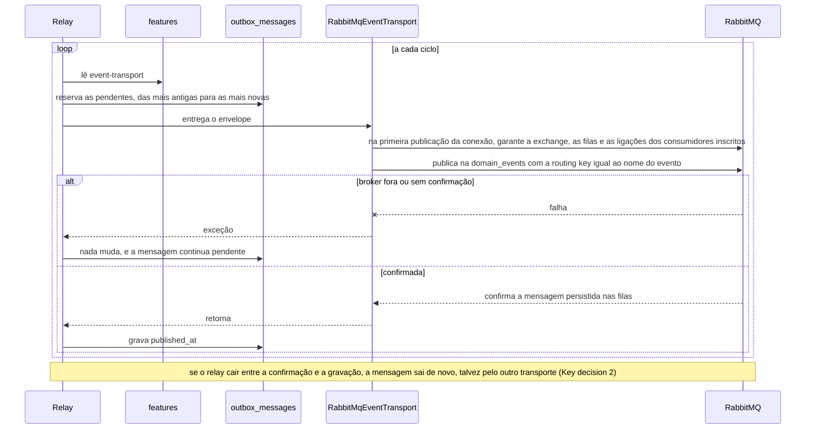
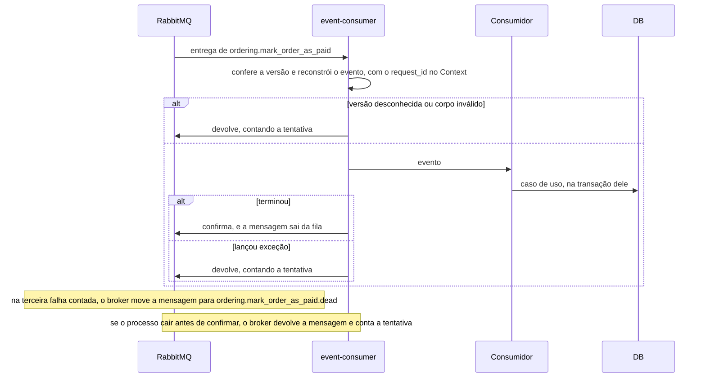

# Transporte de eventos por feature flag: Redis com Horizon e RabbitMQ

> Faça o plano a partir deste documento. Cada slice abaixo já traz a sua forma: copie, não derive de novo.
> Status: confirmed by diashelter, 2026-10-18

## Situation

- Project: em construção. É um projeto de estudo, sem produção e sem usuários, e o banco é recriado por `make fresh`, então não há linhas nem filas a migrar.
- Decision: decidida por diashelter na [HEL-13](https://linear.app/helter/issue/HEL-13/planejar-como-utilizar-o-feature-flags-para-implementar-utilizacao-de) em 2026-10-15 e já prevista pelo design da HEL-9. Em 2026-10-18, esta discovery decidiu a forma: os dois transportes ficam trocáveis em definitivo por uma flag global, virada sem deploy por um comando no terminal; o Horizon substitui o worker; a falha definitiva no RabbitMQ vai para uma fila de mortas; os testes usam um RabbitMQ real; e a comparação entra na linha de base do k6. A HEL-13 vem antes da HEL-12.
- In flight: copia o outbox da HEL-9 (o envelope, a porta `EventTransport`, o relay e a entrega ao menos uma vez) e as regras da pilha de carga da HEL-14. Ficam de fora a HEL-12, que vai mover as pastas e os namespaces dos módulos e do `Shared` depois desta, e a HEL-8, que vai instrumentar a fila.
- At stake: médio. Nada está em produção, e o Horizon e a flag se desfazem numa tarde. O que custa caro mudar é a topologia do RabbitMQ e o formato da mensagem nela: depois que um consumidor assina uma fila, mudar a exchange, o nome da fila ou o corpo exige migrar mensagens.

## Problem

Construção. A HEL-9 deixou a publicação atrás de uma porta, o `EventTransport`, com uma única implementação, a fila do Laravel no Redis. Ela prometeu que a HEL-13 poria um segundo transporte atrás de uma flag sem mudar casos de uso, eventos ou consumidores, e o Review dela dispara agora que a HEL-13 começou. Sem a HEL-13, nada para no produto: o pedido anda do mesmo jeito. O que fica parado é o estudo: a porta nunca foi provada com um segundo transporte, os consumidores só existem como jobs do Laravel, e não há como comparar o Redis com o RabbitMQ no mesmo código.

Vem antes da HEL-12 porque a HEL-12 ainda não tem branch e vai reorganizar o `Shared` inteiro. A HEL-13 só mexe na mensageria e na infraestrutura, e a HEL-12 depois move uma pasta a mais.

A fila não é gargalo. Na linha de base do k6 (2026-10-16, 50 VUs), o p95 de `order_payable_wait` é de 2.035 ms, que é a própria resolução da consulta de 2 s, e o `breakpoint` quebra no PHP-FPM, a 49,4 it/s. A HEL-13 mede os transportes; não conserta desempenho. E, com 2 s de resolução, os dois transportes cairiam na mesma leitura, por isso a espera do k6 muda (slice [load-test TRANSPORT](#load-test-transport)).

## Success

- Worked if:
  - os 5 consumidores rodam nos dois transportes sem mudança em nenhum caso de uso, evento ou consumidor. É o Review da HEL-9;
  - virar a flag com pedidos em andamento não perde pedido: todo pedido chega a `awaiting_payment`, quer a mensagem tenha sido aceita antes, quer depois da virada. Isso é provado por um teste e por uma execução manual na pilha de dev;
  - com a flag em `rabbitmq` e o container `rabbitmq` parado, os pedidos esperam e avançam quando ele volta, ou quando a flag vira para `redis`;
  - a linha de base do k6 tem, no mesmo commit, uma linha do `load` para cada valor da flag, aceita pela regra dos 20%, com `order_payable_wait` medido a cada 250 ms;
  - `make test`, `make pint` e o smoke de carga passam.
- Going wrong:
  - um consumidor ou um caso de uso precisa mudar para rodar no RabbitMQ, o que significa que a porta falhou;
  - mensagens se acumulam na fila de um consumidor com o `event-consumer` no ar;
  - entregas chegam à fila de mortas sem a exceção correspondente no log;
  - o relay continua publicando pelo transporte antigo mais de um ciclo depois da virada.
- Review: quando as duas linhas do `load` entrarem na tabela. diashelter compara o `order_payable_wait` dos dois transportes e decide se o padrão da flag continua `redis`.

## Boundary

In:
- A flag `event-transport` no Postgres e o `make event-transport`, para vê-la e virá-la.
- O RabbitMQ nos Compose de dev e de carga e no CI.
- O `RabbitMqEventTransport`, com a topologia e a publicação confirmada.
- O processo `event-consumer`, as filas de mortas, o `make events-failed` e o `make events-retry`.
- O Horizon no lugar do `queue:work`, nas duas pilhas, com o `/horizon` no Nginx e o container `scheduler`.
- Um vhost por checkout no `make test`.
- A espera do k6 a cada 250 ms e uma linha da linha de base por transporte.
- A documentação, conforme o `AGENTS.md`.

Out:
- O trace do `event-consumer`: ele fica fora da instrumentação da fila do Laravel, e o design da HEL-8 precisa contar com isso.
- Flag por evento, por cliente ou por porcentagem: ficou decidido que a flag é global.
- Uma tela para virar a flag: ficou decidido que a flag vira por um comando.
- O `DeliverOrder` no RabbitMQ: ele continua um job do Laravel com delay, porque é um comando interno do Fulfillment, e o RabbitMQ não atrasa uma mensagem sem plugin.
- Um consumidor fora do PHP: a topologia permite (Key decision 3), mas nenhum é construído.
- Inbox, novas tentativas com espera crescente e um processo por consumidor: ver Shape.
- Apagar sozinha a fila de um consumidor removido do código: ver o slice [RabbitMqEventTransport](#rabbitmqeventtransport).
- Pastas, namespaces e migrations por módulo: ficam para a HEL-12. A migration do Pennant fica junto das migrations atuais.

Unchanged:
- O `EventOutbox`, a tabela `outbox_messages`, os 5 eventos (nome, versão e payload), os 5 consumidores e os casos de uso.
- O relay: lotes de 100, espera de 500 ms parado e de 5 s depois de uma falha, retenção de 7 dias.
- O comportamento do `QueueEventTransport` e do `DeliverEvent`.
- O nome do container `queue-worker`, o `make logs-worker`, o `make queue`, o `make queue-failed`, o `make queue-retry` e o `failed_jobs`.
- As rotas, os status e os códigos HTTP, e a consulta de 2 s do frontend.
- O `QUEUE_CONNECTION=redis` em dev e a fila `sync` nos testes.
- O smoke do CI, que roda com a flag em `redis`.

## Prior art

- **O que se repete:** publicar e assinar no RabbitMQ com uma exchange, uma fila por assinante e a routing key pelo tipo do evento. Adotamos (Key decision 3).
- **A falha relatada:** uma mensagem publicada antes de existir a fila do assinante é descartada sem erro. E, segundo a documentação das quorum queues, elas "cannot provide any safety guarantees for messages that have not been confirmed". Daí a Key decision 5.
- **A outra falha relatada:** a mensagem envenenada em loop. Desde o RabbitMQ 4.3, o limite de entregas das quorum queues conta o `basic.reject` e a queda do cliente, mas não o `basic.nack`. Um consumidor que devolve com nack nunca chega à fila de mortas. E a estratégia padrão de dead-lettering é at-most-once; o at-least-once exige o overflow `reject-publish`. Daí as Key decisions 6 e 7.
- **A falha do Pennant:** ele guarda o valor de uma flag em memória até o fim da requisição. No relay, que é um processo contínuo, a "requisição" nunca termina, e a virada nunca chegaria (Key decision 1).
- **A falha do Horizon:** a espera padrão dele com a fila vazia é de 3 s, contra o `--sleep=1` do `queue:work` de hoje. Sem igualar os dois, a comparação mediria o worker, e não o transporte (slice [Horizon](#horizon)).
- **O que dispensamos:** o driver que põe o RabbitMQ como uma conexão de fila do Laravel. Os consumidores continuariam sendo jobs, o contrário do que a HEL-13 pede.

## Shape

A flag global `event-transport`, guardada no Postgres, decide a cada ciclo do relay por qual transporte as mensagens pendentes do outbox saem. Um deles é a fila do Laravel no Redis, cujas entregas passam a rodar no Horizon. O outro é o RabbitMQ: cada envelope é publicado uma vez numa exchange de tópico, e o broker o copia para a fila durável de cada consumidor, lida por um processo próprio, fora dos jobs do Laravel, com as mesmas regras de entrega do lado Redis. A porta é a topologia do RabbitMQ (o nome da exchange, o nome estável de cada fila e o envelope JSON no corpo), porque, depois que alguém assina uma fila, mudar qualquer um deles é migrar mensagens.

A forma mais pesada daria um processo por consumidor, novas tentativas com espera crescente e um inbox por consumidor. Ela vence quando um consumidor precisar escalar sozinho ou tiver um efeito externo que não consegue proteger, e hoje são 5 consumidores PHP idempotentes, com o mesmo volume. A forma escolhida não sobrevive a três situações:
- um consumidor lento, que atrasa os outros no mesmo processo;
- um efeito externo com limite de taxa, que queima as 3 tentativas em milissegundos;
- um efeito que não é idempotente.

Qualquer uma delas força a separação.

## Key decisions

1. **A flag `event-transport` é global, mora no Postgres e decide só por qual transporte o relay publica.** O valor é `redis` quando nada foi gravado e `rabbitmq` depois de virada. O relay a relê a cada ciclo, então uma virada vale no ciclo seguinte, sem deploy nem restart. Ela fica no Postgres, e não no Redis, para que dê para virar com qualquer um dos dois transportes fora. Casos de uso, eventos, consumidores e o `DeliverOrder` nunca a leem.
2. **Os dois lados de consumo ficam sempre no ar, e uma mensagem termina pelo transporte que a aceitou.** Virar a flag não move o que já está numa fila. Se o relay cair entre o aceite e a marcação, e a flag virar nesse intervalo, a mesma mensagem sai pelos dois transportes. A idempotência dos consumidores, da HEL-9, cobre o efeito.
3. **No RabbitMQ, o relay publica uma vez por evento, e o broker faz a cópia para cada consumidor.** Cada consumidor tem a sua fila durável, ligada à exchange pelo nome dos eventos que assina, e nem o produtor nem o transporte listam consumidores ao publicar. É isso que deixa um consumidor de fora do PHP assinar um evento sem mudar o relay. Não copie o `QueueEventTransport`, que cria uma entrega por consumidor na hora de publicar.
4. **A mensagem e os nomes da topologia são contrato.**
   - O corpo é o envelope em JSON, com as chaves de `outbox_messages` em snake_case e o `occurred_at` em RFC 3339, em UTC.
   - A exchange é `domain_events`.
   - A fila de cada consumidor tem um nome estável, `<módulo>.<consumidor em snake_case>`, declarado na inscrição e nunca derivado da classe PHP. A HEL-12 vai mudar os namespaces, e uma fila nomeada pela classe ficaria órfã, com mensagens dentro.
5. **"Aceito", no RabbitMQ, quer dizer confirmado pelo broker e com destino garantido.** O transporte só retorna depois de o broker confirmar a mensagem persistente. Sem a confirmação, ele lança, e a mensagem continua pendente no outbox. Além disso, nenhuma mensagem é publicada antes de existir, já ligada, a fila de cada consumidor inscrito, mesmo que o `event-consumer` nunca tenha subido. Não copie o padrão dos tutoriais em que só o consumidor declara a própria fila: a primeira mensagem depois de um deploy seria descartada sem erro.
6. **As regras de entrega são as mesmas nos dois transportes e moram num lugar só.** Valem igual para o `DeliverEvent` e para o `event-consumer`: a conferência da versão, a reconstrução do evento, o `request_id` devolvido ao `Context` e as 3 tentativas. Muda só o destino da falha definitiva: o `failed_jobs` de um lado, a fila de mortas do outro. Tanto uma exceção do consumidor quanto uma queda do processo no meio da entrega contam como tentativa.
7. **Uma entrega morta nunca some e, reprocessada, volta só para o consumidor dela.** Ela fica em `<consumidor>.dead` até o `make events-retry` ou o descarte à mão. Devolvê-la pela `domain_events` a entregaria de novo a todos os consumidores do evento.

## Work

| Slice | Delivers | Status |
|---|---|---|
| [make test](#make-test) | O RabbitMQ real nos testes e no CI, com um vhost por checkout | clear |
| [event-transport](#event-transport) | A flag global no Postgres, relida pelo relay a cada ciclo, e o `make event-transport` | clear |
| [RabbitMqEventTransport](#rabbitmqeventtransport) | O broker, a topologia e a publicação confirmada | open — 1 default taken |
| [event-consumer](#event-consumer) | O processo que consome as filas dos consumidores com as regras do `DeliverEvent` | open — 1 default taken |
| [events-retry](#events-retry) | O `make events-failed` e o `make events-retry` sobre as filas de mortas | clear |
| [Horizon](#horizon) | O Horizon no lugar do `queue:work`, o `/horizon` só para `admin` e as métricas pelo `scheduler` | open — 2 defaults taken |
| [load-test TRANSPORT](#load-test-transport) | A pilha de carga com os dois transportes, a espera a cada 250 ms e uma linha do `load` por transporte | clear |

Order: make test → event-transport → RabbitMqEventTransport → event-consumer → events-retry → load-test TRANSPORT. O Horizon pode ir em paralelo e precisa estar pronto antes do load-test TRANSPORT, porque as duas linhas são medidas com ele.

Already handled by existing code:
- **O transporte da flag fora:** a mensagem fica pendente no outbox, e o relay tenta de novo a cada 5 s (`OutboxRelay`).
- **A mesma mensagem entregue duas vezes, inclusive pelos dois transportes:** as guardas dos consumidores cuidam disso (a transição condicional de `orders.status` e a primeira gravação de `orders.estimated_delivery_on`).
- **A falha definitiva no lado Redis:** vai para o `failed_jobs`, aparece no `make queue-failed` e volta com o `make queue-retry`.
- **O cliente esperando o pedido sair de `placed`:** a tela consulta a cada 2 s.
- **A ordem entre filas:** é só a melhor possível, como no outbox. Dentro da fila de um consumidor, as mensagens saem na ordem de chegada.

Derivable from the repository, left to the plan:
- Os logs em inglês e só com ids, como os do relay.
- Os testes em Pest.
- Os serviços novos no Compose e os alvos `logs-*` no Makefile, como o `outbox-relay` e o `logs-relay`.
- As variáveis do RabbitMQ no `.env.example` e no `backend/.env.example`, como as do Redis e do Postgres.
- As regras de cache e log dos containers de carga, do `AGENTS.md`.
- As regras de arquitetura com um namespace por expectativa.
- A documentação, conforme o `AGENTS.md`:
  - a seção "Eventos, outbox, consumidores e filas" e a tabela "Filas" do README;
  - o procedimento de deploy que muda o formato de um evento, que passa a valer para as filas do RabbitMQ;
  - a linha do `Shared` na análise de domínio;
  - a seção "Eventos pelo outbox transacional" do `AGENTS.md`.

### make test

**Delivers** um RabbitMQ real para os testes do transporte, do consumidor e da fila de mortas, isolado por checkout, também no CI. **Status: clear.**

| State | What should happen | Caller sees |
|---|---|---|
| `make test` na pasta principal | Usa o vhost `ecommerce_testing`, criado se não existir, como o banco de testes | A linha que mostra o banco de testes também mostra o vhost |
| `make test` num worktree | Usa o vhost `ecommerce_testing_<worktree>`, com o mesmo nome do banco. Duas suítes rodando ao mesmo tempo não veem as filas uma da outra | Idem |
| `make test-db-drop` | Apaga também o vhost do checkout | |
| Cada teste do broker | Começa com o vhost sem as filas nem as mensagens do teste anterior | |
| Container `rabbitmq` parado | Os testes que precisam do broker falham dizendo que o RabbitMQ não está no ar. Nenhum é pulado | A falha do teste |
| O resto da suíte | Continua com a fila `sync` e sem broker | |
| CI | Sobe o `rabbitmq` junto com o `db` e o `redis` antes do `make test` | |

Alternatives considered: simular o broker em memória. Venceria se o CI não pudesse subir o RabbitMQ. Ficou de fora porque as 3 tentativas, a fila de mortas e a confirmação só se provam no broker de verdade.

### event-transport

**Delivers** a flag global `event-transport`, com os valores `redis` e `rabbitmq`, guardada pelo Pennant no Postgres e relida pelo relay a cada ciclo, e o alvo `make event-transport`, que a mostra e a vira. **Status: clear.** Key decisions 1 e 2.

| State | What should happen | Caller sees |
|---|---|---|
| Nada gravado ainda (banco novo, `make fresh`, CI) | Vale `redis`, o comportamento de hoje | |
| `make event-transport` | Mostra o valor atual | `redis` ou `rabbitmq` |
| `make event-transport TO=rabbitmq` | Grava o valor, e o relay publica pelo RabbitMQ a partir do ciclo seguinte | O valor anterior e o novo |
| `TO` com valor desconhecido | É recusado, e nada muda | Erro com os valores aceitos |
| `TO` igual ao valor atual | Nada muda | Aviso de que o valor já era esse |
| Uma virada | Grava uma linha no log com o valor anterior, o novo, o horário e o usuário do sistema que rodou o `make` | |
| O relay percebe a virada | Grava uma linha no log do relay com o transporte novo, uma vez por mudança | `make logs-relay` |
| Virada com mensagens já aceitas pelo transporte antigo | Elas terminam por ele (Key decision 2) | |
| Virada com o Redis ou o RabbitMQ fora | Funciona, porque a flag não depende de nenhum dos dois (Key decision 1) | |

Table `features`, do Pennant, criada pela migration dele e sem mudança no formato. A flag é uma linha, com `name` igual a `event-transport`, o escopo global e `value` igual a `"redis"` ou `"rabbitmq"`. Nenhuma tabela existente muda.

Alternatives considered: uma tabela própria de uma linha. Venceria se o Pennant não servisse a mais nada. Ficou o Pennant porque a HEL-13 pede o uso de feature flags, e os escopos dele servem às próximas flags, por cliente ou por porcentagem.

### RabbitMqEventTransport

**Delivers** o container `rabbitmq`, com o painel de gestão, nos Compose de dev e de carga; a topologia; e a implementação do `EventTransport` que publica cada envelope uma vez, com confirmação. **Status: open — 1 default taken.** É a porta (Key decisions 3, 4 e 5).

| Objeto | Nome | Tipo | Nota |
|---|---|---|---|
| Exchange | `domain_events` | topic, durável | Recebe um envelope por evento, com a routing key igual ao nome do evento |
| Fila do consumidor | `<nome do consumidor>` | quorum | Ligada à `domain_events` pelo nome de cada evento que o consumidor assina. Depois da terceira entrega que falha, vai para a `domain_events.dead` |
| Exchange de mortas | `domain_events.dead` | direct, durável | Recebe a entrega morta com a routing key igual ao nome do consumidor |
| Fila de mortas | `<nome do consumidor>.dead` | quorum | Ligada à `domain_events.dead` pelo nome do consumidor. Nunca expira |

| Consumidor | Nome estável | Assina |
|---|---|---|
| `MarkOrderAsAwaitingPayment` | `ordering.mark_order_as_awaiting_payment` | `ordering.order_placed` |
| `MarkOrderAsPaid` | `ordering.mark_order_as_paid` | `payment.payment_approved` |
| `RecordEstimatedDelivery` | `ordering.record_estimated_delivery` | `fulfillment.delivery_scheduled` |
| `MarkOrderAsDelivered` | `ordering.mark_order_as_delivered` | `fulfillment.order_delivered` |
| `ScheduleOrderDelivery` | `fulfillment.schedule_order_delivery` | `ordering.order_paid` |

A mensagem é persistente, com `content_type` igual a `application/json`, `message_id` igual ao `id` do envelope e `type` igual ao `name`. O corpo é o envelope:

```json
{
  "id": "0199f3a2-7c4e-7b1a-9d2e-4f6a8b0c1d2e",
  "name": "ordering.order_paid",
  "version": 1,
  "payload": { "order_id": "0199f3a2-6b10-7e55-8a31-2c9d4e7f0a11", "delivery_business_days": 5 },
  "occurred_at": "2026-10-18T15:52:24.715000Z",
  "request_id": "9c1e6f0a-3b2d-4c5e-8f7a-1d2e3f4a5b6c"
}
```

| State | What should happen | Caller sees |
|---|---|---|
| Flag em `rabbitmq`, broker no ar | O envelope vai para a `domain_events`, e a mensagem só é marcada publicada depois da confirmação do broker (Key decision 5) | O consumidor roda |
| Broker fora, ou sem confirmar a mensagem | O transporte recusa, e a mensagem fica pendente até ele voltar ou a flag virar | Os pedidos esperam |
| Primeira publicação num broker vazio | A exchange, as filas e as ligações de todos os consumidores inscritos já existem antes da mensagem (Key decision 5) | Nada se perde |
| Dois consumidores do mesmo evento | O broker põe uma cópia na fila de cada um (Key decision 3) | |
| Evento sem consumidor inscrito | A publicação dá certo, e o broker descarta a mensagem, como o Redis faz hoje | |
| Consumidor novo inscrito no código | A fila dele passa a existir e recebe os eventos publicados daí em diante | |
| Consumidor removido do código | A fila dele continua recebendo cópias até ser apagada à mão, e o README diz como (default 1) | |
| Nome de consumidor fora do formato, ou repetido | É recusado na inscrição, no boot | `LogicException` |



O cliente AMQP é o php-amqplib 3.7, que exige a extensão `sockets`, ausente na imagem PHP hoje. A versão do RabbitMQ é 4.3 ou superior, porque a regra do limite de entregas da Key decision 6 depende dela. O painel de gestão fica numa porta do host definida no `.env` da raiz, com as credenciais de lá.

Alternatives considered: a extensão `amqp` do PECL. Venceria se o php-amqplib não desse conta da vazão, e na carga de hoje ele dá.

Open, default taken:
1. A fila de um consumidor removido do código. Default: não é apagada sozinha, porque a topologia só acrescenta, e uma remoção automática apagaria a fila de um assinante de fora do PHP. O README diz como apagá-la.

### event-consumer

**Delivers** o processo `events:consume`, no container `event-consumer`, que lê as filas de todos os consumidores inscritos e entrega com as mesmas regras do `DeliverEvent` (Key decision 6). **Status: open — 1 default taken.**

| State | What should happen | Caller sees |
|---|---|---|
| Mensagem na fila de um consumidor | O consumidor recebe o evento reconstruído, com o `request_id` de origem no `Context`. A mensagem só sai da fila depois de o consumidor terminar | |
| O consumidor lança exceção | A entrega conta como tentativa e volta para a fila. Na terceira falha, vai para `<consumidor>.dead` (Key decisions 6 e 7) | `warning` no log com `message_id`, nome do evento, consumidor, tentativa e erro |
| O envelope tem uma versão que o evento não declara, ou o corpo não é um envelope | O consumidor não é chamado, e a entrega falha como qualquer outra até a fila de mortas | O log tem o nome e a versão, ou o `message_id`, se houver |
| A mesma mensagem chega duas vezes | O efeito acontece uma vez, pela guarda do próprio consumidor | |
| O processo cai com uma entrega em andamento | O broker devolve a mensagem, e a queda conta como tentativa (Key decision 6) | |
| Broker fora | O processo espera e volta a consumir sozinho quando o broker volta. As mensagens ficam nas filas | O log do container mostra a espera |
| `make queue-restart` | O processo termina depois da entrega em andamento, e o container o sobe com o código novo, como faz com o relay | |
| Flag em `redis` | O processo fica no ar e consome o que ainda estava no RabbitMQ (Key decision 2) | |



Open, default taken:
1. Um processo só para todas as filas, com uma entrega por vez. Default: sim, para que a comparação tenha o mesmo número de processos do Horizon. Separar por consumidor é a forma pesada do Shape.

### events-retry

**Delivers** os alvos `make events-failed`, que lista, e `make events-retry`, que devolve as entregas das filas de mortas. **Status: clear.** Key decision 7.

| State | What should happen | Caller sees |
|---|---|---|
| `make events-failed` sem mortas | Nada muda | Aviso de que não há entregas mortas |
| `make events-failed` com mortas | Lista as entregas de cada fila de mortas, e nada sai da fila | Consumidor, evento, id da mensagem, `occurred_at`, `request_id` e tentativas. O erro fica no log, pelo id da mensagem |
| `make events-retry` | Devolve todas as mortas, cada uma à fila do próprio consumidor e com as tentativas zeradas | Quantas voltaram, por consumidor |
| `make events-retry ID=<id da mensagem>` | Devolve só essa mensagem. Se ela estiver morta em mais de uma fila, devolve cada cópia ao seu consumidor | Quantas voltaram |
| `ID` que não está em nenhuma fila de mortas | Nada muda | Erro de mensagem não encontrada |
| Devolvida, falha de novo 3 vezes | Volta para a fila de mortas | |
| Broker fora | Nada muda | Erro dizendo que o RabbitMQ não está no ar |
| Descartar uma entrega morta | Faz-se pelo painel de gestão do RabbitMQ, sem alvo novo | |

### Horizon

**Delivers** o Horizon no lugar do `queue:work`, no container `queue-worker` das pilhas de dev e de carga, com o painel `/horizon` só para a equipe `admin` e as métricas preenchidas por um container `scheduler`. **Status: open — 2 defaults taken.**

| State | What should happen | Caller sees |
|---|---|---|
| O container sobe | O Horizon roda a fila `default` da conexão `redis` com os parâmetros do `queue-worker` de hoje: um processo, 3 tentativas, timeout de 60 s e espera de 1 s com a fila vazia | |
| Flag em `redis` | Roda os `DeliverEvent` e o `DeliverOrder` | |
| Flag em `rabbitmq` | Roda o `DeliverOrder` e os `DeliverEvent` que já estavam na fila | |
| Equipe `admin` autenticada no backoffice abre `/horizon` | O painel abre | `200` |
| Equipe `support`, cliente ou visitante abre `/horizon` | É recusado em qualquer ambiente, inclusive no `local` (default 1) | `403` |
| Um job falha 3 vezes | Vai para o `failed_jobs` e aparece no painel e no `make queue-failed`, como hoje | |
| `make queue-restart` | O Horizon termina depois dos jobs em andamento, e o container o sobe com o código novo, junto com o relay e o `event-consumer` | |
| Aba de métricas | É preenchida a cada 5 min pelo `scheduler` (default 2) | |
| Redis fora | O Horizon espera, como o `queue:work` espera hoje | |

O Nginx passa a mandar `/horizon` para o PHP. Hoje ele só manda `/api` e `/sanctum`, e o resto cai no frontend, então o painel precisa abrir por inteiro pela mesma origem.

Open, default taken:
1. O painel também fica fechado no `local`. Default: sim, só para `admin`, porque o painel mostra payloads com ids e `request_id`, e o Horizon, por padrão, o abriria para qualquer um no `local`.
2. Um container `scheduler` só para o snapshot do Horizon. Default: sim. O projeto não tem agendador, e sem ele a aba de métricas fica vazia.

### load-test TRANSPORT

**Delivers** a pilha de carga com o RabbitMQ, o Horizon e o `event-consumer`; a espera até o pedido ficar pagável consultando a cada 250 ms; e uma linha do `load` por transporte na linha de base. **Status: clear.**

| State | What should happen | Caller sees |
|---|---|---|
| `make load-test TYPE=<perfil>` | Igual a hoje, com a flag em `redis` | |
| `make load-test TYPE=load TRANSPORT=rabbitmq` | A pilha grava a flag antes da rodada | O relatório traz o transporte no nome do arquivo e no resumo |
| `TRANSPORT` desconhecido | É recusado antes de recriar a pilha | Erro com os valores aceitos |
| A espera até o pedido ficar pagável | Consulta o pedido a cada 250 ms e desiste depois de 60 s, o limite de hoje | `order_payable_wait` com resolução de 250 ms |
| Smoke do CI | Roda com a flag em `redis`. O RabbitMQ sobe, mas fica parado | |
| As linhas antigas da tabela | Ficam como estão. A série nova, "Horizon, espera a cada 250 ms", vai para uma segunda tabela, com a coluna "Transporte", depois da tabela da HEL-14 | |
| Uma linha nova é aceita | Quando duas rodadas seguidas do `load`, com o mesmo transporte e no mesmo commit, ficam a menos de 20% uma da outra, a regra de hoje | |
| Limite de aprovação de `order_payable_wait` | Continua o da linha `load` da HEL-14 (2.450 ms), que vale como teto | |

Mudança registrada no plano, em 2026-10-18: este slice previa uma coluna nova na tabela da HEL-14 e limites recalculados a partir da linha `redis`. As provas da HEL-14 fixam aquela tabela em 12 colunas e tiram os limites da linha `load` dela, então a série nova ganhou uma tabela própria, e os limites ficaram.

Nessa espera, o k6 deixa de consultar como o frontend, que consulta a cada 2 s. O README da pasta registra o motivo: com 2 s, os dois transportes caem na mesma leitura.

## Sources

- [HEL-13](https://linear.app/helter/issue/HEL-13/planejar-como-utilizar-o-feature-flags-para-implementar-utilizacao-de): as duas abordagens (Redis com Horizon e RabbitMQ fora dos jobs) atrás de feature flags.
- [.design/transactional-outbox.md](transactional-outbox.md): a porta `EventTransport`, o envelope, a entrega ao menos uma vez e o Review que esta HEL dispara.
- [HEL-12](https://linear.app/helter/issue/HEL-12/implementar-um-padrao-de-modularidade-melhor-ao-sistema): a mudança de namespaces, motivo do nome estável das filas, e a ordem entre as duas HELs.
- [.design/observability-better-stack.md](observability-better-stack.md): o trace pela fila do Laravel, que não alcança o `event-consumer`.
- [load-tests/README.md, Linha de base](../load-tests/README.md#linha-de-base): o p95 de 2.035 ms, o breakpoint no PHP-FPM e a regra dos 20%.
- [Laravel Pennant (13.x)](https://laravel.com/docs/13.x/pennant): escopo global, valores ricos, a tabela `features` e o cache em memória.
- [Laravel Horizon (13.x)](https://laravel.com/docs/13.x/horizon): a autorização do painel, o `horizon:terminate`, o snapshot a cada 5 min e os parâmetros dos supervisores.
- [RabbitMQ, Quorum Queues](https://www.rabbitmq.com/docs/quorum-queues): o limite de entregas a partir da 4.3, o dead-lettering at-least-once e a confirmação do publicador.
- [php-amqplib no Packagist](https://packagist.org/packages/php-amqplib/php-amqplib): a versão 3.7 e as extensões `sockets` e `mbstring` exigidas.
