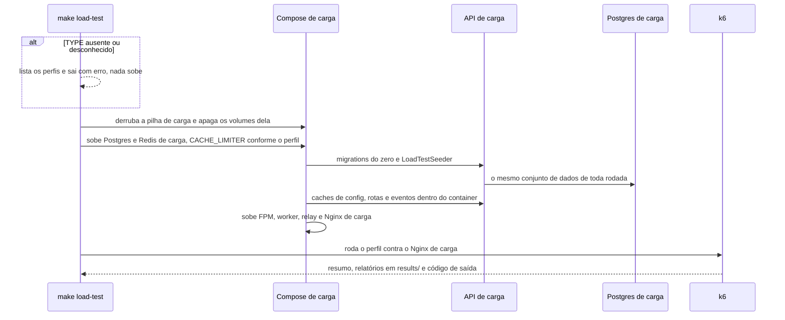
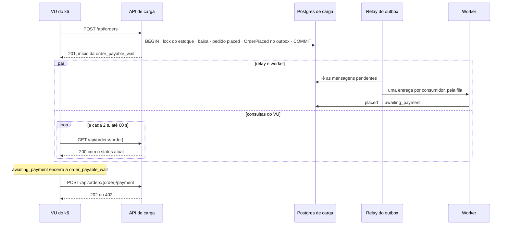

# Testes de desempenho e carga com k6

> Faça o plano a partir deste documento. Cada slice abaixo já traz a sua forma: copie, não derive de novo.
> Status: confirmed by diashelter, 2026-10-16

## Situation

- Project: em construção. É um projeto de estudo, sem produção e sem usuários. O único ambiente é o Docker local, mais o CI.
- Decision: decidida por diashelter em 2026-10-16, na [HEL-14](https://linear.app/helter/issue/HEL-14/implementar-testes-de-performance-e-carga-utilizando-o-k6). A issue já fixa o k6, os testes de carga, de estresse e de outros tipos, os caminhos que não são felizes e uma pasta na raiz do projeto. Esta discovery decidiu o restante:
  - o objetivo, que é uma linha de base comparável;
  - o ambiente, com pilha e banco de carga separados;
  - o tratamento dos limites de requisição;
  - a mistura de tráfego e os tipos de teste;
  - o smoke no CI e o registro da linha de base.
- In flight:
  - Esta peça segue dois precedentes:
    - o `AssignRequestId`, que já reaproveita o `X-Request-ID` enviado pelo cliente;
    - o CI, que roda sobre o mesmo Compose e o mesmo `Makefile` do ambiente local.
  - A HEL-8 (métricas do servidor) fica de fora.
  - A HEL-12 também fica de fora, mas vai mover rotas, consultas e migrations de todos os módulos. Ela é a primeira mudança que a linha de base vai comparar.
- At stake: baixo. São uma pasta nova, um projeto Compose, um seeder, uma chave de configuração e um job de CI, e tudo se desfaz numa tarde. O risco real é o isolamento: um cache ou uma variável no lugar errado faz a API de dev apontar para o banco de carga, ou o contrário.

## Problem

Construção, com um objetivo de estudo, como a HEL-8. Hoje ninguém sabe quanto tempo cada rota leva sob concorrência, nem quantas requisições a API atende antes de degradar. A única medição é a de um `curl` isolado em 2026-10-16: `GET /api/products` leva de 25 a 40 ms com a aplicação aquecida.

O Pest prova as regras uma requisição por vez. Três garantias só aparecem com concorrência real:

- o lock de estoque do checkout, com dois clientes disputando a última unidade;
- os limites de requisição sob rajada;
- o atraso do outbox entre o pedido criado e o pedido que pode ser pago.

Nada do produto trava sem esta peça. O momento é este porque a HEL-12 vai reorganizar todos os módulos, e sem uma linha de base medida antes não há como dizer se ela mudou o desempenho. A HEL-6 também afirmou que o tamanho da página não muda o número de queries, mas nada mediu o tempo.

## Success

- Worked if:
  - Um comando por perfil roda a partir de um estado limpo e mostra, por template de rota, o p95, as req/s e os erros inesperados, além da espera até o pedido poder ser pago.
  - A primeira linha de base do perfil `load` e o ponto de ruptura do `breakpoint` estão registrados com o commit e a máquina.
  - O `contention` prova que, com 50 compradores simultâneos, são vendidas exatamente as 10 unidades disponíveis.
  - O `limits` prova o `429` em cada rota limitada.
  - O smoke roda no CI em todo pull request.
  - Depois de qualquer rodada, o banco de dev tem as mesmas linhas de antes.
- Going wrong:
  - Duas rodadas do `load` no mesmo commit diferem mais de 20% no p95. Nesse caso a linha de base é ruído.
  - Um script passa a aceitar um status novo só para a rodada passar.
  - O smoke do CI fica instável.
  - O seed de carga passa de 90 segundos.
- Review: quando a HEL-12 for integrada. diashelter roda o `load` antes e depois e compara com a linha registrada. Se a diferença ficar menor que o ruído entre rodadas, a linha de base não serve ao propósito e o ambiente precisa ser revisto.

## Boundary

In:
- O projeto Compose de carga, com banco e Redis próprios.
- O `LoadTestSeeder`.
- A escolha do armazenamento do limitador.
- Os fluxos da vitrine, da compra e da equipe, com os seus casos de erro.
- Os perfis `smoke`, `load`, `stress`, `spike`, `breakpoint`, `soak`, `contention` e `limits`.
- O smoke no CI e a tabela da linha de base.
- O README, o `.env.example` e o `AGENTS.md` atualizados.

Out:
- Otimizar o que os testes encontrarem: cada achado vira uma issue própria.
- As métricas do servidor (CPU, memória, Postgres e Redis): são da HEL-8.
- Uma imagem de produção (ver Shape).
- A falha do `X-Forwarded-For` e o contador compartilhado entre as rotas limitadas: os dois foram corrigidos fora da HEL-14, nas branches `helterdias/fix-forged-client-ip` e `helterdias/fix-per-route-throttle`, e o perfil `limits` depende da segunda (Key decision 4 e slice Concurrency scenarios).
- O desempenho do frontend.
- Painéis em Grafana ou InfluxDB e o k6 Cloud: o relatório HTML do próprio k6 basta, e não há custo.
- A geração de carga distribuída.

Unchanged:
- A pilha de dev: os serviços do `docker-compose.yml`, o `backend/.env`, o `make fresh`, o `DatabaseSeeder` e o pool do PHP-FPM de dev, que segue com 5 workers.
- Os `throttle` literais nas rotas e os testes de `429` do Pest.
- As rotas, os códigos, os corpos e as mensagens da API.

## Prior art

- **Teste de ruptura com modelo aberto.** A documentação do k6 recomenda o `ramping-arrival-rate` (a taxa de chegada sobe mesmo quando a API fica lenta), parado por um limite com `abortOnFail`. Adotamos (slice Test profiles).
- **Respostas esperadas por requisição.** O k6 marca como esperada cada resposta que bate com o `expectedStatuses`, e o `http_req_failed` conta só as outras. Adotamos (Key decision 6).
- **A falha mais relatada: o gerador de carga na mesma máquina da API.** Ele disputa CPU e achata os números. Não temos uma segunda máquina, então a Key decision 3 limita a comparação à mesma máquina, e cada linha registra qual foi.

## Shape

Uma pasta `load-tests/` na raiz guarda os scripts do k6, um projeto Compose de carga e a tabela da linha de base. Cada rodada recria o banco de carga com o `LoadTestSeeder`, sobe uma cópia da API com configuração de produção e roda um perfil contra ela pelo Nginx, com a mistura de tráfego da loja. A porta é o isolamento: a pilha de carga compartilha só a imagem e a árvore de trabalho com a de dev, e um cache ou um log gravado no lugar errado ligaria uma à outra (Key decisions 1 e 2). Mudar a configuração ou os dados depois da primeira medição só custa abrir uma série nova da linha de base (Key decision 3).

A alternativa mais pesada é uma imagem de produção imutável, com o código dentro, as dependências sem as de desenvolvimento e limites de CPU e memória por container. Ela só ganha se os números precisarem comparar máquinas diferentes ou valer como capacidade de produção, e hoje nenhuma das duas coisas é verdade.

## Key decisions

1. **A pilha de carga é um projeto Compose próprio, com Postgres e Redis próprios. Ela compartilha com a de dev só a imagem do PHP e a árvore de trabalho.** Nada do que uma rodada faz chega ao banco, às filas, ao cache ou às sessões de dev. Cada rodada começa apagando os volumes da pilha de carga, então toda rodada parte do mesmo estado. O `make down` de dev e o `make load-down` nunca removem os volumes um do outro.
2. **A pilha de carga nunca grava na árvore compartilhada um arquivo que a de dev lê.** Os caches de configuração, rotas e eventos ficam num caminho dentro do container, e os logs vão para a saída padrão. Não rode o `optimize` do jeito de sempre nesse container: o cache de configuração gravado em `bootstrap/cache` levaria o banco de carga para a API de dev.
3. **A linha de base vale para uma máquina, uma configuração e um conjunto de dados.** A configuração é a de produção: sem debug, opcache sem revalidação, config, rotas e eventos em cache, pool do FPM dimensionado e o mesmo custo de bcrypt de hoje. Os dados vêm do `LoadTestSeeder`, determinístico. Mudar a máquina, a configuração, o conjunto de dados, o pool ou a versão do k6 abre uma série nova, e a linha registra o que mudou. Nenhum número é lido como capacidade de produção.
4. **O k6 só fala HTTP, pelo Nginx de carga, como o SPA.** Ele usa o cookie de CSRF, a sessão por cookie e um `Origin` de domínio stateful. Os ids são descobertos pela API pública e pela do admin. Não há acesso ao banco, rota só de teste, atalho de autenticação nem `X-Forwarded-For` forjado para espalhar as chaves do limitador.
5. **O armazenamento do limitador de requisições passa a ser escolhido por ambiente (`cache.limiter`, pela variável `CACHE_LIMITER`). Sem a variável, ele usa o armazenamento padrão, e dev, CI e Pest se comportam como hoje.**
   - Os perfis de volume (`load`, `stress`, `spike`, `breakpoint` e `soak`) e o `contention` rodam com o armazenamento em memória por requisição, o que torna todo limite inerte.
   - O `smoke` e o `limits` rodam com os limites reais.
   - Isto desvia do que a entrevista descreveu ("limites configuráveis"). Os valores continuam literais nas rotas, e o que muda é só onde o limitador guarda as contagens. É uma linha de configuração em vez de reescrever as rotas que a HEL-12 vai mover.
   - A alternativa são limitadores nomeados com valores vindos da configuração. Ela ganha se algum limite precisar de outro valor num ambiente que não seja o de carga, ou quando a HEL-12 reescrever as rotas de qualquer jeito.
6. **Cada requisição declara os status que espera, e só um status inesperado, um timeout ou um check do corpo que falhou contam como erro.** Um `404` para o pedido de outro cliente e um `409` para quem perde a disputa de estoque são acertos. Os limites de erro de todos os perfis contam só os erros inesperados, e o `code` do erro é conferido, nunca o texto da mensagem.
7. **A compra imita o frontend: depois do `201`, consulta o pedido a cada 2 segundos até ele chegar a `awaiting_payment`, e só então paga.** Essa espera é uma métrica própria, a `order_payable_wait`, e mede o relay do outbox e o worker sob carga. Depois de 60 segundos o VU desiste e conta um erro. Nunca se paga antes: o `409` resultante esconderia o atraso em vez de medi-lo.
8. **Um resultado aceito vira uma linha na tabela da linha de base, na documentação da pasta de carga. Os relatórios brutos ficam fora do git.** Uma linha só é aceita quando duas rodadas seguidas no mesmo commit diferem menos de 20% no p95.

## Work

| Slice | Delivers | Status |
|---|---|---|
| [LoadTestSeeder](#loadtestseeder) | O conjunto de dados determinístico da pilha de carga | open — 2 defaults taken |
| [Load stack](#load-stack) | O projeto Compose de carga, o `cache.limiter` e os comandos de rodar e derrubar | open — 2 defaults taken |
| [Storefront](#storefront) | O fluxo do visitante anônimo, com 75% da mistura | clear |
| [Checkout](#checkout) | O fluxo do cliente que compra e paga, com 20% da mistura, e a `order_payable_wait` | clear |
| [Backoffice](#backoffice) | O fluxo da equipe no painel, com 5% da mistura | clear |
| [Concurrency scenarios](#concurrency-scenarios) | Os perfis `contention` e `limits` | open — 1 default taken |
| [Test profiles](#test-profiles) | Os oito perfis, os limites de aprovação e a tabela da linha de base | open — 3 defaults taken |
| [CI smoke](#ci-smoke) | O job do smoke em todo pull request | clear |

Order: LoadTestSeeder → Load stack → Storefront → Checkout → Backoffice → Concurrency scenarios → Test profiles → CI smoke.

Already handled by existing code: pagar um pedido que ainda não está em `awaiting_payment` responde `409`, o que o `PaymentTest` já cobre. O k6 nunca faz isso (Key decision 7).

Derivable from the repository, left to the plan:
- as métricas agrupadas por template de rota (o caminho sem o id), nunca pela URL;
- um intervalo de 1 a 3 segundos entre os passos de cada fluxo;
- um `X-Request-ID` em cada requisição que identifica o perfil, o VU e a iteração, como o `AssignRequestId` já aceita;
- os comandos no estilo do `Makefile`, com `##`;
- a documentação da pasta em português e o código em inglês;
- o erro lido pelo `code` do `ApiErrorResponse`.

### LoadTestSeeder

**Delivers** o mesmo conjunto de dados a cada rodada, com volume suficiente para a vitrine, a compra e o painel. **Status: open.**

| State | What should happen |
|---|---|
| Rodada nova | O banco de carga recebe exatamente o mesmo conjunto, com a semente fixa do Faker, como o `DatabaseSeeder` |
| Compradores | 1.000 clientes `load-customer-{n}@example.com`, com a senha do seed de dev e um endereço cada, em UFs variadas |
| Cliente reservado | `load-customer-0` não é usado por nenhum VU. Os pedidos dele servem ao caso do pedido de outro cliente |
| Equipe | Um admin e um suporte |
| Vitrine | 8 categorias e 200 produtos: 170 ativos com 1.000.000 de unidades, 10 ativos sem unidades e 20 inativos |
| Produto disputado | Um produto ativo com exatamente 10 unidades, comprado só pelo `contention` |
| Histórico | 10.000 pedidos nos últimos 12 meses, com itens, cópia do endereço, frete e pagamentos, na mesma distribuição de status do `OrderSeeder`. Eles não baixam estoque e não gravam `outbox_messages` |
| Fora da pilha de carga | O `DatabaseSeeder` não chama este seeder, e o `make fresh` não muda |

Open, default taken:
1. Os volumes (1.000 clientes, 200 produtos e 10.000 pedidos): ficam como na tabela. Mudar depois da primeira linha de base abre uma série nova (Key decision 3).
2. O seed termina em até 90 segundos na VM de dev: se passar, o plano grava os pedidos em lote.

### Load stack

**Delivers** a pilha de carga ao lado da de dev, o armazenamento do limitador escolhido por ambiente e os dois comandos que a operam. **Status: open.** É a porta (Key decisions 1 e 2).

| State | What should happen | Caller sees |
|---|---|---|
| `make load-test TYPE=<perfil>` com a pilha de dev no ar | A pilha de carga sobe ao lado sem tocar em nada de dev | O resumo do k6 no terminal e os relatórios HTML e JSON em `load-tests/results/`, ignorada pelo git |
| `TYPE` ausente ou desconhecido | Nada sobe | A lista dos perfis válidos e um código de saída diferente de zero |
| Um limite de aprovação foi cruzado | Os relatórios são gravados mesmo assim | Um código de saída diferente de zero |
| A pilha de carga não sobe (falha de migration, por exemplo) | O k6 não roda | Os logs da pilha de carga e um código de saída diferente de zero |
| `make load-down` | Remove a pilha de carga e os volumes dela | — |
| Depois de qualquer rodada | O banco de dev tem as mesmas linhas de antes, e o `bootstrap/cache` da árvore não ganhou arquivo | — |
| Dev, CI e Pest sem `CACHE_LIMITER` | Os limites valem como hoje, e os testes de `429` passam sem mudança | — |
| Pilha de carga com `CACHE_LIMITER=array` | Nenhum limite dispara | — |

`make load-test TYPE=<smoke|load|stress|spike|breakpoint|soak|contention|limits>` → código de saída `0` quando todos os limites de aprovação passam, com `results/<perfil>-<data e hora>.html` e `.json`.
`make load-down` → remove a pilha de carga e os volumes dela.

A configuração da pilha de carga (Key decision 3):
- `APP_DEBUG=false` e logs de `warning` para cima na saída padrão;
- opcache sem revalidação de arquivos;
- config, rotas e eventos em cache fora da árvore;
- `BCRYPT_ROUNDS=12` e `ORDER_DELIVERY_DELAY_SECONDS=10`, como em dev;
- `SESSION_DOMAIN` e `SANCTUM_STATEFUL_DOMAINS` apontando para o host do Nginx de carga;
- `CACHE_LIMITER` definido pelo perfil.

Alternatives considered:
- Perfis do Compose no mesmo `docker-compose.yml`: ganham se as duas pilhas precisarem conversar. O custo é que os volumes, a rede e o `down -v` passariam a ser compartilhados.
- Um banco a mais no Postgres de dev: ganha se a VM de 4 GB não comportar um segundo Postgres. O custo é que a carga passa a disputar o mesmo servidor com os dados de dev.

Open, default taken:
1. O pool do FPM de carga: `pm = static` com 16 workers. A VM tem 8 CPUs, e o pool de dev, com 5 workers, mediria só a fila do FPM.
2. Sem painel ao vivo do k6: só o relatório HTML exportado no fim da rodada.

### Storefront

**Delivers** o visitante anônimo, com 75% dos VUs de cada perfil de volume. Cada iteração passa pelas categorias, pela listagem (página, categoria e ordem), por dois detalhes de produto, pela cotação de frete e pela validação do carrinho. Em 1% das iterações, o visitante também se cadastra. **Status: clear.**

| State | What should happen | Caller sees |
|---|---|---|
| Listagem com página, categoria e ordem válidas | Lista a página | `200` |
| Ordem inválida (`sort=preco`) | Nada é listado | `422 VALIDATION_FAILED` |
| Página além da última | Lista vazia | `200` |
| Detalhe de produto ativo com unidades | Mostra o produto | `200` |
| Detalhe de produto inativo ou sem unidades | Nada é mostrado | `404` |
| Id malformado ou UUID desconhecido | Nenhuma query no id malformado | `404 NOT_FOUND` |
| Frete de UF válida, ou desconhecida | Cota, ou recusa | `200`, ou `422` |
| Carrinho só com itens disponíveis | Nenhum problema | `200` |
| Carrinho com produto inativo ou sem unidades | Mostra o problema no item | `200` com o problema |
| Cadastro com e-mail novo, ou já usado | Cria o cliente, ou recusa | `201`, ou `422` |

### Checkout

**Delivers** o cliente que compra, com 20% dos VUs de cada perfil de volume. Cada VU usa o seu `load-customer-{n}` e faz login uma vez, na primeira iteração. A sessão vale até o fim da rodada. **Status: clear.**

| State | What should happen | Caller sees |
|---|---|---|
| Primeira iteração | Cookie de CSRF e login | `204` e `200` |
| Carrinho disponível e endereço próprio | Grava o pedido em `placed` | `201` |
| Carrinho com o produto sem unidades (5% das iterações) | Nada é gravado | `409 INSUFFICIENT_STOCK` |
| `address_id` malformado, ou de outro cliente | Nada é gravado e o estoque não é tocado | `422` em `address_id` |
| Pedido ainda em `placed` | Consulta de novo depois de 2 segundos (Key decision 7) | `200` com `placed` |
| Pedido em `awaiting_payment` | A `order_payable_wait` registra o tempo desde o `201` | `200` |
| 60 segundos sem ficar pagável | O VU desiste do pedido | Conta um erro inesperado |
| Cartão aprovado (90%) | Grava a tentativa aprovada | `202` |
| Cartão recusado e depois aprovado (10%) | Grava as duas tentativas | `402 PAYMENT_DECLINED` e depois `202` |
| Pagar de novo um pedido já pago | Nada é cobrado | `409` |
| `card_token` ausente | Nada é cobrado | `422` |
| Pedido do `load-customer-0` | Nada é mostrado | `404` |
| Pedido sem sessão | Nada é mostrado | `401` |
| Conta e lista de pedidos | Mostra o resumo | `200` |
| Cadastrar e excluir um endereço próprio | Grava e remove, e o caderno nunca chega ao limite de 10 | `201` e `204` |
| `PUT` no endereço de outro cliente | Nada muda | `404` |

### Backoffice

**Delivers** a equipe no painel, com 5% dos VUs de cada perfil de volume. Metade dos VUs entra como admin e metade como suporte, e cada um faz login uma vez. **Status: clear.**

| State | What should happen | Caller sees |
|---|---|---|
| Dashboard | Monta as métricas sobre os 10.000 pedidos do histórico | `200` |
| Lista de pedidos (páginas 1 a 3) e um detalhe | Mostra | `200` |
| Listas de estoque e de produtos | Mostra | `200` |
| Ajuste de estoque de +1 num produto da vitrine (2% das iterações) | Grava sob o mesmo lock que o checkout usa | `200` |
| Suporte tenta excluir um produto | Nada é excluído | `403` |
| Produto desconhecido no admin | Nada é mostrado | `404` |
| Sessão de cliente no painel, ou de equipe nas rotas da loja | Nada é mostrado | `401` |

### Concurrency scenarios

**Delivers** dois perfis curtos que provam garantias que o Pest não alcança, porque ele roda uma requisição por vez. **Status: open.**

`contention`, com o limitador inerte (Key decision 5):

| State | What should happen | Caller sees |
|---|---|---|
| 50 clientes compram ao mesmo tempo uma unidade do produto disputado, que tem 10 | Grava 10 pedidos e recusa 40, e o estoque nunca fica negativo | 10 × `201` e 40 × `409 INSUFFICIENT_STOCK`, sem nenhum `5xx` |
| 50 pares de pedidos cruzados ao mesmo tempo (A e B, e depois B e A) | Todos gravam, sem deadlock | `201`, sem nenhum `5xx` |
| Conferência final, pela lista de estoques do admin | O produto disputado termina com 0 unidades | `200` |

`limits`, com os limites reais. Os corpos são inválidos ou a senha está errada, para que nada seja gravado. A tabela supõe um contador por rota, o que só existe com a correção da branch `helterdias/fix-per-route-throttle`. Sem ela, as rotas limitadas somam num único contador por cliente ou IP, e a tabela não vale.

| State | What should happen | Caller sees |
|---|---|---|
| 11ª tentativa de login ou de cadastro no minuto, do mesmo IP | Recusada pelo limite | `429 TOO_MANY_REQUESTS` |
| 21º pedido ou pagamento do mesmo cliente no minuto | Os 20 primeiros chegam à validação, e o 21º é recusado | 20 × `422`, depois `429` |
| 61ª validação de carrinho ou cotação de frete no minuto | Recusada pelo limite | `429` |
| Rajada de 30 logins simultâneos | Quantos passam do limite de 10 é registrado em `rate_limit_overshoot` | — |

Open, default taken:
1. A rajada de logins simultâneos é registrada, e não reprovada. O limitador confere e depois conta, então uma rajada pode deixar passar mais de 10. Se passar, isso vira uma issue própria, e o perfil não é afrouxado para esconder o resultado.

### Test profiles

**Delivers** os oito perfis, com a mesma mistura de tráfego (75% vitrine, 20% compra e 5% equipe nos perfis de volume), e a tabela da linha de base. **Status: open.**

| Perfil | Forma da carga | Limites de requisição | Passa quando |
|---|---|---|---|
| `smoke` | 1 VU por fluxo, uma iteração de cada, passando por todos os estados das tabelas acima | reais | Nenhum erro inesperado e 100% dos checks. Não há limite de latência |
| `load` | De 0 a 50 VUs em 1 min, 5 min em 50 e 1 min descendo | inertes | Erro inesperado < 1%; p95 das leituras da vitrine < 500 ms; p95 de `POST /api/orders` < 1 s; p95 da `order_payable_wait` < 10 s |
| `stress` | De 0 a 150 VUs em 2 min, 5 min em 150 e 2 min descendo | inertes | Os mesmos limites do `load`. A linha registra como a API degrada |
| `spike` | 50 VUs, salto para 300 em 10 s, 1 min no pico, volta a 50 em 10 s e 2 min em 50 | inertes | Erro inesperado < 5% na rodada inteira |
| `breakpoint` | Taxa de chegada de 5 a 500 iterações/s em 15 min, sem patamar | inertes | Aborta quando o erro inesperado passa de 5% ou o p95 passa de 2 s por 30 s. O resultado é a taxa no momento da parada |
| `soak` | 50 VUs por 1 hora | inertes | Os mesmos limites do `load`. O relatório compara a primeira meia hora com a última |
| `contention`, `limits` | Ver [Concurrency scenarios](#concurrency-scenarios) | inerte, reais | As tabelas daquele slice |

A tabela da linha de base (Key decision 8) tem uma linha por resultado aceito, com estas colunas:
- data, commit e máquina (CPUs e memória da VM do Docker);
- perfil, e VUs ou taxa;
- req/s;
- p95 da vitrine, de `POST /api/orders` e da `order_payable_wait`;
- erro inesperado;
- ponto de ruptura, no `breakpoint`;
- o que mudou desde a série anterior.

Open, default taken:
1. Os limites de latência valem só até a primeira linha de base. Depois dela, passam a ser o p95 registrado vezes 1,2.
2. A VM do Docker tem 4 GB, e o k6, as duas pilhas e 300 VUs no pico podem não caber. Se um container for morto por falta de memória, o pico do `spike` desce, ou a VM ganha memória. Isso se decide na primeira rodada.
3. A versão do k6 é a linha 2.3, a mais recente da documentação em 2026-10-16, fixada numa tag exata da imagem oficial `grafana/k6`.

### CI smoke

**Delivers** um job próprio no workflow de CI, paralelo ao do backend, que sobe a pilha de carga e roda `make load-test TYPE=smoke` em todo pull request e push na `main`. **Status: clear.**

| State | What should happen | Caller sees |
|---|---|---|
| Rotas e payloads como os scripts esperam | O smoke passa | Job verde |
| Uma rota, um payload ou um código mudou e o script não | Status inesperado | Job vermelho, com o resumo do k6 no log |
| A pilha de carga não sobe | Os logs da pilha são impressos | Job vermelho |
| O runner está lento | Nada, porque o smoke não tem limite de latência | Job verde |
| Fim do job, com sucesso ou falha | A pilha e os volumes são removidos | — |

## Sources

- [HEL-14](https://linear.app/helter/issue/HEL-14/implementar-testes-de-performance-e-carga-utilizando-o-k6): o pedido, o k6, os tipos de teste, os caminhos que não são felizes e a pasta na raiz.
- [.design/observability-better-stack.md](observability-better-stack.md): as métricas do servidor ficam na HEL-8.
- [.design/cqrs-read-side.md](cqrs-read-side.md): as contagens de queries que a linha de base complementa com tempo.
- [.design/transactional-outbox.md](transactional-outbox.md): o caminho medido pela `order_payable_wait`.
- [k6: breakpoint testing](https://grafana.com/docs/k6/latest/testing-guides/test-types/breakpoint-testing/): o `ramping-arrival-rate` e o `abortOnFail`.
- [k6: expectedStatuses](https://grafana.com/docs/k6/latest/javascript-api/k6-http/expected-statuses/): as respostas esperadas por requisição.
- [k6: web dashboard](https://grafana.com/docs/k6/latest/results-output/web-dashboard/): o relatório HTML exportado no fim da rodada.
