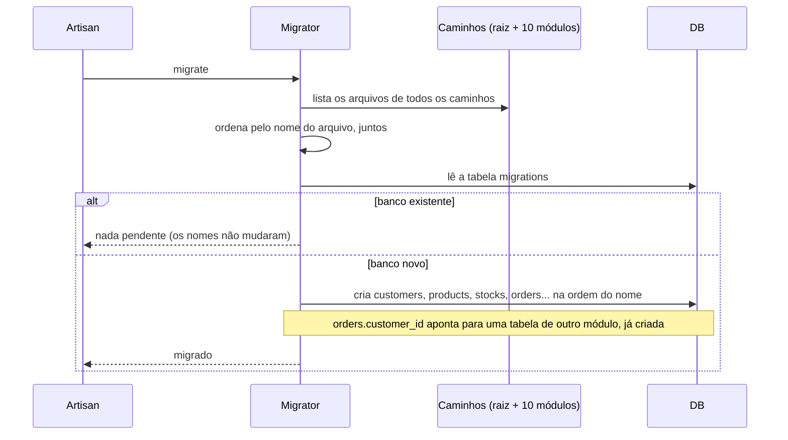

# Módulos como pacotes: `internachi/modular`, camadas Core, Persistence e Http (HEL-12)

> Plan from this document. Each slice below carries its own shape - copy it, do not re-derive it.
> Status: confirmed by diashelter, 2026-10-19, com as respostas padrão de cada slice `open`.
> Rodada 2 (2026-10-19): Module Layout e Messaging estão entregues na PR 27. As slices Module Routes, Module Migrations e Load Baseline seguem numa branch empilhada sobre a da PR 27, numa só spec (`.specs/features/module-routes-migrations`), confirmada por diashelter.

## Situation

- Project: em construção ativa. Projeto de estudo (Loja Demo), sem produção; existem bancos de desenvolvimento e testes já migrados em cada checkout.
- Decision: committed por diashelter em 2026-10-09, na [HEL-12](https://linear.app/helter/issue/HEL-12/implementar-um-padrao-de-modularidade-melhor-ao-sistema) (In Progress), e prevista como a próxima etapa por cinco designs anteriores (vocabulário, outbox, consultas, k6 e transporte de eventos).
- In flight: segue a regra de fachada da HEL-7 e do vocabulário da HEL-10 (público é só `Contracts`, `Events` e o vocabulário que as assinaturas alcançam), os nomes estáveis de evento e consumidor da HEL-9 e da HEL-13, e o desenho de consultas da HEL-6. Ficam de fora a observabilidade (HEL-8) e qualquer mudança de comportamento de rota, evento ou tabela.
- At stake: médio. Não há dados em risco, mas a troca de namespace atravessa cada classe, teste e documento, e renomear um arquivo de migration reexecuta o SQL numa base já migrada. Reverter depois de integrado custa o mesmo que fazer.

## Problem

Construção. A [análise de domínio](../docs/domain-analysis.md) fechou as fronteiras entre os contextos (HEL-7, 10, 6), mas o módulo ainda não é uma unidade: criar um novo exige editar pelo menos cinco lugares globais (a lista de providers, o arquivo central de rotas com 18 controllers de 8 módulos, a pasta de migrations, a de factories e a lista de padrões de rota do `AppServiceProvider`), e dentro de cada módulo as 15 pastas por tipo técnico não dizem o que é regra de negócio, o que é banco e o que é HTTP. Sem esta peça, cada feature seguinte continua tocando a raiz, e o `Shared` (38 arquivos, 26 deles de mensageria) segue crescendo como depósito. O momento é agora porque as HEL-6, 9, 10, 11 e 13 já deixaram as classes estáveis e os nomes de evento e fila independentes do namespace; a HEL-14 deixou uma linha de base de carga para medir se a reorganização custou algo.

Número que decidiu: 9 módulos, 260 arquivos PHP, 14 migrations e 10 factories em pastas globais, 110 arquivos de teste importando `App\Modules` (contados no repositório em 2026-10-19). Não há medida de dor de equipe: o repositório tem um só autor.

## Success

- Worked if: um módulo novo nasce editando fora dele só o `composer.json` e o `composer.lock` da raiz, que o gerador da biblioteca escreve (hoje, pelo menos 5 lugares à mão), e `route:list`, `migrate:status` e a suíte (`make test`) dão o mesmo resultado antes e depois da troca.
- Going wrong: algum módulo precisa de uma linha à mão na raiz (fora o `require` do `composer.json`) para ser descoberto; `make test` ou o CI exigem um passo manual de `composer install`; o smoke ou o `load` de carga saem do ruído da linha de base de 2026-10-16.
- Review: quando a HEL-12 for integrada - diashelter roda `make load-test` antes e depois e compara (compromisso já escrito no design da HEL-14).

## Boundary

In: os 9 módulos atuais mais o `Messaging`, saído do `Shared`; pacote, provider, rotas, migrations e factories de cada um; as camadas `Core`, `Persistence` e `Http`; o `ModuleBoundariesTest` e os testes de arquitetura vizinhos; `AGENTS.md`, README e `docs/domain-analysis.md`; o Makefile, o Docker e o CI quando precisarem de `composer install` ou de um cache novo.

Out: fundir módulos - nenhum par passou no teste dos seis critérios (ver Module Map). Trocar a projeção `Customer` do Ordering, que lê a tabela `customers` do Identity, por um contrato - é acoplamento intrusivo conhecido (problema 3 da análise) e merece a própria mudança. Quebrar o ciclo de contratos Catalog e Inventory - cada sentido atende um caso de uso diferente. Bancos ou deploys separados por módulo. Mover testes para dentro dos módulos - o Pest separa por tipo (Unit sem banco, Feature com banco).

Unchanged: nomes de `Contracts`, de eventos (`ordering.order_placed`...), de consumidores e de filas; URIs, nomes de rota e contadores de `throttle`; nomes de arquivo de migration e de tabela; o comportamento HTTP; as 19 interfaces; a flag `event-transport`; o frontend.

## Prior art

- Os pacotes de módulos para Laravel convergem em provider, rotas e migrations próprios, descobertos sem registro manual - seguimos esse eixo. O README do `internachi/modular` o contrapõe ao `nwidart/laravel-modules`, mais adequado a módulos ligados e desligados em tempo de execução; não temos essa condição.
- O contrato do `internachi/modular` não aplica prefixo nem grupo de middleware às rotas do módulo (a documentação consultada só faz `require` de cada arquivo) - a Key decision 4 existe para isso.

## Shape

Cada módulo vira um pacote Composer em `app-modules/<nome>`, com o namespace `Modules\<Nome>`, descoberto pela biblioteca e dono do próprio provider, das rotas, das migrations e das factories; a raiz fica só com o que é do framework. Dentro do pacote, a fachada pública (`Contracts`, `Events`) fica ao lado de três camadas privadas, `Core`, `Persistence` e `Http`, e o `ModuleBoundariesTest` passa a ler essa árvore. A porta é o nome do arquivo de migration e o namespace: o primeiro reexecuta o SQL se mudar, o segundo atravessa todo o código e a documentação, e por isso a troca é feita por script, um módulo por vez, como na HEL-7. A alternativa mais leve é manter `App\Modules` e deixar cada provider carregar as próprias rotas e migrations, sem a biblioteca e sem pacote por módulo; ela ganha se o custo de ser pacote (um `composer install` em cada checkout e worktree, e o cache de módulos) superar o que a descoberta automática economiza. Como a HEL-12 pede a biblioteca, ela fica como alternativa.

## Key decisions

1. **Cada módulo é um pacote Composer em `app-modules/<nome-em-kebab>` com o namespace `Modules\<Nome>`; `App\Modules` deixa de existir.** A raiz do `backend/` exige `modules/*` por repositório `path` com symlink, e a biblioteca roda com os padrões, sem configuração. Eventos e consumidores já têm nome estável, então o envelope do outbox e as filas do RabbitMQ não mudam. O que carrega a classe antiga são os jobs `DeliverEvent` já enfileirados no Redis (guardam a classe do consumidor): a fila é esvaziada antes da troca.
2. **A raiz descobre os módulos sozinha; o único registro de um módulo novo é o `require` no `composer.json` da raiz, escrito pelo gerador.** O provider de cada módulo é registrado pelo próprio `composer.json` do pacote, e a lista de providers, o arquivo central de rotas e os padrões de rota por módulo do `AppServiceProvider` somem da raiz. A raiz guarda só o que é do framework: a configuração, o `bootstrap`, as migrations de `cache`, `jobs` e `features`, o `routes/console.php` e o `DatabaseSeeder`.
3. **A visibilidade passa a ser estrutural, no primeiro nível de `src/`.** `Contracts` e `Events` são a fachada; `Core` (casos de uso, serviços de domínio, consumidores, jobs, DTOs, value objects, enums e exceções), `Persistence` (models, repositórios e consultas) e `Http` (controllers, requests, resources, regras e middleware) são privados. O vocabulário público continua calculado pelas assinaturas, não pela pasta. A direção é `Http` → `Core` → `Persistence`: `Core` e `Persistence` não usam `Http`, e as regras de hoje continuam (repositório não usa serviço; consulta não usa repositório nem caso de uso). A proibição de `Core` e `Persistence` usarem `Http` é a única regra de camada nova.
4. **Cada módulo declara o próprio prefixo `/api` e o grupo `api` nas suas rotas.** A biblioteca não os aplica. A autorização continua provada pelos testes que percorrem `Route::getRoutes()` (`StaffRoleTest`, `AuthorizationTest`, `RateLimitTest`, `RouteBindingTest`), que passam a ser o oráculo da troca: nenhuma rota pode perder `auth`, `admin`, `throttle` nomeado ou o padrão de UUID por ter mudado de arquivo. Os padrões de UUID dos parâmetros são registrados no `register()` de um provider, e nunca no `boot()`: o spike mostrou que uma rota copia os padrões globais quando é criada, e a biblioteca cria as rotas antes do `boot()` dos providers da aplicação.
5. **Nenhum arquivo de migration é renomeado nem editado.** A tabela `migrations` guarda o nome, então renomear reexecutaria o SQL numa base existente. Mover o arquivo para o módulo dono mantém a ordem global por nome (o migrator ordena os caminhos juntos), que é o que protege as 5 chaves estrangeiras entre módulos (`orders.customer_id`, `order_items.product_id`, `stocks.product_id`, `payments.order_id`, `customer_addresses.customer_id`).
6. **O conjunto de módulos são 10: os 9 atuais, sem fusões, mais o `Messaging`, extraído do `Shared`.** O `Shared` fica com o kernel (erros, classes base, `RecordId`, limitador de requisições, `Http` base). Os dois módulos de infraestrutura não dependem de módulo de negócio, e o `Shared` não depende do `Messaging`.
7. **Interface só existe como fronteira entre módulos (`Contracts`) ou como porta com uma segunda implementação ou duplo de teste real.** Nenhuma das 19 interfaces sai: 13 contratos só atravessam módulos, e `PaymentGateway`, `ProductCatalog`, `EventOutbox`, `EventTransport`, `EventConsumer` e `DomainEvent` têm segunda implementação ou duplo nos testes. Uma interface nova fora desses casos é recusada na revisão, e a regra entra no `AGENTS.md`.

## Work

| Slice | Delivers | Status |
|---|---|---|
| [Module Map](#module-map) | a decisão por módulo, com a evidência, em `docs/domain-analysis.md` | clear |
| [Library Spike](#library-spike) | as 5 perguntas sobre a biblioteca respondidas num módulo de verdade (2026-10-19) | clear |
| [Module Layout](#module-layout) | os 10 pacotes em `app-modules`, com `Core`, `Persistence`, `Http` e o provider | done - PR 27 (4 defaults taken) |
| [Messaging](#messaging) | o módulo `Messaging`, tirado do `Shared` | done - PR 27 (2 defaults taken) |
| [Module Routes](#module-routes) | as rotas de cada módulo no módulo, sem arquivo central | clear |
| [Module Migrations](#module-migrations) | as migrations e factories de cada módulo no módulo | open - 1 default taken |
| [Load Baseline](#load-baseline) | a comparação de carga antes e depois | clear |

Order: Module Map → Library Spike → Module Layout e Messaging juntos (um só script) → Module Routes e Module Migrations (independentes) → Load Baseline. O Module Layout só começa depois que o spike responder; se o spike falhar, a alternativa leve da Shape assume as três slices seguintes.

Already handled by existing code: rota com `auth`, `admin`, `throttle` nomeado e padrão de UUID - os testes que percorrem `Route::getRoutes()`; fila de consumidor no RabbitMQ - o nome estável dado na inscrição; id em texto e UUID v7 - não muda.

Derivable from the repository, left to the plan: namespaces de factory e seeder, nome do pacote em `composer.json` (`modules/<nome>`), docblocks, ordem dos `use`, texto dos comandos do Makefile - tudo como o módulo Payment (o menor com model, migration, rota, factory e evento) faz depois da troca.

### Module Map

**Delivers** a análise de domínio e acoplamento registrada em `docs/domain-analysis.md`, com a decisão por módulo. **Status: clear.**

| Módulo | Tipo | Decisão | Evidência |
|---|---|---|---|
| Ordering | Core | fica | 53 arquivos, 2096 linhas, 24 commits; linguagem própria (carrinho, pedido, frete) |
| Catalog | Supporting | fica | 48 arquivos; produto e categoria não dividem vocabulário com o estoque |
| Inventory | Supporting | fica, não funde com o Catalog | 3 imports para cada lado e 7 commits conjuntos, mas a linguagem difere e a consistência também (bloqueio de linha na reserva) |
| Customers | Supporting | fica, não funde com o Identity | 8 commits conjuntos, mas Identity é Generic e Customers é Supporting: mudam por motivos diferentes |
| Identity | Generic | fica | conta de equipe e de cliente, credenciais |
| Payment | Supporting | fica, não funde com o Fulfillment | 514 e 369 linhas, nenhum import entre os dois; linguagens diferentes |
| Fulfillment | Supporting | fica | ver acima |
| Backoffice | Read model | fica | 3 arquivos, 159 linhas, nenhuma tabela, lê 4 contratos; fundir em qualquer dono inverteria a dependência |
| Shared | kernel | encolhe para 13 arquivos (12 do kernel mais o `SharedServiceProvider`) | 26 dos 38 arquivos são de mensageria (ver Messaging) |
| Messaging | infraestrutura | novo | 26 arquivos, a tabela `outbox_messages` e 5 comandos, com ciclo de mudança próprio (HEL-9 e HEL-13) |

Acoplamento medido (imports entre módulos, 2026-10-19): quase tudo é por contrato; o único acoplamento intrusivo é a projeção `Customer` do Ordering sobre `customers` (somente leitura, documentada, mantida). O acoplamento funcional entre Ordering e Inventory (reserva na mesma transação) é necessário. Os ciclos de import (Catalog e Inventory; Ordering com Fulfillment e com Payment, estes por eventos) atravessam só `Contracts` e `Events`.

### Library Spike

**Delivers** cinco respostas, dadas em 2026-10-19 ao mover o Payment para `app-modules/payment` num worktree descartável (`internachi/modular` 3.0.2, Laravel 13, PHP 8.5). Evidência em `.specs/features/library-spike/evidence/`. **Status: clear** - nenhuma resposta bloqueia a biblioteca; uma muda a Key decision 4 e outra a árvore da Module Layout.

**Resposta 1 - cache de módulos.**
Comando: `modules:cache`, e `modules:cache` com `APP_MODULES_CACHE=/tmp/laravel/app-modules.php`.
Resultado: grava `bootstrap/cache/app-modules.php` com `bootstrapPath('cache/app-modules.php')` fixo no pacote; nenhuma variável de ambiente o desvia (o arquivo não aparece em `/tmp/laravel`). Só o `modules:cache` o grava (o `optimize` não o escreve: depois dele, `bootstrap/cache` tem config, events, packages, routes e services, e nenhum `app-modules.php`), e sem ele a biblioteca descobre os módulos no filesystem a cada boot.
Efeito: confirma o `AGENTS.md` (a pilha de carga não roda `optimize`) e adiciona uma medida à Load Baseline: o custo da descoberta a cada boot sem o cache. Veredito: confirma.

**Resposta 2 - rotas do módulo.**
Comando: `route:list --path=payment --json` com o arquivo de rotas sem prefixo nem grupo, e `route:list --path=orders -vv` com os dois.
Resultado: sem o envelope a URI é `orders/{order}/payment`, `POST /api/orders/{order}/payment` responde 404 e o middleware não tem o grupo `api`; com `prefix('api')->middleware('api')` a rota recebe `EnsureFrontendRequestsAreStateful`, e `POST` responde 401 sem login e 404 para um id desconhecido. Segunda descoberta: os padrões de UUID registrados no `boot()` do `AppServiceProvider` não valem para as rotas do módulo, porque uma rota copia os padrões globais quando é criada e a biblioteca cria as rotas antes desse `boot()` (14 testes falharam: `RouteBindingTest` e três casos de `UuidIdsTest` respondiam 401 onde esperavam 404). Registrar os padrões no `register()` os corrigiu.
Efeito: confirma a Key decision 4 e a completa (os padrões vão para o `register()`). Veredito: muda.

**Resposta 3 - migrations de vários caminhos.**
Comando: `migrate:fresh` com a migration de `payments` só no módulo; `migrate` depois de migrar com o arquivo no lugar antigo e movê-lo; consulta a `information_schema`.
Resultado: os 14 nomes de `main` ficam `Ran` na mesma ordem, `Nothing to migrate.` num banco já migrado, e `payments_order_id_foreign -> orders` existe.
Efeito: confirma a Key decision 5. Veredito: confirma.

**Resposta 4 - factory.**
Comando: o teste `creates a payment through the module factory`.
Resultado: `Payment::factory()->create()` grava a linha com a factory em `database/factories` do módulo, no namespace `Modules\Payment\Database\Factories`, e `#[UseFactory]` apontando para ele; o `composer.json` gerado já mapeia esse namespace.
Efeito: confirma a decisão da Module Layout sobre factories e dá o namespace. Veredito: confirma.

**Resposta 5 - checkout, Docker e CI.**
Comando: `make test`, `make pint`, `composer install` num clone novo e o container `api` com o symlink do módulo removido.
Resultado: `make test` no worktree roda 1846 testes verdes e 10 vermelhos, todos de 4 arquivos de arquitetura que leem a pasta `app/Modules` (`DomainEventsTest`, `ModuleBoundariesTest`, `OrderCodeBoundariesTest`, `EventDeliveryTest`); o clone novo cria `vendor/modules/payment` como symlink; o `make pint` passa depois de rodar o Pint nos arquivos que o gerador cria com tabulação; o entrypoint do container não instala o pacote quando `vendor/autoload.php` já existe. O `make:module` pergunta se deve cancelar na primeira vez, reescreve o formato do `composer.json` raiz e põe o provider em `src/Providers/`, não na raiz de `src/`.
Efeito: confirma a seção Migration (cada checkout existente roda `composer install`) e muda a árvore da Module Layout (provider em `Providers/`). Veredito: muda.

Nenhuma resposta bloqueia: as três slices seguintes seguem a Shape, não a alternativa leve.

### Module Layout

**Delivers** os 10 pacotes em `app-modules/<nome>`, cada um com `composer.json`, `<Nome>ServiceProvider`, `src/` com a árvore abaixo, e o `ModuleBoundariesTest` lendo a nova árvore. **Status: open.** É a porta (Key decisions 1, 2, 3 e 7).

```txt
app-modules/<nome>/
  composer.json
  src/
    Providers/        <Nome>ServiceProvider.php (o gerador da biblioteca o coloca aqui)
    Contracts/        fachada
    Events/           fachada
    Core/             UseCases, Services, Consumers, Jobs, DTOs, ValueObjects, Enums, Exceptions
    Persistence/      Models, Repositories, Queries
    Http/             Controllers, Requests, Resources, Rules, Middleware
  routes/
  database/           migrations, factories
```

| State | What should happen | Caller sees |
|---|---|---|
| Módulo novo | o gerador cria o pacote com provider e as camadas; fora dele só o `composer.json` e o `composer.lock` da raiz mudam | `git status` só dentro de `app-modules`, mais os dois arquivos do Composer |
| Classe privada usada de outro módulo | o teste de arquitetura falha | `ModuleBoundariesTest` |
| `Core` ou `Persistence` usando `Http` | o teste falha (regra nova) | `ModuleBoundariesTest` |
| Repositório usa serviço, ou consulta usa repositório ou caso de uso | o teste falha, como hoje | `ModuleBoundariesTest` |
| Interface nova fora de `Contracts` sem segunda implementação | recusada na revisão; a regra está no `AGENTS.md` | revisão |
| Job `DeliverEvent` antigo na fila do Redis | a fila é esvaziada antes da troca; o RabbitMQ não é afetado | `make queue-restart` depois |
| Checkout ou worktree existente | rodar `composer install` antes do primeiro `make test` | falha clara se faltar |

Alternatives considered: manter `App\Modules` com a biblioteca apontada para `app/Modules` - ganha se o `AGENTS.md` do diretório pai, que fixa `app/Modules`, valer mais que o padrão da biblioteca; custa o psr-4 `App\` raiz sobreposto ao do módulo.

Open, default taken:
1. As factories vão com o model para o módulo; os seeders ficam na raiz, porque semeiam dados de vários módulos (composição). Uma factory que usa o model de outro módulo (`OrderFactory` com `CustomerAccount`, por exemplo) é código de teste e fica fora do `ModuleBoundariesTest`.
2. `Gateways` é uma quarta pasta privada só do Payment, ao lado das três (adaptador de serviço externo, não é banco nem HTTP).
3. Os testes ficam em `backend/tests`, por tipo.
4. A pasta `Queries` fica em `Persistence` em todos os módulos, inclusive a do Backoffice, que só lê contratos.

### Messaging

**Delivers** o módulo `Messaging`, com o outbox, o relay, as portas de transporte, o RabbitMQ, os 5 comandos `outbox:relay`, `events:transport`, `events:consume`, `events:failed` e `events:retry`, a tabela `outbox_messages` e o provider que hoje mora no `AppServiceProvider`. **Status: open.**

| State | What should happen | Caller sees |
|---|---|---|
| Módulo de negócio grava um evento | continua pelo `EventOutbox`, só dentro de transação | `LogicException` sem transação, como hoje |
| Módulo de negócio inscreve um consumidor | continua no `boot()` do próprio provider, com o nome estável | a fila `<nome>` do RabbitMQ é a mesma |
| `Messaging` usando um módulo de negócio | o teste falha | `ModuleBoundariesTest` |
| `Shared` usando o `Messaging` | o teste falha | `ModuleBoundariesTest` |
| Troca de transporte | `make event-transport` funciona igual | a flag `event-transport` não muda |

Open, default taken:
1. Extrair mesmo, e não deixar a mensageria dentro do `Shared` - ganha o contrário se a pasta nova não reduzir o que um leitor precisa ler: o `Shared` cai de 38 para 12 arquivos, e é a mudança que muda mais coisa de lugar.
2. A fachada do `Messaging` é `DomainEvent`, `EventOutbox`, `EventConsumer` e o registro de inscrições, todos em `Contracts`; o registro passa a ser interface, pela mesma regra de fronteira entre módulos.

### Module Routes

**Delivers** um arquivo de rotas por módulo, no módulo, e o fim do arquivo central de rotas. **Status: clear** (depende do spike).

| State | What should happen | Caller sees |
|---|---|---|
| Rota do módulo | declara `/api` e o grupo `api`, com a mesma URI, nome, middleware e contador de `throttle` de hoje | `route:list` idêntico |
| Rota de administração | cada módulo repete `admin`, `auth:staff` e o grupo `admin` dos `DELETE` | `StaffRoleTest` e `AuthorizationTest` verdes |
| Parâmetro `{product}`, `{order}`... | o padrão de UUID é registrado no `register()` do provider do módulo dono do parâmetro | `RouteBindingTest` e `UuidIdsTest` verdes |
| Rota de dois módulos com o mesmo prefixo (`admin`) | convivem; a ordem é a de carregamento dos módulos, sem sobreposição de URI | `route:list` sem rota duplicada |

### Module Migrations

**Delivers** cada migration no módulo dono, sem renomear; as factories já foram com os models na PR 27. **Status: open - 1 default taken.** É a segunda porta (Key decision 5).

| Tabela | Módulo |
|---|---|
| `customers` | Identity |
| `users`, `password_reset_tokens`, `sessions` | Identity (arquivo inteiro) |
| `categories`, `products`, `category_product` | Catalog |
| `stocks` | Inventory |
| `orders`, `order_items` | Ordering |
| `payments` | Payment |
| `customer_addresses` | Customers |
| `outbox_messages` | Messaging |
| `cache`, `cache_locks`, `jobs`, `job_batches`, `failed_jobs`, `features` | raiz (framework) |

Nenhuma tabela é criada ou alterada.



| State | What should happen | Caller sees |
|---|---|---|
| Banco já migrado | nada pendente depois da troca | `migrate:status` idêntico |
| Banco novo | as tabelas sobem na mesma ordem, e as chaves estrangeiras passam | `make fresh` verde |
| Arquivo renomeado por engano | reexecutaria o SQL; a revisão recusa | `migrate:status` com pendência |

Open, default taken:
1. O arquivo `0001_01_01_000000_create_users_table` vai inteiro para o Identity, levando `password_reset_tokens` e `sessions` junto, porque dividir o arquivo mudaria uma migration já executada. O README anota que `sessions` mora no Identity só por causa do arquivo.

Alternatives considered: deixar as 3 tabelas do arquivo na raiz - ganha se `sessions` precisar de dono próprio, o que a API em modo SPA com cookie ainda não exige.

### Load Baseline

**Delivers** a comparação do `smoke` e do `load` do k6 antes da primeira mudança e depois da última, contra a linha de 2026-10-16. **Status: clear.**

| State | What should happen | Caller sees |
|---|---|---|
| Antes de mover | `make load-test TYPE=load` registrado como linha desta rodada | relatório em `load-tests/results` |
| Depois de mover | mesma rodada, mesmo ambiente | diferença menor que o ruído entre rodadas |
| Diferença maior que o ruído | a causa é achada antes de integrar | a HEL-12 não fecha |
| Pilha de carga e o cache de módulos | nada é gravado em `bootstrap/cache` pelos containers de carga | a regra do `AGENTS.md` continua valendo |

## Migration

Sem dados a migrar. Em cada checkout, worktree e container existente: `composer install` (o entrypoint só instala se `vendor/autoload.php` não existe), esvaziar a fila do Redis antes e rodar `make queue-restart` depois, e conferir `migrate:status`. A documentação (`AGENTS.md`, README e as 119 referências da `docs/domain-analysis.md`) é reescrita pelo mesmo script que move as classes.

## Sources

- [HEL-12 no Linear](https://linear.app/helter/issue/HEL-12/implementar-um-padrao-de-modularidade-melhor-ao-sistema) - o pedido: camadas, rotas e migrations por módulo, provider por módulo, biblioteca, interfaces, `Shared`.
- [docs/domain-analysis.md](../docs/domain-analysis.md) e os designs [module-facades](module-facades.md), [module-vocabulary](module-vocabulary.md), [cqrs-read-side](cqrs-read-side.md), [transactional-outbox](transactional-outbox.md), [event-transport-flag](event-transport-flag.md) e [load-tests-k6](load-tests-k6.md) - as regras de fachada, os nomes estáveis e o compromisso da linha de base.
- README e `composer.json` do repositório `InterNACHI/modular`, e a página do pacote no Packagist (versão 3.0.2, 2026-03-23, PHP 8.3 ou mais, `illuminate/support ^11|^12|^13`) - o que a biblioteca faz e exige. A documentação indexada no Context7 sobre o carregamento de rotas e de migrations pode não ser a oficial e é o que o spike confirma.
