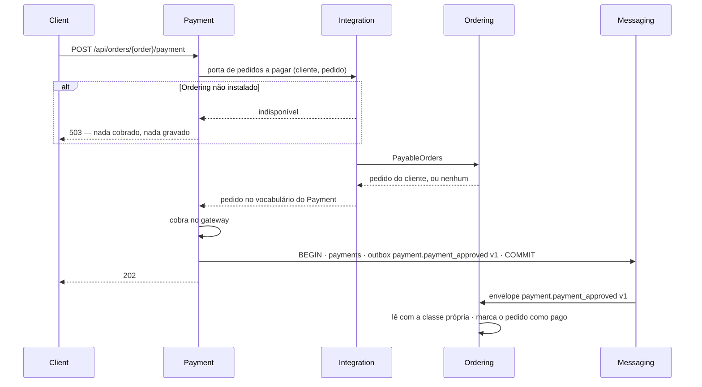

# Módulos isolados: testes no módulo, portas do consumidor e nenhum import entre módulos de negócio

> Plan from this document. Each slice below carries its own shape - copy it, do not re-derive it.
> Status: confirmed by diashelter, 2026-10-20 (construir, com o piloto Payment ↔ Ordering primeiro).
> Rodada 1 (2026-10-20): Module Tests e Payment ↔ Ordering construídos na branch `helterdias/module-isolation-pilot` (plano em `.specs/features/module-isolation-pilot`). O Payment pede o pedido pela porta `OrdersToPay`, o pacote `Integration` a liga ao `PayableOrders` ou a uma porta que responde `503 SERVICE_UNAVAILABLE`, a `2026_10_06_000001_create_payments_table` perdeu a referência a `orders` (o `ModuleMigrationsTest` passou a congelar 16 migrations) e os testes de 5 módulos (Identity, Messaging, Shared, Catalog e Payment) moram em `app-modules/<módulo>/tests`. Dois achados da prova de remoção mudaram a slice Module Tests (ver a slice).

## Situation

- Project: em construção ativa. É um projeto de estudo (Loja Demo), sem produção e com um só autor. Cada checkout e worktree já tem bancos de desenvolvimento e de testes migrados.
- Decision: aberta e confirmada nesta descoberta por diashelter, em 2026-10-20. Ainda não há issue no Linear (a última é a HEL-16).
- In flight: nada; todas as branches estão na `main`. Copia como precedente os nomes estáveis de evento e de consumidor (HEL-9, HEL-13), a regra da HEL-7 de que o consumidor define o contrato quando o fornecedor já depende dele e a convenção do `internachi/modular` para testes de módulo. Ficam de fora a observabilidade (HEL-8) e o frontend.
- At stake: médio-alto. A mudança reabre três decisões fechadas: os testes na raiz por tipo (HEL-12), o contrato e o vocabulário do fornecedor como porta (HEL-7 e HEL-10) e a regra do `AGENTS.md` de nunca editar uma migration executada. Ela atravessa os 8 módulos de negócio e os 114 arquivos de teste, e tira 6 chaves estrangeiras de bancos com dados de desenvolvimento. Nenhum dado de cliente corre risco, mas voltar atrás custa reescrever as travessias outra vez.

## Problem

Construção. A HEL-12 fez de cada módulo um pacote, mas o módulo ainda não é uma unidade: os testes moram fora dele, o código compila contra outros módulos de negócio e o banco aponta para tabelas de outros módulos. Esta peça deve provar, no projeto de estudo, que cada um dos 8 módulos de negócio (Catalog, Inventory, Ordering, Payment, Fulfillment, Identity, Customers e Backoffice) é completo: removido qualquer um deles, a aplicação sobe e as suítes dos outros passam. Nada no produto trava sem ela. O que fica sem prova é o isolamento, e cada feature escrita sobre as fachadas atuais é mais uma travessia a reescrever depois. O momento é agora porque não há nada em andamento e a HEL-12 acabou de dar a cada módulo o seu pacote, as suas rotas e as suas migrations.

Números que decidiram, contados no repositório em 2026-10-20:

- **Testes:** dos 114 arquivos (628 declarações de teste), 29 tocam um só módulo e 68 tocam de 2 a 8, por import, por helper do `Pest.php` ou por rota. Outros 13 são de arquitetura e 4 são do kernel.
- **Código:** 112 linhas `use` ligam módulos de negócio em 14 pares, por 14 contratos e 4 eventos.
- **Banco:** 6 chaves estrangeiras ligam os módulos, e o model `Customer` do Ordering lê a tabela `customers` do Identity.
- **Factories:** 7 delas criam linhas de outro módulo.

## Success

- Worked if:
  - para cada um dos 8 módulos de negócio, com o pacote dele removido, o `migrate:fresh` e as suítes de todos os outros módulos passam;
  - nenhum módulo de negócio usa outro módulo de negócio;
  - a suíte de composição passa com todos os módulos instalados.
- Going wrong:
  - no piloto, sem o Payment as suítes dos outros módulos não passam, ou sem o Ordering a do Payment não passa;
  - a cola no `Integration` sai maior que o código que ela substitui;
  - a suíte de composição precisa repetir o que as suítes dos módulos já testam.
- Review: quando a última slice for integrada. diashelter roda a prova de remoção dos 8 módulos e confere cada um contra a lista de travessias deste documento.

## Boundary

In:

- os 8 módulos de negócio;
- o pacote novo `Integration`;
- o `Shared`, que ganha o `BrazilianState` e o apoio de teste para a identidade;
- a suíte de composição em `backend/tests`;
- o `ModuleBoundariesTest` e os testes de arquitetura vizinhos;
- o job de prova de remoção no CI;
- o `AGENTS.md`, o README e o `docs/domain-analysis.md`.

Out:

- **O frontend.** O pedido é sobre os módulos do backend.
- **Módulos em processos ou bancos separados, e integração só por eventos com réplicas locais.** O critério "pronto para virar serviço" foi descartado (ver Shape).
- **Remover o `Shared`, o `Messaging` ou o `Integration`.** São infraestrutura, como o framework.
- **Fundir módulos, inclusive o Customers e o Identity**, o par mais acoplado. A HEL-12 mediu e decidiu manter os dois separados.
- **Seeders por módulo.** Os seeders são composição e continuam na raiz. Um `migrate:fresh --seed` sem algum módulo falha, e isso é aceito.
- **A pilha de carga** (`load-tests/`, `LoadTestSeeder`). Ela roda com todos os módulos, como a suíte de composição.
- **Uma classe leitora por consumidor no `Messaging`.** Hoje cada evento tem um só módulo leitor. A mudança no registro entra com o primeiro evento lido por dois módulos.

Unchanged: rotas; payloads; códigos HTTP (a única resposta nova é o `503` da Key decision 3); nomes, versões e payloads de evento; nomes de consumidor e filas do RabbitMQ; nomes de tabela e de coluna; nomes de arquivo de migration; o padrão de UUID das rotas; o `throttle` nomeado.

## Prior art

- **O teste de módulo roda sozinho por padrão.** O Spring Modulith sobe só o módulo testado (modo `STANDALONE`) e trata à parte as dependências de saída. Adotamos: a suíte de cada módulo roda sem os outros (Key decision 6).
- **A costura que se repete é um pacote de eventos de integração por módulo**, o único compartilhado entre módulos (é o *modular monolith with DDD* de Kamil Grzybek, descrito pela InfoQ). Não adotamos, porque o objetivo é nenhum import entre módulos. O preço é perder o compilador como prova de compatibilidade, e a Key decision 4 existe para cobrir isso.
- **Os times mantêm uma suíte de integração de sistema** que sobe a aplicação inteira e espera os fluxos assíncronos terminarem. Adotamos: é a suíte de composição da raiz.

## Shape

Cada módulo de negócio passa a ser um pacote que carrega os próprios testes e pede de fora só o que declara nas próprias portas, no próprio vocabulário. O pacote de infraestrutura `Integration` liga cada porta ao contrato do módulo que a atende, ou a uma implementação indisponível quando esse módulo não está instalado. Os eventos são lidos pelo nome, com uma classe do consumidor. A decisão difícil de reverter é a inversão da posse dos contratos somada à saída das 6 chaves estrangeiras: voltar significa reescrever 14 travessias e recriar chaves sobre dados gravados sem elas.

A alternativa mais pesada é a integração só por eventos, com réplicas locais. Ela só ganharia se os módulos fossem para processos ou bancos separados, o que está fora do escopo, e quebraria a reserva de estoque na transação do pedido.

## Key decisions

1. **Um módulo de negócio usa só a si mesmo, o `Shared` e os quatro contratos públicos do `Messaging`. O `Integration` é o único pacote que usa mais de um módulo de negócio, e só pelas fachadas deles.**
   - O `Integration` é infraestrutura, como o `Shared` e o `Messaging`: a biblioteca o descobre e ele não é removível.
   - O `ModuleBoundariesTest` o trata como mais uma origem das regras de fachada, e o `ModuleLayersTest` o nomeia como o único pacote que pode nomear um módulo isolado, numa varredura dos arquivos de cada pacote (`src`, `routes`, `database` e `tests`). A varredura substituiu a expectativa por namespace prevista aqui na rodada 1: uma expectativa do Pest por namespace só vê as classes de `src`, e a factory e os testes de um módulo isolado também não podem nomear outro.
   - O código de execução da raiz (`bootstrap`, `config`, `app/`) não nomeia classes de módulos de negócio. A única exceção são os models de usuário dos guards, em `config/auth.php` (slice Identity).
   - A suíte de composição e os seeders da raiz podem nomear qualquer módulo.
2. **Toda travessia é uma porta do consumidor, no vocabulário dele. O que o fornecedor oferece continua no `Contracts` dele, e o `Integration` tem um adaptador por porta.**
   - A regra da HEL-7 ("quando o fornecedor já depende do consumidor, o consumidor define o contrato") vira a regra geral.
   - O vocabulário da HEL-10 deixa de atravessar: um tipo de um módulo nunca aparece na assinatura de outro.
   - A regra de negócio fica no dono e atravessa só como resultado. O `ProductAvailability` continua sendo o único lugar da regra "pode ser comprado"; o Ordering recebe a resposta, não a regra.
   - A única exceção são valores genéricos que não carregam regra de nenhum módulo. Eles vão para o `Shared`, e hoje só o `BrazilianState` se encaixa.
3. **Sem o fornecedor instalado, qualquer rota que chama a porta responde `503` e não deixa nada gravado.**
   - O corpo é o padrão de erro, com `code` `SERVICE_UNAVAILABLE` e a mensagem `Este recurso está indisponível no momento.`
   - Vale para leitura e para escrita. Não há resposta parcial nem dado inventado. As duas leituras em que uma resposta parcial seria defensável estão abertas nas suas slices, com o `503` como padrão.
   - A autorização falha fechada: sem o Identity, uma rota de admin nunca passa.
   - Um evento sem consumidor instalado é publicado e ninguém reage. Reinstalar o módulo não reprocessa o que já foi publicado.
4. **O formato publicado de um evento é o nome, a versão e as chaves do payload. Cada módulo leitor o lê com uma classe própria e privada, e só o módulo do prefixo do nome grava o evento.**
   - A suíte de composição prova, para cada nome e versão inscritos, que o payload gravado pelo produtor é lido por cada leitor. Sem uma classe compartilhada, o compilador não pega uma chave renomeada, e essa prova toma o lugar dele.
   - O `Messaging` não muda, porque o registro já resolve o envelope pela classe que o consumidor inscreveu.
5. **Nenhum módulo aponta chave estrangeira para a tabela de outro módulo, nem lê a tabela de outro.**
   - **Migrations:** as 6 chaves saem editando só a referência nas 6 migrations de criação; a coluna e os índices ficam. Essa é a única exceção à regra do `AGENTS.md` de nunca editar migration executada, e fica registrada lá. Cada módulo dono da tabela ganha uma migration que apaga a chave onde ela existir, para os bancos já migrados convergirem.
   - **Comportamento:** o que uma chave fazia vira um pedido explícito. O estoque sai junto com o produto, na mesma transação (antes, pela cascata). As chaves `restrict` já tinham guarda na aplicação: um produto com pedido não é excluído, e pedido, pagamento e cliente não têm rota de exclusão.
   - **Projeção:** o `Customer` do Ordering vira uma porta.
6. **Os testes de um módulo moram nele, em `tests/Unit` (sem banco) e `tests/Feature` (com banco), e passam com só ele, o `Shared` e o `Messaging` instalados.**
   - O que vem de outro módulo é um duplo da porta do próprio módulo.
   - Quem entra autenticado é uma identidade de teste: o id e, para a equipe, o papel. Nunca um model, factory ou helper de outro módulo.
   - O `backend/tests` vira a suíte de composição: fluxos entre módulos reais, arquitetura, compatibilidade de payload, adaptadores e seeders. Ela só roda com todos os módulos.
   - Isso reverte a decisão da HEL-12 de manter os testes na raiz, separados por tipo. A separação por tipo continua, agora dentro de cada módulo.
7. **A prova é estrutural e roda no CI: para cada módulo da matriz, o job remove o pacote e roda o `migrate:fresh` e as suítes dos módulos restantes.** Um módulo entra na matriz quando nenhum outro o usa nem aponta para as suas tabelas. Ao fim, os 8 estão nela. A regra de não usar outro módulo de negócio é cobrada antes, pelo `ModuleBoundariesTest`.

## Work

| Slice | Delivers | Status |
|---|---|---|
| [Module Tests](#module-tests) | os testes de cada módulo no módulo, rodando sozinhos, e o `backend/tests` como suíte de composição | done - rodada 1 (27 arquivos em 5 módulos) |
| [Payment ↔ Ordering](#payment--ordering) | pagamento e aprovação sem import entre os dois, com o pacote `Integration`, o primeiro adaptador e o primeiro `503` | done - rodada 1 |
| [Removal Proof](#removal-proof) | o job de remoção no CI, começando pelo Backoffice e pelo Payment | open — 1 default taken |
| [Backoffice](#backoffice) | o dashboard sobre portas próprias | clear |
| [Fulfillment ↔ Ordering](#fulfillment--ordering) | frete no checkout, agendamento e entrega sem import entre os dois, e o `BrazilianState` no `Shared` | clear |
| [Catalog e Inventory](#catalog-e-inventory) | vitrine com estoque, abertura e lista de estoque, exclusão de produto, carrinho e checkout sobre portas | open — 1 default taken |
| [Customers](#customers) | conta, admin de clientes, caderno de endereços e cliente do pedido sem import entre Customers, Identity e Ordering | open — 2 defaults taken |
| [Identity](#identity) | guards, regra de admin e entrada nos testes sem ninguém nomear o Identity | open — 1 default taken |

Order: Module Tests → Payment ↔ Ordering → Removal Proof → Backoffice → Fulfillment ↔ Ordering → Catalog e Inventory → Customers → Identity. O Backoffice vem cedo porque não depende de nada e, ao sair do caminho, libera a entrada do Catalog, do Inventory, do Ordering e do Identity na matriz.

Already handled by existing code:

- **Evento sem consumidor:** a fila do Laravel o entrega a zero consumidores, e o RabbitMQ descarta a mensagem quando não há fila ligada (Key decision 3).
- **Rota de um módulo removido:** some junto com o pacote, e a resposta é o `404` padrão.
- **Id fora da forma canônica:** continua respondendo `404` sem query.

Derivable from the repository, left to the plan, tudo como o Payment fica depois do piloto:

- os nomes das portas, dos adaptadores, das classes leitoras de evento e dos duplos, e a pasta de cada um dentro de `Contracts` e `Core`;
- o namespace `Modules\<Nome>\Tests` no `autoload` do pacote, que é a convenção da biblioteca (o Composer ignora o `autoload-dev` de uma dependência);
- o nome da migration que apaga cada chave;
- o destino de cada um dos 68 arquivos de teste que cruzam módulos: vai para o módulo, com duplo, quando testa uma regra dele; vai para a composição quando testa a corrente entre módulos.

### Module Tests

**Delivers** a suíte de cada módulo dentro do módulo, rodando só com ele, e o `backend/tests` como suíte de composição. **Status: clear.** Key decision 6.

| State | What should happen |
|---|---|
| Teste que só usa o código do módulo | mora em `app-modules/<módulo>/tests`, em `Unit` (sem banco) ou em `Feature` (com banco) |
| Teste que precisa de um produto, estoque, conta ou pedido de outro módulo | usa o duplo da porta do próprio módulo; nenhuma factory, model ou helper de outro módulo |
| Teste que entra autenticado | usa a identidade de teste do `Shared` (o id e, para a equipe, o papel) |
| Fluxo entre módulos reais, arquitetura, compatibilidade de payload, adaptador ou seeder | fica em `backend/tests` e só roda com todos os módulos |
| Factory que hoje cria a linha de outro módulo (as 7) | gera o id da outra tabela sem criar a linha, na slice da sua travessia, quando a chave estrangeira sai (a `PaymentFactory` no piloto): antes disso, o id sem linha falharia na chave |
| `make test`, `make test-filter`, worktree e CI | rodam as suítes dos módulos e a de composição, sem nenhum passo novo |
| Helper de teste de um módulo | só os testes do próprio módulo o usam |

Esta slice moveu 27 arquivos para 5 módulos (Identity, Messaging, Shared, Catalog e Payment). Um arquivo só muda de lugar quando o módulo dele sobe e migra sozinho: o Ordering e o Fulfillment assinam os eventos um do outro ao subir, e a migration de `stocks` aponta para `products`, do Catalog, então os testes desses três esperam a slice da sua travessia. Cada arquivo que cruza módulos muda de lugar na slice da sua travessia.

Alternatives considered: pôr o namespace de teste de cada módulo no `autoload-dev` da raiz. Isso deixaria o código de teste fora do autoload de produção do pacote, mas exigiria uma linha na raiz por módulo, contra a decisão 2 da HEL-12.

### Payment ↔ Ordering

**Delivers** o pagamento (`POST /api/orders/{order}/payment`) e a reação à aprovação sem que o Payment e o Ordering importem um ao outro. Cria o pacote `Integration`, o primeiro adaptador e o primeiro `503`. **Status: clear.** É a decisão difícil de reverter (Key decisions 1 a 4); as slices seguintes copiam a forma daqui.

| State | What should happen | Caller sees |
|---|---|---|
| Pedido do cliente, aguardando pagamento, cobrança aprovada | o pagamento é gravado e o `payment.payment_approved` entra no outbox na mesma transação; o Ordering o lê com a classe dele e marca o pedido como pago | `202` |
| Pedido desconhecido ou de outro cliente | nada é cobrado | `404`, com o corpo de id desconhecido |
| Pedido que não aguarda pagamento | nada é cobrado | `409` `Este pedido não está aguardando pagamento.` |
| Cobrança recusada | a tentativa recusada é gravada | `402` |
| Ordering ausente | nada é cobrado nem gravado | `503` |
| Payment ausente | a rota não existe; os pedidos ficam em `awaiting_payment`; a pasta de testes de cada módulo restante passa. O Ordering ainda não tem a sua: os testes dele esperam a slice Fulfillment ↔ Ordering, porque o Ordering e o Fulfillment assinam os eventos um do outro ao subir (correção da rodada 1) | `404` |
| Suíte do Payment sem o Ordering | passa, com um duplo da porta de pedidos a pagar | — |

A porta do Payment (`OrdersToPay`, que devolve um `OrderToPay`) descreve o pedido a pagar com o id, o id do cliente, o total em centavos e se ele aguarda pagamento. O status completo do Ordering não atravessa.

Table `payments`: `order_id` perde a chave estrangeira para `orders`; a coluna e os índices ficam (Key decision 5).

Alternatives considered: o Payment guardar a própria cópia do pedido, alimentada pelo `ordering.order_placed`. Isso tiraria a chamada síncrona, mas o valor cobrado viria de uma cópia, e a regra "o valor sempre vem do pedido" passaria a depender de o evento já ter chegado.

### Removal Proof

**Delivers** o job do CI que remove cada módulo da matriz e roda o `migrate:fresh` e as suítes dos módulos restantes. **Status: open — 1 default taken.** Key decision 7.

| State | What should happen | CI shows |
|---|---|---|
| Módulo da matriz removido, e nenhum outro o usa | o `migrate:fresh` e as suítes restantes passam | job verde |
| Algum módulo usa o removido, lê a tabela dele ou aponta chave para ela | o job daquele módulo falha | job vermelho, com o teste que caiu |
| Módulo que ainda tem alguma travessia por desfazer | fica fora da matriz | — |
| Suíte de composição | não roda nos jobs de remoção; roda no job normal, com todos os módulos | — |

Entrada na matriz:

1. Backoffice e Payment, junto com esta slice.
2. Fulfillment, depois da slice dele.
3. Catalog e Inventory, depois da slice deles e da do Backoffice.
4. Customers e Ordering, depois da slice do Customers.
5. Identity, por último.

Custo: um job por módulo, em paralelo. Em 2026-10-20 a suíte inteira levou 94 s no CI, e cada job roda menos que ela.

Alternatives considered: desligar o módulo só na descoberta da biblioteca, mantendo as classes no autoload. É mais barato, mas uma classe do módulo removido nomeada por texto ainda carregaria, e a prova passaria sem valer nada.

Open, default taken:

1. O job roda em todo pull request ou só na `main`? Padrão: em todo pull request, como o `make test` e o smoke de carga.

### Backoffice

**Delivers** o dashboard (`GET /api/admin/dashboard`) sobre portas próprias para as quatro métricas: catálogo, clientes, estoque e pedidos. **Status: clear.**

| State | What should happen | Caller sees |
|---|---|---|
| Os quatro fornecedores instalados | inalterado | `200` |
| Algum deles ausente | — | `503` |
| Suíte do Backoffice | passa com duplos das quatro portas | — |
| Contagem de produtos por status e de pedidos por período | chegam no vocabulário do Backoffice; o `ProductStatus` do Catalog não atravessa | — |

### Fulfillment ↔ Ordering

**Delivers** a cotação de frete do checkout (`POST /api/orders`), o agendamento e a entrega sem import entre o Fulfillment e o Ordering. A tabela `deliveries` fica sem chave para `orders`, e o `BrazilianState` vai para o `Shared`. **Status: clear.**

| State | What should happen | Caller sees |
|---|---|---|
| Checkout com o Fulfillment | o frete vem da tabela de frete pela porta do Ordering, como hoje | `201` |
| Checkout sem o Fulfillment | nenhum pedido é criado e nada é reservado | `503` |
| `GET /api/shipping/quote` | inalterado, usando o `BrazilianState` do `Shared` | `200` |
| Pedido pago, com o Fulfillment | o `ordering.order_paid` é lido pela classe do Fulfillment; o `fulfillment.delivery_scheduled` e o `fulfillment.order_delivered`, pelas classes do Ordering; a idempotência da HEL-16 não muda | — |
| Pedido pago, sem o Fulfillment | o pedido fica `paid` (Key decision 3) | — |
| Suíte do Fulfillment sem o Ordering | passa, com o evento de pedido pago construído pela classe do próprio Fulfillment | — |

O Fulfillment deixa de implementar o `ShippingQuoter` do Ordering e passa a oferecer a cotação no próprio `Contracts`. O `ShippingQuoter` continua sendo a porta do Ordering.

Table `deliveries`: `order_id` perde a chave estrangeira para `orders` e continua única, porque é a chave de idempotência da HEL-16.

### Catalog e Inventory

**Delivers**, sobre portas e sem import entre Catalog, Inventory e Ordering:

- a vitrine e o admin de produtos com estoque;
- a abertura do estoque de um produto novo;
- a lista de estoque do admin;
- a exclusão de produto;
- o carrinho (`POST /api/cart/validate`) e o checkout (`POST /api/orders`).

As colunas `stocks.product_id` e `order_items.product_id` ficam sem chave. **Status: open — 1 default taken.**

| State | What should happen | Caller sees |
|---|---|---|
| Criar produto (`POST /api/admin/products`) com o Inventory | o produto e o estoque inicial são gravados na mesma transação | `201` |
| Criar produto sem o Inventory | nada é gravado | `503` |
| Lista de estoque do admin sem o Catalog | — | `503` |
| Excluir produto sem pedidos | o produto, os vínculos com categorias e o estoque saem na mesma transação; o estoque, que antes saía pela cascata, agora sai a pedido do Catalog | `204` |
| Excluir produto com pedidos | recusado como hoje, pela porta do Catalog atendida pelo Ordering | `409` |
| Excluir produto sem o Inventory ou sem o Ordering | nada é apagado | `503` |
| Carrinho ou checkout sem o Catalog ou sem o Inventory | nada é reservado nem gravado | `503` |
| Reserva de estoque no checkout | continua na transação do pedido, com o bloqueio de linha de hoje; o adaptador não abre transação própria | — |
| Página de produtos | o Catalog pede os níveis de estoque uma vez por página, como manda a HEL-6 | — |

Tables `stocks` e `order_items`: `product_id` perde a chave estrangeira para `products`. Em `stocks`, a coluna continua única.

Alternatives considered: o estoque sair por um evento `catalog.product_deleted`, consumido pelo Inventory. Isso tiraria a chamada síncrona, mas deixaria um estoque órfão até a entrega do evento, e a lista de estoque do admin o mostraria.

Open, default taken:

1. Sem o Inventory, a vitrine e o detalhe de produto respondem `503` ou mostram os produtos sem quantidade? Padrão: `503` (Key decision 3). Mostrar sem quantidade exigiria decidir o que o carrinho faz com um produto de estoque desconhecido.

### Customers

**Delivers**, sem import entre Customers, Identity e Ordering:

- a conta (`GET /api/account`, `PUT /api/account/profile`);
- o admin de clientes (`/api/admin/customers`);
- o caderno de endereços usado no checkout;
- o cliente mostrado no pedido do admin (`/api/admin/orders`).

As colunas `orders.customer_id` e `customer_addresses.customer_id` ficam sem chave, e o model `Customer` do Ordering sai. **Status: open — 2 defaults taken.** É o par mais acoplado: são 27 linhas `use` do Customers para o Identity.

| State | What should happen | Caller sees |
|---|---|---|
| Criar ou editar cliente, ou editar o perfil, com e-mail ou senha inválidos | as mesmas mensagens de hoje; só o Identity valida e normaliza e-mail e senha, pela porta do Customers; corpo inválido é `422` para qualquer id | `422` |
| Corpo válido, cliente desconhecido | — | `404` |
| Qualquer uma dessas rotas sem o Identity | nada é gravado | `503` |
| `GET /api/account` e admin de clientes sem o Ordering (contagem e pedidos recentes) | — | `503` |
| Checkout com endereço salvo, sem o Customers | nenhum pedido é criado | `503` |
| Lista e detalhe de pedidos do admin | o nome e o e-mail do cliente vêm do Identity por uma porta do Ordering, numa chamada por página | `200` |

Tables `orders` e `customer_addresses`: `customer_id` perde a chave estrangeira para `customers`.

Open, default taken:

1. Só o Identity valida e-mail e senha, e os adaptadores `EmailRule` e `PasswordRule` saem do Customers (o `HttpAdaptersTest` perde os casos do Customers)? Padrão: sim. A alternativa é levar o `Email` para o `Shared`, e ela ganha se um terceiro módulo precisar validar e-mail; a senha continua sendo regra do Identity de qualquer forma.
2. Sem o Identity, o pedido do admin responde `503` ou aparece sem o cliente? Padrão: `503` (Key decision 3).

### Identity

**Delivers** a autenticação e a regra de admin das rotas de todos os módulos sem que eles, nem a raiz, nomeiem o middleware do Identity. A suíte de cada módulo passa a entrar com a identidade de teste. **Status: open — 1 default taken.**

| State | What should happen | Caller sees |
|---|---|---|
| Rota de admin com equipe de papel `admin` | passa, como hoje | — |
| Rota de admin com equipe de papel `support` | recusada | `403` |
| Sem o Identity, rota protegida sem sessão | — | `401` |
| Sem o Identity, rota de admin com sessão de equipe | nunca passa (Key decision 3) | `403` |
| Suíte de outro módulo sem o Identity | entra com a identidade de teste e passa | — |
| Registro, login, `me` e gestão da equipe (`/api/auth/*`, `/api/admin/users`) | inalterados, no Identity | — |

O Identity é o dono da definição de "admin". A raiz e os outros módulos só pedem a regra pelo nome.

Open, default taken:

1. Os guards e os provedores de usuário continuam no `config/auth.php` da raiz, com os models do Identity nomeados como texto? Padrão: sim, é a exceção da Key decision 1. A alternativa, o Identity registrar os provedores no próprio service provider, ganha se surgir um segundo módulo de identidade.

## Sources

- [Módulos como pacotes, HEL-12](modular-layout.md): a decisão de manter os testes na raiz por tipo (revertida aqui), a raiz só com o framework, as chaves entre módulos e a regra das migrations.
- [Facades dos módulos, HEL-7](module-facades.md) e [vocabulário público, HEL-10](module-vocabulary.md): a porta que esta mudança substitui.
- [Outbox transacional, HEL-9](transactional-outbox.md), [transporte por flag, HEL-13](event-transport-flag.md) e [idempotência dos eventos, HEL-16](event-idempotency.md): os nomes estáveis de evento e de consumidor e a chave única de `deliveries`.
- [Análise de domínio](../docs/domain-analysis.md): os contextos e o acoplamento intrusivo da projeção `Customer`.
- README do `internachi/modular` (3.x): a suíte `Modules` e o namespace `Tests` no autoload do pacote.
- [Spring Modulith, testes de módulo](https://docs.spring.io/spring-modulith/reference/2.0/testing.html): os modos de subida do teste de módulo.
- [InfoQ, Design of a Modular Monolith with DDD (2019)](https://www.infoq.com/news/2019/09/design-ddd-modular-monolith/): o pacote de eventos de integração compartilhado entre módulos.
- [Milan Jovanović, Testing Modular Monoliths: System Integration Testing](https://milanjovanovic.tech/blog/testing-modular-monoliths-system-integration-testing): a suíte de integração de sistema.
