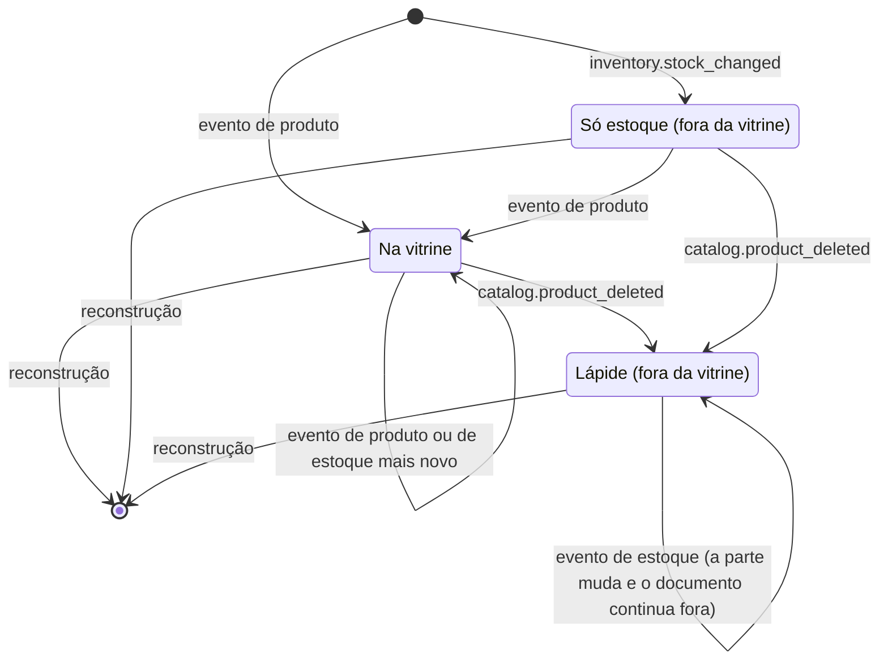
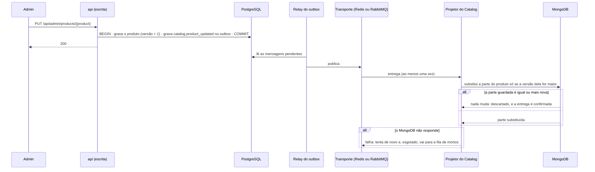
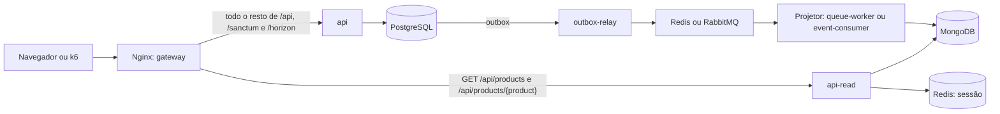

# Modelo de leitura da vitrine: MongoDB, projeção pelo outbox e API de leitura atrás do gateway

> Faça o plano a partir deste documento. Cada slice abaixo já traz a sua forma: copie, não derive de novo.
> Status: confirmed by diashelter, 2026-10-27

## Situation

- Project: em construção ativa. É um projeto de estudo (Loja Demo), sem produção e com um só autor; cada checkout e worktree tem os seus bancos de desenvolvimento e de testes.
- Decision: tomada por diashelter em 2026-10-23, na [HEL-17](https://linear.app/helter/issue/HEL-17/cqrs), como estudo do padrão, com o PostgreSQL na escrita e o MongoDB na leitura. Esta discovery fechou o alcance em 2026-10-27: a vitrine, uma API de leitura atrás de um gateway, a sincronização pelo outbox e eventos que carregam o estado.
- In flight: copia o outbox e os nomes estáveis de evento e de consumidor (HEL-9, HEL-13, HEL-16), as consultas da HEL-6, as leitoras de evento em `Core/InboundEvents` e o `503` do isolamento dos módulos. O isolamento ainda tem 6 slices pendentes; esta rodada entra antes da slice Catalog e Inventory, que deixa de construir a porta de estoque da vitrine.
- At stake: médio-baixo. Nenhum dado de cliente corre risco, e errar custa retrabalho. O que pesa é o formato dos eventos, um contrato publicado e versionado, e a vitrine fora do PostgreSQL, com banco, container e roteamento novos em dev, nos testes, no CI e na pilha de carga.

## Problem

Construção, com objetivo de estudo. A HEL-6 levou a vitrine para consultas que compõem os módulos pelos contratos, sempre exatas, e deixou o modelo de leitura projetado como alternativa até uma leitura ficar lenta ou um módulo ganhar banco próprio. Nenhuma das duas coisas é verdade: no `load` de 2026-10-20 a vitrine tem p95 de 24 ms, e a ruptura (cerca de 50 it/s no `breakpoint`) vem da fila do PHP-FPM, não do banco. A HEL-17 constrói o modelo de leitura pelo que ele ensina, e não por uma dor medida: um banco de leitura de outro tipo, a projeção assíncrona com o estado nos eventos, a consistência eventual, a reconstrução e uma API de leitura num processo próprio, atrás de um gateway. Sem ela, o projeto tem o CQRS do código (consultas separadas dos casos de uso), mas nenhum lado de leitura com armazenamento e processo próprios. O momento é agora, e não depois do isolamento, porque a slice Catalog e Inventory reescreveria a leitura de estoque da vitrine que esta rodada elimina.

## Success

- Worked if:
  - `GET /api/products` e `GET /api/products/{product}`, pelo Nginx, são servidos pelo `api-read`, que sobe e responde sem nenhuma credencial do PostgreSQL;
  - os testes de feature atuais da vitrine passam contra o modelo de leitura sem mudar nenhuma expectativa de corpo, e nenhuma leitura da vitrine resta no PostgreSQL;
  - cada escrita que muda a vitrine tem um teste que mostra o documento mudando, e entregas repetidas e fora de ordem de cada evento terminam na versão mais nova;
  - esvaziar o MongoDB e rodar a reconstrução devolve a mesma vitrine, com o mesmo corpo em todas as páginas;
  - o smoke de carga passa pelo gateway, e o `load` registra o `storefront_projection_lag`.
- Going wrong:
  - um evento leva só o campo alterado ou uma diferença de quantidade, e não a parte inteira;
  - a regra "pode ser comprado" aparece gravada no documento ou escrita numa expressão do MongoDB;
  - o `api-read` precisa do PostgreSQL para subir;
  - um produto volta a um estado anterior na vitrine depois do `contention` ou do `load`.
- Review: quando a slice Catalog e Inventory do isolamento começar. diashelter confere o que sobrou da porta de estoque da vitrine e a série nova da linha de base do k6.

## Boundary

In:
- a vitrine (`GET /api/products` e `GET /api/products/{product}`);
- os eventos de produto, categoria e estoque, e as colunas de versão;
- o modelo de leitura, o projetor e a reconstrução;
- o container `api-read` e o Nginx como gateway, na pilha de dev e na de carga;
- o MongoDB em dev, nos testes, no CI e na pilha de carga;
- a métrica `storefront_projection_lag` no k6;
- o README, a análise de domínio, o `AGENTS.md` e o README dos testes de carga.

Out:
- **As outras leituras** (`GET /api/categories`, o cadastro de produto e a lista de estoque do admin, os pedidos, o dashboard): a vitrine é o primeiro modelo de leitura, e as outras só repetiriam o padrão.
- **CDC**: as escritas chegam ao MongoDB pelo outbox (decisão de diashelter nesta discovery). O CDC das tabelas de domínio prenderia a projeção ao esquema de dois módulos, e o CDC só da tabela `outbox_messages`, que trocaria o relay de todos os eventos, cabe numa issue própria.
- **Uma aplicação de leitura separada e um gateway dedicado**: ver Shape.
- **A observabilidade** (HEL-8) e o deploy de produção.
- **O frontend**: o corpo da vitrine não muda.

Unchanged:
- As rotas, os códigos HTTP, o corpo, a paginação, os filtros e as ordenações (`name`, `price_asc` e `price_desc`), os 12 produtos por página do `shop.products_per_page` e a mensagem `Produto indisponível.`.
- O carrinho (`POST /api/cart/validate`) e o checkout (`POST /api/orders`), que continuam lendo o PostgreSQL, o checkout com lock, e as mensagens `Produto indisponível.` e `Estoque insuficiente. Disponível: N.`.
- O cadastro de produto e a lista de estoque do admin, que continuam no `ProductQuery`, no `StockListQuery` e no `StockLevels`.
- Os 5 eventos atuais (nomes, versões e payloads) e os seus consumidores, os dois transportes e a flag `event-transport`.
- Os nomes das tabelas e das migrations existentes; as tabelas só ganham a coluna `version`.

## Prior art

- **O driver oficial atende o Laravel 13.** O `mongodb/laravel-mongodb` 5.7.0 traz a compatibilidade com o Laravel 13.x, mas a página de compatibilidade da documentação ainda para no 11.x. O plano confere a versão na hora de instalar.
- **O Debezium Server publica no RabbitMQ (desde a 2.2) e no Redis Stream, e tem o roteador de outbox.** O sink do RabbitMQ não tirava a routing key da coluna do outbox (DBZ-8752). Não adotamos: a sincronização é pelo outbox.
- **A falha que todo mundo relata com o estado nos eventos** é uma entrega repetida ou atrasada sobrescrever um estado mais novo. As Key decisions 3 e 4 existem para impedir isso.

## Shape

A vitrine passa a ser lida de um modelo de leitura do Catalog no MongoDB: um documento por produto, com a parte do produto e a parte do estoque, cada uma com a sua versão, e as categorias numa coleção ao lado. As escritas do Catalog e do Inventory publicam pelo outbox eventos com o estado inteiro da parte que mudou, o projetor do Catalog aplica uma parte só quando ela é mais nova, e o `api-read` serve a vitrine a partir dele, atrás do Nginx como gateway. A porta é o formato dos eventos (estado inteiro mais a versão do registro) e a saída da vitrine do PostgreSQL: voltar a eventos só com id, ou a uma leitura de reserva no banco de escrita, é reescrever o projetor, os payloads publicados e o roteamento.

A alternativa mais pesada, uma aplicação de leitura separada (outro projeto, sem o código dos módulos) atrás de um gateway dedicado, só ganha se o lado de leitura precisar de deploy, versão e escala independentes, e nada disso vale num projeto de estudo com um autor e uma máquina.

## Key decisions

1. **A vitrine é lida só do modelo de leitura, pelo `api-read`, que não tem credencial do PostgreSQL, e não há leitura de reserva.** Com o MongoDB ou o `api-read` fora do ar, a resposta é `503 SERVICE_UNAVAILABLE` com a mensagem `Este recurso está indisponível no momento.`, como no isolamento dos módulos. A vitrine pode ficar alguns segundos atrás da escrita, e isso foi aceito: quem decide a venda é o checkout, no PostgreSQL e com lock. A leitura da vitrine no PostgreSQL deixa de existir, e com ela a única travessia da vitrine para o `StockLevels`.
2. **O modelo de leitura é do Catalog: o projetor do Catalog é o único que grava nele, e só o código do Catalog o lê.** O documento guarda o status e a quantidade como chegaram, e a disponibilidade, o rótulo do status e o `404` da página do produto são decididos na leitura, pelo `ProductAvailability`. O documento nunca guarda `is_available`: com as duas partes chegando por eventos diferentes, um valor gravado ficaria preso à parte que chegou por último, e a regra seria escrita uma segunda vez.
3. **Toda escrita que muda a vitrine grava o seu evento pelo outbox, na transação dela, com o estado inteiro da parte que muda e a versão do registro, nunca uma diferença nem só o campo alterado.** Foi decidido por diashelter nesta discovery, contra a recomendação de eventos só com id, porque o estudo é o worker que lê da fila os dados a gravar. Não copie os payloads dos eventos do pedido, que levam só o id. Um evento de estoque leva a quantidade resultante, nunca as unidades vendidas: uma entrega repetida baixaria o estoque duas vezes.
4. **Produtos, categorias e estoques ganham uma versão dada pela escrita, que só cresce, uma por registro, e o projetor aplica uma parte só quando a versão dela é maior que a guardada.** Uma entrega repetida, atrasada ou fora de ordem é descartada, e a projeção converge para o último estado gravado; essa é a chave natural de idempotência do projetor, uma escrita condicional como o `AGENTS.md` pede. Uma exclusão deixa uma lápide com a versão, para um evento atrasado nunca ressuscitar o registro. A convergência não pode depender de haver um processo só consumindo, que é o caso hoje.
5. **O payload de um evento passa a aceitar uma lista plana de escalares e datas com hora em ISO 8601.** A lista é a `category_ids` dos eventos de produto; as datas com hora são `created_at` e `updated_at`, no formato do corpo da vitrine. Objetos e listas aninhadas continuam recusados na gravação. O motivo da regra antiga, um formato publicado que não depende da classe PHP, continua de pé, e a frase do `AGENTS.md` e do README que diz "só escalares" muda junto.
6. **O Nginx, que já é a entrada única, é o gateway.** `GET /api/products` e `GET /api/products/{product}` vão para o `api-read`; todo o resto vai para o `api`, como hoje, nas pilhas de dev e de carga. O `api-read` é o mesmo código e a mesma imagem do `api`, num processo PHP-FPM próprio.

## Work

| Slice | Delivers | Status |
|---|---|---|
| [Eventos `catalog.*` e `inventory.stock_changed`](#eventos-catalog-e-inventorystock_changed) | Toda escrita que muda a vitrine publica a parte inteira com a versão do registro | clear |
| [ProductDocument](#productdocument) | As coleções do modelo de leitura e o projetor do Catalog que as mantém | open — 1 default taken |
| [Reconstrução](#reconstrução) | O modelo de leitura refeito a partir da escrita, no `make fresh`, na pilha de carga e quando o MongoDB é esvaziado | open — 1 default taken |
| [api-read](#api-read) | A vitrine servida pelo modelo de leitura, sem o PostgreSQL | clear |
| [Gateway](#gateway) | O Nginx mandando a vitrine ao `api-read` e o resto ao `api`, e o MongoDB no CI | clear |
| [storefront_projection_lag](#storefront_projection_lag) | O tempo entre uma escrita e a vitrine mostrá-la, medido pelo k6 | open — 1 default taken |

Order: Eventos → ProductDocument → Reconstrução → api-read → Gateway → storefront_projection_lag. Os eventos são gravados e testados pelo outbox antes de haver projetor; a reconstrução vem antes do `api-read` porque, sem ela, a vitrine de dev e a de testes ficariam vazias depois dos seeders.

Already handled by existing code:
- Checkout de um produto que a vitrine ainda mostra disponível → o checkout lê o PostgreSQL com lock e recusa com as mensagens atuais.
- O admin conferindo a própria edição → o cadastro do admin lê o PostgreSQL.
- Evento com uma versão que a classe não declara → o `DeliverEvent` recusa, como hoje.
- Id fora da forma canônica → `404` sem leitura, pelo padrão de rota do Catalog.

Derivable from the repository, left to the plan:
- As classes de evento, a leitora do `inventory.stock_changed` em `Core/InboundEvents` do Catalog e a prova de que ela lê o que o Inventory grava, na suíte de composição: como os eventos do pedido e o `OrderEventPayloadTest`.
- Os nomes dos consumidores do projetor, a inscrição no service provider do Catalog e as entradas do `ConsumerRedeliveryTest`: como os consumidores atuais.
- O MongoDB como serviço do Compose de dev, do de carga e do CI (`--wait`), as variáveis `MONGODB_*` nos dois `.env.example` e um banco de testes por checkout (`ecommerce_testing` e `ecommerce_testing_<worktree>`): como o PostgreSQL, o Redis e o RabbitMQ.
- O `503`: a `ServiceUnavailableException` do `Shared`.
- As migrations das colunas `version`, uma por módulo dono, com nomes que ordenam depois das tabelas: como o `AGENTS.md` pede.
- A documentação: o README, a análise de domínio (os termos "modelo de leitura", "projetor" e "reconstrução" na linguagem ubíqua do Catalog, a matriz entre contextos sem o `StockLevels` da vitrine), o `AGENTS.md` (Key decision 5) e o README dos testes de carga, como o `AGENTS.md` pede.

### Eventos `catalog.*` e `inventory.stock_changed`

**Delivers** um evento gravado pelo outbox, na transação da escrita, para cada escrita que muda a vitrine, com a parte inteira e a versão do registro. **Status: clear.** Key decisions 3, 4 e 5.

| Escrita | O que é gravado | Caller sees |
|---|---|---|
| O admin cria um produto (`POST /api/admin/products`) | `catalog.product_created`, e `inventory.stock_changed` da abertura do estoque, na mesma transação, os dois com a versão 1 | `201` (inalterado) |
| O admin edita um produto (`PUT /api/admin/products/{product}`) | `catalog.product_updated` com a nova versão | `200` (inalterado) |
| O admin muda o status (`PATCH /api/admin/products/{product}/status`) | `catalog.product_status_changed` com a nova versão | `200` (inalterado) |
| O admin exclui um produto (`DELETE /api/admin/products/{product}`) | `catalog.product_deleted` com a versão da exclusão | inalterado |
| O admin cria ou edita uma categoria | `catalog.category_created` ou `catalog.category_updated` | inalterado |
| O admin exclui uma categoria sem produtos | `catalog.category_deleted` | inalterado |
| O admin exclui uma categoria com produtos | Recusado como hoje, nenhum evento | inalterado |
| O admin ajusta o estoque (`PUT /api/admin/stocks/{stock}`) | `inventory.stock_changed` com a quantidade gravada | `200` (inalterado) |
| O ajuste deixaria o estoque negativo | Recusado como hoje, nenhum evento | `422` `O estoque não pode ficar negativo.` (inalterado) |
| O checkout cria o pedido (`POST /api/orders`) | Um `inventory.stock_changed` por produto do pedido, na transação do checkout, com a quantidade que restou | `201` (inalterado) |
| O checkout recusa (indisponível, estoque insuficiente, conflito) | Nenhum evento | inalterado |
| Qualquer escrita que volta atrás | Nenhum evento, porque o outbox está na transação | — |
| Duas escritas no mesmo registro | Versões estritamente crescentes, na ordem em que as transações gravam | — |

Os eventos, todos na versão 1:

| Evento | Payload |
|---|---|
| `catalog.product_created`, `catalog.product_updated`, `catalog.product_status_changed` | `product_id`, `name`, `price_cents`, `description` (nulo), `image_url` (nulo), `status`, `category_ids` (lista), `created_at`, `updated_at`, `version` |
| `catalog.product_deleted` | `product_id`, `version` |
| `catalog.category_created`, `catalog.category_updated` | `category_id`, `name`, `slug`, `version` |
| `catalog.category_deleted` | `category_id`, `version` |
| `inventory.stock_changed` | `stock_id`, `product_id`, `quantity`, `version` |

Tabelas `products`, `categories` e `stocks`: cada uma ganha uma coluna.

| Column | Type | Null | References | Note |
|---|---|---|---|---|
| `products.version` | bigint | no | | 1 na criação; cada escrita do produto soma 1, na transação dela. As linhas que já existem recebem 1 |
| `categories.version` | bigint | no | | o mesmo, para a categoria |
| `stocks.version` | bigint | no | | o mesmo, para a linha de estoque; o checkout e o ajuste somam 1 cada um |

Alternatives considered: um evento só, `catalog.product_saved`, para criar, editar e mudar o status. Ganha se nenhum consumidor jamais distinguir os três fatos; os três levam o mesmo payload, e manter três nomes custa pouco.

### ProductDocument

**Delivers** as coleções do modelo de leitura e o projetor do Catalog que as mantém a partir dos eventos. **Status: open — 1 default taken.** É a porta (Key decisions 2, 3 e 4).

| State | What should happen |
|---|---|
| Chega um evento de produto mais novo que a parte guardada | A parte do produto é substituída inteira, e o documento é criado se ainda não existe |
| Chega um evento de produto com versão igual ou menor (repetido, atrasado, fora de ordem) | Descartado; nada muda |
| Chega `inventory.stock_changed` antes do evento do produto | O documento nasce só com a parte do estoque e fica fora da vitrine até a parte do produto chegar |
| Chega um evento de estoque mais novo | A parte do estoque é substituída inteira; um mais velho ou igual é descartado |
| Chega `catalog.product_deleted` | O documento vira lápide com a versão da exclusão e sai da vitrine; um evento de produto atrasado é descartado, e um de estoque atualiza a parte do estoque sem tirar o documento da lápide |
| Chega um evento de categoria | O documento da categoria é substituído, descartado ou vira lápide pela mesma regra de versão; nenhum documento de produto é tocado |
| O mesmo envelope é entregue duas vezes pelo `EventDelivery` | Uma mudança só (`ConsumerRedeliveryTest`) |
| Duas entregas do mesmo produto rodam ao mesmo tempo | O documento termina na versão maior das duas |
| O MongoDB não responde durante a entrega | A entrega falha e é tentada de novo como a de qualquer consumidor (3 tentativas na fila do Laravel; devolução e fila `.dead` no RabbitMQ). Esgotadas as tentativas, a parte fica velha até um evento mais novo ou a reconstrução |

Coleção `catalog_products`, um documento por produto:

| Campo | Tipo | Null | Note |
|---|---|---|---|
| `_id` | string | no | o id do produto (UUID v7 em texto) |
| `product` | objeto | yes | nulo até o primeiro evento de produto: `name`, `price_cents`, `description`, `image_url`, `status`, `category_ids`, `created_at`, `updated_at`, `version` |
| `stock` | objeto | yes | nulo até o primeiro evento de estoque: `id`, `quantity`, `version` |
| `deleted_version` | inteiro | yes | a lápide: a versão de `catalog.product_deleted` |

Índices: `product.category_ids` (filtro da vitrine), `product.name` com `_id` e `product.price_cents` com `_id` (as três ordenações, com o id de desempate, como hoje).

Coleção `catalog_categories`, uma por categoria: `_id` (o id da categoria), `name`, `slug`, `version` e `deleted_version`, com índice em `slug`, que não é único porque uma lápide pode guardar o slug que uma categoria nova reusou.

O caminho de uma escrita até a vitrine:

O projetor roda onde os consumidores já rodam (`queue-worker` com o Redis, `event-consumer` com o RabbitMQ), e esses containers passam a falar com o MongoDB. Ao criar o documento, a escrita condicional que perde para uma versão mais nova pode responder como chave duplicada: isso é descartar, não falhar, senão a entrega acaba na fila de mortos.

Alternatives considered: gravar o nome e o slug das categorias dentro de cada documento de produto. Ganha se a vitrine precisar de uma leitura só por página; exige atualizar todos os produtos da categoria a cada renomeação e uma ordem entre os eventos de categoria e os de produto, que vão por filas diferentes.

Open, default taken:
1. As lápides só saem na reconstrução. Elas crescem uma por produto ou categoria excluídos, o que é desprezível numa loja de estudo.

### Reconstrução

**Delivers** o modelo de leitura refeito a partir da escrita a qualquer momento, e preenchido depois do `make fresh` e do seed da pilha de carga. **Status: open — 1 default taken.** Key decision 4.

| State | What should happen |
|---|---|
| `make fresh` | Depois dos seeders, o modelo de leitura é esvaziado e preenchido de novo; a vitrine mostra os produtos semeados segundos depois |
| O MongoDB é esvaziado à mão | A reconstrução devolve a mesma vitrine, com o mesmo corpo em todas as páginas |
| A reconstrução roda com o admin editando ou checkouts acontecendo | Nada volta atrás: o estado republicado leva a versão atual, e o mais novo vence, seja ele da reconstrução ou da escrita |
| O MongoDB tem documentos de registros que não existem mais no PostgreSQL (um banco anterior) | Somem, porque a reconstrução começa esvaziando |
| Durante a reconstrução | A vitrine responde `200` com o que já foi projetado; vale só para dev, testes e a pilha de carga |
| A pilha de carga sobe | O k6 só começa depois que a vitrine lista o conjunto de dados inteiro (slice storefront_projection_lag) |

A reconstrução nunca parte do histórico do outbox: as mensagens publicadas ficam só 7 dias, e os seeders gravam pelas factories, sem evento. O Catalog esvazia as duas coleções, cada dono republica pelo outbox o estado atual dos seus registros com a versão atual (o Catalog, as categorias e os produtos; o Inventory, os estoques), e o projetor é o único que grava no modelo de leitura. Quem junta os passos é o Makefile, nunca um módulo chamando o comando de outro.

Alternatives considered: o Catalog ler a escrita direto, as próprias tabelas e o estoque pelo `StockLevels` com a versão. Ganha se o outbox não aguentar uma rajada de uma mensagem por registro; cria um segundo caminho de gravação no modelo de leitura e uma leitura entre módulos que o isolamento teria de virar porta.

Open, default taken:
1. A republicação usa os mesmos nomes e as mesmas versões dos eventos (`catalog.category_updated`, `catalog.product_updated`, `inventory.stock_changed`). Para quem consome, ela é uma reentrega do último estado, que todo consumidor já precisa aceitar por ser entrega ao menos uma vez.

### api-read

**Delivers** `GET /api/products` e `GET /api/products/{product}` servidos pelo modelo de leitura, no container `api-read`, que fala só com o MongoDB e com o Redis (a sessão do Sanctum para o SPA). **Status: clear.** Key decisions 1 e 2.

| State | What should happen | Caller sees |
|---|---|---|
| A vitrine lista uma página, com filtro por slug de categoria e ordenação | Só os documentos com a parte do produto e sem lápide, filtrados, ordenados e paginados no MongoDB, com as categorias da página lidas de uma vez | `200` com o mesmo corpo e a mesma paginação (`meta.total`, `meta.last_page`) |
| Slug de categoria desconhecido | Página vazia, como hoje | `200` |
| Ordenação ou página inválidas | Recusado, como hoje | `422` |
| Página de um produto disponível (ativo e com unidades, pelo `ProductAvailability`) | Lido do documento | `200` |
| Página de um produto inativo, sem unidades ou sem a parte do estoque | Recusado | `404` `Produto indisponível.` |
| Id desconhecido, com lápide ou só com a parte do estoque | Recusado como desconhecido | `404` |
| Documento sem a parte do estoque | Sem estoque e indisponível, como o default 1 da HEL-6 | `stock: null`, `is_available: false`, `available_quantity: 0` |
| O produto cita uma categoria que ainda não chegou ou virou lápide | A categoria fica fora da lista do produto | `200` |
| Uma página com 1 produto e uma página cheia | O mesmo número de leituras no MongoDB | — |
| O MongoDB não responde | Key decision 1 | `503` `SERVICE_UNAVAILABLE` |

Nenhuma rota nova. A rota e o controller continuam no Catalog; o que muda é a consulta, que passa a ler o MongoDB.

### Gateway

**Delivers** o Nginx mandando a vitrine ao `api-read` e o resto ao `api`, nas pilhas de dev e de carga, e o MongoDB e o `api-read` no CI. **Status: clear.** Key decision 6.

| State | What should happen | Caller sees |
|---|---|---|
| `GET /api/products`, com ou sem query string, e `GET /api/products/{product}` | Vão para o `api-read` | as respostas da slice api-read |
| `/api/admin/products`, `/api/categories`, `POST /api/cart/validate`, todo o resto de `/api`, `/sanctum` e `/horizon` | Vão para o `api`, como hoje | inalterado |
| O `api-read` está fora do ar ou não responde | O gateway responde, sem chamar o `api` | `503` com o corpo padrão de erro (`SERVICE_UNAVAILABLE`) e um `X-Request-ID` |
| O endereço do cliente | Chega ao `api-read` como chega ao `api` hoje, sem confiar em `X-Forwarded-*` | — |

Alternatives considered: um gateway dedicado (Traefik, Kong, KrakenD). Ganha quando a borda precisar de autenticação, limite de requisição ou descoberta de serviços; hoje o limite mora no Laravel e há dois destinos fixos.

### storefront_projection_lag

**Delivers** a métrica do k6 do tempo entre uma escrita e a vitrine mostrá-la, e a pilha de carga com o MongoDB, o `api-read` e a reconstrução. **Status: open — 1 default taken.**

| State | What should happen |
|---|---|
| O fluxo da equipe grava um preço novo no produto da equipe | Lê `GET /api/products/{product}` pelo gateway a cada 250 ms até ver aquele preço ou um maior: é uma amostra da métrica |
| A vitrine não mostra o preço em 60 s | Conta como erro inesperado, como a `order_payable_wait` |
| `load`, `stress` e `soak` | A métrica é registrada, com o p95 no resumo e no `-checks.txt`, sem limite de aprovação na primeira série |
| A pilha de carga sobe | Seed, reconstrução e o k6 só depois de a vitrine listar o conjunto de dados inteiro; o check do `setup` sobre o total de produtos continua valendo |
| O smoke no CI | Passa pelo gateway |
| A linha de base | Abre uma série nova nas duas tabelas, porque a vitrine passa a ser servida pelo `api-read` |

Open, default taken:
1. O `LoadTestSeeder` ganha um produto só da equipe, ativo e com unidades, que nenhum fluxo de compra escolhe, como o `Produto Disputado`. O fluxo da equipe grava preços sempre maiores, então ver um preço igual ou maior que o seu prova que a sua escrita, ou uma posterior, chegou à vitrine com vários VUs da equipe ao mesmo tempo. O conjunto passa de 201 para 202 produtos.

## Sources

- [HEL-17](https://linear.app/helter/issue/HEL-17/cqrs): a decisão de estudar o CQRS com o PostgreSQL na escrita e o MongoDB na leitura, e as perguntas de CDC, worker e gateway.
- [Lado de leitura da HEL-6](cqrs-read-side.md): as consultas, o `ProductAvailability` e o modelo projetado deixado de fora, com as condições.
- [Módulos isolados](module-isolation.md): o `503`, as leitoras de evento em `InboundEvents`, as slices pendentes e o "processos separados" que esta rodada reabre.
- [Outbox transacional](transactional-outbox.md): o envelope, o payload só com escalares e a retenção de 7 dias.
- [Idempotência dos eventos](event-idempotency.md): a chave natural de cada consumidor e a prova de reentrega.
- [Testes de carga](../load-tests/README.md): a linha de base da vitrine, a ruptura no PHP-FPM e a `order_payable_wait`, modelo da métrica nova.
- [laravel-mongodb 5.7.0](https://newreleases.io/project/github/mongodb/laravel-mongodb/release/5.7.0) e a [página de compatibilidade](https://mongodb.com/docs/drivers/php/laravel-mongodb/v5.x/compatibility): o suporte ao Laravel 13.
- [Debezium Server](https://debezium.io/documentation/reference/operations/debezium-server.html), o [sink do RabbitMQ na 2.2](https://debezium.io/blog/2023/04/03/debezium-2-2-beta1-released/), o [roteador de outbox](https://debezium.io/documentation/reference/2.4/transformations/outbox-event-router.html) e a [DBZ-8752](https://issues.redhat.com/browse/DBZ-8752): a alternativa de CDC.
