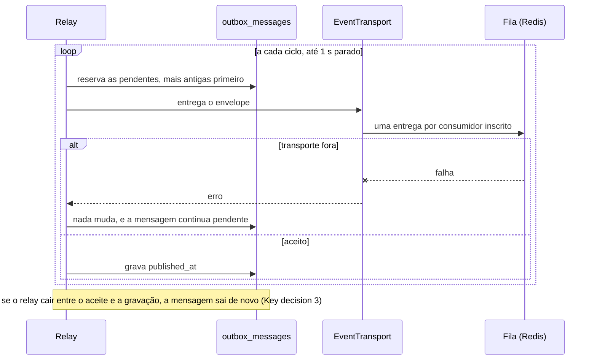
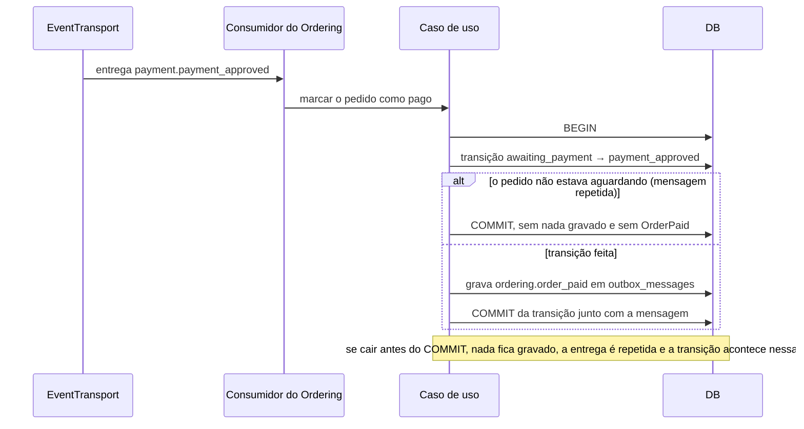

# Outbox transacional: eventos gravados na transação e consumidos pela camada

> Faça o plano a partir deste documento. Cada slice abaixo já traz a sua forma: copie, não derive de novo.
> Status: confirmed by diashelter, 2026-10-15

## Situation

- Project: em construção. É um projeto de estudo, sem produção e sem usuários. O banco é recriado por `make fresh`, então não há linhas a migrar.
- Decision: decidida por diashelter na [HEL-9](https://linear.app/helter/issue/HEL-9/implementar-o-padrao-outbox-para-poder-disparar-eventos) em 2026-10-08. Todo evento sai pelo outbox, dentro de uma transação, e uma camada própria publica e consome os eventos. Em 2026-10-15, esta discovery decidiu a ordem (a HEL-9 vem antes da HEL-13), a forma (a camada assume também o consumo), a latência e a retenção.
- In flight: segue a regra da HEL-7, pela qual os eventos carregam dados e nunca models, e a da HEL-11, pela qual os ids são UUID v7 em texto. Ficam de fora a HEL-13, que vai acrescentar o transporte com feature flag (Horizon e RabbitMQ) atrás da porta criada aqui, e a HEL-12, que vai mover pastas, namespaces e migrations por módulo.
- At stake: médio. A mudança toca 5 eventos, 5 listeners, 5 casos de uso e o ambiente Docker, mas nenhum dado existente. A porta que custa caro mudar é o envelope gravado e o contrato do transporte: a HEL-13 vai ser construída sobre os dois.

## Problem

Construção, com um defeito real no caminho. Hoje os 5 eventos usam `ShouldDispatchAfterCommit` e chegam aos listeners pela fila do Redis. Quando o envio para a fila falha depois do commit, o evento se perde e nada o recupera. Pela leitura do código, em 2026-10-15, isso trava o pedido em três pontos:

1. **`OrderPlaced` perdido.** O pedido fica em `placed` com o estoque já baixado, e o pagamento responde `409`, porque o pedido não está aguardando pagamento.
2. **`PaymentApproved` perdido.** O `PayOrderUseCase` dispara o evento fora de qualquer transação. A cobrança fica aprovada, o pedido continua em `awaiting_payment` e uma nova tentativa também responde `409`, porque já existe pagamento aprovado.
3. **`OrderPaid` perdido.** O `UPDATE` da transição já foi gravado quando o envio falha. O listener tenta de novo, mas a guarda de idempotência não deixa a transição acontecer outra vez, e o `OrderPaid` nunca mais é disparado. Aqui o retry torna a falha permanente.

Nada disso foi medido, porque o projeto não tem tráfego. Os três casos saem da leitura dos casos de uso.

A segunda parte do problema é a HEL-13. Ela quer um transporte trocável por flag, com consumidores fora dos jobs do Laravel. Para isso, precisa de um envelope que possa ser gravado e de um ponto único de publicação. Sem a HEL-9, a HEL-13 ligaria o transporte nos 5 pontos de disparo e mexeria neles de novo depois.

A saída mais barata seria o driver de fila `database`: o job seria gravado na mesma transação, o que já funciona como um outbox. Ela foi descartada porque prende os eventos aos jobs do Laravel, que é justamente o que a HEL-13 quer deixar.

## Success

- Worked if:
  - com o transporte falhando no momento da publicação (Redis parado), o pedido avança para o próximo status assim que o transporte volta, em cada uma das três janelas. Isso é provado por testes que derrubam o transporte e por uma execução manual que para o container `redis`;
  - nenhum evento sai de um caso de uso fora de uma transação. Gravar sem transação aberta falha, e um teste de arquitetura recusa evento disparado direto pelo dispatcher do Laravel;
  - em operação normal, o consumidor roda até 2 s depois do commit, e a tela de pagamento sai de `placed` em um ciclo de consulta;
  - os logs do consumidor mantêm o `request_id` da requisição que gravou o evento;
  - `make test` e o Pint passam.
- Going wrong:
  - um caso de uso volta a disparar o evento direto "porque é mais simples";
  - surge um consumidor sem guarda de idempotência;
  - linhas pendentes se acumulam em `outbox_messages` com o Redis no ar, o que indica o relay parado;
  - a tela de pagamento leva mais de um ciclo para sair de `placed`.
- Review: quando a HEL-13 começar. diashelter confere se o segundo transporte entra atrás do `EventTransport` sem mudar casos de uso, eventos ou consumidores. Se precisar mudar, a porta falhou.

## Boundary

In:
- A tabela `outbox_messages`, o envelope e a gravação na transação.
- Os 5 eventos com nome e versão, e os 5 casos de uso que os gravam: o checkout, o pagamento, a marcação de pago, o agendamento da entrega e a entrega.
- O relay num container próprio, a porta de transporte e uma implementação dela sobre a fila do Laravel no Redis.
- Os consumidores inscritos pelo módulo que consome, com uma entrega por consumidor e o `request_id` levado adiante.
- A retenção de 7 dias.
- O `docker-compose.yml`, o `Makefile`, a coerência do CI e a atualização do README, da análise de domínio e do `AGENTS.md`.

Out:
- Horizon, RabbitMQ e feature flags: ficam para a HEL-13.
- Pastas, namespaces e migrations por módulo: ficam para a HEL-12. Até lá, a migration do outbox fica junto das migrations atuais.
- Métricas e painéis de fila: ficam para a HEL-8.
- Tela de falhas no admin. A falha definitiva continua aparecendo no `make queue-failed` e pode ser reprocessada com o `make queue-retry`.
- Histórico e replay de eventos: a mensagem publicada não é registro de auditoria (Key decision 8).
- Inbox por consumidor e garantia de ordem: ver as Key decisions 3 e 6.

Unchanged:
- O job `DeliverOrder`. Ele é um comando interno do Fulfillment, não um evento, e continua um job do Laravel com delay, enfileirado pelo agendamento da entrega depois do commit.
- As guardas que tornam os consumidores idempotentes: a transição condicional de `orders.status` e a primeira gravação de `orders.estimated_delivery_on`.
- Os status do pedido, as rotas e os códigos HTTP: `201` no checkout, `202` na aprovação, `402` na recusa e `409` para pedido que não pode ser pago.
- A consulta da tela de pagamento e do detalhe do pedido a cada 2 s.
- O container `queue-worker` e os comandos `make queue-*`.
- Os nomes das classes de evento e as suas propriedades. Muda só como elas são publicadas.

## Prior art

- **O que se repete:** a mensagem é gravada numa tabela na mesma transação do dado, e um relay separado a publica, seja consultando a tabela (polling publisher), seja lendo o log de transações do banco (transaction log tailing). Adotamos o polling. Ler o log exige infraestrutura de CDC, e isso só se paga quando o volume torna a consulta cara, o que não é o caso aqui.
- **A falha relatada:** o relay publica de novo uma mensagem quando cai depois de publicar e antes de registrar a publicação. Por isso o consumidor precisa ser idempotente (Key decision 3).
- **A outra falha relatada:** quem escreve o código esquece de publicar o evento depois de mudar o dado. É ela que a recusa fora de transação e o teste de arquitetura impedem (Key decision 1).
- **O que dispensamos:** a fonte diz que o outbox entrega na ordem em que a aplicação gravou. Aqui a fila do Laravel, com mais de um worker, não preserva essa ordem, e nenhum consumidor depende dela (Key decision 6).

## Shape

Cada evento de domínio vira uma mensagem em `outbox_messages`, gravada na mesma transação da mudança de estado que ele anuncia, num envelope próprio (nome estável, versão e payload JSON) que não depende da classe PHP. Um relay, num container próprio, entrega as mensagens pendentes a uma porta de transporte e as marca como publicadas. Hoje a única implementação dessa porta enfileira um job do Laravel por par (mensagem, consumidor), e cada consumidor se inscreve pelo nome do evento, no módulo que consome. A porta é o envelope mais o contrato do transporte: depois que a HEL-13 publicar fora do Laravel, mudar o formato de um evento significa subir a versão e atender as duas versões enquanto houver mensagens antigas em trânsito.

A forma mais leve republicaria as mensagens no dispatcher do Laravel e deixaria os 5 listeners `ShouldQueue` como estão. Ela perdeu porque cada listener decide sozinho que roda na fila do Laravel, e a HEL-13, que já está no backlog, pede consumidores fora desses jobs. Com ela, a HEL-13 reescreveria os 5 listeners e montaria a camada de consumo nessa hora.

## Key decisions

1. **O evento é gravado na mesma transação da mudança de estado que ele anuncia, e gravar sem uma transação aberta é erro de programação.** Os eventos deixam de usar `Dispatchable` e `ShouldDispatchAfterCommit`, e um teste de arquitetura recusa o disparo direto. Não copie o padrão atual de "atualizar e depois disparar". No pagamento, a tentativa aprovada e o `PaymentApproved` entram juntos. Na marcação de pago, a transição e o `OrderPaid` entram juntos, e uma transição que não acontece não grava nada. Os casos de uso sem estado próprio (o agendamento da entrega e a entrega) abrem uma transação só para a mensagem.
2. **O envelope é um formato próprio, nunca a classe PHP nem um `serialize()`.** Ele tem o id da mensagem (UUID v7), o nome `<módulo>.<evento>` em snake_case, a versão (um inteiro a partir de 1), o payload em JSON, o instante em que o evento ocorreu e o `request_id`. O payload tem só escalares: ids em texto e datas em `Y-m-d`. Cada evento declara o próprio nome e a própria versão, porque o módulo produtor é dono da sua linguagem publicada. O motivo: a HEL-12 vai mudar os namespaces, e a HEL-13 vai ler mensagens fora dos jobs do Laravel.
3. **A entrega acontece ao menos uma vez, e o consumidor é idempotente. Não há inbox.** O relay pode entregar de novo quando cai entre o transporte aceitar e a mensagem ser marcada, e a entrega a um consumidor pode ser repetida. Os 5 consumidores de hoje já são idempotentes. O inbox (um registro das mensagens já processadas por consumidor) passa a valer a pena quando surgir um consumidor com um efeito que ele mesmo não consegue proteger, como um e-mail ou uma chamada externa.
4. **Cada par (mensagem, consumidor) é uma entrega separada, e o consumidor se inscreve pelo nome do evento, no módulo que consome.** O produtor nunca lista os seus consumidores. Um consumidor que falha é repetido sozinho, sem repetir os outros. O event discovery do Laravel sobre `Listeners` deixa de ser usado.
5. **O transporte é uma porta que recebe o envelope.** Casos de uso, eventos e consumidores não sabem qual é o transporte. Hoje existe uma implementação, sobre a fila do Laravel no Redis, e a entrega carrega o envelope inteiro, nunca só o id da mensagem. A HEL-13 acrescenta outra implementação atrás de uma flag.
6. **O relay é um processo próprio e entrega uma mensagem pendente ao transporte em até 1 s.** Se o transporte cair, as mensagens ficam pendentes e saem quando ele voltar, das mais antigas para as mais novas. A ordem é só a melhor possível, e nenhum consumidor depende dela: a sequência do pedido já está garantida pelo próprio fluxo, já que o `OrderPaid` só existe depois de o `PaymentApproved` ter sido tratado.
7. **O `request_id` da requisição que gravou o evento vai no envelope e volta ao `Context` do consumidor.** Um evento gravado por um consumidor leva o mesmo `request_id` adiante. Assim continua valendo a promessa do README de que o `request_id` aparece nos logs dos jobs enfileirados pela requisição.
8. **As mensagens publicadas ficam 7 dias e depois são apagadas. As pendentes nunca são apagadas.** A tabela não é histórico e não serve para replay.

## Work

| Slice | Delivers | Status |
|---|---|---|
| [outbox_messages](#outbox_messages) | A tabela, o envelope e a gravação recusada fora de transação | clear |
| [EventConsumer](#eventconsumer) | Inscrição pelo nome do evento, transporte sobre a fila do Laravel com uma entrega por consumidor e `request_id` restaurado | clear |
| [OutboxRelay](#outboxrelay) | O processo no container `outbox-relay`, a publicação em até 1 s, a retenção e o reinício | clear |
| [Order events](#order-events) | Os 5 eventos no envelope e os 5 casos de uso gravando na transação | clear |

Order: outbox_messages → EventConsumer → OutboxRelay → Order events.

Already handled by existing code:
- Uma mensagem repetida para os consumidores de hoje é tratada pela transição condicional de `orders.status` e pela primeira gravação de `orders.estimated_delivery_on`.
- Um consumidor que falha 3 vezes vai para `failed_jobs`, aparece no `make queue-failed` e pode ser reprocessado com o `make queue-retry`.
- O cliente esperando o pedido sair de `placed` é atendido pela consulta de 2 s da tela de pagamento.
- O deploy que muda o formato de um job continua seguindo o procedimento do README para esvaziar a fila, que agora vale para as entregas.

Derivable from the repository, left to the plan:
- Os logs em inglês e só com ids, como os casos de uso de hoje.
- Os testes em Pest, como os testes de feature que já existem.
- As regras de arquitetura com um namespace por expectativa, como o `ModuleBoundariesTest`.
- O serviço novo no Compose e os alvos do Makefile, como o `queue-worker` e o `logs-worker`.
- A atualização da documentação conforme o `AGENTS.md`: a seção "Eventos, listeners, jobs e filas" do README e a linha da análise de domínio que diz que "o envelope e o outbox ficam para a HEL-9".

### outbox_messages

**Delivers** a tabela das mensagens, o envelope e a gravação de um evento na transação aberta pelo caso de uso. **Status: clear.** É a porta (Key decision 2).

| State | What should happen | Caller sees |
|---|---|---|
| Caso de uso grava um evento dentro de uma transação | Uma mensagem pendente (sem `published_at`) é escrita e só existe se a transação fizer commit | Nada: o caso de uso segue |
| A transação é desfeita depois da gravação | A mensagem some junto com o resto, e nada é publicado | O erro do caso de uso, como hoje |
| Gravação sem transação aberta | É recusada e nada é escrito (Key decision 1) | Erro de programação (exceção) |
| Evento com um valor que não é escalar no payload | É recusado na gravação | Erro de programação (exceção) |
| Gravação durante uma requisição | O envelope leva o `request_id` do `Context` (Key decision 7) | Nada |
| Gravação fora de uma requisição (console, seeder) | O `request_id` fica vazio | Nada |

Table `outbox_messages`; no existing table changes.

| Column | Type | Null | References | Note |
|---|---|---|---|---|
| `id` | uuid | no | | Chave e id da mensagem, UUID v7 gerado pela aplicação, como os demais registros |
| `name` | string(100) | no | | Nome estável do evento, como `ordering.order_paid` |
| `version` | smallint | no | | Versão do payload, a partir de 1 |
| `payload` | jsonb | no | | Só os dados do evento, com escalares |
| `request_id` | string(128) | yes | | `request_id` do `Context` na gravação. Os 128 caracteres são o limite que o `AssignRequestId` aceita |
| `occurred_at` | timestamp | no | | Instante da gravação, dentro da transação |
| `published_at` | timestamp | yes | | Vazio enquanto a mensagem está pendente. O relay preenche depois que o transporte aceita |

Índices: um índice serve a busca das pendentes (as sem `published_at`, das mais antigas para as mais novas), e outro serve a limpeza das publicadas pelo `published_at`.

Nos testes, o `RefreshDatabase` mantém uma transação aberta em volta de cada teste. A recusa precisa ser provada contra o nível real de transação do teste, senão ela passa sem nunca recusar.

Alternatives considered: uma tabela de outbox por módulo, que vence se os módulos passarem a ter bancos separados. Hoje existe um banco só, e a HEL-12 só move a migration.

### EventConsumer

**Delivers** a inscrição de consumidores pelo nome do evento, a implementação do `EventTransport` sobre a fila do Laravel no Redis, com uma entrega por consumidor, a reconstrução do evento a partir do envelope e o `request_id` restaurado. **Status: clear.**

| State | What should happen | Caller sees |
|---|---|---|
| Mensagem publicada com dois consumidores inscritos | Uma entrega por consumidor, e cada uma roda sozinha (Key decision 4) | Nada |
| Mensagem sem nenhum consumidor inscrito | A publicação dá certo sem nenhuma entrega | Nada |
| O consumidor falha | Só essa entrega é repetida, até 3 tentativas como hoje, e depois vai para `failed_jobs` | `make queue-failed` lista a entrega com o nome do evento e o consumidor |
| A mesma mensagem é entregue duas vezes | O efeito do consumidor acontece uma vez, pela guarda do próprio consumidor (Key decision 3) | Nada |
| O envelope tem uma versão que o evento não conhece | A entrega falha sem tentar adivinhar e vai para `failed_jobs` | Entrega com falha, com o nome e a versão |
| `make queue-retry` depois dos 7 dias de retenção | A entrega roda, porque carrega o envelope inteiro (Key decision 5) | Nada |
| O consumidor grava outro evento | O envelope novo leva o mesmo `request_id` (Key decision 7) | Os logs da cadeia inteira têm o mesmo `request_id` |

Alternatives considered: descobrir os consumidores pelo tipo do parâmetro, como o event discovery faz hoje com os listeners. Essa opção vence se a lista de inscrições nos service providers virar ruído, com dezenas de consumidores. Com 5, a inscrição explícita no módulo que consome é mais fácil de ler.

### OutboxRelay

**Delivers** o processo contínuo que entrega as mensagens pendentes ao `EventTransport`, roda no container `outbox-relay` e apaga as publicadas depois de 7 dias. **Status: clear.**

| State | What should happen | Caller sees |
|---|---|---|
| Mensagem pendente com o transporte no ar | Vai para o transporte em até 1 s e é marcada como publicada (Key decision 6) | O consumidor roda, e a tela de pagamento sai de `placed` em um ciclo de consulta |
| Transporte fora (Redis parado) | A mensagem continua pendente e o relay segue tentando. Quando o transporte volta, as pendentes saem das mais antigas para as mais novas | O pedido espera no status em que está, e a tela continua consultando |
| O relay cai depois de o transporte aceitar e antes de marcar | A mensagem é entregue de novo quando o relay volta (Key decision 3) | Nada |
| Dois relays rodando | Cada mensagem é pega por um relay de cada vez | Nada |
| Container `outbox-relay` parado | As mensagens se acumulam pendentes, sem perda | Os pedidos esperam |
| Mensagem publicada há mais de 7 dias | É apagada (Key decision 8) | Nada |
| Mensagem pendente há mais de 7 dias | Fica guardada | Nada |
| O código do relay mudou | `make queue-restart` reinicia também o relay | Nada |

### Order events

**Delivers** os 5 eventos do pedido no envelope, cada um com nome e versão, e os 5 casos de uso gravando cada evento na transação da mudança que ele anuncia. **Status: clear.** Fecha as três janelas do Problem.

| Evento | `name` | `version` | `payload` |
|---|---|---|---|
| `OrderPlaced` | `ordering.order_placed` | 1 | `order_id` |
| `PaymentApproved` | `payment.payment_approved` | 1 | `order_id` |
| `OrderPaid` | `ordering.order_paid` | 1 | `order_id`, `delivery_business_days` |
| `DeliveryScheduled` | `fulfillment.delivery_scheduled` | 1 | `order_id`, `estimated_delivery_on` (o dia do calendário de `America/Sao_Paulo`, em `Y-m-d`) |
| `OrderDelivered` | `fulfillment.order_delivered` | 1 | `order_id` |

| State | What should happen | Caller sees |
|---|---|---|
| O checkout faz commit | `OrderPlaced` é gravado na transação do checkout | `201`, como hoje |
| O checkout falha (estoque insuficiente ou a terceira colisão de código) | Nenhuma mensagem | `409` ou `500`, como hoje |
| Transporte fora depois do commit do checkout | O pedido fica em `placed` até o transporte voltar e então vai para `awaiting_payment` (janela 1) | A tela de pagamento continua consultando |
| Pagamento aprovado | A tentativa aprovada e o `PaymentApproved` entram juntos | `202`, como hoje |
| Pagamento recusado | A tentativa é gravada, sem mensagem | `402`, como hoje |
| Aprovação concorrente que perde a corrida pela unicidade | A perdedora não deixa nem pagamento aprovado nem mensagem | `409`, como hoje |
| Transporte fora depois da aprovação | O pedido vai para `payment_approved` quando o transporte volta, e uma nova tentativa continua respondendo `409` (janela 2) | O detalhe do pedido continua consultando |
| `PaymentApproved` tratado | A transição para `payment_approved` e o `OrderPaid` entram juntos (janela 3) | Nada |
| `PaymentApproved` repetido | Nenhuma transição e nenhum `OrderPaid` a mais | Nada |
| `OrderPaid` tratado | `DeliveryScheduled` é gravado numa transação só com ele, e depois do commit o `DeliverOrder` entra na fila com o delay | Nada |
| `OrderPaid` repetido | A data é anunciada de novo, o Ordering mantém a primeira e um segundo `DeliverOrder` entra na fila | Nada |
| `DeliverOrder` roda ou é repetido | `OrderDelivered` é gravado numa transação só com ele, e uma repetição é ignorada pelo Ordering | Nada |

Alternatives considered: o Fulfillment consumir o próprio `DeliveryScheduled` para enfileirar o `DeliverOrder`. Isso vence se a entrega com delay precisar sobreviver à fila caindo depois do commit sem depender do retry. Hoje a entrega do `OrderPaid` já é repetida quando o enfileiramento falha.

## Sources

- [HEL-9](https://linear.app/helter/issue/HEL-9/implementar-o-padrao-outbox-para-poder-disparar-eventos): a decisão de levar todo evento pelo outbox, com uma camada para publicar e consumir.
- [HEL-13](https://linear.app/helter/issue/HEL-13/planejar-como-utilizar-o-feature-flags-para-implementar-utilizacao-de): o transporte com feature flag e consumidores fora dos jobs do Laravel, a condição que dá a vitória à forma escolhida.
- [HEL-12](https://linear.app/helter/issue/HEL-12/implementar-um-padrao-de-modularidade-melhor-ao-sistema): a mudança de namespaces e de migrations por módulo, motivo do nome estável no envelope.
- [.design/module-facades.md](module-facades.md) e [.design/uuid-record-ids.md](uuid-record-ids.md): os payloads com dados e o id em texto que este outbox grava.
- [README, Eventos, listeners, jobs e filas](../README.md#eventos-listeners-jobs-e-filas): o fluxo atual, a idempotência dos listeners e o procedimento para esvaziar a fila no deploy.
- [Transactional outbox, microservices.io](https://microservices.io/patterns/data/transactional-outbox.html): o polling publisher, a entrega repetida e o esquecimento de publicar como falhas relatadas.
