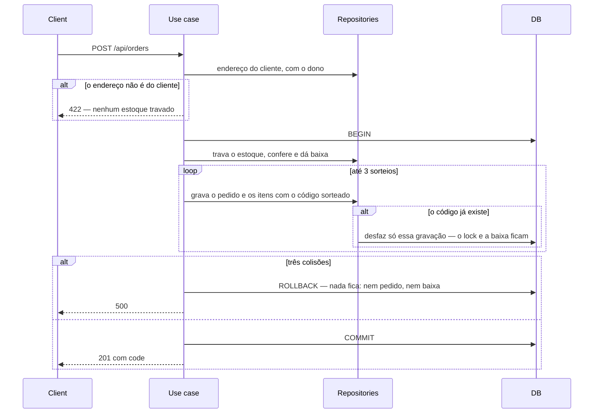
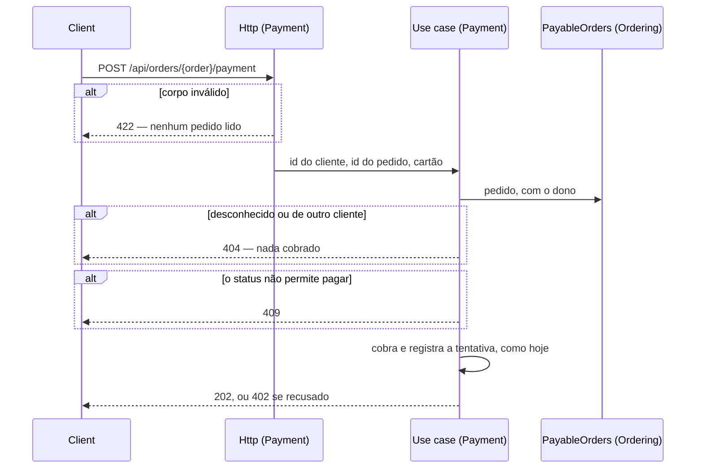

# Ids públicos: UUID v7 nos registros e nenhum binding nas rotas

> Faça o plano a partir deste documento. Cada slice abaixo já traz a sua forma: copie, não derive de novo.
> Status: confirmed by diashelter, 2026-10-15

## Situation

- Project: em construção. É um projeto de estudo, sem produção e sem usuários. O banco é recriado por `make fresh`, então não há linhas a migrar.
- Decision: decidida por diashelter na [HEL-11](https://linear.app/helter/issue/HEL-11/verificar-onde-o-model-baind-route-nao-faz-sentido-e-remover) em 2026-10-09. A HEL-11 troca o id inteiro por UUID v7, para não expor os números internos do banco, e remove o route model binding onde ele não faz sentido. Em 2026-10-15, esta discovery decidiu o critério (camadas e dono), a forma (o id vai até o use case) e o código do pedido.
- In flight: segue duas regras anteriores. A da HEL-7 diz que o registro de outro módulo chega pelo contrato do dono. A da HEL-10 calcula o vocabulário público, que acompanha a troca de tipo das assinaturas sem mudar o teste. A HEL-9 (outbox), a HEL-6 (leituras) e a HEL-12 (rotas e migrations por módulo) ficam de fora, mas vão ser construídas sobre o tipo do id definido aqui. Por isso esta vem antes delas.
- At stake: médio. A mudança toca as 9 tabelas de negócio, 40 arquivos com id inteiro nas assinaturas, os resources, as rotas e o frontend. Não envolve dados, e errar custa só retrabalho. A porta é o tipo do id nas assinaturas e nos payloads.

## Problem

Construção. A HEL-11 promete que ninguém veja um número interno do banco. Hoje o id inteiro aparece em três lugares:

- 14 resources o devolvem;
- 9 rotas do frontend o colocam na URL;
- 6 telas mostram `Pedido #42`.

O número revela quantos pedidos a loja já recebeu, e `/products/7` convida a tentar o 8. O tipo do id também está em 9 tabelas, em 9 métodos de 7 contratos, em 5 eventos e nas listas tipadas. A HEL-9 vai gravar esses payloads, a HEL-6 vai publicar contratos de leitura com eles e a HEL-12 vai mover as migrations. Trocar o tipo depois delas significaria refazer o que foi construído em cima.

O ticket também pergunta se tirar o route model binding reduz o número de queries. A contagem foi feita pela leitura do código, em 2026-10-15. Tirar o binding economiza uma query em só 5 rotas, todas de escrita, e nenhuma nas leituras:

- o ajuste de estoque, que lê o estoque duas vezes, a segunda com lock;
- os 4 deletes (produto, categoria, membro da equipe e endereço), que leem o registro antes de apagar.

Sozinha, essa economia não pagaria a mudança. Quem paga é outro problema:

- o binding implícito acessa dados fora de `Repositories/`;
- nas rotas do cliente, ele carrega o registro de qualquer cliente e responde `403`, o que confirma que o registro existe.

## Success

- Worked if:
  - nenhuma resposta da API e nenhuma URL do frontend carrega um id inteiro, e as 9 tabelas de negócio têm `uuid` como chave;
  - nenhuma tela mostra o id do pedido, só o código;
  - nenhuma rota resolve registro por binding, nem implícito nem por `Route::bind`, e o teste de arquitetura falha com uma violação de propósito;
  - as 5 rotas fazem uma query a menos e nenhuma rota faz uma a mais, medido pelo log de queries nos testes;
  - nas três rotas do cliente, o registro de outro cliente responde `404`, igual a um id desconhecido;
  - `make test` e o Pint passam.
- Going wrong:
  - um use case volta a receber um model "para economizar uma query";
  - uma policy volta a responder `403` ao lado da busca com o dono;
  - um id malformado vira `500` em algum lugar, como numa regra `exists` sem a validação do formato antes;
  - o código do pedido aparece num contrato, num evento ou numa URL.
- Review: quando a HEL-9 ou a HEL-6 começar. diashelter confere se os payloads e os contratos novos já nasceram com ids `string` e se nenhum binding voltou.

## Boundary

In:
- UUID v7 como chave das 9 tabelas de negócio e como tipo de toda chave estrangeira para elas.
- Ids `string` em contratos, eventos, listas tipadas, value objects, DTOs, use cases e resources, e a validação do formato na entrada HTTP.
- O código do pedido: a coluna, a geração, os resources e as telas.
- A remoção de todo binding de registro, implícito ou por `Route::bind`, e das três policies que só conferem o dono.
- Os tipos, as rotas, o carrinho salvo e as telas do frontend.
- A atualização do README, da análise de domínio e do `AGENTS.md`.

Out:
- O formato das rotas: o `PUT admin/stocks/{stock}` continua endereçado pelo estoque, e nenhuma rota muda de caminho.
- A busca de pedido pelo código no admin. O código já nasce único e indexado, mas a busca é outra entrega.
- O layout de pastas, rotas e migrations por módulo: fica para a HEL-12.
- As tabelas do framework (`jobs`, `failed_jobs`, `sessions`, `cache`). O `sessions.user_id` continua `bigint`, porque a sessão roda no Redis (no `array`, nos testes) e a tabela não é usada. Se o driver mudar para `database`, essa coluna precisa virar `uuid`.

Unchanged:
- Os caminhos das rotas, os nomes dos contratos e dos eventos e a forma dos métodos. Só mudam o tipo do id e o dono no `PayableOrders` (Key decision 5).
- As mensagens de negócio: 'Produto não encontrado.', 'Endereço de entrega não encontrado.', 'Produto indisponível.' e 'Recurso não encontrado.'.
- As check constraints, os índices e as regras de exclusão (`restrictOnDelete`, `cascadeOnDelete`) das tabelas.
- As regras do `ModuleBoundariesTest`. O vocabulário calculado acompanha os tipos novos sozinho.
- O admin: a equipe continua vendo qualquer registro. O dono só vale para as rotas do cliente.

## Prior art

- Chave UUID ordenada no tempo (v7) em vez de aleatória (v4): a RFC 9562 registra que a ordenada no tempo tem localidade no índice, enquanto a aleatória espalha as inserções. Adotamos, e o `HasUuids` do Laravel 13 já gera v7.
- A falha relatada: os 48 bits mais significativos do v7 são o instante de criação em milissegundos, então expor o id revela quando o registro nasceu. Aceitamos. Produto, endereço, cliente, equipe e pedido já mostram `created_at`, e só categoria, estoque e pagamento passam a revelar o instante. A HEL-11 quer esconder a contagem e a sequência, não o instante.
- A RFC diz que um UUID não deve ser usado como credencial (security capability): ser difícil de adivinhar não autoriza nada. É por isso que o dono continua sendo conferido (Key decision 5).

## Shape

Todo registro de negócio passa a ser identificado por um UUID v7 gerado pela aplicação, que é o único id no banco, nos contratos, nos eventos e na API. O pedido ganha, além dele, um código curto para pessoas lerem. A rota deixa de entregar registros: ela carrega ids, e quem os resolve é o use case ou o repositório, junto com o dono quando o registro é do cliente. A porta é o tipo do id nas assinaturas e nos payloads. Hoje ela é barata, porque o banco é recriado e nada foi construído em cima. Fica cara depois que a HEL-9 gravar payloads e a HEL-6 publicar contratos de leitura.

A forma mais leve era um `Route::bind` explícito por parâmetro, resolvido pelo repositório do dono. Controllers e use cases não mudariam, e o `404` continuaria vindo antes da validação do corpo. Mas nenhuma query seria economizada, e ficariam dois mecanismos. diashelter escolheu levar o id até o use case. A forma leve ganharia se o `404` antes da validação importasse mais que use cases falando só em ids, como os listeners já falam.

## Key decisions

1. **Toda tabela de negócio tem como chave primária um UUID v7 gerado pela aplicação, e toda chave estrangeira para ela é `uuid`. Nenhum id inteiro sobra em tabela de negócio, contrato, evento ou resposta.** São as 9 tabelas, com o tipo nativo `uuid` do PostgreSQL, não texto. As tabelas do framework não mudam. É a porta: barata agora, com o banco recriado por `make fresh`, e cara depois que a HEL-9 e a HEL-6 forem construídas em cima.
2. **O id atravessa toda fronteira como `string`, na forma canônica do UUID. Não existe value object de id.** As listas tipadas (`ProductIds`, `CategoryIds`, `CustomerIds`) recusam um id malformado na construção. Um value object por registro ganharia se surgissem assinaturas com dois ids de registros diferentes, em que trocar um pelo outro passaria despercebido. Hoje há uma só, a do `DeliveryAddressBook`.
3. **Um id malformado nunca chega ao banco: no caminho é `404`, igual a um id desconhecido, e no corpo é `422`.** No PostgreSQL, comparar uma coluna `uuid` com um texto que não é UUID é erro, e não "nenhuma linha". Isso vale para as buscas e para as regras `exists`, então sem essa barreira a resposta seria `500`. Hoje é o binding implícito, pelo `HasUuids`, que confere o formato na rota. Sem ele (Key decision 4), a conferência precisa existir por conta própria.
4. **Nenhuma rota resolve registro. A rota carrega ids, e quem os resolve é o use case (escrita) ou o repositório (leitura): o repositório do próprio módulo, ou o contrato do dono quando o registro é de outro módulo.** Não sobra binding implícito nem `Route::bind`, e o teste de arquitetura falha com um novo. A consequência foi aceita: o corpo é validado antes da existência. Corpo inválido é `422`, qualquer que seja o id, e corpo válido com id desconhecido é `404`. Isso desfaz o desvio que a análise de domínio registrou para o pagamento. Não copie os `Route::bind` do `PaymentServiceProvider` e do `CustomersServiceProvider`: eles saem.
5. **O registro do cliente é buscado junto com o dono. O pedido, o pagamento e o endereço de outro cliente são indistinguíveis de um id desconhecido.** A resposta é `404`, com o mesmo corpo, antes de qualquer conferência de status (nunca `409`). O dono fica na busca, como o `DeliveryAddressBook` já faz no checkout. Por isso a `OrderPolicy`, a `CustomerAddressPolicy` e a `OrderPaymentPolicy`, que só conferem o dono, deixam de existir. Não as mantenha como uma segunda checagem respondendo `403`. O `PayableOrders` passa a receber o dono junto com o pedido.
6. **Todo pedido tem um código de 8 símbolos do alfabeto `ABCDEFGHJKMNPQRSTUVWXYZ23456789`. O código é sorteado, independente do id, único e imutável, e é atribuído quando o pedido é colocado.** É o que as pessoas leem: toda tela que mostrava `#<id>` passa a mostrar `#<code>`. URLs, contratos e eventos continuam com o id, e nenhum contrato recebe o código como parâmetro. O alfabeto deixa de fora `0`, `O`, `1`, `I` e `L`, e dá cerca de 850 bilhões de combinações.
7. **Uma colisão de código nunca derruba a colocação do pedido.** O código é sorteado de novo, até 3 vezes, sem perder o lock nem a baixa de estoque já feitos. No PostgreSQL, uma violação de unicidade aborta a transação inteira. Por isso a gravação com o código fica isolada dela, como o registro do pagamento já faz. Na terceira colisão seguida, o pedido falha inteiro e nada fica gravado.

## Work

| Slice | Delivers | Status |
|---|---|---|
| [UUID v7 keys](#uuid-v7-keys) | As 9 tabelas com chave `uuid`, ids `string` em toda assinatura, o formato validado no corpo e o frontend tratando id como texto | clear |
| [orders.code](#orderscode) | Todo pedido com código de 8 símbolos, devolvido pela API e mostrado em toda tela no lugar do id | clear |
| [Guard staff e vitrine](#guard-staff-e-vitrine) | As rotas do admin e `GET /api/products/{product}` sem binding, com o id chegando ao use case ou ao repositório, e 4 escritas com uma query a menos | clear |
| [Guard customer](#guard-customer) | As três rotas do cliente buscando o registro com o dono, sem as três policies, e o teste de arquitetura recusando qualquer binding | clear |

Order: UUID v7 keys → orders.code → Guard staff e vitrine → Guard customer.

A primeira slice deixa a aplicação funcionando com o binding implícito ainda no lugar, porque o `HasUuids` resolve o UUID da rota e responde `404` para um malformado. Os dois `Route::bind` deixam de converter o id para inteiro e recusam o malformado com `404` até saírem. O teste de arquitetura entra com a última slice, quando nenhum binding sobra.

Already handled by existing code:
- Endereço de outro cliente no checkout: já é `422` 'Endereço de entrega não encontrado.', porque o `DeliveryAddressBook` busca com o dono.
- Produto existente mas indisponível na vitrine: já é `404` 'Produto indisponível.'.
- `404` na tela do pedido: cada página já mostra a mensagem da API no seu cartão de erro. O pedido de outro cliente passa a mostrar 'Recurso não encontrado.' em vez da página de acesso negado, sem mudança no frontend.

Derivable from the repository, left to the plan:
- Os models que gravam usam o `HasUuids`, o `Customer` do Ordering, que é só leitura, declara a chave como texto, e factories e seeders não passam id: tudo como o Laravel faz.
- Os testes trocam o `999999` por um UUID v7 que não existe. As rotas de escrita do `MoneyInCentsTest` passam a mandar um corpo válido para continuar provando o `404` (Key decision 4).
- O `404` de id desconhecido sai com o envelope `NOT_FOUND` e 'Recurso não encontrado.', como o `ApiExceptionRenderer` já faz.
- As ordenações continuam desempatando pelo `id`, que segue único, então nenhuma muda.
- A leitura vai do controller ao repositório, como as actions `index` já fazem. A escrita vai do controller ao use case.
- A chave nova do carrinho no navegador descarta a anterior, como a troca de `cart` para `cart-v2` já fez.
- Os payloads dos eventos mudam de tipo: `make fresh` e `make queue-restart` antes de rodar, como a HEL-7 pediu.
- A atualização do README, da análise de domínio e do `AGENTS.md`, como o próprio `AGENTS.md` pede. Na análise de domínio, o problema da HEL-11 é marcado com ✅ e o desvio do pagamento é desfeito. No `AGENTS.md`, a regra do `Route::bind` é reescrita pela Key decision 4, e a das policies pela 5.

### UUID v7 keys

**Delivers** as 9 tabelas de negócio com chave `uuid` gerada pela aplicação. Os ids passam a ser `string` em contratos, eventos, listas tipadas, value objects, DTOs e resources, o formato é validado no corpo, e o frontend trata id como texto. **Status: clear.** É a porta (Key decisions 1 a 3).

| State | What should happen | Caller sees |
|---|---|---|
| Um registro é criado em qualquer das 9 tabelas | A aplicação gera o UUID v7 antes de gravar | `id` como UUID em texto |
| Id malformado no corpo (`items.*.product_id`, `address_id`, `category_ids.*`) | Recusado antes de qualquer leitura (Key decision 3) | `422` no campo |
| Id bem formado mas desconhecido no corpo | Como hoje | validação do carrinho: `200` com 'Produto não encontrado.' no item; checkout: `409` 'Produto não encontrado.'; `address_id`: `422` 'Endereço de entrega não encontrado.'; `category_ids.*`: `422` |
| Id malformado no caminho, enquanto o binding ainda existe | O `HasUuids` recusa nas rotas com model, e os dois `Route::bind` recusam por conta própria | `404` 'Recurso não encontrado.' |
| Carrinho salvo no navegador com ids numéricos | Descartado ao carregar | carrinho vazio |
| URL do frontend com id que não é UUID | A rota não casa | página de não encontrado |

Contratos e eventos: todo parâmetro e toda propriedade de id passa de `int` a `string`. São os 7 contratos (`CustomerAccounts`, `CustomerOrderHistory`, `ProductOrderHistory`, `StockInitializer`, `StockReservation`, `DeliveryAddressBook`, `PayableOrders`) e os 5 eventos (`OrderPlaced`, `OrderPaid`, `PaymentApproved`, `DeliveryScheduled`, `OrderDelivered`). Nenhum método muda de nome.

Nenhuma tabela é criada. As tabelas que já existem mudam assim:

| Table | Column | Before → after | References |
|---|---|---|---|
| `users` | `id` | `bigint` → `uuid`, chave primária | — |
| `customers` | `id` | `bigint` → `uuid`, chave primária | — |
| `categories` | `id` | `bigint` → `uuid`, chave primária | — |
| `products` | `id` | `bigint` → `uuid`, chave primária | — |
| `stocks` | `id`, `product_id` | `bigint` → `uuid`; `product_id` continua único | `products.id` |
| `category_product` | `product_id`, `category_id` | `bigint` → `uuid`; continuam a chave composta | `products.id`, `categories.id` |
| `orders` | `id`, `customer_id` | `bigint` → `uuid` | `customers.id` |
| `order_items` | `id`, `order_id`, `product_id` | `bigint` → `uuid` | `orders.id`, `products.id` |
| `payments` | `id`, `order_id` | `bigint` → `uuid` | `orders.id` |
| `customer_addresses` | `id`, `customer_id` | `bigint` → `uuid` | `customers.id` |

Alternatives considered: ofuscar o inteiro (Sqids) em vez de trocar a chave. Ganharia se trocar a chave fosse caro, com dados em produção. Aqui o número continuaria sequencial por baixo, e cada fronteira teria de codificar e decodificar.

### orders.code

**Delivers** todo pedido com um código de 8 símbolos (Key decisions 6 e 7), devolvido pela API e mostrado em toda tela no lugar do id. **Status: clear.**

| State | What should happen | Caller sees |
|---|---|---|
| O pedido é colocado | O código é sorteado e gravado com o pedido, na mesma transação | `201` com `code` |
| O código sorteado já existe | Sorteia de novo, até 3 vezes, sem soltar o lock nem desfazer a baixa de estoque | `201` |
| Três colisões seguidas | O pedido falha inteiro, e nada fica gravado: nem pedido, nem itens, nem baixa | `500` |
| Uma tela mostra um pedido: lista e detalhe do cliente, painel da conta, pagamento, aviso de pedido criado, lista e detalhe do admin e detalhe do cliente no admin | Mostra o código | `#K7Q2M9XA` |
| O pedido é aberto pela URL | A URL continua com o id | `/account/orders/<uuid>` |

`POST /api/orders` `{ items, address_id }` → `201` `{ data: { id, code, … } }`

O `code` também aparece nos pedidos de `GET /api/orders`, `GET /api/orders/{order}`, `GET /api/admin/orders` e `GET /api/admin/orders/{order}`. Aparece ainda nos resumos de pedido (`OrderSummaries`) de `GET /api/account` (`last_order` e `recent_orders`) e de `GET /api/admin/customers/{customer}`.

Table `orders` ganha uma coluna:

| Column | Type | Null | References | Note |
|---|---|---|---|---|
| `code` | `char(8)` | no | — | Único, com uma check constraint do formato (8 símbolos do alfabeto da Key decision 6), como as outras do esquema. Só a colocação do pedido grava. |

Alternatives considered: um código curto derivado do UUID, sem coluna nova. Ganharia se ninguém precisasse buscar nem ditar um código único, mas ele não é único garantido. Uma sequência ganharia se revelar a contagem de pedidos fosse aceitável, e a HEL-11 existe para evitar isso.

### Guard staff e vitrine

**Delivers** `GET /api/products/{product}` e as rotas do admin com registro (`products`, `categories`, `stocks`, `customers`, `users` e `orders`) sem binding (Key decisions 3 e 4). Nas escritas, o id chega ao use case. Nas leituras, chega ao repositório. O `{customer}` passa a ser resolvido pelo `CustomerAccounts` dentro do use case. **Status: clear.**

| State | What should happen | Caller sees |
|---|---|---|
| Id desconhecido, sem corpo ou com corpo válido | Nada muda | `404` 'Recurso não encontrado.' |
| Id malformado no caminho | Nenhuma query | `404` 'Recurso não encontrado.' |
| Corpo inválido, com qualquer id | Validado antes da existência | `422` |
| Produto existente mas indisponível na vitrine | Como hoje | `404` 'Produto indisponível.' |
| `PUT /api/admin/stocks/{stock}` | O estoque é lido uma vez só, já com lock | `200`, com 3 queries (eram 4) |
| `DELETE` de produto ou categoria | A regra de bloqueio (produto já pedido, categoria com produtos) roda com o id, e o registro é apagado sem ser lido antes | `204`, ou `409` como hoje; uma query a menos |
| `DELETE /api/admin/users/{user}` da própria conta | Recusado antes de qualquer leitura | `409` 'Você não pode remover a própria conta.' |
| `DELETE /api/admin/users/{user}` de outro membro | Apagado sem ser lido antes | `204`; uma query a menos |
| Cliente desconhecido em `GET` ou `PUT /api/admin/customers/{customer}` | O `CustomerAccounts` não devolve nada | `404` |
| Demais leituras e updates | A mesma contagem de queries de hoje | `200` |

### Guard customer

**Delivers** `GET /api/orders/{order}`, `POST /api/orders/{order}/payment`, `PUT /api/account/addresses/{address}` e `DELETE /api/account/addresses/{address}` buscando o registro com o dono, sem a `OrderPolicy`, a `CustomerAddressPolicy` e a `OrderPaymentPolicy` (Key decisions 4 e 5). O teste de arquitetura passa a recusar qualquer binding de registro. **Status: clear.**

| State | What should happen | Caller sees |
|---|---|---|
| Registro do próprio cliente | Como hoje | `200`, `202` ou `204` |
| Registro de outro cliente | Nada é alterado, e a resposta é a de um id desconhecido | `404` 'Recurso não encontrado.' (hoje é `403`) |
| Pagamento de pedido de outro cliente que nem está aguardando pagamento | O dono é conferido antes do status | `404`, nunca `409` |
| Pagamento de pedido desconhecido, com corpo válido | Nada é cobrado | `404` |
| Pagamento com corpo inválido, de qualquer pedido | Validado antes da existência | `422` |
| `DELETE` do próprio endereço | Apagado com o dono, sem ser lido antes | `204`; uma query a menos |
| Uma rota nova com binding implícito ou `Route::bind` | O teste de arquitetura falha | — |

O `PayableOrders` passa a receber o dono junto com o pedido, como o `DeliveryAddressBook`.

## Sources

- [HEL-11](https://linear.app/helter/issue/HEL-11/verificar-onde-o-model-baind-route-nao-faz-sentido-e-remover): o compromisso com o UUID v7 e as duas perguntas do ticket.
- [Facades dos módulos](module-facades.md): a Key decision 6 da HEL-7, em que o registro de outro módulo chega pelo contrato do dono. Esta rodada leva essa busca para dentro do use case.
- [Vocabulário público dos módulos](module-vocabulary.md): o vocabulário calculado, que acompanha a troca de tipo, e a HEL-11 deixada para esta rodada.
- [Análise de domínio](../docs/domain-analysis.md): o desvio do pagamento (`{payableOrder}` resolvido antes da validação), que a Key decision 4 desfaz.
- [RFC 9562](https://www.rfc-editor.org/rfc/rfc9562.html): o layout do UUID v7 (o instante nos 48 bits mais significativos), a localidade no índice e o aviso de não usar UUID como credencial.
- HEL-9, HEL-6 e HEL-12 no Linear: o que vem depois e vai ser construído sobre o tipo do id.
