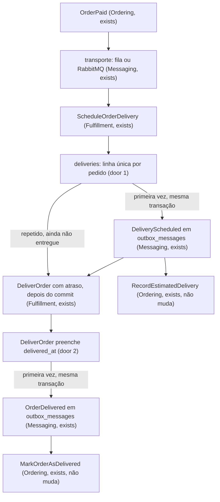
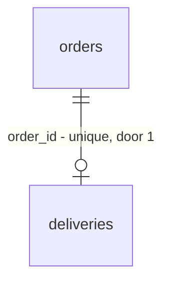

# Event Idempotency

## Problem

A entrega de eventos é ao menos uma vez por decisão do projeto (o relay pode publicar de novo, o `events:consume` devolve a mensagem com requeue, um `queue:retry` entrega dias depois), então todo consumidor precisa tolerar a mesma mensagem duas vezes. Dos seis pontos assíncronos, os quatro consumidores do Ordering toleram, por uma escrita condicional em `orders`. O consumidor do Fulfillment (`ScheduleOrderDelivery`) e o job `DeliverOrder` não: cada reentrega de `OrderPaid` grava outro `DeliveryScheduled` (com a data recalculada) e enfileira outro `DeliverOrder`, e cada retry de `DeliverOrder` grava outro `OrderDelivered`. O Ordering absorve as duplicatas, então `orders` fica certo, mas as linhas de `outbox_messages` e os jobs se multiplicam em cadeia, e uma falha ao enfileirar depois do commit faz o retry gravar o evento outra vez. O README promete que "os consumidores são idempotentes", o que é falso para o Fulfillment, e nenhum teste entrega o mesmo envelope duas vezes pelo `EventDelivery`: os atuais chamam `handle()` direto. Número do repositório em 2026-10-20: 2 de 6 pontos sem guarda, 0 testes de reentrega pelo caminho real. O projeto não tem produção, então não há métrica de dor.

Quando isto entregar, reentregar qualquer mensagem não muda o banco nem cria mensagem nova no outbox, e a promessa do README vale para os seis pontos e tem um teste cada. O [design](../../../.design/event-idempotency.md), confirmado por diashelter em 2026-10-20 (HEL-16), fixou como: o Fulfillment ganha uma linha por pedido que decide se já anunciou.

## Flow

Reaproveita o `EventDelivery` e o outbox transacional como estão, a escrita condicional do Ordering (que não muda) e o padrão do Payment de chave única por pedido para decidir "já fiz".

O padrão novo, copiado por todo produtor depois (door 3): o evento só é gravado quando a escrita guardada mudou uma linha, na mesma transação; o trabalho seguinte é enfileirado depois do commit e pode se repetir.

## Impact

| Front | What changes |
| --- | --- |
| domain | termo novo: `Delivery` - o registro do Fulfillment de que um pedido pago foi agendado e, depois, entregue; vive em `Modules\Fulfillment\Persistence`; não tem rota nem leitura de outro módulo |
| domain | termo vizinho que não muda: `delivery_*` em `orders`, `DeliveryAddress` e o bloco `delivery` da API são do Ordering e leem `orders`; quem ramifica neles não vê a tabela nova |
| domain | termo existente: o Fulfillment era um módulo sem estado e passa a ter a camada `Persistence`; quem ramifica nisso: `ModuleLayersTest`, `ModuleBoundariesTest` e `ModuleMigrationsTest`, que congela os 14 nomes de migration e passa a congelar 15 |
| domain | termo existente: a promessa "os consumidores são idempotentes" do README (linhas sobre inbox e sobre o retry do `DeliverOrder`), do `AGENTS.md` e de `docs/domain-analysis.md` passa a valer por uma regra escrita e um teste por consumidor |
| stored data | tabela nova `deliveries`; nenhuma tabela existente muda, e a migration nova roda em cada banco com `make migrate` |
| stored data | pedidos pagos antes da mudança, com um `DeliverOrder` já na fila e sem linha: o job não muda nada (assunção 1, revista na review do PR) |
| stored data | um pedido entregue antes da mudança não tem linha: um `OrderPaid` dele reentregue depois cria a linha, anuncia `DeliveryScheduled` e agenda o job uma vez, o mesmo efeito de hoje, que o Ordering absorve. Só afeta bancos de desenvolvimento |

## Relations

One-way constraints: `deliveries.order_id` unique e com exclusão restrita (door 1); o estado entregue é `delivered_at` preenchido (door 2). Nenhuma outra tabela muda.

## Surface

`None - nothing consumed outside` (nenhuma rota; os payloads e as versões de `DeliveryScheduled` e `OrderDelivered` não mudam)

## Landing

| One-way door | Literal shape | Alternative rejected |
| --- | --- | --- |
| a chave de "já agendei" | tabela `deliveries` com `UNIQUE (order_id)` e `FOREIGN KEY (order_id) REFERENCES orders(id) ON DELETE RESTRICT`, como `payments` faz | consultar `outbox_messages` pelo `DeliveryScheduled` do pedido: vaza o interior do Messaging e a mensagem some com 7 dias; perguntar ao Ordering se `estimated_delivery_on` já existe: leitura entre módulos com corrida, porque a data só chega ao pedido de forma assíncrona |
| o estado "entregue" | `deliveries.delivered_at` nulo até a entrega e preenchido uma só vez; `estimated_delivery_on` sem valor nulo, escrito só na criação | uma coluna `status` com enum: ganha quando uma transportadora real trouxer estados (em trânsito, falhou); hoje são dois estados e `delivered_at` já guarda quando |
| o padrão do produtor | evento gravado no outbox só se a escrita guardada mudou uma linha, ambos na mesma transação; o `DeliverOrder` enfileirado depois do commit e repetível, porque `delivered_at` o torna inofensivo | inbox genérico por (consumidor, id da mensagem): ganha se aparecer um consumidor sem chave natural, e hoje nenhum aparece; além disso não cobre o retry do job `DeliverOrder`, que não é entrega de evento |
| o nome da migration | `2026_10_20_000001_create_deliveries_table` em `app-modules/fulfillment/database/migrations`, que ordena depois de `create_orders_table` e não é renomeada nem editada depois de executada (a tabela `migrations` guarda o nome) | um nome com a data do dia da execução: o `ModuleMigrationsTest` congelaria um nome que muda de checkout para checkout |

- Nada mais nesta entrega é difícil de reverter

## Criteria

### S1: Delivery - o agendamento anuncia uma vez (P1)

Um `OrderPaid` repetido não grava linha nem mensagem nova, e a falha em qualquer ponto é reparada pela reentrega.

**Acceptance Criteria**

1. WHEN o primeiro `OrderPaid` de um pedido chega THEN the system SHALL gravar uma linha em `deliveries` com o `order_id`, a data prevista calculada dos `deliveryBusinessDays` do evento e `delivered_at` nulo, gravar um `DeliveryScheduled` com essa data em `outbox_messages` na mesma transação, e enfileirar um `DeliverOrder` com o atraso de `shop.delivery_delay_seconds` depois do commit
2. WHEN chega um `OrderPaid` de um pedido que já tem linha com `delivered_at` nulo THEN the system SHALL gravar zero linhas em `deliveries` e zero em `outbox_messages`, manter a data da primeira linha e enfileirar um `DeliverOrder`
3. WHEN chega um `OrderPaid` de um pedido cuja linha tem `delivered_at` preenchido THEN the system SHALL gravar zero linhas, zero mensagens e enfileirar zero jobs
4. IF gravar a linha ou o `DeliveryScheduled` falha THEN the system SHALL desfazer as duas escritas, enfileirar zero jobs e deixar a falha subir ao `DeliverEvent` para a nova tentativa
5. IF o enfileiramento do `DeliverOrder` falha depois do commit THEN the system SHALL manter a linha e o `DeliveryScheduled` já gravados, e a reentrega do `OrderPaid` SHALL enfileirar o job sem gravar linha nem mensagem
6. WHEN duas entregas do mesmo `OrderPaid` correm ao mesmo tempo THEN the system SHALL terminar com uma só linha em `deliveries` e um só `DeliveryScheduled` para o pedido
7. The system SHALL recusar, no banco, uma segunda linha de `deliveries` para o mesmo `order_id` e a exclusão de um pedido que tem linha

**Independent test:** entregar o mesmo envelope de `OrderPaid` duas vezes pelo `EventDelivery` e contar as linhas de `deliveries` e as mensagens `fulfillment.delivery_scheduled`.

### S2: DeliverOrder - a entrega anuncia uma vez (P1)

Um retry ou um job duplicado de `DeliverOrder` não grava outro `OrderDelivered`.

**Acceptance Criteria**

8. WHEN o `DeliverOrder` roda para um pedido com `delivered_at` nulo THEN the system SHALL preencher `delivered_at` e gravar um `OrderDelivered` em `outbox_messages` na mesma transação
9. WHEN o `DeliverOrder` roda de novo para um pedido com `delivered_at` preenchido THEN the system SHALL manter `delivered_at` e gravar zero mensagens
10. IF a transação do `DeliverOrder` falha depois de preencher `delivered_at` THEN the system SHALL desfazer as duas escritas, e o retry (`tries = 3`) SHALL entregar o pedido
11. WHEN o `DeliverOrder` roda para um pedido sem linha em `deliveries` THEN the system SHALL não gravar linha nem `OrderDelivered` (revisto na review do PR: antes criava a linha já entregue)
12. The system SHALL NOT alterar `orders.status` a partir do Fulfillment

**Independent test:** rodar o job duas vezes para o mesmo pedido e contar as mensagens `fulfillment.order_delivered`.

### S3: Redelivery - a promessa vale e tem prova (P1)

Cada consumidor tem um teste que entrega o mesmo envelope duas vezes pelo caminho real.

**Acceptance Criteria**

13. WHEN o mesmo envelope de `OrderPlaced` é entregue duas vezes a `MarkOrderAsAwaitingPayment` pelo `EventDelivery` THEN the system SHALL deixar o pedido em `awaiting_payment` com o `updated_at` da primeira entrega e a contagem de `outbox_messages` igual à anterior
14. WHEN o mesmo envelope de `PaymentApproved` é entregue duas vezes a `MarkOrderAsPaid` pelo `EventDelivery` THEN the system SHALL deixar o pedido em `payment_approved` e gravar um só `OrderPaid`
15. WHEN o mesmo envelope de `DeliveryScheduled` é entregue duas vezes a `RecordEstimatedDelivery` pelo `EventDelivery` THEN the system SHALL manter a primeira data em `orders.estimated_delivery_on` e o status inalterado
16. WHEN o mesmo envelope de `OrderDelivered` é entregue duas vezes a `MarkOrderAsDelivered` pelo `EventDelivery` THEN the system SHALL deixar o pedido em `delivered` com o `updated_at` da primeira entrega
17. WHEN o mesmo envelope de `OrderPaid` é entregue duas vezes a `ScheduleOrderDelivery` pelo `EventDelivery` THEN the system SHALL gravar um só `DeliveryScheduled` e uma só linha em `deliveries`
18. WHEN o ciclo completo do pedido recebe um `OrderPaid` reentregue no meio THEN the system SHALL terminar com uma mensagem de cada um de `payment.payment_approved`, `ordering.order_paid`, `fulfillment.delivery_scheduled` e `fulfillment.order_delivered`, e o pedido `delivered`
19. WHERE a flag `event-transport` é `rabbitmq`, WHEN o mesmo envelope chega duas vezes ao consumidor pelo `events:consume` (o que um requeue produz) THEN the system SHALL deixar o estado do banco e a contagem de `outbox_messages` iguais aos da primeira entrega
20. The README SHALL descrever a tabela `deliveries` e a guarda do Fulfillment, e SHALL NOT dizer que o retry do `DeliverOrder` "anuncia a entrega de novo e é ignorado"

**Independent test:** `make test-filter` nos testes de reentrega e leitura do trecho do README que descreve a idempotência.

## Out of scope

| Excluded | Why |
| --- | --- |
| inbox genérico (mensagens processadas por consumidor) | só pagaria com um consumidor sem chave natural, e hoje nenhum tem; volta como decisão se aparecer um |
| idempotência de rotas HTTP (clique duplo em `POST /api/orders`) | não é evento assíncrono |
| garantia de ordem entre mensagens | o README já a trata como melhor esforço e nenhum consumidor depende dela |
| mudar o relay, os transportes ou a flag `event-transport` | a entrega ao menos uma vez é a decisão fixa; o que muda é o consumidor |
| estados de uma transportadora real (em trânsito, falhou) | a entrega continua simulada; o enum de estado volta com a transportadora |
| expor `deliveries` por rota ou por contrato | nenhum outro módulo precisa dela hoje |

## Assumptions

| Assumption | Chosen default | Rationale | Confirmed? |
| --- | --- | --- | --- |
| `DeliverOrder` para um pedido sem linha | não grava linha nem `OrderDelivered` | só afeta bancos de desenvolvimento; a review do PR tirou a criação da linha já entregue, que gravava o dia UTC como data prevista | y |
| `DeliverOrder` duplicado enquanto o pedido não foi entregue | os jobs extras rodam e viram no-op pela guarda de `delivered_at` | é o preço de reparar um enfileiramento perdido sem uma coluna a mais; está na Key decision 2 do design | y |
| nome e posição da migration | `2026_10_20_000001_create_deliveries_table`, e o `ModuleMigrationsTest` ganha o nome na lista de donos e passa a congelar 15 | o teste congela nomes já executados; um nome novo exige estender a lista, não afrouxá-la | n |
| "hoje" e `delivered_at` | o relógio da aplicação (`now()`), no fuso da aplicação | é o que o restante do código usa | n |

**Open questions:** none - all resolved or logged above.

## Observable

`None - no user-facing surface`

## Sources

- [Design da idempotência dos eventos](../../../.design/event-idempotency.md) - confirmado por diashelter em 2026-10-20; fixa a tabela `deliveries`, o padrão do produtor e a regra de um teste de reentrega por consumidor.
- [HEL-16](https://linear.app/helter/issue/HEL-16/verificar-idepotencia-dos-eventos-assincronos) - o pedido: verificar se a execução repetida de um evento duplica informação ou deixa estado inconsistente.
