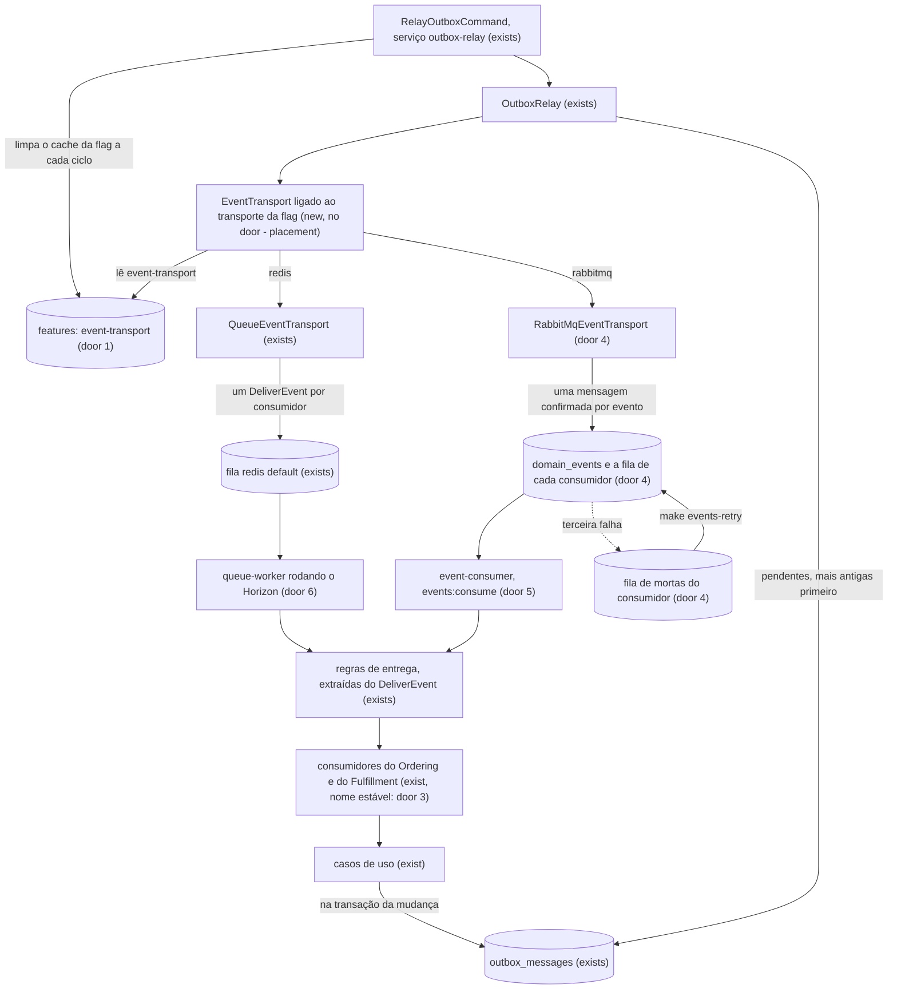

# Transporte de eventos por feature flag: Redis com Horizon e RabbitMQ

## Problem

Hoje todo evento sai do outbox por um único transporte, a fila do Laravel no Redis, e todo consumidor só existe como um job `DeliverEvent` rodado pelo `queue:work`. A porta `EventTransport` da HEL-9 nunca recebeu uma segunda implementação, então ninguém provou que ela aguenta trocar o transporte sem mexer em casos de uso, eventos ou consumidores, e o Review da HEL-9 dispara agora que a HEL-13 começou. Quem paga é o estudo do projeto: não há como comparar o Redis com o RabbitMQ no mesmo código, nem ver um consumidor rodar fora dos jobs do Laravel.

A fila não é gargalo. Na linha de base do k6 (2026-10-16, 50 VUs), o p95 de `order_payable_wait` é de 2.035 ms, que é a própria resolução da consulta de 2 s, e o `breakpoint` quebra no PHP-FPM, a 49,4 it/s. Com essa resolução, os dois transportes cairiam na mesma leitura.

Quando isso estiver pronto, um comando no terminal vira o transporte sem deploy, os dois lados entregam com as mesmas regras, uma entrega que falha 3 vezes no RabbitMQ fica guardada e pode ser devolvida, o Horizon mostra a fila do Laravel, e a linha de base do k6 tem um número de cada transporte, medido a cada 250 ms.

## Flow

Reaproveita o outbox inteiro (a tabela `outbox_messages`, o `OutboxRelay` com o lote, a espera e a retenção, o `QueueEventTransport`, as inscrições e as guardas de idempotência dos consumidores), o sinal `illuminate:queue:restart` que o relay já observa, o alias `admin` do Identity para fechar o painel e o padrão de banco por checkout do `make test`. As regras de entrega saem de dentro do `DeliverEvent` para uma classe que ele e o `event-consumer` usam; nada delas é escrito duas vezes.

1. Um caso de uso grava o evento em `outbox_messages` (exists), como hoje.
2. O `RelayOutboxCommand` (exists) limpa o cache em memória da flag `event-transport` (door 1) no começo de cada ciclo e roda o `OutboxRelay` (exists), que reserva as pendentes e entrega cada envelope ao `EventTransport` do container.
3. O `EventTransport` do container passa a ser um seletor (new, no door - placement) que lê a flag e entrega ao `QueueEventTransport` (exists) ou ao `RabbitMqEventTransport` (door 4). Quando o valor muda em relação ao ciclo anterior, registra uma linha no log.
4. Pelo Redis: um `DeliverEvent` por consumidor vai para a fila `default`, e o container `queue-worker`, agora rodando o Horizon (door 6), o executa.
5. Pelo RabbitMQ: o transporte garante a topologia (door 4) na primeira publicação da conexão, publica uma mensagem por evento na `domain_events` e só retorna depois da confirmação do broker. O broker copia a mensagem para a fila de cada consumidor, pelo nome estável dele (door 3).
6. O processo `events:consume` (door 5), no container `event-consumer`, lê as filas dos consumidores, uma entrega por vez. Ele confirma a mensagem depois de o consumidor terminar e a devolve, contando a tentativa, quando o consumidor falha. Na terceira falha, o broker a move para `<consumidor>.dead`.
7. Os dois lados chamam as mesmas regras de entrega (exists, extraídas do `DeliverEvent`): conferem a versão, reconstroem o evento, devolvem o `request_id` ao `Context` e chamam o `handle()` do consumidor (exists), que delega ao caso de uso.
8. out: os pedidos avançam como hoje. O `make events-failed` lista as filas de mortas, o `make events-retry` devolve cada entrega só à fila do consumidor dela, e o `/horizon` mostra a fila do Laravel para a equipe `admin`.

## Impact

| Front | What changes |
| --- | --- |
| domain | termo novo "transporte da flag" (`event-transport`, valores `redis` e `rabbitmq`), no `Shared`. Quem decide com base no transporte hoje: só o `OutboxRelay`, pela ligação do `EventTransport` no `AppServiceProvider`, e os testes que trocam essa ligação (`OrderEventsOutboxTest`, `OutboxRelayTest` e o helper de `tests/Pest.php`), que continuam valendo porque o seletor é o que fica ligado ao `EventTransport` |
| domain | termo novo "nome do consumidor" (`ordering.mark_order_as_paid`), dado na inscrição. A assinatura de `EventSubscriptions::subscribe()` ganha o nome como terceiro argumento obrigatório. Quem chama hoje: o `OrderingServiceProvider` (4 inscrições), o `FulfillmentServiceProvider` (1) e o `EventDeliveryTest` (12 chamadas), que passam a dar o nome |
| domain | termo existente "entrega": era só o job `DeliverEvent`; passa a ser também a mensagem que o `event-consumer` recebe do RabbitMQ, com as mesmas regras. O comportamento do `DeliverEvent` não muda, e o `EventDeliveryTest` continua valendo sem mudança de expectativa |
| domain | termo existente "worker": o container `queue-worker` deixa de rodar `queue:work` e passa a rodar o Horizon, com os mesmos parâmetros. O nome do container, o `make logs-worker` e o `make queue` (um `queue:work` em primeiro plano) não mudam |
| stored data | nothing to migrate: a tabela `features` do Pennant é nova, e o projeto recria o banco com `make fresh`. O RabbitMQ ganha um volume novo, vazio |
| environment | imagem PHP com a extensão `sockets`. No Compose de dev, entram os serviços `rabbitmq`, `event-consumer` e `scheduler`, e o `queue-worker` muda de comando. O Nginx passa a mandar `/horizon` ao PHP. Variáveis `RABBITMQ_*` nos dois `.env.example`. No Makefile, entram `event-transport`, `events-failed`, `events-retry` e `logs-consumer`; o `queue-restart` passa a terminar o Horizon; o `test-prepare` cria o vhost de testes; e o `test-db-drop` o apaga. O CI sobe o `rabbitmq` antes do `make test` |
| load stack | o Compose de carga ganha `rabbitmq`, sem porta no host, e `event-consumer`, e o `queue-worker` dele roda o Horizon. O `make load-test` aceita `TRANSPORT`, e a espera até pagar passa a consultar a cada 0,25 s. Mudam as provas da HEL-14 que fixam o que mudou: `stack.sh connection` (a lista de serviços), `stack.sh cache-env` (entra o `event-consumer`) e `payable.test.js` (os tempos de espera, em passos de 0,25 s). Não mudam `docs.sh baseline-rows` nem `profiles.test.js thresholds-from-baseline`: a tabela da HEL-14 e os limites que saem dela ficam como estão (door 8) |
| docs | README: a seção "Eventos, outbox, consumidores e filas" (o transporte da flag, o RabbitMQ, o `event-consumer`, as filas de mortas, o Horizon), a tabela "Filas", os containers, a estrutura de pastas e a nota de deploy que muda formato, que passa a valer para as filas do RabbitMQ (e para apagar o volume quando um argumento de fila muda). Análise de domínio: a linha do `Shared`, um problema novo com ✅, o plano e a "Última atualização". `AGENTS.md`: a regra do nome estável do consumidor, a da flag, o `make test` precisando do `rabbitmq` e o `queue-restart`. `load-tests/README.md`: a espera a cada 250 ms, o `TRANSPORT` e a segunda tabela. O design em `.design/event-transport-flag.md` registra as duas mudanças da door 8 |

## Relations

`None - no stored-data shape change` na modelagem do domínio: a tabela `features` é do Pennant, criada pela migration dele sem mudança no formato, e não se relaciona com nenhuma tabela de negócio. A flag é uma linha dela, de escopo global.

One-way constraints: a flag só aceita os valores `redis` e `rabbitmq`, e a ausência de linha vale `redis` (door 1).

## Surface

Only routes this adds or whose signature changes.

| Route | In | Out | Status |
| --- | --- | --- | --- |
| `GET /horizon` e tudo sob `/horizon/` (o painel e a API JSON dele) | a sessão `staff` | a página e o JSON do Horizon | `200`, `403` |

## Landing

| One-way door | Literal shape | Alternative rejected |
| --- | --- | --- |
| 1. a flag `event-transport` | `laravel/pennant` com o driver `database` e a tabela `features`. `Feature::define('event-transport', fn () => 'redis')`. Lida por `Feature::globally()->value('event-transport')` e gravada por `Feature::globally()->activate('event-transport', $value)`, com `$value` em `['redis', 'rabbitmq']`. O processo `outbox:relay` chama `Feature::flushCache()` no começo de cada ciclo. O comando é `php artisan events:transport {value?} {--by=}`, e o alvo é `make event-transport [TO=redis\|rabbitmq]`, que passa `--by=$(USER)` | Uma chave no cache do Redis: com o Redis fora, ninguém leria nem viraria a flag (design, Key decision 1). Uma variável de ambiente: exige reiniciar o relay, e a decisão foi virar sem deploy. Uma tabela própria de uma linha: a HEL-13 é sobre usar feature flags, e os escopos do Pennant servem às próximas |
| 2. as dependências novas | `composer require laravel/pennant:^1.26 laravel/horizon:^5.50 php-amqplib/php-amqplib:^3.7`; `docker-php-ext-install sockets` no `docker/php/Dockerfile`; a imagem `rabbitmq:4.3.5-management-alpine` nos dois Compose | A extensão `amqp` do PECL: compila uma biblioteca C a mais na imagem Alpine, e o php-amqplib atende a carga. O driver `laravel-queue-rabbitmq`: os consumidores continuariam jobs, o contrário da HEL-13. RabbitMQ anterior ao 4.3: o limite de entregas contaria o `basic.nack`, e a regra das 3 tentativas mudaria de forma. A tag 4.3.6, publicada em 2026-10-16: nova demais para fixar |
| 3. o nome estável do consumidor | `$subscriptions->subscribe(PaymentApproved::class, MarkOrderAsPaid::class, 'ordering.mark_order_as_paid')`. O nome segue `^[a-z]+\.[a-z_]+$`; um nome pertence a uma só classe, e uma classe tem um só nome. Os 5 nomes: `ordering.mark_order_as_awaiting_payment`, `ordering.mark_order_as_paid`, `ordering.record_estimated_delivery`, `ordering.mark_order_as_delivered` e `fulfillment.schedule_order_delivery` | Derivar o nome da classe: a HEL-12 vai mudar os namespaces, e a fila ficaria órfã com mensagens dentro. Uma constante em cada consumidor: muda os 5 consumidores, e o Review da HEL-9 pede que nenhum mude |
| 4. a topologia e a mensagem no RabbitMQ | Exchange `domain_events` (`topic`, durável) e `domain_events.dead` (`direct`, durável). Para cada consumidor, a fila `<nome>` com `x-queue-type=quorum`, `x-delivery-limit=2`, `x-dead-letter-exchange=domain_events.dead`, `x-dead-letter-routing-key=<nome>`, `x-dead-letter-strategy=at-least-once` e `x-overflow=reject-publish`, ligada à `domain_events` por cada nome de evento que ele assina; e a fila `<nome>.dead` (`x-queue-type=quorum`), ligada à `domain_events.dead` por `<nome>`. A mensagem é persistente (`delivery_mode` 2), com `content_type` `application/json`, `message_id` igual ao `id`, `type` igual ao `name` e o corpo `{"id","name","version","payload","occurred_at","request_id"}`, com o `occurred_at` em `Y-m-d\TH:i:s.u\Z`, em UTC. A publicação usa a confirmação do publicador, com espera de até 5 s. O transporte declara tudo na primeira publicação de cada conexão, e o `events:consume`, ao subir | Políticas no lugar dos argumentos: ficam fora da aplicação e precisariam ser criadas em cada vhost (dev, carga e cada vhost de testes). Filas clássicas: sem limite de entregas, e a documentação recomenda quorum para filas duráveis. Uma entrega por consumidor na publicação, como no Redis: o produtor listaria os consumidores (design, Key decision 3). Os argumentos de uma fila não mudam depois de declarada: mudar o limite ou a fila de mortas exige apagar o volume do `rabbitmq` |
| 5. o processo consumidor | `php artisan events:consume`, no serviço `event-consumer` (`<<: *php`, `restart: unless-stopped`), com um canal, `basic_qos` de prefetch 1 e um `basic_consume` por fila de consumidor. Confirma com `basic_ack` depois de o `handle()` retornar e devolve com `basic_reject` e `requeue=true` quando ele lança; nunca usa `basic_nack`. Sem broker, tenta conectar de novo a cada 5 s. Termina com `0`, depois da entrega em andamento, quando a chave `illuminate:queue:restart` muda | `basic_nack` com requeue: desde o 4.3, não conta para o limite de entregas, e a mensagem ficaria em loop. Um processo por consumidor: é a forma pesada do design. Encerrar o processo sem broker e deixar o Compose subi-lo de novo: o log viraria uma sequência de stack traces de boot |
| 6. o Horizon no worker | `queue-worker` com `command: ["php", "artisan", "horizon"]`, nos dois Compose. Em `config/horizon.php`, para `local` e `production`, um supervisor na conexão `redis`, fila `default`, com `balance` `false`, `minProcesses` 1, `maxProcesses` 1, `tries` 3, `timeout` 60 e `sleep` 1. O painel tem `'middleware' => ['web', 'admin']` e `Horizon::auth(fn () => true)`, porque o portão é o alias `admin`. No Nginx, `location ^~ /horizon` vai para o PHP. O `make queue-restart` roda `queue:restart` e `horizon:terminate`. O serviço `scheduler` roda `php artisan schedule:work`, com `Schedule::command('horizon:snapshot')->everyFiveMinutes()` | O portão padrão do Horizon: abre o painel a qualquer um no `local` e, fora dele, usa o guard padrão, que não é o `staff`, e recusaria até o `admin`. Renomear o container para `horizon`: quebra o `make logs-worker` e as provas da pilha de carga, sem ganho |
| 7. um vhost de testes por checkout | O `test-prepare` cria o vhost `$(TEST_DB_DATABASE)` (`rabbitmqctl add_vhost` e `set_permissions`) se ele não existe e passa `RABBITMQ_VHOST=$(TEST_DB_DATABASE)` ao container dos testes. O `test-db-drop` o apaga com `rabbitmqctl delete_vhost` | Um vhost só para todos os checkouts: duas suítes em worktrees diferentes veriam as filas uma da outra. Um broker simulado: não prova as 3 tentativas, a fila de mortas nem a confirmação |
| 8. a medição por transporte no k6 | `POLL_SECONDS = 0.25` em `load-tests/lib/payable.js` (o `GIVE_UP_SECONDS` continua 60). Uma segunda tabela em `load-tests/README.md`, depois da tabela da HEL-14, com o cabeçalho `\| Data \| Commit \| Máquina \| Transporte \| Perfil \| VUs ou taxa \| req/s \| p95 vitrine (ms) \| p95 POST /api/orders (ms) \| p95 order_payable_wait (ms) \| Erro inesperado \| Mudou desde a série anterior \|`. O `make load-test TYPE=<perfil> TRANSPORT=<redis\|rabbitmq>` usa `redis` quando o `TRANSPORT` falta | Uma coluna nova na tabela da HEL-14, como o design dizia: quebra as provas `docs.sh baseline-rows` e `profiles.test.js`, que fixam aquela tabela em 12 colunas e a ancoram ao merge da HEL-14. Recalcular os limites a partir da linha nova: obrigaria a mudar a prova `thresholds-from-baseline` da HEL-14, e os limites de hoje (2.450 ms na espera) continuam valendo como teto |

- Nothing else in this change is hard to reverse: o seletor do transporte, a classe das regras de entrega, a pasta de cada classe nova no `Shared`, os nomes dos comandos `events:failed` e `events:retry`, o texto dos logs e da saída dos comandos ficam para o diff.
- As doors 1, 3, 4 e 5 valem além desta feature. O projeto registra decisões no `AGENTS.md` e na análise de domínio, então é lá que elas entram (Impact, linha docs), como na HEL-9.

## Criteria

### S1: make test com RabbitMQ (P1)

A suíte prova o RabbitMQ contra um broker de verdade, e duas suítes em checkouts diferentes não se enxergam.

**Acceptance Criteria**

1. The dev Compose SHALL have a service `rabbitmq` with the image `rabbitmq:4.3.5-management-alpine`, a healthcheck, a named volume, and the management UI published on host port `${RABBITMQ_MANAGEMENT_PORT:-15672}`
2. The image built from `docker/php/Dockerfile` SHALL load the `sockets` extension
3. WHEN `make test` runs in the main checkout THEN the system SHALL create the RabbitMQ vhost `ecommerce_testing` if it does not exist and run the suite with `RABBITMQ_VHOST=ecommerce_testing`
4. WHEN `make test` runs in a git worktree THEN the system SHALL use a vhost named exactly like that checkout's test database (`ecommerce_testing_<worktree>`)
5. WHEN `make test-db-drop` runs THEN the system SHALL delete the checkout's vhost as well as its database
6. WHEN a test that uses the broker starts THEN the checkout's vhost SHALL hold no queue and no exchange other than the broker's defaults
7. IF the `rabbitmq` service is unreachable THEN every test that uses the broker SHALL fail with a message containing `RabbitMQ`, and none SHALL be skipped
8. The CI job `backend` SHALL start `rabbitmq` together with `db` and `redis`, and wait for its healthcheck, before `make test`

**Independent test:** com o `rabbitmq` no ar, rodar `make test` na pasta principal e num worktree ao mesmo tempo, e conferir que os dois vhosts existem e que as duas suítes passam.

### S2: event-transport (P1)

Um comando vira o transporte do relay sem deploy, e o relay obedece no ciclo seguinte.

**Acceptance Criteria**

9. WHILE no value is stored for the feature `event-transport` the system SHALL resolve it to `redis`
10. WHEN `make event-transport` runs without `TO` THEN it SHALL print the current value and exit 0
11. WHEN `make event-transport TO=rabbitmq` runs while the value is `redis` THEN the system SHALL store `rabbitmq` as the global value of `event-transport`, print the previous and the new value, and exit 0
12. IF `TO` is neither `redis` nor `rabbitmq` THEN the command SHALL exit 1, print the accepted values, and leave the stored value unchanged
13. IF `TO` equals the current value THEN the command SHALL exit 0, print that the value already was that, and write neither the `features` table nor the log
14. WHEN the value changes THEN the system SHALL write exactly one `info` log line carrying `previous`, `current` and `changed_by`, where `changed_by` is the `--by` option (the host `USER` when run through make)
15. WHILE the `redis` service is down the command SHALL still read and change the value
16. WHEN the value is `redis` THEN the `EventTransport` bound in the container SHALL hand every envelope to `QueueEventTransport`, and WHEN it is `rabbitmq` THEN to `RabbitMqEventTransport`
17. WHEN the stored value changes while `outbox:relay` is running THEN the relay SHALL publish through the new transport from its next cycle on, without a restart
18. WHEN the relay publishes through a transport other than the one of its previous publication THEN the system SHALL write one `info` log line naming the new transport, once per change

**Independent test:** com o relay rodando, gravar um pedido, rodar `make event-transport TO=rabbitmq`, gravar outro e conferir em `make logs-relay` a linha da mudança e o segundo pedido avançando pelo `event-consumer`.

### S3: RabbitMqEventTransport (P1)

Cada evento é publicado uma vez, com confirmação, e o broker põe uma cópia na fila de cada consumidor.

**Acceptance Criteria**

19. The `OrderingServiceProvider` and the `FulfillmentServiceProvider` SHALL subscribe the 5 consumers under exactly the 5 names of door 3
20. IF a subscription gives a consumer name that does not match `^[a-z]+\.[a-z_]+$`, gives one name to two consumer classes, or gives two names to one consumer class THEN `EventSubscriptions` SHALL throw `LogicException`
21. WHEN `RabbitMqEventTransport` publishes the first envelope of a connection THEN, before the message is published, the vhost SHALL hold the exchanges `domain_events` (topic, durable) and `domain_events.dead` (direct, durable), and for each subscribed consumer the quorum queue `<name>` with the arguments of door 4, bound to `domain_events` by each event name it subscribes, and the quorum queue `<name>.dead`, bound to `domain_events.dead` by `<name>`
22. WHEN `RabbitMqEventTransport` publishes an envelope THEN the system SHALL publish exactly one persistent message to `domain_events` with routing key equal to the envelope `name`, `content_type` `application/json`, `message_id` equal to the envelope `id`, `type` equal to the `name`, and a JSON body with exactly the keys `id`, `name`, `version`, `payload`, `occurred_at` and `request_id`, `occurred_at` formatted as `Y-m-d\TH:i:s.u\Z` in UTC
23. WHEN an envelope whose `name` has two subscribed consumers is published THEN each of the two consumer queues SHALL hold exactly one copy of the message
24. WHEN an envelope whose `name` has no subscribed consumer is published THEN `publish()` SHALL return without error and no queue SHALL receive a message
25. WHEN the broker confirms the message THEN `publish()` SHALL return, and the relay SHALL set `published_at` on its `outbox_messages` row
26. IF the broker is unreachable, negatively acknowledges the message, or does not confirm it within 5 seconds THEN `publish()` SHALL throw, and the `outbox_messages` row SHALL keep `published_at` null
27. The load Compose SHALL have a service `rabbitmq` with the image `rabbitmq:4.3.5-management-alpine` and no port published on the host

**Independent test:** contra o vhost de testes, gravar um `OrderPaid`, rodar o relay uma vez com a flag em `rabbitmq` e conferir a mensagem na fila `fulfillment.schedule_order_delivery`, com o corpo e as propriedades da door 4.

### S4: event-consumer (P1)

As mensagens do RabbitMQ chegam a cada consumidor com as mesmas regras do `DeliverEvent`, e uma falha repetida vai para a fila de mortas.

**Acceptance Criteria**

28. The dev Compose and the load Compose SHALL each have a service `event-consumer` running `php artisan events:consume` with `restart: unless-stopped`, and in the load Compose it SHALL have the same cache and log environment as `api`
29. WHEN a message is in the queue `<name>` THEN the system SHALL rebuild the event with the `fromPayload()` of the class subscribed under the message `name`, call the `handle()` of the consumer subscribed as `<name>` exactly once, and acknowledge the message only after `handle()` returns
30. WHEN `events:consume` delivers an envelope with a `request_id` THEN the Context `request_id` SHALL equal that value while the consumer runs
31. WHEN `events:consume` delivers an envelope whose `request_id` is null THEN the Context SHALL hold no `request_id` while the consumer runs
32. IF a consumer throws on every delivery THEN its `handle()` SHALL be called exactly 3 times, and the message SHALL then be in `<name>.dead` and in no other queue
33. WHEN a consumer throws THEN the system SHALL write a `warning` log line carrying `message_id`, `name`, `consumer`, `attempt` and `error`
34. IF the envelope `version` differs from the `eventVersion()` of the class subscribed under its `name`, or the body is not a JSON object with the 6 keys of door 4, THEN the consumer SHALL never be called, and the message SHALL end in `<name>.dead` after 3 deliveries
35. IF the connection closes while a delivery is unacknowledged THEN the delivery SHALL count as an attempt, and the third such closing SHALL move the message to `<name>.dead`
36. The `events:consume` process SHALL hold at most one unacknowledged delivery at a time
37. WHILE the broker is unreachable `events:consume` SHALL keep running, retry connecting every 5 seconds, and consume again once it connects
38. WHEN the cache key `illuminate:queue:restart` changes THEN `events:consume` SHALL exit 0 after acknowledging or returning the delivery in progress
39. WHILE `event-transport` is `redis` `events:consume` SHALL keep consuming the messages already in the consumer queues
40. The `DeliverEvent` job SHALL keep the behaviour of the HEL-9 checks, with the `EventDeliveryTest` expectations unchanged

**Independent test:** contra o vhost de testes, inscrever um consumidor que sempre lança, publicar um envelope e rodar o `events:consume` até a fila esvaziar: 3 chamadas, 3 linhas de `warning` e a mensagem em `<nome>.dead`.

### S5: events-retry (P2)

A equipe vê as entregas mortas e as devolve, cada uma só ao consumidor dela.

**Acceptance Criteria**

41. WHEN `make events-failed` runs and every dead queue is empty THEN it SHALL print `Nenhuma entrega morta.` and exit 0
42. WHEN `make events-failed` runs with dead deliveries THEN it SHALL print one row per dead delivery with the consumer name, the event name, the `message_id`, the `occurred_at`, the `request_id` and the delivery count, exit 0, and leave every dead queue with the same messages as before
43. WHEN `make events-retry` runs THEN every dead delivery SHALL be published to the queue of its own consumer and to no other queue, every dead queue SHALL be empty, and the command SHALL print how many returned per consumer
44. WHEN `make events-retry ID=<message id>` runs THEN only the dead deliveries with that `message_id` SHALL move, each to the queue of its own consumer
45. IF no dead delivery has the given `ID` THEN `make events-retry` SHALL exit 1, print that the message was not found, and move nothing
46. IF `make events-retry` stops halfway THEN every dead delivery SHALL be in its dead queue, in its consumer queue, or in both, and never in neither
47. WHEN a returned delivery fails 3 more times THEN it SHALL be back in `<name>.dead`
48. IF the broker is unreachable THEN `make events-failed` and `make events-retry` SHALL exit 1 with a message containing `RabbitMQ` and change nothing

**Independent test:** produzir uma entrega morta com um consumidor que lança, conferir a linha no `make events-failed`, trocar o consumidor por um que funciona, rodar o `make events-retry ID=<id>` e conferir que o consumidor rodou uma vez.

### S6: Horizon (P2)

A fila do Laravel roda no Horizon com os parâmetros de hoje, e só a equipe `admin` vê o painel.

**Acceptance Criteria**

49. The service `queue-worker` of the dev Compose and of the load Compose SHALL run `php artisan horizon`
50. The Horizon configuration SHALL define, for the `local` and `production` environments, exactly one supervisor on the connection `redis` and the queue `default` with 1 process, `tries` 3, `timeout` 60 and `sleep` 1
51. WHEN a staff member with the role `admin`, authenticated in the `staff` session, requests `GET /horizon` THEN the system SHALL answer `200`
52. IF a staff member with the role `support`, a customer or a visitor requests `GET /horizon` or any path under `/horizon/` THEN the system SHALL answer `403`, in the `local` environment as in any other
53. WHEN `GET /horizon` is requested through the Nginx of the dev Compose THEN the response SHALL come from the PHP application and not from the frontend
54. WHEN `make queue-restart` runs THEN it SHALL run `horizon:terminate` as well as `queue:restart`
55. The dev Compose SHALL have a service `scheduler` running `php artisan schedule:work`, and the schedule SHALL run `horizon:snapshot` every five minutes

**Independent test:** entrar no backoffice como `admin@example.com`, abrir `http://localhost:8080/horizon` e ver o `DeliverOrder` de um pedido pago; entrar como `support` e receber `403`.

### S7: load-test TRANSPORT (P2)

A linha de base tem um número de cada transporte, medido a cada 250 ms, e as provas da HEL-14 continuam valendo.

**Acceptance Criteria**

56. WHEN `make load-test TYPE=<profile>` runs without `TRANSPORT` THEN the load stack SHALL run with `event-transport` resolving to `redis`
57. WHEN `make load-test TYPE=<profile> TRANSPORT=rabbitmq` runs THEN the load stack SHALL store `rabbitmq` in `event-transport` before k6 starts, and the reports SHALL be named `<profile>-rabbitmq-<stamp>`
58. IF `TRANSPORT` is neither `redis` nor `rabbitmq` THEN `make load-test` SHALL exit non-zero, print the accepted values, and not touch the load stack
59. WHEN the checkout flow waits for an order to become payable THEN it SHALL read the order every 0.25 seconds and give up after 60 seconds
60. The load Compose SHALL define exactly the services `api`, `db`, `event-consumer`, `k6`, `nginx`, `outbox-relay`, `queue-worker`, `rabbitmq` and `redis`
61. The `load-tests/README.md` SHALL hold, after the HEL-14 baseline table, a second table with the header of door 8 and, on one same commit, one `load` row with `Transporte` `redis` and one with `rabbitmq`, each accepted by the 20% rule
62. The baseline table of the HEL-14 and the approval thresholds derived from its `load` row SHALL stay unchanged

**Independent test:** rodar `make load-test TYPE=smoke TRANSPORT=rabbitmq` e conferir o relatório `smoke-rabbitmq-<carimbo>` com zero erro inesperado.

## Out of scope

| Excluded | Why |
| --- | --- |
| Flag por evento, por cliente ou por porcentagem | A discovery decidiu uma flag global |
| Tela para virar a flag | A discovery decidiu um comando no terminal |
| Levar o `DeliverOrder` para o RabbitMQ | É um comando interno do Fulfillment com delay, e o RabbitMQ não atrasa mensagem sem plugin |
| Um consumidor fora do PHP | A topologia permite, mas nenhum é construído |
| Inbox, novas tentativas com espera crescente e um processo por consumidor | É a forma pesada do design; nenhum consumidor de hoje precisa delas |
| Apagar sozinha a fila de um consumidor removido do código | A topologia só acrescenta; uma remoção automática apagaria a fila de um assinante de fora. O README diz como apagar à mão |
| Trace e métricas do `event-consumer` | Ficam para a HEL-8, que vai instrumentar a fila |
| Recalcular os limites de aprovação do k6 a partir das linhas novas | Mudaria a prova da HEL-14; os limites de hoje continuam valendo como teto (door 8) |

## Assumptions

| Assumption | Chosen default | Rationale | Confirmed? |
| --- | --- | --- | --- |
| O vhost do RabbitMQ em dev e na pilha de carga | O vhost padrão `/`, com usuário e senha de `RABBITMQ_USER` e `RABBITMQ_PASSWORD` | Cada pilha tem o seu broker, e só os testes precisam separar checkouts | n |
| Nova tentativa depois de uma falha no RabbitMQ | Imediata, sem espera | É o que o `DeliverEvent` faz hoje (3 tentativas, sem backoff); a comparação fica justa | n |
| Mudar um argumento de fila (door 4) num ambiente que já tem as filas | Apagar o volume do `rabbitmq` e subir de novo, como diz o README | O projeto não tem produção, e o `make fresh` já recria o banco | n |
| Quem virou a flag | O `USER` do host que rodou o `make` | Dentro do container não há outra identidade | n |

**Open questions:** none - all resolved or logged above.

## Observable

| Surface | Decision | Landing |
| --- | --- | --- |
| command `make event-transport` | output format and verbosity | AC 10, AC 11, AC 13 |
| command `make event-transport` | every flag and its default | AC 10 (sem `TO`, só mostra), AC 14 (`--by`) |
| command `make event-transport` | exit codes | AC 10, AC 11, AC 12, AC 13 |
| command `make event-transport` | what it prints when it fails halfway | n/a - é uma única gravação; ou o valor muda, ou não |
| command `make events-failed` | output format and verbosity | AC 41, AC 42 |
| command `make events-failed` | exit codes | AC 41, AC 42, AC 48 |
| command `make events-retry` | every flag and its default | AC 43 (sem `ID`, todas), AC 44 |
| command `make events-retry` | exit codes | AC 45, AC 48 |
| command `make events-retry` | what it prints when it fails halfway | AC 46 |
| command `events:consume` | output format and verbosity | AC 33, e a espera sem broker vai para o log do container (AC 37) |
| command `events:consume` | exit codes | AC 38 |
| command `make load-test` | every flag and its default | AC 56, AC 57 |
| command `make load-test` | exit codes | AC 58 |
| command `make load-test` | output format | AC 57 (o transporte no nome do relatório) |
| command `make test` | output format | existing - a linha que mostra o banco de testes, que passa a mostrar o vhost (AC 3) |
| screen `/horizon` | unauthorised state | AC 52 |
| screen `/horizon` | empty, loading and error states | existing - as telas do próprio Horizon |
| screen `/horizon` | density, ordering and destructive actions | existing - as do próprio Horizon |
| API `GET /horizon/*` | response shape and error shape | existing - a API do Horizon; a recusa é o `403` do alias `admin` (AC 52) |
| API `GET /horizon/*` | versioning and rate limits | n/a - é o painel do pacote, para a equipe, sem limite próprio |
| contrato `domain_events` (quem assina uma fila) | response shape | AC 22 |
| contrato `domain_events` | who may call it | n/a - o acesso é pelas credenciais do broker no `.env`, sem consumidor externo hoje |
| contrato `domain_events` | versioning | existing - a `version` do envelope, com a regra da HEL-9 de subir a versão quando o payload muda |
| document README, `AGENTS.md`, análise de domínio, `load-tests/README.md` | structure and what the reader does next | Impact, linha docs |

## Sources

- [.design/event-transport-flag.md](../../../.design/event-transport-flag.md) - o design confirmado por diashelter em 2026-10-18, de que este plano sai; a door 8 muda duas linhas do slice load-test TRANSPORT dele
- [HEL-13](https://linear.app/helter/issue/HEL-13/planejar-como-utilizar-o-feature-flags-para-implementar-utilizacao-de) - as duas abordagens atrás de feature flags
- [.specs/features/transactional-outbox/plan.md](../transactional-outbox/plan.md) - as doors da HEL-9 que este plano usa sem mudar
