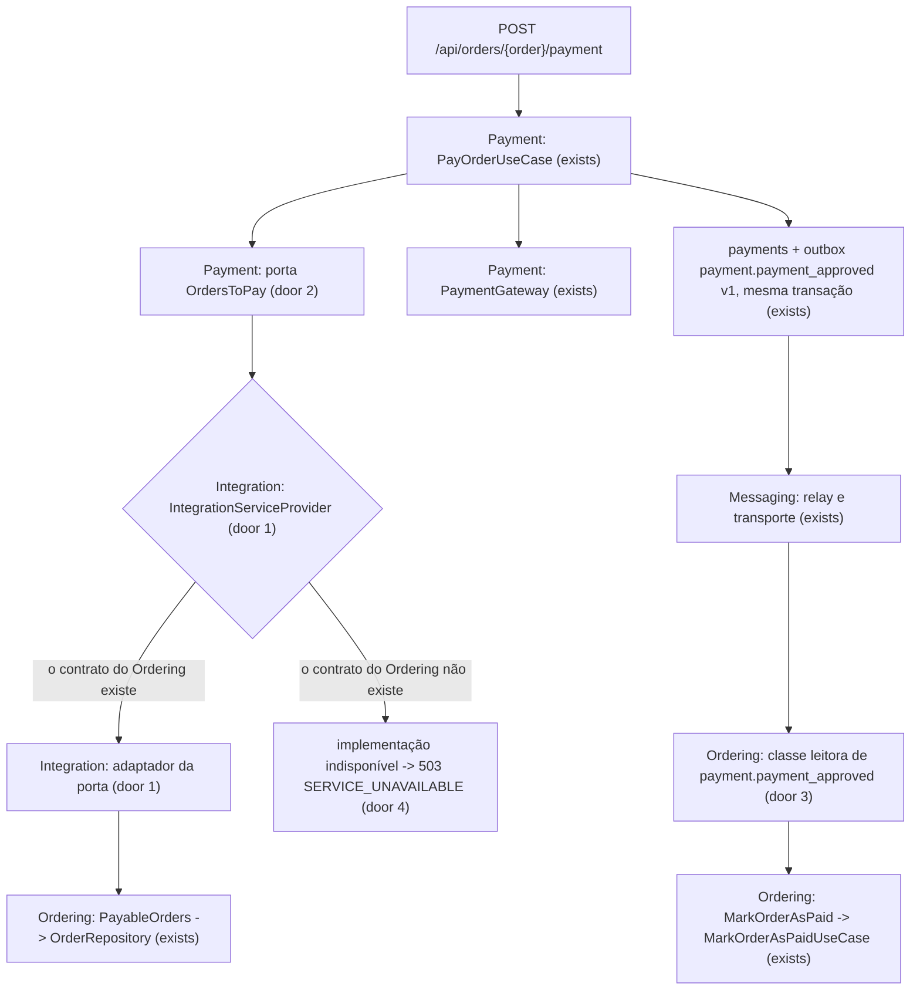
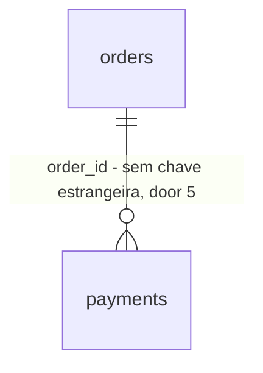

# Module Isolation Pilot

## Problem

Os testes de todos os módulos moram em `backend/tests`, misturados aos fluxos que juntam módulos. Dos 114 arquivos, 27 testam um módulo que já sobe sozinho e usam só esse módulo, mas nenhum deles mora dentro do módulo que testa.

O Payment e o Ordering não existem um sem o outro:

- o Payment lê o pedido pelas classes do Ordering (`PayableOrders`, `OrderForPayment`, `OrderStatus`);
- o consumidor do Ordering é tipado pela classe `PaymentApproved` do Payment;
- a tabela `payments` aponta uma chave estrangeira para `orders`;
- a factory de pagamento cria um pedido.

Removido um dos dois pacotes, o outro deixa de carregar ou de migrar, e a suíte do Payment não roda sem o Ordering.

Quem paga é o objetivo de estudo do projeto, que é provar que cada módulo é uma unidade completa. O [design](../../../.design/module-isolation.md), confirmado por diashelter em 2026-10-20, escolheu provar a forma primeiro neste par.

Números do repositório em 2026-10-20:

- 628 declarações `it(`/`test(` em 114 arquivos (recontadas em 2026-10-20 por `git grep`; a descoberta dizia 637);
- 7 linhas `use` entre Payment e Ordering: 5 do Payment para o Ordering e 2 do Ordering para o Payment;
- 1 chave estrangeira entre eles.

O projeto não tem produção, então não há métrica de dor.

Quando isto entregar:

- os testes de 5 módulos moram em `app-modules/<módulo>/tests` e passam com só aquele módulo, o `Shared` e o `Messaging` instalados;
- o Payment é o primeiro módulo de negócio que roda sozinho e pode ser removido sem quebrar os outros;
- a porta do consumidor, o adaptador no `Integration`, o `503` sem fornecedor e o evento lido pelo nome existem para as próximas slices copiarem.

## Flow

Reaproveita o contrato `PayableOrders` e o `OrderRepository` do Ordering do lado do fornecedor, o outbox e o `EventDelivery` como estão (o `Messaging` não muda), o corpo de erro padrão do `Shared` e a convenção de testes de módulo do `internachi/modular`.

Caminho de um teste de módulo (door 6):

1. `make test` -> PHPUnit (exists) - as suítes `Unit` e `Feature` listam `tests/<Tipo>` e `app-modules/*/tests/<Tipo>`
2. `backend/tests/Pest.php` (exists) - estende o `TestCase` (e o `RefreshDatabase`, em `Feature`) às pastas dos módulos por glob, e carrega o `tests/Helpers.php` de cada módulo
3. o teste do módulo entra autenticado pela identidade de teste do `Shared` (door 7) e usa duplos das portas do próprio módulo; o `backend/tests` fica como a suíte de composição

## Impact

| Front | What changes |
| --- | --- |
| domain | termo novo: `Integration` - pacote de infraestrutura em `app-modules/integration`, o único que usa mais de um módulo de negócio, e só pelas fachadas deles |
| domain | termo novo: `OrdersToPay` e `OrderToPay` - o que o Payment precisa de um pedido (id, id do cliente, total em centavos e se aguarda pagamento), no vocabulário do Payment |
| domain | termo novo: `SERVICE_UNAVAILABLE` - código de erro `503` no `ApiErrorCode`; o frontend mostra a `message` do corpo e não ramifica no `code` |
| domain | termo existente: `PayableOrders`, `OrderForPayment` e `OrderStatus` eram a entrada do Payment; agora só o adaptador do `Integration` os usa. Quem ramifica neles: `ModuleBoundariesTest` (vocabulário calculado), `IdTypesTest` e `TypedListSignaturesTest` |
| domain | termo existente: `PaymentApproved` (`Modules\Payment\Events`) continua sendo a classe do produtor, e o Ordering para de importá-la. Quem ramifica nela: `OrderStatusFlowTest`, `OrderEventsOutboxTest`, `ConsumerRedeliveryTest`, `ConsumerNamesTest` e `OrderEventPayloadTest`, todos da suíte de composição |
| domain | regras existentes do `AGENTS.md` que mudam: "nunca edite uma migration já executada" ganha a sua única exceção; "não há exceção de fronteira" ganha o `Integration`; os testes deixam de morar só em `backend/tests`; a lista de pastas permitidas por módulo ganha as do `Integration` |
| domain | design: a linha de factories da slice Module Tests do `.design/module-isolation.md` é corrigida (assunção 2) |
| tests | 27 arquivos mudam para `app-modules/<módulo>/tests`; os helpers do `Pest.php` que são de um módulo vão para o `tests/Helpers.php` dele, e as fixtures do Messaging vão com os testes do Messaging |
| tests | testes de arquitetura que mudam de forma: `ModulePackagesTest` (11 pacotes; o manifesto ganha o namespace `Tests`), `ModuleMigrationsTest` (16 nomes), `ModuleMigrationsForeignKeyTest` (5 chaves entre módulos, e nenhuma em `payments.order_id`), `ModuleBoundariesTest` (o `Integration` como mais uma origem das regras de fachada) e `ModuleLayersTest` (o Payment isolado, com o `Integration` como o único pacote que pode nomeá-lo, os testes no módulo e as classes leitoras, por varredura dos arquivos de cada pacote) |
| tests | o caso `ties payments to existing orders and keeps orders that have payments` e a linha `payments.order_id restricts` do `UuidKeysTest` deixam de valer por decisão (Key decision 5 do design) e são substituídos pelo critério 21 |
| stored data | a chave `payments_order_id_foreign` sai dos bancos já migrados pela migration nova; nenhuma linha muda, e um banco novo nunca cria a chave |
| build | `composer install` em cada checkout e worktree depois de puxar o pacote novo (como na HEL-12); `make test`, `make test-filter` e o CI rodam com os mesmos comandos |

## Relations

One-way constraints: `payments.order_id` deixa de ter chave estrangeira (door 5). O índice em `order_id` e o índice único parcial de pagamento aprovado por pedido continuam.

## Surface

| Route | In | Out | Status |
| --- | --- | --- | --- |
| `POST /api/orders/{order}/payment` | `card_token` | `data.id` · `data.order_id` · `data.status` · `data.amount_cents` · `message` | `202`, `401`, `402`, `404`, `409`, `422`, `429`, `503` |

O `503` é a única mudança de assinatura da rota.

## Landing

| One-way door | Literal shape | Alternative rejected |
| --- | --- | --- |
| 1. o pacote `Integration` | `app-modules/integration`, pacote `modules/integration`, namespace `Modules\Integration\`, provider `Modules\Integration\Providers\IntegrationServiceProvider`, um adaptador por porta em `Modules\Integration\<Consumidor>\`; o único pacote que usa mais de um módulo de negócio; o `ModuleLayout` ganha o terceiro tipo `COMPOSITION = ['Integration']` | a pasta `backend/app/Integration` na raiz: contradiz a decisão 2 da HEL-12 (a raiz guarda só o que é do framework), e diashelter a recusou na descoberta |
| 2. a porta do consumidor | `Modules\Payment\Contracts\OrdersToPay::findForPayment(string $customerId, string $orderId): ?OrderToPay`, com `Modules\Payment\Core\ValueObjects\OrderToPay(string $id, string $customerId, int $totalCents, bool $awaitingPayment)` | o Payment seguir importando `PayableOrders`, porque viola "nenhum import entre módulos de negócio"; ou um enum de status próprio do Payment espelhando o `OrderStatus`, porque copia a máquina de estados do Ordering para quem só decide "aguarda pagamento" |
| 3. a classe leitora do consumidor | `Modules\Ordering\Core\InboundEvents\PaymentApproved implements DomainEvent`, com nome `payment.payment_approved`, versão `1` e payload `order_id`; usada só por `Modules\Ordering\Core\Consumers` e `Modules\Ordering\Providers` | um pacote compartilhado de eventos de integração, a costura que se repete no *prior art*: é um import entre módulos |
| 4. o fornecedor ausente | sem o fornecedor, o `IntegrationServiceProvider` liga a porta a uma implementação que lança `Modules\Shared\Exceptions\ServiceUnavailableException` (HTTP `503`) em todo método; a presença é `interface_exists` do contrato do fornecedor que o adaptador usa; a resposta é `{"code":"SERVICE_UNAVAILABLE","message":"Este recurso está indisponível no momento.","errors":{},"request_id":"<X-Request-ID>"}` | o registro de módulos da biblioteca, porque um módulo presente na descoberta e ausente do autoload (ou o contrário) passaria; ou deixar o container falhar, porque responde `500` sem um código que diga o motivo |
| 5. `payments.order_id` sem chave estrangeira | a migration `2026_10_06_000001_create_payments_table` perde só `->constrained()->restrictOnDelete()`; a migration nova `2026_10_21_000001_drop_payments_order_id_foreign` (Payment) roda `ALTER TABLE payments DROP CONSTRAINT IF EXISTS payments_order_id_foreign`; a exceção é registrada no `AGENTS.md` | manter a chave, porque a suíte do Payment não migra sem a tabela `orders`; ou só a migration nova, sem editar a de criação, porque um `migrate:fresh` sem o Ordering falha na de criação |
| 6. testes no módulo | `app-modules/<módulo>/tests/Unit` e `tests/Feature`; o namespace `Modules\<Módulo>\Tests\` aponta para `tests/` no `autoload` do `composer.json` do pacote; as suítes `Unit` e `Feature` do `phpunit.xml` listam também `app-modules/*/tests/<Tipo>`; os helpers de um módulo ficam em `app-modules/<módulo>/tests/Helpers.php` | o namespace no `autoload-dev` da raiz, porque exige uma linha na raiz por módulo, contra a decisão 2 da HEL-12; ou a suíte única `Modules` do `modules:sync`, porque perde a separação `Unit`/`Feature` que o `AGENTS.md` descreve |
| 7. a identidade de teste | `Modules\Shared\Tests` oferece o login de cliente por um `Authenticatable` que só tem o `id` (um UUID v7 novo, quando nenhum é dado), no guard `customer`; nenhum teste de módulo cria model ou factory do Identity para entrar | entrar com `CustomerAccount::factory()`, porque prende o teste de todo módulo ao Identity, que é o que esta mudança desfaz |

- Nothing else in this change is hard to reverse

## Criteria

### S1: Module Tests (P1)

Os testes que já usam só o próprio módulo moram nele e passam com só ele instalado.

**Acceptance Criteria**

1. The system SHALL keep the 27 test files of the table *Arquivos movidos* only under `app-modules/<módulo>/tests/Unit` (os que hoje estão em `tests/Unit`) or `app-modules/<módulo>/tests/Feature` (os que hoje estão em `tests/Feature`), and none of them under `backend/tests`
2. WHEN `make test` runs THEN the system SHALL run the module tests and the `backend/tests` suite in the same run, the `Feature` ones with `RefreshDatabase` and the `Unit` ones without it, with no new command, flag or variable
3. WHEN `make test-filter FILTER=<nome>` matches the name of a test that lives in a module THEN the system SHALL run that test
4. WHEN the tests of `Identity`, `Messaging`, `Shared`, `Catalog` or `Payment` run with every business module except that one removed THEN the system SHALL run `migrate:fresh` and pass all of that module's tests
5. The system SHALL map `Modules\<Módulo>\Tests\` to `tests/` in the `composer.json` of each package that has a `tests` folder, and in no root `composer.json` key
6. IF a file under `app-modules/<A>/tests` names a class of another business module THEN the architecture suite SHALL fail, and it SHALL fail on a deliberate violation
7. The system SHALL keep every `it(`/`test(` declaration of the base (628, recounted on 2026-10-20; the 637 of the discovery was a miscount) by name in `backend/tests` or `app-modules/*/tests`, except the one case replaced by criterion 21
8. The system SHALL let a module test sign in as a customer with the test identity of `Modules\Shared\Tests` on the `customer` guard, with an `id` that is a canonical UUID v7

**Independent test:** `make test` verde, a pasta `tests` de cada um dos 5 módulos verde numa cópia com os outros módulos de negócio removidos e nenhum dos 27 arquivos em `backend/tests`.

### S2: Payment ↔ Ordering (P1)

O pagamento e a reação à aprovação funcionam sem que o Payment e o Ordering se importem.

**Acceptance Criteria**

9. The system SHALL have no reference to `Modules\Ordering` under `app-modules/payment` and no reference to `Modules\Payment` under `app-modules/ordering`
10. The system SHALL let `Modules\Integration` be the only package that uses both `Modules\Payment` and `Modules\Ordering`, and the architecture suite SHALL fail on a deliberate violation of each direction
11. WHEN a signed-in customer pays an order of theirs in `awaiting_payment` with `card_token` `fake_card_approved` THEN the system SHALL answer `202` with the body of today, record one `payments` row with `status` `approved` and the order total as `amount_cents`, and record one `payment.payment_approved` with payload `{"order_id": "<id>"}` in the same transaction
12. IF the order id is unknown or the order belongs to another customer THEN the system SHALL answer `404` with the unknown id body, call the gateway zero times and write no `payments` row
13. IF the order is in `placed`, `payment_approved` or `delivered`, or already has an approved payment, THEN the system SHALL answer `409` with `Este pedido não está aguardando pagamento.` and call the gateway zero times
14. IF the gateway declines the charge THEN the system SHALL answer `402` and keep the declined `payments` row, as today
15. IF the body is invalid THEN the system SHALL answer `422` before reading the order, for any order id, with or without the Ordering package installed
16. IF the Ordering package is not installed THEN `POST /api/orders/{order}/payment` with a valid body SHALL answer `503` with `{"code":"SERVICE_UNAVAILABLE","message":"Este recurso está indisponível no momento.","errors":{},"request_id":"<X-Request-ID>"}`, call the gateway zero times and write no row in `payments` nor in `outbox_messages`
17. WHEN `payment.payment_approved` version 1 is delivered to `ordering.mark_order_as_paid` THEN the system SHALL read it with the class `Modules\Ordering\Core\InboundEvents\PaymentApproved` and move an `awaiting_payment` order to `payment_approved`
18. WHEN the same `payment.payment_approved` envelope is delivered twice through `EventDelivery` THEN the system SHALL leave the order in `payment_approved` and record exactly one `ordering.order_paid` (AD-001)
19. The system SHALL read, with Ordering's reader class, the payload that `Modules\Payment\Events\PaymentApproved::toPayload()` writes, into the same `order_id`, and the composition suite SHALL fail when the two disagree on name, version or payload keys
20. IF `Modules\Ordering\Core\InboundEvents` is used outside `Modules\Ordering\Core\Consumers` and `Modules\Ordering\Providers` THEN the architecture suite SHALL fail
21. The system SHALL have no foreign key on `payments.order_id`, after `migrate:fresh` and after `migrate` on a database migrated before this change, and SHALL keep the other 5 foreign keys between modules unchanged
22. WHEN the Payment package is removed THEN the system SHALL run `migrate:fresh`, answer `404` to `POST /api/orders/{order}/payment`, and pass the `tests` folder of every remaining module that has one
23. WHEN both modules are installed THEN `OrdersToPay` SHALL resolve to the `Integration` adapter, which SHALL return an `OrderToPay` with `awaitingPayment` true only for an order in `awaiting_payment`, and `null` for an unknown order or an order of another customer
24. WHEN this change lands THEN `AGENTS.md`, `README.md`, `docs/domain-analysis.md` and `.design/module-isolation.md` SHALL describe the `Integration` package, the port of the consumer, the `503` without a provider, the migration exception, the module test folders and the 5 modules whose tests live in them, with no mention left of `Modules\Ordering` in the Payment module or of the `payments.order_id` foreign key

**Independent test:** `make test` verde; numa cópia sem o Ordering, a suíte do Payment verde e o `POST` respondendo `503`; numa cópia sem o Payment, `migrate:fresh` e as suítes dos módulos verdes.

#### Arquivos movidos

| Módulo | Arquivos (caminho atual em `backend/tests`) |
| --- | --- |
| Identity (10) | `Feature/Auth/AuthTest.php`, `Feature/Auth/StaffAuthTest.php`, `Feature/Middleware/EnsureUserIsAdminTest.php`, `Feature/Queries/CustomerMetricsQueryTest.php`, `Feature/Repositories/CustomerAccountRepositoryTest.php`, `Feature/Repositories/UserRepositoryTest.php`, `Feature/UseCases/User/StaffUseCasesTest.php`, `Unit/DTOs/UpdateUserProfileDTOTest.php`, `Unit/ValueObjects/EmailTest.php`, `Unit/ValueObjects/PasswordTest.php` |
| Messaging (7) | `Feature/Messaging/BrokerIsolationTest.php`, `Feature/Messaging/DeadDeliveriesCommandsTest.php`, `Feature/Messaging/EventTransportFlagTest.php`, `Feature/Messaging/MessagingModuleTest.php`, `Feature/Messaging/RabbitMqEventTransportTest.php`, `Feature/Outbox/EventDeliveryTest.php`, `Feature/Outbox/OutboxRelayTest.php` |
| Shared (2) | `Feature/RateLimitBurstTest.php`, `Feature/RateLimiterStoreTest.php` |
| Catalog (4) | `Feature/Queries/CatalogMetricsQueryTest.php`, `Unit/Services/CategoryServiceTest.php`, `Unit/Services/ProductServiceTest.php`, `Unit/ValueObjects/ProductAvailabilityTest.php` |
| Payment (4) | `Feature/PaymentTest.php`, `Feature/UseCases/Payment/PayOrderUseCaseTest.php`, `Unit/Services/PaymentServiceTest.php`, `Unit/Gateways/FakePaymentGatewayTest.php` |

## Out of scope

| Excluded | Why |
| --- | --- |
| as travessias Fulfillment ↔ Ordering, Catalog e Inventory, Customers, Identity e Backoffice | são as slices seguintes do design, cada uma com o seu plano |
| o job de prova de remoção no CI | é a slice Removal Proof; aqui a remoção é a prova dos critérios 4, 16 e 22, rodada localmente |
| a identidade de teste de equipe (papel `admin` ou `support`) | nenhum teste movido entra como equipe sem o Identity; ela vem com a slice Identity |
| os cerca de 87 arquivos que ainda cruzam módulos | mudam de lugar na slice da sua travessia, ou ficam na suíte de composição |

## Assumptions

| Assumption | Chosen default | Rationale | Confirmed? |
| --- | --- | --- | --- |
| 1. o `OrderCodeGeneratorTest` (Ordering) e o `DeliveryCalendarTest` (Fulfillment) usam só o próprio módulo | ficam em `backend/tests` até a slice Fulfillment ↔ Ordering | o provider de cada um assina, ao subir, um evento do outro, então nenhum dos dois módulos sobe sozinho e o critério 4 não poderia valer para eles | n |
| 2. o design manda as 7 factories que criam linha de outro módulo gerarem só o id, já na slice Module Tests | só a `PaymentFactory` muda aqui; as outras 6 mudam quando a chave da sua travessia sair, e a linha do design é corrigida | uma factory que gera um id sem linha falha na chave estrangeira enquanto ela existir | n |
| 3. os testes de classes do `Shared` que usam um módulo de negócio para exercitá-las (`BaseRepositoryTest`, `RequestIdTest`), o `HorizonTest` e o `ModuleMigrationsForeignKeyTest` | ficam na suíte de composição | dependem de mais de um módulo; reescrevê-los com fixtures próprias é outra mudança | n |
| 4. os nomes dos helpers de teste | continuam funções globais, cada uma no `tests/Helpers.php` do seu módulo; o `Pest.php` da raiz carrega todos | é a forma de hoje; dois módulos com o mesmo nome de helper falham ao carregar, e a remoção (critério 4) pega um teste que chama helper de outro módulo | n |
| 5. a prova sem um módulo | roda numa cópia descartável do `backend/` sem o diretório e sem o `require` do módulo, com o estado do Composer e a descoberta de pacotes refeitos | é a remoção de verdade; desligar só a descoberta deixaria as classes carregáveis e a prova passaria sem valer (ver o design) | n |
| 6. o `down()` da migration que apaga a chave | não faz nada | recriar a chave falharia num banco sem `orders` ou com pagamento de pedido inexistente | n |
| 7. `PayableOrders` e `OrderForPayment` | continuam no Ordering como o contrato que ele oferece, usado só pelo `Integration` | o Ordering decide o que oferece, e o adaptador traduz para a porta do Payment | n |

| 8. o `StockServiceTest` (Inventory) usa só o próprio módulo | fica em `backend/tests` até a slice Catalog e Inventory | a migration de `stocks` cria a chave `stocks.product_id` para `products`, do Catalog, então o Inventory não migra sozinho (achado pela prova C6 durante a construção) | y - diashelter, 2026-10-20 |

**Open questions:** none - all resolved or logged above.

## Observable

| Surface | Decision | Landing |
| --- | --- | --- |
| API `POST /api/orders/{order}/payment` | response shape | AC 11 |
| API `POST /api/orders/{order}/payment` | error shape and codes | AC 12, AC 13, AC 14, AC 15, AC 16 |
| API `POST /api/orders/{order}/payment` | who may call it | existing - `auth:customer` e o dono na busca (`404` para pedido de outro cliente, AC 12) |
| API `POST /api/orders/{order}/payment` | rate limit | existing - `throttle:20,1,payment`, coberto pelo teste de limite que vai para o Payment |
| API `POST /api/orders/{order}/payment` | versioning | n/a - a API não é versionada e o payload não muda; o `503` é um status novo do mesmo corpo de erro |
| command `make test` e `make test-filter` | output, flags and exit codes | AC 2, AC 3 |
| command `make test` e `make test-filter` | what it prints when it fails halfway | existing - a saída do Pest, sem mudança |
| document `AGENTS.md`, `README.md`, `docs/domain-analysis.md`, `.design/module-isolation.md` | structure, depth and what the reader does next | AC 24 |
| collection testes do backend | grouping criterion | AC 1 - por módulo e, dentro dele, `Unit` ou `Feature` |
| collection testes do backend | naming | existing - os arquivos mantêm o nome e o nome dos casos |
| collection testes do backend | duplicates | AC 1 - nenhum dos 27 arquivos fica também em `backend/tests` |
| collection testes do backend | the exception that does not fit | assunções 1 e 3 - os testes que usam mais de um módulo, ou um módulo que ainda não sobe sozinho, ficam na suíte de composição |
| collection testes do backend | ordering | n/a - o PHPUnit decide a ordem dos arquivos e nenhum teste depende dela |

## Sources

- [Módulos isolados (design)](../../../.design/module-isolation.md) - as Key decisions 1 a 7 e as slices Module Tests e Payment ↔ Ordering, confirmadas por diashelter em 2026-10-20
- `.specs/STATE.md` - AD-001 e AD-002 (todo consumidor tem chave natural e teste de reentrega; o produtor só grava o evento quando a escrita guardada mudou uma linha)
