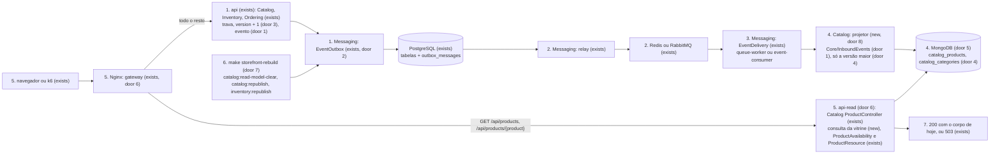
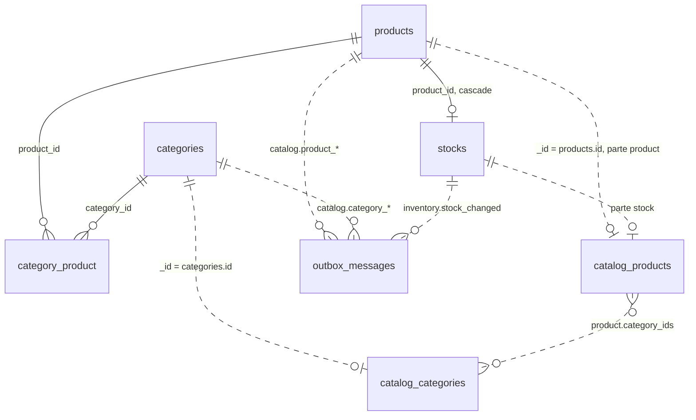
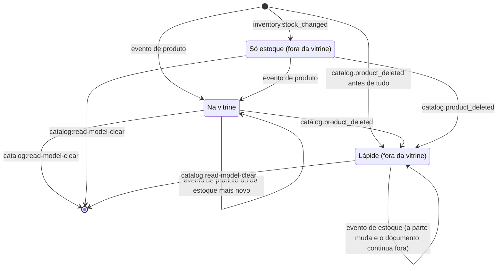

# Storefront Read Model

**Approved**: 2026-10-27 - user: "Aprovado, pode seguir para os checks."

## Problem

O projeto tem o CQRS do código, mas nenhum lado de leitura com armazenamento e processo próprios. A HEL-6 separou as consultas dos casos de uso, e a vitrine (`GET /api/products` e `GET /api/products/{product}`) é uma consulta do Catalog que lê as tabelas dele no PostgreSQL e pede o estoque ao Inventory pelo `StockLevels`, no mesmo processo PHP-FPM e no mesmo banco das escritas. O modelo de leitura projetado ficou de fora da HEL-6 até uma leitura ficar lenta ou um módulo ganhar banco próprio.

Nenhuma das duas condições é verdade, e o design diz isso com números: no `load` de 2026-10-20 a vitrine tem p95 de 24 ms, e a ruptura (cerca de 50 it/s no `breakpoint`) vem da fila do PHP-FPM, não do banco. Quem paga é o objetivo de estudo da [HEL-17](https://linear.app/helter/issue/HEL-17/cqrs): um banco de leitura de outro tipo, a projeção assíncrona com o estado nos eventos, a consistência eventual, a reconstrução e uma API de leitura num processo próprio atrás de um gateway não existem para estudar. O momento é antes da slice Catalog e Inventory do isolamento dos módulos, que reescreveria a leitura de estoque da vitrine que esta mudança elimina.

O projeto não tem produção, então não há métrica de dor.

Quando isto entregar:

- a vitrine é servida pelo `api-read`, atrás do Nginx, a partir de um modelo de leitura do Catalog no MongoDB, com o mesmo corpo de hoje e sem nenhuma leitura no PostgreSQL;
- toda escrita que muda a vitrine publica pelo outbox a parte inteira com a versão do registro, e o projetor converge para o último estado gravado mesmo com entregas repetidas, atrasadas, fora de ordem ou simultâneas;
- esvaziar o MongoDB e reconstruir devolve a mesma vitrine;
- o k6 mede o `storefront_projection_lag`, o tempo entre uma escrita e a vitrine mostrá-la.

## Shape

Reaproveita o outbox, o relay, os dois transportes, a flag `event-transport`, o `EventDelivery` e os nomes estáveis de consumidor (HEL-9, HEL-13, HEL-16), as leitoras de evento em `Core/InboundEvents` e o `503` do isolamento dos módulos (`ServiceUnavailableException`), o `ProductAvailability`, o `ProductView` e o `ProductResource` do Catalog, o controller e as rotas da vitrine, e a mesma imagem PHP. As regras que mudam um resultado (a versão que só cresce, o descarte do evento mais velho, a lápide, o filtro, a ordenação, a contagem da paginação e a disponibilidade) rodam no Catalog, no Inventory e no `Messaging`, alcançados pelo Pest do `make test`; o roteamento roda no Nginx, alcançado pelas provas de ambiente em `docker/tests`; a métrica roda nos scripts do k6, alcançados pelas provas de `load-tests/tests`.

1. escrita do admin (`/api/admin/products...`, `/api/admin/categories...`, `PUT /api/admin/stocks/{stock}`) ou checkout (`POST /api/orders`) -> `api` -> `Catalog`, `Inventory` e `Ordering` (exists) - travam a linha, gravam o estado com `version + 1` (door 3) e gravam o evento com a parte inteira (door 1) pelo `EventOutbox` do `Messaging` (exists, door 2), na mesma transação
2. `Messaging` relay (exists) - publica as mensagens pendentes pelo transporte da flag (Redis ou RabbitMQ)
3. `Messaging` `EventDelivery` (exists), no `queue-worker` ou no `event-consumer` - entrega a cada um dos 8 consumidores do projetor (door 8)
4. projetor do `Catalog` (new, em `Core/Consumers`) - lê o `inventory.stock_changed` com a classe própria em `Core/InboundEvents` (door 1) e grava no MongoDB (door 5) a parte do documento só quando a versão dela é maior (door 4)
5. navegador ou k6 `GET /api/products` e `GET /api/products/{product}` -> Nginx (exists, gateway, door 6) -> `api-read` (door 6) -> `Catalog` `ProductController` (exists) -> consulta da vitrine no MongoDB (new) -> `ProductAvailability` (exists) decide a disponibilidade -> `ProductResource` (exists)
6. reconstrução: `make storefront-rebuild` -> `catalog:read-model-clear`, `catalog:republish` e `inventory:republish` (door 7) - esvazia as coleções e grava pelo outbox o estado atual de cada registro, que segue do passo 2
7. out: a vitrine com o mesmo corpo de hoje; `503 SERVICE_UNAVAILABLE` sem o MongoDB ou sem o `api-read`; a métrica `storefront_projection_lag` no resumo do k6 (door 9)

**Changes underneath**

| Front | What changes |
| --- | --- |
| domain | termos novos no Catalog: `modelo de leitura` (as coleções `catalog_products` e `catalog_categories` no MongoDB, do Catalog), `projetor` (os 8 consumidores do Catalog, os únicos que gravam nelas), `reconstrução` (esvaziar e republicar), `lápide` (`deleted_version`) e `versão do registro` (`version`) |
| domain | `ProductQuery` servia a vitrine e o admin; passa a servir só o admin (`paginateForAdmin`, `find`, `complete`), e o `paginateCatalog` sai. Quem ramifica nele hoje: `ProductController` e `ProductQueryTest` |
| domain | `StockLevels::stocksFor` deixa de ser lido pela vitrine e continua lido pelo `ProductQuery` do admin; `quantitiesFor` continua no carrinho. Quem ramifica: a matriz entre contextos da análise de domínio |
| domain | regra do payload: era "só escalares ou nulo"; passa a aceitar também uma lista plana de escalares e datas com hora em ISO 8601 (door 2). Quem ramifica: `OutboxMessageRepository::record`, o docblock do `DomainEvent`, o `EventOutboxTest`, o `AGENTS.md`, o README e a análise de domínio |
| domain | regras do `AGENTS.md` que mudam: "só o `Messaging` tem `Console/`" (o Catalog e o Inventory ganham a pasta, door 7, e o `ModuleLayout` a lista); "uma consulta lê só as tabelas do próprio módulo" (passa a valer também para as coleções do MongoDB); o `make test` e o CI passam a precisar do `mongodb` |
| stored data | `products`, `categories` e `stocks` ganham `version`; as linhas existentes recebem 1 pelo default da coluna, e nenhuma é reescrita. O MongoDB nasce vazio: depois do `make migrate`, um banco de dev existente precisa do `make storefront-rebuild` |
| tests | o `ModuleMigrationsTest` passa de 16 para 18 nomes congelados; os casos de `paginateCatalog` do `ProductQueryTest` e o caso `reads the stock of the catalog page through the inventory` do `ProductCatalogTest` saem com o código que provam (critérios 41 e 42 os substituem); mudam com a afirmação que provam o `lists the catalog with the same query count for 1 and 12 products` (passa a contar as leituras do MongoDB, critério 41), o `keeps the query count of the checkout` (ganha as mensagens de estoque, critério 8), o `refuses a payload value that is not a scalar or null` (sai com a regra nova, critério 12) e o `subscribes the five consumers under their stable names` (passa a treze, critério 24); os testes que leem a vitrine (`ProductCatalogTest`, `ProductResponseShapeTest`, `ApiErrorResponseTest`, `AuthorizationTest`, `MoneyInCentsTest` e `RequestIdTest`) ganham a reconstrução no preparo, sem mudar nenhuma expectativa (assunção 3) |
| readers | o SPA (vitrine e página do produto): mesmo corpo, critério 34; o `setup()` do k6, que confere `meta.total` pela vitrine: critério 55; o carrinho e o checkout continuam no PostgreSQL: critério 13; o admin continua no PostgreSQL: critério 13 |
| infra | o `mongodb` e o `api-read` entram no Compose de dev, no de carga e no CI; o `queue-worker`, o `event-consumer` e o `api` passam a falar com o MongoDB; o Nginx de dev e o de carga passam a ter dois destinos |

New: as colunas `products.version`, `categories.version` e `stocks.version` (door 3); as coleções `catalog_products` e `catalog_categories` no MongoDB, ligadas às tabelas só pelo id e pelos eventos, sem chave nenhuma (door 4). One-way constraints: `version` bigint, não nulo, só cresce (door 3); `_id` do documento é o id do registro (door 4); o índice de `slug` em `catalog_categories` não é único (door 4).

Estados de um documento de `catalog_products`:

## Surface

| Route | In | Out | Status | Who |
| --- | --- | --- | --- | --- |
| `GET /api/products` | `category` · `sort` (`name`, `price_asc`, `price_desc`) · `page` | `data[]` (as 13 chaves de hoje) · `links` · `meta` | `200`, `422`, `503` | anyone |
| `GET /api/products/{product}` | `product` (UUID v7 canônico) | `data` (as 13 chaves de hoje) | `200`, `404`, `503` | anyone |

O `503` (`SERVICE_UNAVAILABLE`, `Este recurso está indisponível no momento.`) é a única mudança de assinatura das duas rotas. Nenhuma rota nova; as escritas do admin e o checkout respondem como hoje.

## Landing

| One-way door | Literal shape | Alternative rejected |
| --- | --- | --- |
| 1. os eventos da vitrine | todos na versão `1`: `catalog.product_created`, `catalog.product_updated` e `catalog.product_status_changed` com `product_id`, `name`, `price_cents`, `description` (nulo), `image_url` (nulo), `status`, `category_ids` (lista em ordem crescente de id), `created_at`, `updated_at` (`toIso8601String()`, nulo) e `version`; `catalog.product_deleted` com `product_id` e `version`; `catalog.category_created` e `catalog.category_updated` com `category_id`, `name`, `slug` e `version`; `catalog.category_deleted` com `category_id` e `version`; `inventory.stock_changed` com `stock_id`, `product_id`, `quantity` (a quantidade gravada) e `version`. Classes em `Modules\Catalog\Events\` (`ProductCreated`, `ProductUpdated`, `ProductStatusChanged`, `ProductDeleted`, `CategoryCreated`, `CategoryUpdated`, `CategoryDeleted`) e `Modules\Inventory\Events\StockChanged`; a leitora `Modules\Catalog\Core\InboundEvents\StockChanged` | eventos só com o id, que o projetor completaria lendo a escrita: é a recomendação que diashelter recusou (Key decision 3), porque o estudo é o worker que lê da fila os dados a gravar, e cria uma leitura do PostgreSQL no lado de leitura; ou um evento só, `catalog.product_saved`: perde a distinção dos três fatos por quase nada |
| 2. a regra do payload | `EventOutbox::record` aceita, por chave, `null`, um escalar ou uma lista (`array_is_list`) cujos itens são todos `string`, `int`, `float` ou `bool`, e recusa com `InvalidArgumentException` um array associativo, um array com array dentro e um objeto; as datas com hora vão como texto ISO 8601 com o fuso (`2026-10-27T13:45:00+00:00`); o docblock de `toPayload()` e de `fromPayload()` passa a `array<string, string\|int\|float\|bool\|null\|list<string\|int\|float\|bool>>` | a lista codificada em texto (`"id1,id2"`): esconde o tipo no formato publicado e obriga cada leitora a reimplementar o corte; ou aceitar qualquer array: o payload deixaria de ser um formato plano que não depende da classe PHP |
| 3. a versão do registro | migrations `2026_10_27_000001_add_version_to_products_and_categories_tables` (Catalog) e `2026_10_27_000002_add_version_to_stocks_table` (Inventory): `version bigint not null default 1` em `products`, `categories` e `stocks`; toda escrita trava a linha (`SELECT ... FOR UPDATE`), soma 1 na transação dela e monta o evento da linha travada; a criação grava 1; a exclusão publica a versão guardada mais 1 | a versão do evento vinda do relógio (`updated_at`) ou do id da mensagem: dois relógios ou duas escritas no mesmo segundo empatam, e o id da mensagem não diz a ordem das transações; ou uma sequência global: o projetor compara versões de uma parte só, e um contador por tabela acopla escritas que não disputam a mesma linha |
| 4. o documento do modelo de leitura | coleção `catalog_products`: `_id` (id do produto), `product` (nulo, ou `name`, `price_cents`, `description`, `image_url`, `status`, `category_ids`, `created_at` e `updated_at` em texto ISO 8601, `version`), `stock` (nulo, ou `id`, `quantity`, `version`) e `deleted_version` (nulo ou inteiro); índices em `product.category_ids`, em (`product.name`, `_id`) e em (`product.price_cents`, `_id`). Coleção `catalog_categories`: `_id`, `name`, `slug`, `version` e `deleted_version`, com índice não único em `slug`. Nenhum documento guarda `is_available`, `status_label` nem `available_quantity` | o nome e o slug das categorias dentro de cada produto: cada renomeação reescreve todos os produtos da categoria e exige uma ordem entre filas diferentes; ou `is_available` gravado: fica preso à parte que chegou por último e escreve a regra uma segunda vez (Key decision 2) |
| 5. o MongoDB como dependência | serviço `mongodb` com a imagem `mongo:8.2` (tag exata conferida no `docker pull` da instalação), usuário raiz por `MONGO_INITDB_ROOT_USERNAME` e `MONGO_INITDB_ROOT_PASSWORD`; o pacote `mongodb/laravel-mongodb` `^5.7` (o 5.7.0 traz o Laravel 13) e a extensão `mongodb` por `pecl install mongodb` no `docker/php/Dockerfile`; a conexão `mongodb` lê `MONGODB_HOST` (`mongodb`), `MONGODB_PORT` (`27017`), `MONGODB_DATABASE` (`ecommerce`), `MONGODB_USERNAME` e `MONGODB_PASSWORD`, nos dois `.env.example`; o `make test` usa `MONGODB_DATABASE=<o banco de testes do checkout>` | a biblioteca `mongodb/mongodb` sem o pacote do Laravel: perde a conexão do `DB` com o log de consultas que conta as leituras, a configuração por `.env` e o paginador; ou o PostgreSQL com `jsonb` como banco de leitura: é o mesmo banco da escrita, e o estudo é um banco de leitura de outro tipo |
| 6. o `api-read` e o gateway | serviço `api-read` com a imagem `ecommerce-php`, `php-fpm`, o mesmo `backend/` montado, `DB_HOST`, `DB_USERNAME` e `DB_PASSWORD` vazios no `environment` e sem `depends_on` do `db`, nas pilhas de dev e de carga (na de carga, com o mesmo `fpm-pool.conf` do `api`); no Nginx, `GET` e `HEAD` em `^/api/products(/[^/]+)?$` vão para `api-read:9000` por um `resolver` do Docker, e um `502`, `503` ou `504` do `api-read` vira `503` com o corpo padrão de erro e um `X-Request-ID`; todo o resto de `/api`, `/sanctum` e `/horizon` vai para `api:9000` | um gateway dedicado (Traefik, Kong, KrakenD): só ganha quando a borda precisar de autenticação, limite ou descoberta, e hoje são dois destinos fixos com o limite no Laravel; ou uma aplicação de leitura separada: só ganha com deploy, versão e escala independentes |
| 7. a reconstrução | `Modules\Catalog\Console\` com os comandos `catalog:read-model-clear` (esvazia as duas coleções) e `catalog:republish` (grava pelo outbox um `catalog.category_updated` por categoria e um `catalog.product_updated` por produto, com a versão atual); `Modules\Inventory\Console\` com o `inventory:republish` (um `inventory.stock_changed` por linha de `stocks`); o `ModuleLayout` passa a permitir `Console` no Catalog e no Inventory; o alvo `make storefront-rebuild` roda os três nessa ordem, e o `make fresh` e o `make seed` o chamam no fim | o Catalog ler a escrita direto (as próprias tabelas e o estoque pelo `StockLevels` com a versão): cria um segundo caminho de gravação no modelo de leitura e uma leitura entre módulos que o isolamento teria de virar porta; ou reconstruir do histórico do outbox: as publicadas ficam só 7 dias e os seeders gravam sem evento |
| 8. os nomes dos consumidores do projetor | `catalog.project_product_created`, `catalog.project_product_updated`, `catalog.project_product_status_changed`, `catalog.project_product_deleted`, `catalog.project_category_created`, `catalog.project_category_updated`, `catalog.project_category_deleted` e `catalog.project_stock_changed`, cada um uma classe em `Modules\Catalog\Core\Consumers`, inscrita no `boot()` do `CatalogServiceProvider`; no RabbitMQ, as filas `<nome>` e `<nome>.dead` | um consumidor por parte com vários eventos: o `EventSubscriptionRegistry` exige um `handle()` com um evento só, e os nomes viram filas que não mudam depois de declaradas |
| 9. a métrica e o conjunto de dados de carga | a métrica `storefront_projection_lag` (Trend, em ms); o produto `Produto da Equipe` no `LoadTestSeeder` (constante ao lado do `Produto Disputado`), ativo e com unidades; o `PRODUCT_COUNT` do `dataset.js` passa de 201 para 202; a série nova nas duas tabelas da linha de base do `load-tests/README.md` | todo VU da equipe gravar preços crescentes, como no design: duas edições que chegam ao banco em ordem inversa deixam um VU esperando 60 s por um preço que não volta (assunção 2); ou um produto por VU: leva o conjunto a 251 produtos e muda o `setup()` de todos os perfis |

- Nothing else in this change is hard to reverse

## Criteria

### S1: Eventos `catalog.*` e `inventory.stock_changed` (P1)

Toda escrita que muda a vitrine grava pelo outbox, na transação dela, a parte inteira com a versão do registro.

**Acceptance Criteria**

1. WHEN a staff member creates a product through `POST /api/admin/products` (`201`) THEN the system SHALL store `products.version` 1 and `stocks.version` 1 and record, in the transaction of the write, one `catalog.product_created` version 1 with exactly the keys of door 1, the stored values and `version` 1, and one `inventory.stock_changed` version 1 with the stock row id, the product id, the opening quantity and `version` 1
   - `image_url` null in the body → the payload carries the default image URL the product stored, and the version stays 1; `category_ids` [] → `[]`; two categories → their ids in ascending order
2. WHEN a staff member edits a product through `PUT /api/admin/products/{product}` (`200`) THEN the system SHALL add 1 to `products.version` and record one `catalog.product_updated` with the whole product as stored after the write and the new version
   - an edit that only changes the categories → the new `category_ids` and the version plus 1; two edits in a row → versions 2 and 3
3. WHEN a staff member changes the status through `PATCH /api/admin/products/{product}/status` (`200`) THEN the system SHALL add 1 to `products.version` and record one `catalog.product_status_changed` with the whole product, not only `status`, and the new version
4. WHEN an admin deletes a product through `DELETE /api/admin/products/{product}` (`204`) THEN the system SHALL record one `catalog.product_deleted` with `product_id` and the stored version plus 1, and no `inventory.stock_changed` for the stock row the cascade removes
5. WHEN a staff member creates a category (`201`) or renames it (`200`) THEN the system SHALL record `catalog.category_created` with `version` 1, or `catalog.category_updated` with the version plus 1, carrying `category_id`, `name` and the stored `slug`
6. WHEN an admin deletes a category without products (`204`) THEN the system SHALL record one `catalog.category_deleted` with `category_id` and the stored version plus 1
7. WHEN a staff member adjusts a stock through `PUT /api/admin/stocks/{stock}` (`200`) THEN the system SHALL add 1 to `stocks.version` and record one `inventory.stock_changed` with the quantity stored, never the adjusted units
   - `increase` 3 on 7 → `quantity` 10; `decrease` 7 on 7 → `quantity` 0
8. WHEN a customer's checkout creates an order through `POST /api/orders` (`201`) THEN the system SHALL record, in the checkout's transaction, one `inventory.stock_changed` per product of the order with the quantity left and the stock version plus 1
   - 3 units of a product with 10 and 1 of a product with 5 → `quantity` 7 and 4, two messages
9. IF a write is refused (the category with products, the adjustment that would leave the stock negative with `422` `O estoque não pode ficar negativo.`, the checkout refused as unavailable, with insufficient stock or by a conflict) THEN the system SHALL answer as today, record no message in `outbox_messages` and change no `version`
10. IF a write rolls back after recording its event THEN the system SHALL keep no message of it in `outbox_messages` and no `version` change
    - the checkout that fails on the third order code collision after the stock decrement → no `inventory.stock_changed` and the stock version unchanged
11. WHEN two writes on the same row commit concurrently THEN the system SHALL give their events strictly increasing versions in commit order, and the event with the higher version SHALL carry the state the row holds after both, because each write locks the row before computing the new state (door 3)
    - a status change and an edit of the same product in parallel → the higher version carries the final row; a checkout and a stock adjustment of the same stock in parallel → the higher version carries the final quantity
12. The system SHALL accept in an event payload a flat list of `string`, `int`, `float` or `bool` and an ISO 8601 date with time as text, and SHALL refuse with `InvalidArgumentException`, recording nothing, an associative array, an array that holds an array and an object
    - `['a', 'b']` → accepted; `[]` → accepted; `[['a']]` → refused; `['k' => 'v']` → refused; `new stdClass` → refused
13. The system SHALL keep the names, versions and payloads of the 5 existing events, their consumers, the two transports and the `event-transport` flag, and SHALL keep the cart (`POST /api/cart/validate`), the checkout and the admin product and stock pages reading PostgreSQL with today's answers and messages
14. The system SHALL read, with `Modules\Catalog\Core\InboundEvents\StockChanged`, the payload that `Modules\Inventory\Events\StockChanged::toPayload()` writes into the same values, and the composition suite SHALL fail when the two disagree on name, version or payload keys

### S2: ProductDocument e o projetor (P1)

O projetor do Catalog mantém as coleções do modelo de leitura a partir dos eventos e converge para o último estado gravado.

**Acceptance Criteria**

15. WHEN a product event whose version is greater than the stored product part, or with no product part, is delivered THEN the projector SHALL replace the product part whole with the payload values and its version, creating the document when it does not exist
16. IF a product event's version is lower than or equal to the stored product version or to `deleted_version` THEN the projector SHALL discard it and change nothing
    - version 2 stored, version 2 again → nothing changes; version 1 after version 3 → nothing changes; version 3 after version 2 → applied
17. WHEN `inventory.stock_changed` is delivered for a product with no document THEN the projector SHALL create the document with only the stock part (`id`, `quantity`, `version`) and `product` null
18. WHEN a stock event whose version is greater than the stored stock part is delivered THEN the projector SHALL replace the stock part whole; IF it is lower or equal THEN the projector SHALL discard it
19. WHEN `catalog.product_deleted` is delivered THEN the projector SHALL set `deleted_version` to its version, creating the document when it does not exist; a later product event with a version up to `deleted_version` SHALL be discarded, and a later newer stock event SHALL replace the stock part and leave `deleted_version` as it is
    - `catalog.product_deleted` version 4 before `catalog.product_created` version 1 → the document stays a tombstone
20. WHEN a category event is delivered THEN the projector SHALL replace, discard or tombstone the `catalog_categories` document by the same version rule, and SHALL change no `catalog_products` document
21. WHEN the same envelope of each of the 8 events is delivered twice through `EventDelivery` THEN the projector SHALL change the document once and record no outbox message (AD-001, `ConsumerRedeliveryTest`)
22. WHEN two deliveries of the same part with different versions run at the same time THEN the document SHALL end with the higher version, and a conditional write that loses to a newer version, including the duplicate key of a losing upsert, SHALL count as a discard and complete the delivery without failing it
23. IF MongoDB does not answer during a delivery THEN the delivery SHALL fail as any consumer's does (retried by the transport, then `failed_jobs` or `<consumer>.dead`) and the stored document SHALL stay unchanged
24. The system SHALL subscribe the 8 consumers of door 8, by those names, in the `boot()` of the `CatalogServiceProvider`
25. The system SHALL write `catalog_products` and `catalog_categories` only from `Modules\Catalog\Core\Consumers` (through the Catalog persistence) and from `catalog:read-model-clear`, read them only from `Modules\Catalog`, and store no `is_available`, `status_label` or `available_quantity` in a document, and the architecture suite SHALL fail on a deliberate violation

### S3: Reconstrução (P1)

O modelo de leitura é refeito a partir da escrita a qualquer momento, e preenchido depois do `make fresh`, do `make seed` e do seed da pilha de carga.

**Acceptance Criteria**

26. WHEN `make storefront-rebuild` runs THEN it SHALL run `catalog:read-model-clear`, `catalog:republish` and `inventory:republish` in that order, and no module SHALL call another module's command
27. WHEN `catalog:read-model-clear` runs THEN it SHALL empty `catalog_products` and `catalog_categories`, leave both with exactly the indexes of door 4, and exit 0
28. WHEN `catalog:republish` runs THEN it SHALL record through the outbox one `catalog.category_updated` per category and one `catalog.product_updated` per product, each with the current state and the current version, read with its categories in one snapshot, print how many of each it recorded and exit 0; WHEN `inventory:republish` runs THEN it SHALL record one `inventory.stock_changed` per stock row with the current quantity and version, print how many and exit 0
29. IF a republish command fails halfway THEN it SHALL exit non-zero, print how many records it had recorded, and running it again SHALL converge to the same storefront
30. WHEN `make fresh` or `make seed` runs THEN it SHALL end with `make storefront-rebuild`, so the storefront lists the seeded products once the relay and the consumers deliver
31. WHEN MongoDB is emptied and the rebuild runs and its messages are delivered THEN `GET /api/products` SHALL return the same body as before, on every page and for each of the 3 sorts, and `GET /api/products/{product}` the same body for every product
32. IF MongoDB holds documents of records that no longer exist in PostgreSQL THEN the rebuild SHALL leave none of them
33. WHEN a republished envelope is delivered after the envelope of a write that committed later THEN the projector SHALL discard the older one and the storefront SHALL show the written state; WHILE the rebuild runs the storefront SHALL answer `200` with what was already projected

### S4: api-read (P1)

A vitrine é servida a partir do modelo de leitura, com o corpo de hoje e sem o PostgreSQL.

**Acceptance Criteria**

34. The system SHALL pass the storefront cases of `ProductCatalogTest`, `ProductResponseShapeTest`, `ApiErrorResponseTest`, `AuthorizationTest`, `MoneyInCentsTest` and `RequestIdTest` against the read model with no expectation of status or body changed
35. WHEN `GET /api/products` runs THEN the system SHALL list only the documents with a product part and no `deleted_version`, filtered, sorted and paginated in MongoDB, 12 per page (`shop.products_per_page`), with `meta.total` and `meta.last_page` counted there and the query string kept in `links`
36. WHEN `category=<slug>` is given THEN the system SHALL list only the products whose `category_ids` hold a non-tombstoned category with that slug; IF no category has it THEN the system SHALL answer `200` with an empty page and `meta.total` 0
37. WHEN `sort` is `name` THEN the system SHALL order by the name in byte order, as PostgreSQL does today, with the id breaking ties; `price_asc` and `price_desc` SHALL order by `price_cents` with the id ascending breaking ties
    - `Abacaxi`, `Banana`, `Zebra`, `banana`, `caju`, `Água`, `éclair` → that order; two products with the same price → the smaller id first in both price sorts
38. IF `sort` is not one of the three or `page` is not an integer of at least 1 THEN the system SHALL answer `422` as today
39. WHEN `GET /api/products/{product}` reads a document with a product part that `ProductAvailability` finds available THEN the system SHALL answer `200` from the document; IF the product is inactive, has 0 units or has no stock part THEN `404` `Produto indisponível.`; IF the id is unknown, the document is a tombstone or has only the stock part THEN `404` `Recurso não encontrado.`
    - an id outside the canonical UUID form (`/api/products/abc`) → `404` with no MongoDB read, as today
40. WHEN a listed document has no stock part THEN the item SHALL show `stock` null, `is_available` false and `available_quantity` 0; WHEN a product cites a category that has not arrived or is a tombstone THEN the item SHALL leave it out of `categories`, which keep the order of `category_ids`
41. WHEN `GET /api/products` lists a page with 1 product and a full page of 12, each product with 2 categories, THEN the system SHALL run the same number of MongoDB reads for both
42. WHEN `GET /api/products` or `GET /api/products/{product}` runs THEN the system SHALL run no query on the PostgreSQL connection
43. The system SHALL decide `is_available`, `available_quantity` and `status_label` only through `ProductAvailability` and `ProductStatus` at read time, and the storefront query SHALL filter on neither `product.status` nor `stock.quantity`
    - document `active` with quantity 0 → listed, `is_available` false; `inactive` with quantity 5 → listed, `is_available` false
44. IF MongoDB does not answer THEN `GET /api/products` and `GET /api/products/{product}` SHALL answer `503` with `{"code":"SERVICE_UNAVAILABLE","message":"Este recurso está indisponível no momento.","errors":{},"request_id":"<X-Request-ID>"}` within 5 seconds

### S5: Gateway (P1)

O Nginx manda a vitrine ao `api-read` e o resto ao `api`, nas pilhas de dev e de carga, e o CI sobe o MongoDB e o `api-read`.

**Acceptance Criteria**

45. WHEN `GET` or `HEAD` `/api/products`, with or without a query string, or `/api/products/{product}` reaches the Nginx of the dev or the load stack THEN the system SHALL serve it from `api-read`
    - with `api` stopped → the storefront still answers `200`
46. WHEN any other request reaches the Nginx (`/api/admin/products`, `/api/categories`, `POST /api/cart/validate`, `DELETE /api/products`, the rest of `/api`, `/sanctum` and `/horizon`) THEN the system SHALL serve it from `api` as today
    - with `api-read` stopped → `GET /api/categories` and `GET /api/admin/products` answer as today
47. IF `api-read` is stopped THEN the gateway SHALL answer the storefront with `503`, the standard error body with `code` `SERVICE_UNAVAILABLE` and the message `Este recurso está indisponível no momento.`, an `X-Request-ID` header equal to the body's `request_id`, and SHALL send nothing to `api`
    - `api-read` stopped before the Nginx starts → the Nginx starts and answers `503`
48. The system SHALL start `api-read` with `DB_HOST`, `DB_USERNAME` and `DB_PASSWORD` empty in its environment and no dependency on `db`, and WHEN `db` is stopped THEN the storefront through the gateway SHALL answer `200`
49. The system SHALL hand `api-read` the client address from the connection, with the same FastCGI parameters as `api`, and SHALL ignore a client-sent `X-Forwarded-For`
50. The system SHALL run `make test` with a MongoDB database of its own per checkout (`ecommerce_testing` in the main one, `ecommerce_testing_<worktree>` in a worktree), start each test with both collections empty, and drop that database in `make test-db-drop`
51. The CI SHALL start `mongodb` with `--wait` in the `backend` job, and the `load-smoke` job SHALL run through the gateway with `api-read` and `mongodb` up

### S6: storefront_projection_lag (P2)

O k6 mede o tempo entre uma escrita e a vitrine mostrá-la, e a pilha de carga sobe com o MongoDB, o `api-read` e a reconstrução.

**Acceptance Criteria**

52. WHEN the first VU of the team flow (`backoffice`) runs an iteration THEN it SHALL write, through `PUT /api/admin/products/{product}`, a price 1 cent above the last one it wrote to the `Produto da Equipe`, read `GET /api/products/{product}` through the gateway every 250 ms until it shows exactly that price, and add the milliseconds from the `200` of the `PUT` to the read that showed it to `storefront_projection_lag`; no other VU writes that product
53. IF the storefront does not show the written price within 60 seconds THEN the flow SHALL count one unexpected error, as `order_payable_wait` does
54. WHEN `load`, `stress` or `soak` ends THEN the summary and `results/<profile>-checks.txt` SHALL show the p95 of `storefront_projection_lag`, with no approval threshold on it
55. WHEN `make load-test` starts the load stack THEN it SHALL seed, start the relay and the consumers, run the rebuild and wait until `GET /api/products` through the gateway reports `meta.total` 202 before k6 starts, and the `setup()` check SHALL require 202 products
56. The `LoadTestSeeder` SHALL create the `Produto da Equipe`, active and with units, chosen by no purchase flow, for 202 products in all
57. WHEN `make load-test TYPE=smoke` runs THEN it SHALL pass through the gateway with `api-read`, with `storefront_projection_lag` sampled by the team flow
58. WHEN this lands THEN `load-tests/README.md` SHALL open a new series in both baseline tables, saying the storefront is served by `api-read`, and describe `storefront_projection_lag`, the `Produto da Equipe` and the 202 products

### S7: Documentação (P1)

A documentação descreve o código como ele ficou.

**Acceptance Criteria**

59. WHEN this lands THEN `README.md` SHALL describe the read model, the projector, the rebuild (`make storefront-rebuild`), the `api-read`, the gateway routing, the `mongodb` service and its variables, the 8 events with their payloads, the `version` columns and the new payload rule, with no sentence left saying the payload holds only scalars, and `.env.example` and `backend/.env.example` SHALL list the `MONGODB_*` variables of door 5
60. WHEN this lands THEN `docs/domain-analysis.md` SHALL have "modelo de leitura", "projetor" and "reconstrução" in the Catalog's ubiquitous language, the context matrix without the storefront's use of `StockLevels`, and an updated "Última atualização" line
61. WHEN this lands THEN `AGENTS.md` SHALL state the new payload rule (Key decision 5), the `Console/` of the Catalog and the Inventory, the state-carrying versioned events and the projector's version rule, that queries also read the module's own MongoDB collections, and that `make test` and the CI need `mongodb`, with no sentence left saying only `Messaging` has `Console/`

## Out of scope

| Excluded | Why |
| --- | --- |
| as outras leituras (`GET /api/categories`, o cadastro de produto e a lista de estoque do admin, os pedidos, o dashboard) | a vitrine é o primeiro modelo de leitura, e as outras só repetiriam o padrão |
| CDC das tabelas de domínio ou só da `outbox_messages` | as escritas chegam ao MongoDB pelo outbox (decisão de diashelter na discovery); o CDC do outbox trocaria o relay de todos os eventos e cabe numa issue própria |
| uma aplicação de leitura separada e um gateway dedicado | ver Landing, door 6 |
| a observabilidade (HEL-8) e o deploy de produção | fora da HEL-17 |
| o frontend | o corpo da vitrine não muda |
| limite de aprovação para o `storefront_projection_lag` | a primeira série só registra; o limite sai da linha de base, como os da HEL-14 |
| uma checagem de convergência no `teardown` do k6 (vitrine contra o admin depois do `contention` e do `load`) | o design deixa esse sinal para a revisão de diashelter; a convergência é provada pelos critérios 16, 18, 19 e 22, com entregas repetidas, fora de ordem e simultâneas |
| apagar as lápides fora da reconstrução | default 1 da slice ProductDocument: crescem uma por registro excluído, desprezível numa loja de estudo |
| esvaziar as filas do broker na reconstrução | ver assunção 8 |
| atualizar a slice Catalog e Inventory do `.design/module-isolation.md` | o design marca a revisão para quando a slice começar: diashelter confere ali o que sobrou da porta de estoque da vitrine |

## Assumptions

| Assumption | Chosen default | Rationale | Confirmed? |
| --- | --- | --- | --- |
| 1. como o `api-read` fica sem credencial do PostgreSQL, se monta o mesmo `backend/` | o `environment` zera `DB_HOST`, `DB_USERNAME` e `DB_PASSWORD` (a variável vence o `backend/.env`) e não há `depends_on` do `db`; a prova para o `db` e lê a vitrine (critério 48). O `backend/.env` continua montado e legível no container | o `api-read` precisa do mesmo `APP_KEY` e da sessão no Redis para não trocar o cookie do SPA; um `.env` próprio teria de ser gerado de novo a cada `key:generate` | y - diashelter, 2026-10-27 |
| 2. quem grava o preço do `Produto da Equipe` no k6 | só o primeiro VU do fluxo da equipe, em sequência, esperando ver exatamente o preço que gravou (critério 52); muda o default 1 da slice storefront_projection_lag, que fazia todo VU da equipe gravar | com vários VUs, duas edições que chegam ao banco em ordem inversa à do relógio do k6 deixam o preço final abaixo do de um VU, que espera 60 s e conta um erro inesperado | y - diashelter, 2026-10-27 |
| 3. o preparo dos testes atuais que leem a vitrine | criam os dados como hoje (factories) e chamam um helper que roda a reconstrução e o `relayUntilIdle()` antes da requisição; nenhuma expectativa muda. O caso que conta a leitura de `stocks` no PostgreSQL e os casos de `paginateCatalog` saem com o código e dão lugar aos critérios 41 e 42 | as factories gravam sem evento, como os seeders, e a reconstrução é o caminho que o design dá para a escrita sem evento | n |
| 4. a ordem das categorias de um produto | `category_ids` em ordem crescente de id no payload, e o corpo segue essa ordem | hoje a ordem não é definida (a relação não ordena); a reconstrução só devolve o mesmo corpo com uma ordem determinística, e o UUID v7 ordena pela criação | n |
| 5. a autenticação e a porta do MongoDB em dev | usuário raiz com senha (`MONGODB_USERNAME`, `MONGODB_PASSWORD`), como o PostgreSQL e o RabbitMQ, e a porta opcional `MONGODB_FORWARD_PORT` (27018) no host, como a `DB_FORWARD_PORT`; nenhuma porta na pilha de carga | ver os documentos com um cliente faz parte do estudo; credencial no `.env`, nunca no código | n |
| 6. o tempo até o `503` | a conexão do `api-read` desiste do MongoDB em 2 s (`serverSelectionTimeoutMS` e `connectTimeoutMS`), e a vitrine responde `503` em até 5 s (critério 44); um `api-read` que trava responde `503` no `fastcgi_read_timeout` de 60 s, o mesmo do `api` | o padrão do driver é 30 s, e a vitrine ficaria presa no PHP-FPM, que é onde a pilha já rompe | n |
| 7. o `make seed` | também termina com a reconstrução (critério 30) | os seeders gravam sem evento; sem ela, um `make seed` deixaria a vitrine sem os dados novos | n |
| 8. mensagens antigas na fila durante a reconstrução | a reconstrução não esvazia as filas; uma entrega de antes dela, de um registro que não existe mais, pode recriar o documento dele até a próxima reconstrução | a reconstrução roda em dev, nos testes e na pilha de carga, com as filas paradas ou vazias; esvaziar as filas do broker mexeria no `Messaging` e nos dois transportes | n |
| 9. o estoque removido em cascata pela exclusão do produto | não publica `inventory.stock_changed`; a lápide do produto basta para tirar o documento da vitrine | a linha some pela chave estrangeira, sem passar pelo Inventory; a slice Catalog e Inventory do isolamento revê essa cascata | n |
| 10. a ordem da republicação | categorias, depois produtos, depois estoques | a ordem não muda o resultado (cada parte tem a sua versão), e as categorias primeiro deixam a vitrine completa mais cedo | n |
| 11. o modelo de leitura no smoke | o smoke também tira a amostra do `storefront_projection_lag` (o primeiro VU da equipe roda uma iteração), e uma espera que desiste falha o CI pelo `unexpected_errors` `rate==0` | o smoke do CI é a única prova de ponta a ponta da projeção pelos dois processos (relay e consumidores) num pull request | n |

**Open questions:** none - all resolved or logged above.

## Differences from the source

| Source shows | Product shows | Confirmed |
| --- | --- | --- |
| o default 1 da slice storefront_projection_lag do design: todo VU da equipe grava preços sempre maiores no `Produto da Equipe` e espera ver um preço igual ou maior | só o primeiro VU do fluxo da equipe grava, em sequência, e espera ver exatamente o preço que gravou (critério 52) | y - AD-006 |

## Sources

- [Modelo de leitura da vitrine (design)](../../../.design/storefront-read-model.md) - binding - a Situation, o Problem, o Success, o Boundary, as Key decisions 1 a 6 e as 6 slices, confirmados por diashelter em 2026-10-27
- [HEL-17](https://linear.app/helter/issue/HEL-17/cqrs) - binding - a decisão de estudar o CQRS com o PostgreSQL na escrita e o MongoDB na leitura
- `.specs/STATE.md` - AD-001 e AD-002 (chave natural de idempotência e teste de reentrega; o produtor grava o evento só quando a escrita mudou uma linha), AD-003 (a leitora de evento em `Core/InboundEvents`), AD-004 e AD-005 (as decisões desta mudança que valem para as próximas) e AD-006 (a medida do lag, que muda o default 1 do design)
- [mongodb/laravel-mongodb no Packagist](https://packagist.org/packages/mongodb/laravel-mongodb) e [LaraPlugins](https://laraplugins.io/plugins/mongodb/laravel-mongodb) - o 5.7.0, de 2026-03-20, com o Laravel 13 e o `ext-mongodb` `^1.21|^2`, conferidos em 2026-10-27
- [docker-library/mongo](https://github.com/docker-library/mongo) - a linha `8.2` da imagem oficial, conferida em 2026-10-27
- a ordem de nomes do `postgres:18-alpine` - conferida em 2026-10-27 num container descartável: `en_US.utf8` com o provedor `libc` do musl ordena por byte (`Abacaxi | Banana | Zebra | banana | caju | Água | éclair`), a mesma ordem da comparação padrão do MongoDB
