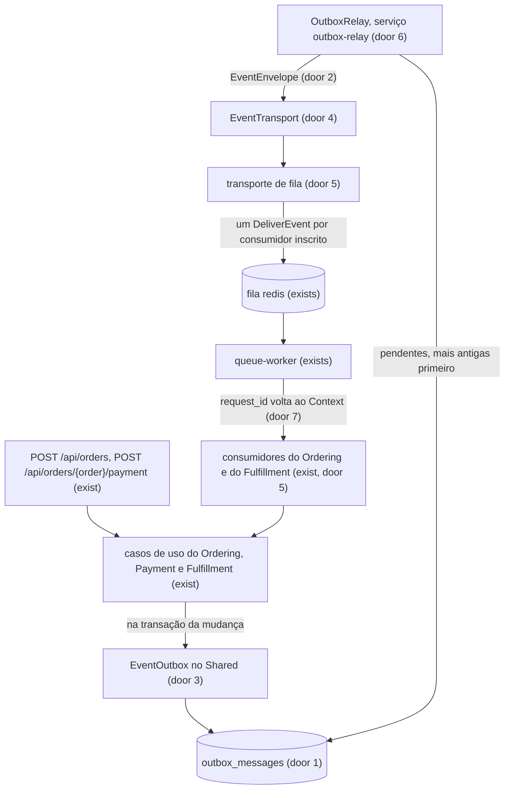

# Outbox transacional: eventos gravados na transação e consumidos pela camada

## Problem

Hoje um evento do pedido só existe depois do commit. Ele vai para a fila do Redis numa chamada separada, e se essa chamada falha, ninguém fica sabendo. Os 5 eventos (`OrderPlaced`, `PaymentApproved`, `OrderPaid`, `DeliveryScheduled` e `OrderDelivered`) usam `ShouldDispatchAfterCommit`, e os listeners `ShouldQueue` os recebem pela fila. A leitura dos casos de uso em 2026-10-15 mostra três pontos em que uma falha da fila trava o pedido para sempre:

1. **`OrderPlaced` perdido.** O pedido fica em `placed`, com o estoque já baixado. O pagamento responde `409` ('Este pedido não está aguardando pagamento.'), e a tela de pagamento fica consultando o pedido sem fim.
2. **`PaymentApproved` perdido.** O `PayOrderUseCase` dispara o evento depois que a transação do pagamento fechou, então ele sai na hora. O cliente foi cobrado, o pedido fica em `awaiting_payment`, e uma nova tentativa também responde `409`, porque já existe pagamento aprovado.
3. **`OrderPaid` perdido.** A transição para `payment_approved` é gravada antes do disparo. O listener tenta de novo, mas a transição condicional não acontece uma segunda vez, e o `OrderPaid` nunca sai. O pedido nunca é entregue, e o retry é justamente o que torna a falha permanente.

Nada disso foi medido: o projeto não tem tráfego. Os três casos vêm da leitura do código.

Quem também paga é a HEL-13. Ela vai pôr um segundo transporte atrás de uma feature flag, com consumidores fora dos jobs do Laravel. Hoje cada listener decide sozinho que roda como job do Laravel, e o disparo está espalhado por 5 casos de uso. Sem um ponto único de publicação e sem um formato de evento que possa ser gravado, a HEL-13 teria de mexer nos 5 casos de uso e nos 5 listeners.

Quando isso estiver pronto, uma falha da fila só atrasa o pedido: ele avança assim que a fila volta. E a HEL-13 troca o transporte sem tocar em casos de uso, eventos ou consumidores.

## Flow

Reaproveita o container `queue-worker`, a fila `redis`, o `tries = 3` com o `failed_jobs` e o `make queue-retry`, as guardas de idempotência do Ordering (a transição condicional de `orders.status` e a primeira gravação de `orders.estimated_delivery_on`), o `Context` com o `request_id` do `AssignRequestId` e o sinal do `queue:restart`. Nada disso é reimplementado.

1. Um caso de uso que muda estado grava o evento pelo `EventOutbox` (door 3), dentro da própria transação. Em `outbox_messages` (door 1), a mensagem nasce pendente, com o `request_id` do `Context` (door 7). O commit grava a mudança e a mensagem juntas, e um rollback desfaz as duas.
2. O `OutboxRelay` (door 6), que roda no serviço `outbox-relay`, reserva as pendentes das mais antigas para as mais novas. Monta o `EventEnvelope` (door 2) de cada uma, entrega ao `EventTransport` (door 4) e só então a marca como publicada. Na primeira falha do transporte, para o ciclo e deixa a mensagem e as seguintes pendentes.
3. O transporte de fila (door 5) põe na fila padrão um `DeliverEvent` para cada consumidor inscrito sob o nome da mensagem, com o envelope inteiro.
4. O `queue-worker` (exists) roda o `DeliverEvent`: devolve o `request_id` ao `Context`, reconstrói o evento pela classe inscrita e chama o `handle()` do consumidor. Se falhar, só essa entrega é repetida, e depois de 3 tentativas ela vai para o `failed_jobs`.
5. O consumidor chama o caso de uso (exists), que pode gravar o próximo evento da cadeia, de volta ao passo 1. O `DeliverOrder` continua como job do Laravel, enfileirado pelo agendamento da entrega depois do commit.
6. out: as rotas respondem como hoje. A tela de pagamento sai de `placed` no ciclo seguinte de consulta, e a mensagem publicada é apagada depois de 7 dias.

## Impact

| Front | What changes |
| --- | --- |
| domain | termo existente "evento": era um objeto despachado pelo dispatcher do Laravel depois do commit e passa a ser uma mensagem gravada na transação, com nome e versão próprios. Quem decide com base nele hoje: os 5 casos de uso que o disparam (`PlaceOrderUseCase`, `PayOrderUseCase`, `MarkOrderAsPaidUseCase`, `ScheduleDeliveryUseCase` e `DeliverOrderUseCase`), e o `OrderEventPayloadTest`, cujo teste `still announces OrderPaid only after the commit` confere o `ShouldDispatchAfterCommit` e é trocado pelos critérios 31 e 39 |
| domain | termo existente "listener" vira "consumidor" (`EventConsumer`): `MarkOrderAsAwaitingPayment`, `MarkOrderAsPaid`, `RecordEstimatedDelivery`, `MarkOrderAsDelivered` e `ScheduleOrderDelivery` saem de `Listeners/` e vão para `Consumers/`, sem `ShouldQueue` e sem `$tries`. O event discovery de `bootstrap/app.php` sai. Quem decide com base nele hoje: o `OrderStatusFlowTest` (`Event::assertListening` e `CallQueuedListener`), o README e a regra do `AGENTS.md` de reiniciar o worker depois de alterar listeners |
| domain | termos novos no `Shared`: "mensagem do outbox" (`outbox_messages`), "envelope" (`EventEnvelope`), "transporte" (`EventTransport`), "inscrição" (`EventSubscriptions`) e "entrega" (`DeliverEvent`) |
| stored data | nothing to migrate: tabela nova, sem chave estrangeira. O projeto não tem produção, e `make fresh` recria o banco |
| queue | os jobs `CallQueuedListener` dão lugar a `DeliverEvent`. Um `CallQueuedListener` que ainda estiver na fila falha no código novo, porque a classe do listener mudou de lugar. Vale o procedimento do README para esvaziar a fila antes do deploy (no ambiente local: `make fresh` e `make queue-restart`) |
| environment | serviço novo `outbox-relay` no Compose, com a mesma imagem e o mesmo volume do `queue-worker`. O `make logs` passa a incluir o relay, e entra o `make logs-relay`. O CI só sobe `db`, `redis` e `api`, então o workflow não muda, e o relay não roda contra o banco `ecommerce_testing` |
| tests | 8 arquivos usam `Event::fake` ou `Queue::fake` para os eventos do pedido (`CheckoutTest`, `CheckoutShippingTest`, `PaymentTest`, `MoneyInCentsTest`, `OrderStatusFlowTest`, `Account/CustomerRecordRoutesTest`, `UseCases/Order/PlaceOrderUseCaseTest` e `UseCases/Payment/PayOrderUseCaseTest`). Eles passam a conferir as linhas de `outbox_messages`, com o mesmo comportamento esperado. Os testes da cadeia rodam o relay com `--once`, e com a fila `sync` o consumidor roda dentro do ciclo do relay |
| docs | README: a seção "Eventos, listeners, jobs e filas" (diagrama, tabela de classes e as notas sobre `ShouldDispatchAfterCommit`, listeners e discovery), a estrutura de pastas, os containers e os comandos do Makefile. Análise de domínio: a linha que diz que "o evento só é disparado depois do commit", a matriz de integração, a linha "o envelope e o outbox ficam para a HEL-9" da tabela de problemas, um problema novo com ✅, o plano e a "Última atualização". `AGENTS.md`: a regra de reiniciar o worker, que passa a valer também para consumidores e relay, e as regras de eventos, onde as doors 1 a 5 entram como regra do projeto |

## Relations

`outbox_messages` é uma entidade isolada: não tem chave estrangeira para nenhuma tabela de negócio. O payload leva os ids como dado (door 1), então uma mensagem sobrevive à exclusão do registro que menciona, e apagar uma mensagem não toca em nenhum outro registro.

One-way constraints: a chave é um UUID v7 gerado pela aplicação, como nos demais registros, e é também o id da mensagem que o consumidor vê (door 1). Uma mensagem pendente nunca é apagada pela retenção (door 6).

## Surface

None - nenhuma rota HTTP é criada ou muda de assinatura. O que fica de fora do código é o envelope que a HEL-13 vai consumir, e ele é a door 2.

## Landing

| One-way door | Literal shape | Alternative rejected |
| --- | --- | --- |
| 1. a tabela `outbox_messages` | `$table->uuid('id')->primary()`, `$table->string('name', 100)`, `$table->smallInteger('version')`, `$table->jsonb('payload')`, `$table->string('request_id', 128)->nullable()`, `$table->timestamp('occurred_at')` e `$table->timestamp('published_at')->nullable()`, sem `timestamps()` e sem chave estrangeira. Índices: `CREATE INDEX outbox_messages_pending_index ON outbox_messages (occurred_at, id) WHERE published_at IS NULL` e `$table->index('published_at')`. O `id` é gerado pela aplicação, como v7 | Uma tabela por módulo: existe um banco só, e a HEL-12 só move a migration. Chave estrangeira para `orders`: o outbox é genérico, e a retenção apagaria em cascata. Uma coluna booleana `published`: perde a idade de que a retenção precisa |
| 2. o envelope e o contrato do evento | `interface DomainEvent { public static function eventName(): string; public static function eventVersion(): int; /** @return array<string, string\|int\|float\|bool\|null> */ public function toPayload(): array; public static function fromPayload(array $payload): static; }`. `final readonly class EventEnvelope(string $id, string $name, int $version, array $payload, CarbonImmutable $occurredAt, ?string $requestId)`. O nome segue `^[a-z]+\.[a-z_]+$`, como `<módulo>.<evento em snake_case>`. As chaves do payload são snake_case. O formato de fio da HEL-13 usa as mesmas chaves das colunas da door 1 | O nome da classe PHP como nome: a HEL-12 muda os namespaces. `serialize()`: ilegível fora do PHP. Payload derivado das propriedades por reflexão: renomear uma propriedade mudaria o formato publicado sem ninguém perceber |
| 3. a gravação só dentro de uma transação | `interface EventOutbox { public function record(DomainEvent $event): void; }`, implementada por um repositório do `Shared`. Recusa com `LogicException` quando `app('db.transactions')->callbackApplicableTransactions()->isEmpty()`, que desconta a transação do `RefreshDatabase`. Recusa com `InvalidArgumentException` um valor do payload que não seja escalar ou nulo. Os eventos perdem `Dispatchable` e `ShouldDispatchAfterCommit` | `DB::transactionLevel() === 0`: dentro do `RefreshDatabase` o nível é sempre pelo menos 1, então a recusa nunca poderia ser provada. Despachar em `DB::afterCommit`: é a janela de hoje, porque o envio falha depois do commit |
| 4. a porta do transporte | `interface EventTransport { public function publish(EventEnvelope $envelope): void; }`. Retornar significa que o transporte aceitou, e lançar exceção significa que não aceitou. Há uma única implementação, o transporte de fila, ligada no container. A HEL-13 acrescenta outra atrás de uma flag | O relay empurrar o job direto para a fila do Laravel: a HEL-13 teria de mudar o relay. O dispatcher de eventos do Laravel como transporte: os consumidores continuariam listeners `ShouldQueue` (a forma A, recusada no design) |
| 5. a inscrição, o consumidor e a entrega | `EventSubscriptions::subscribe(PaymentApproved::class, MarkOrderAsPaid::class)` no `boot()` do service provider do módulo que consome (`OrderingServiceProvider` e `FulfillmentServiceProvider`). O consumidor fica em `<Módulo>/Consumers/` e implementa a interface marcadora `EventConsumer`, com um único `public function handle(PaymentApproved $event): void`. A entrega é `final class DeliverEvent implements ShouldQueue { public int $tries = 3; public function __construct(public EventEnvelope $envelope, public string $consumer) {} }`. O `withEvents(discover: ...)` sai de `bootstrap/app.php` | Descobrir os consumidores pelo tipo do `handle()`: com 5 consumidores, a lista explícita no módulo que consome é mais fácil de ler (design). Um job por mensagem chamando todos os consumidores: a falha de um repetiria os outros |
| 6. o relay | `php artisan outbox:relay [--once]`. Cada ciclo, numa transação: `SELECT ... WHERE published_at IS NULL ORDER BY occurred_at, id LIMIT 100 FOR UPDATE SKIP LOCKED`, entrega em ordem e grava `published_at` de cada mensagem aceita. Na primeira falha, para, faz o commit do que já foi marcado e registra um `warning`. Espera 500 ms depois de um ciclo vazio e 5 s depois de uma falha. Apaga as publicadas há mais de 7 dias ao iniciar e no máximo uma vez por hora. Termina com `0` quando a chave de cache `illuminate:queue:restart` muda. No Compose, o serviço `outbox-relay` usa `<<: *php`, `command: ["php", "artisan", "outbox:relay"]` e `restart: unless-stopped` | Uma tarefa do scheduler por minuto: até 1 min de espera, contra os 2 s confirmados no design. Um job de relay despachado depois do commit: se o envio falhasse, a mensagem esperaria pelo próximo evento. `LISTEN/NOTIFY` do PostgreSQL: mais uma conexão para gerenciar, por uma latência que o polling já atende |
| 7. o `request_id` atravessa o relay | O `EventOutbox` lê `Context::get(AssignRequestId::CONTEXT_KEY)` e grava o valor em `request_id`. O `DeliverEvent` chama `Context::add(AssignRequestId::CONTEXT_KEY, $envelope->requestId)` antes do consumidor, quando o valor não é nulo | Confiar no `Context` que o Laravel serializa no job: quem enfileira o `DeliverEvent` é o relay, que não tem requisição, e o `request_id` se perderia |

- Nothing else in this change is hard to reverse: o tamanho do lote, os tempos de espera, o nome das classes de implementação, a pasta de cada classe nova no `Shared` e onde o `EventTransport` e o `EventOutbox` são ligados ficam para o diff.
- As doors 1 a 5 e a 7 valem além desta feature. O projeto registra decisões no `AGENTS.md` e na análise de domínio, então é lá que elas entram (Impact, linha docs), e não num `STATE.md` paralelo.

## Criteria

### S1: outbox_messages (P1)

Um caso de uso grava um evento dentro da própria transação, e nada é gravado fora de uma.

**Acceptance Criteria**

1. The database SHALL have the table `outbox_messages` with exactly the columns, types and nullability of door 1, the partial index `outbox_messages_pending_index`, an index on `published_at`, and no foreign key
2. WHEN `EventOutbox` records an event inside an open transaction THEN the system SHALL insert exactly one `outbox_messages` row whose `name`, `version` and `payload` are the event's `eventName()`, `eventVersion()` and `toPayload()`, whose `id` is a canonical version 7 UUID, whose `occurred_at` is the current time and whose `published_at` is null
3. IF the transaction that recorded an event rolls back THEN the system SHALL leave no `outbox_messages` row for that event
4. IF `EventOutbox` is asked to record an event while no transaction is open, the `RefreshDatabase` wrapper not counting as one, THEN the system SHALL throw `LogicException` and insert no row
5. IF an event's `toPayload()` returns a value that is not a string, an int, a float, a bool or null THEN `EventOutbox` SHALL throw `InvalidArgumentException` and insert no row
6. WHEN an event is recorded while the Context holds a `request_id` THEN the row's `request_id` SHALL equal that value
7. WHEN an event is recorded while the Context holds no `request_id` THEN the row's `request_id` SHALL be null

**Independent test:** num teste, gravar o `OrderPlaced` dentro de `DB::transaction` e conferir a linha. Fora da transação, conferir a `LogicException` e a tabela vazia.

### S2: EventConsumer (P1)

Cada mensagem publicada chega a cada consumidor inscrito, numa entrega só dele, com o `request_id` de origem.

**Acceptance Criteria**

8. WHEN the queue transport publishes an envelope whose `name` has N subscribed consumers THEN it SHALL push N `DeliverEvent` jobs on the default queue connection, one per consumer, each carrying the whole envelope and the consumer class
9. WHEN the queue transport publishes an envelope whose `name` has no subscribed consumer THEN it SHALL return without pushing a job
10. WHEN a `DeliverEvent` job runs THEN the system SHALL rebuild the event with the subscribed class's `fromPayload()` and call the consumer's `handle()` with it exactly once
11. WHEN a `DeliverEvent` job runs for an envelope with a `request_id` THEN the Context `request_id` SHALL equal that value while the consumer runs
12. WHEN a `DeliverEvent` job runs for an envelope whose `request_id` is null THEN the Context SHALL hold no `request_id` while the consumer runs
13. IF the envelope's `version` differs from the `eventVersion()` of the class subscribed under its `name` THEN the `DeliverEvent` job SHALL throw `UnexpectedValueException` with the name and the version in its message, without calling the consumer
14. IF a consumer throws THEN only its own `DeliverEvent` job SHALL be retried, for at most 3 attempts in total, and SHALL then be recorded in `failed_jobs`, while the other consumers of the same message run once
15. IF a module subscribes a consumer whose single `handle()` parameter is not the subscribed event class, or that does not implement `EventConsumer`, THEN the system SHALL throw `LogicException` when the subscription is made
16. IF two different event classes are subscribed under the same `eventName()` THEN the system SHALL throw `LogicException` when the second subscription is made
17. WHEN a `DeliverEvent` job runs after its `outbox_messages` row was deleted THEN it SHALL still call the consumer with the event its envelope carries
18. The system SHALL register no Laravel event listener for any class under `App\Modules\*\Events`

**Independent test:** inscrever um consumidor de teste, publicar um envelope pelo transporte de fila com a fila `sync` e conferir que o consumidor recebeu o evento com o `request_id` no `Context`.

### S3: OutboxRelay (P1)

As mensagens pendentes saem para o transporte, das mais antigas para as mais novas, e nenhuma se perde quando ele cai.

**Acceptance Criteria**

19. WHEN `php artisan outbox:relay --once` runs THEN the relay SHALL hand every pending message to `EventTransport` in ascending `occurred_at`, then `id`, set each one's `published_at` to the current time once the transport accepts it, and exit `0`
20. IF `EventTransport` throws for a message THEN the relay SHALL keep `published_at` null on that message and on every later message of the cycle, keep the earlier messages of the cycle marked published, and log a `warning` with the message `id`, its `name` and the exception message
21. IF `EventTransport` throws during `php artisan outbox:relay --once` THEN the command SHALL exit `1`
22. The relay SHALL select the pending messages with `FOR UPDATE SKIP LOCKED`, so a message locked by another relay is not handed to the transport by this one
23. WHILE `outbox:relay` runs without `--once`, WHEN a cycle finds no pending message THEN the relay SHALL wait 500 ms before the next cycle
24. WHILE `outbox:relay` runs without `--once`, WHEN a cycle ends with a transport failure THEN the relay SHALL wait 5 s before the next cycle
25. WHEN `outbox:relay` starts, and at most once per hour while it runs, THEN the relay SHALL delete every message whose `published_at` is more than 7 days old and SHALL keep every message whose `published_at` is null, whatever its `occurred_at`
26. WHEN `php artisan queue:restart` runs while `outbox:relay` runs without `--once` THEN the relay SHALL exit `0` after the cycle in progress
27. The Compose file SHALL define the service `outbox-relay` with the image and volume of `queue-worker`, the command `php artisan outbox:relay` and `restart: unless-stopped`
28. The `make logs` target SHALL include the `outbox-relay` service, and the `make logs-relay` target SHALL follow only its logs

**Independent test:** com o ambiente no ar, rodar `docker compose stop redis`, fazer um checkout e ver a mensagem pendente e o `warning` em `make logs-relay`. Depois, rodar `docker compose start redis` e ver o pedido ir para `awaiting_payment`.

### S4: Order events (P1)

Os 5 eventos do pedido passam pelo outbox, e as três janelas do Problem fecham.

**Acceptance Criteria**

29. The events SHALL declare `eventName()` and `eventVersion()` as: `OrderPlaced` `ordering.order_placed` 1, `PaymentApproved` `payment.payment_approved` 1, `OrderPaid` `ordering.order_paid` 1, `DeliveryScheduled` `fulfillment.delivery_scheduled` 1, and `OrderDelivered` `fulfillment.order_delivered` 1
30. The 5 events SHALL produce exactly these payload keys: `order_id` in all five; `delivery_business_days`, an int, in `OrderPaid`; `estimated_delivery_on`, a `Y-m-d` string of the `America/Sao_Paulo` calendar day, in `DeliveryScheduled`. `fromPayload(toPayload())` SHALL rebuild an event with the same `orderId`, the same `deliveryBusinessDays` and the same `Y-m-d` day
31. The codebase SHALL have every class in a module's `Events` folder implement `DomainEvent`, and no class under `App\Modules` SHALL use `Illuminate\Foundation\Events\Dispatchable`, `Illuminate\Contracts\Events\ShouldDispatchAfterCommit`, `Illuminate\Support\Facades\Event` or the `event()` helper
32. The system SHALL subscribe `MarkOrderAsAwaitingPayment` to `OrderPlaced`, `MarkOrderAsPaid` to `PaymentApproved`, `RecordEstimatedDelivery` to `DeliveryScheduled` and `MarkOrderAsDelivered` to `OrderDelivered` in the Ordering module, and `ScheduleOrderDelivery` to `OrderPaid` in the Fulfillment module, and nothing else
33. WHEN `POST /api/orders` returns `201` THEN `outbox_messages` SHALL hold exactly one `ordering.order_placed` row whose `payload.order_id` is the new order's id
34. IF `POST /api/orders` returns `409` for insufficient stock, or fails with `500` on the third code collision, THEN `outbox_messages` SHALL hold no `ordering.order_placed` row
35. WHEN `POST /api/orders/{order}/payment` returns `202` THEN `outbox_messages` SHALL hold exactly one `payment.payment_approved` row whose `payload.order_id` is that order's id
36. IF `POST /api/orders/{order}/payment` returns `402` THEN the declined payment SHALL be recorded and `outbox_messages` SHALL hold no `payment.payment_approved` row
37. IF recording the approved payment hits the unique violation of a concurrent approval THEN the request SHALL return `409` and add no `payment.payment_approved` row
38. IF recording `payment.payment_approved` throws THEN `POST /api/orders/{order}/payment` SHALL return `500` and leave neither the approved payment nor the message
39. WHEN `MarkOrderAsPaid` handles `PaymentApproved` for an order in `awaiting_payment` THEN the order SHALL move to `payment_approved` and `outbox_messages` SHALL gain exactly one `ordering.order_paid` row carrying that order's `delivery_business_days`
40. IF recording `ordering.order_paid` throws THEN the order SHALL stay in `awaiting_payment`, and WHEN the same delivery runs again with the outbox working THEN the order SHALL move to `payment_approved` with exactly one `ordering.order_paid` row
41. WHEN `PaymentApproved` is handled again for an order already in `payment_approved` THEN the order SHALL keep its status and no `ordering.order_paid` row SHALL be added
42. WHEN `ScheduleOrderDelivery` handles `OrderPaid` THEN `outbox_messages` SHALL gain one `fulfillment.delivery_scheduled` row with the estimated day, and a `DeliverOrder` job SHALL be pushed with a delay of `shop.delivery_delay_seconds`
43. IF recording `fulfillment.delivery_scheduled` throws THEN no `DeliverOrder` job SHALL be pushed
44. WHEN `DeliverOrder` runs THEN `outbox_messages` SHALL gain one `fulfillment.order_delivered` row for that order
45. IF `EventTransport` throws while the relay publishes `ordering.order_placed` THEN the order SHALL stay in `placed` with the message pending, and WHEN a later relay cycle succeeds THEN the order SHALL be in `awaiting_payment`
46. IF `EventTransport` throws while the relay publishes `payment.payment_approved` THEN the order SHALL stay in `awaiting_payment`, a second `POST /api/orders/{order}/payment` SHALL return `409`, and WHEN a later relay cycle succeeds THEN the order SHALL be in `payment_approved`
47. WHEN a checkout, an approved payment and relay cycles run until no message is pending THEN the order SHALL end in `delivered` with `estimated_delivery_on` set, and every `outbox_messages` row recorded after the payment SHALL carry the payment request's `request_id`

**Independent test:** `make fresh`, comprar e pagar pelo navegador e conferir em `make logs-relay` e `make logs-worker` a cadeia `placed → awaiting_payment → payment_approved → delivered`, com o mesmo `request_id` do pagamento em todos os logs a partir dele.

## Out of scope

| Excluded | Why |
| --- | --- |
| Horizon, RabbitMQ e a feature flag do transporte | HEL-13: entra atrás do `EventTransport` (door 4) |
| pastas, namespaces e migrations por módulo | HEL-12. A migration do outbox fica junto das atuais |
| métricas e painéis de fila e de outbox | HEL-8 |
| tela de mensagens ou entregas com falha no admin | design, Boundary Out: a falha continua em `make queue-failed` e `make queue-retry` |
| histórico e replay de eventos | design, Key decision 8: a mensagem publicada é apagada depois de 7 dias |
| inbox por consumidor | design, Key decision 3: os 5 consumidores já são idempotentes. Volta quando surgir um efeito que o consumidor não consegue proteger |
| garantia de ordem entre mensagens na entrega | design, Key decision 6: a ordem é só a melhor possível, e nenhum consumidor depende dela |
| ler versões antigas de um payload | só a versão atual de cada evento é aceita (critério 13). Ler mais de uma versão entra quando um formato mudar com mensagens em trânsito |
| levar o `DeliverOrder` pelo outbox | design, Unchanged: é um comando interno do Fulfillment, não um evento |

## Assumptions

| Assumption | Chosen default | Rationale | Confirmed? |
| --- | --- | --- | --- |
| a pasta dos consumidores | `Listeners/` vira `Consumers/` no Ordering e no Fulfillment, e as classes mantêm o nome | sem o event discovery, eles deixam de ser listeners do Laravel, e o nome da pasta enganaria. O `ModuleBoundariesTest` gera a regra de privacidade a partir das pastas, então a pasta nova já nasce privada | n |
| os tempos e o lote do relay | constantes na classe do relay: lote de 100, 500 ms depois de um ciclo vazio, 5 s depois de uma falha, limpeza por hora e retenção de 7 dias. Nenhuma variável de ambiente nova | o design fixou os valores, e nada pede que mudem por ambiente. Uma variável a mais exigiria `.env.example` e coerência no CI sem nenhum uso | n |
| a espera depois de uma falha do transporte | 5 s, e não 500 ms | com o Redis fora, 500 ms gerariam dois `warning` por segundo. O design não fixa prazo para a volta, só que as pendentes saiam quando o transporte voltar | n |
| `SIGTERM` no meio de um ciclo | nenhum tratamento de sinal. O processo morto desfaz a transação do ciclo, as mensagens continuam pendentes, e as já enfileiradas saem de novo no próximo ciclo | a entrega ao menos uma vez (Key decision 3) já cobre esse caso, e o `docker compose stop` espera 10 s antes de matar o processo | n |
| log de sucesso do relay | nenhuma linha por mensagem publicada | cada consumidor já registra o seu efeito com o `request_id`, e uma linha por mensagem a cada 500 ms seria ruído. A falha tem o seu `warning` (critério 20) | n |
| a precisão de `occurred_at` | a padrão do framework, em segundos. O `id` (UUID v7) desempata dentro do mesmo segundo | a ordem é só a melhor possível (Key decision 6), e o v7 do `ramsey/uuid` cresce dentro do mesmo milissegundo no mesmo processo | n |
| a data do `DeliveryScheduled` no payload | `Y-m-d` do dia de `America/Sao_Paulo`, reconstruída como o início desse dia no mesmo fuso | é o dia que o `DeliveryCalendar` calcula, e o `RecordEstimatedDeliveryUseCase` grava só a data | n |

**Open questions:** none - all resolved or logged above.

## Observable

| Surface | Decision | Landing |
| --- | --- | --- |
| command `php artisan outbox:relay` | output format and verbosity | AC 20 (o `warning` da falha). Nenhuma linha por mensagem publicada (Assumptions) |
| command `php artisan outbox:relay` | every flag and its default | AC 19, 21: `--once`, desligado por padrão. Os tempos são constantes (Assumptions) |
| command `php artisan outbox:relay` | exit codes | AC 19, 21, 26 |
| command `php artisan outbox:relay` | what it prints when it fails halfway | AC 20: o `warning` com `id`, `name` e a mensagem, e as pendentes continuam pendentes |
| command `make logs`, `make logs-relay`, `make queue-restart` | output and behaviour | AC 26, 28 |
| screen pagamento | loading state enquanto o pedido está em `placed` | existing - a consulta de 2 s. AC 45 fecha o caso em que ela não terminava nunca |
| screen detalhe do pedido | loading state enquanto o pagamento está sendo processado | existing - a consulta de 2 s. AC 46 |
| screen pagamento e detalhe | error, empty, unauthorised states | n/a - nenhuma tela muda, e as respostas da API são as de hoje |
| API `POST /api/orders` | response shape and codes | existing - `201`, `409`, `422` e `500` de hoje. AC 33, 34 |
| API `POST /api/orders/{order}/payment` | response shape and codes | existing - `202`, `402`, `404` e `409` de hoje. AC 35 a 38 |
| all routes | versioning, rate limits | n/a - nenhuma rota é criada ou muda, e nenhum `throttle` muda |
| collection inscrições de consumidores | duplicates, the exception that does not fit | AC 15, 16 |
| collection nomes de evento | naming, ordering | AC 29. O formato está na door 2 |
| document README, análise de domínio, `AGENTS.md` | structure, depth, what the reader does next | existing - o `AGENTS.md` define onde e como atualizar. Os pontos estão na linha docs do Impact |

## Sources

- [HEL-9](https://linear.app/helter/issue/HEL-9/implementar-o-padrao-outbox-para-poder-disparar-eventos) - todo evento sai pelo outbox dentro de uma transação, por uma camada de publicar e consumir
- [.design/transactional-outbox.md](../../../.design/transactional-outbox.md) - o design confirmado por diashelter em 2026-10-15: Key decisions 1 a 8, a forma B e as quatro slices
