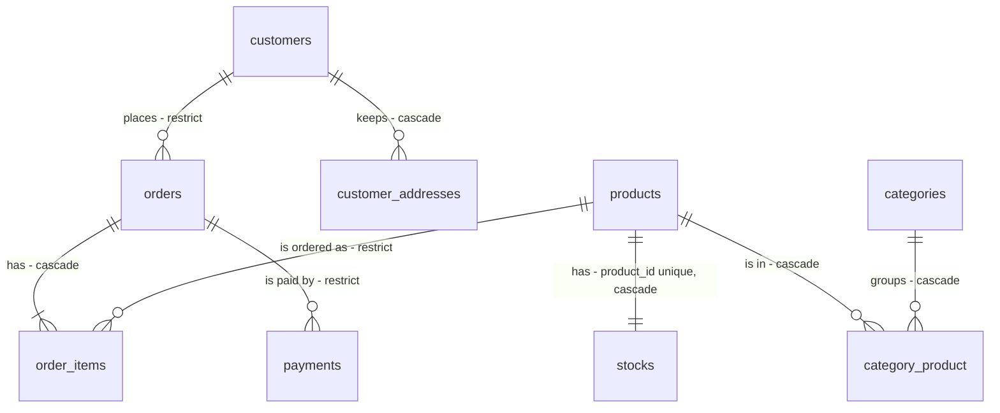

# Ids públicos: UUID v7 nos registros e nenhum binding nas rotas

## Problem

Hoje todo registro de negócio é identificado por um inteiro sequencial, e esse número sai do banco para quem usa a loja. Recontagem de 2026-10-15 no código:

- 13 resources o devolvem (`id`, `order_id`, `product_id`, `customer.id`, `stock.id` e `product.id`). O design contou 14;
- 8 rotas do frontend o colocam na URL: `/products/7`, `/payment/42`, `/account/orders/42` e cinco do admin. O design contou 9;
- 9 lugares, em 8 telas, mostram `#42`: a lista, o detalhe e o painel do cliente (dois no painel), o pagamento, o aviso de pedido criado, a lista e o detalhe do admin e o detalhe do cliente no admin.

O número revela quantos pedidos a loja já recebeu, e `/products/7` convida a tentar o 8. O mesmo tipo está em 9 tabelas, em 9 métodos de 7 contratos, em 5 eventos e no job `DeliverOrder`, e nas listas tipadas. A HEL-9 vai gravar esses payloads, a HEL-6 vai publicar contratos de leitura com eles e a HEL-12 vai mover as migrations. A que chegar antes desta herda o inteiro e precisa ser refeita depois.

Nas rotas que apontam para um registro, o route model binding lê o banco fora de `Repositories/`. Nas quatro rotas do cliente com registro (o pedido, o pagamento dele e as duas do endereço), o binding carrega o registro de qualquer cliente e a policy responde `403`, o que confirma a quem não é dono que aquele id existe. E 6 rotas de escrita leem o registro sem precisar:

- o ajuste de estoque, que lê o estoque e depois o lê de novo com lock;
- os 4 deletes (produto, categoria, membro da equipe e endereço), que leem o registro só para apagá-lo;
- a edição do cliente no admin, que lê o cliente no `Route::bind` e de novo no `updateProfile` do `CustomerAccounts`. O design contou 5 rotas; esta é a sexta.

Quando isto estiver entregue, nenhum número interno sai do banco. A API e as URLs só levam UUIDs, e as telas mostram um código de 8 símbolos no lugar de `#42`. O pedido, o pagamento e o endereço de outro cliente respondem como um id desconhecido (`404`), e as 6 rotas fazem uma query a menos.

## Flow

Reaproveita os `Route::pattern` do `AppServiceProvider`, que já recusam com `404` um id fora do formato no caminho antes de qualquer query; só a expressão muda. Reaproveita também:

- o `HasUuids` do Laravel 13, que gera o v7 com `Str::uuid7()`;
- a busca com o dono que o `DeliveryAddressBook` já faz;
- o savepoint com que o `PayOrderUseCase` (exists) isola a gravação do pagamento;
- o `ApiExceptionRenderer`, que já dá ao `404` o envelope `NOT_FOUND` com 'Recurso não encontrado.'.

O design atribuía a recusa do id malformado no caminho ao `HasUuids` e aos dois `Route::bind`. Os padrões globais já fazem isso antes deles, então nenhum binding precisa conferir formato em nenhuma slice.

1. requisição em `/api/*` com `{product}`, `{category}`, `{stock}`, `{customer}`, `{user}`, `{order}` ou `{address}` -> `AppServiceProvider` (exists): o padrão global de cada parâmetro só casa o formato canônico do id (door 2). Fora dele a rota não casa: `404` 'Recurso não encontrado.', sem query
2. rota casada -> Form Request (exists) valida o corpo antes de qualquer leitura do registro. Os ids do corpo (`items.*.product_id`, `address_id` e `category_ids.*`) passam pelo formato (door 2) antes de qualquer busca ou regra `exists`. Corpo inválido: `422`
3. controller (exists) entrega ids `string` (door 1), e nenhum parâmetro de rota vira registro (door 4). Na escrita, o id vai ao use case (exists). Na leitura, vai ao repositório (exists), ou ao use case quando já existe um, como o `ShowCustomerUseCase`
4. use case ou repositório (exists) -> repositório do próprio módulo, ou o contrato do dono (`CustomerAccounts`, `PayableOrders`, exists) quando o registro é de outro módulo. Nas rotas do cliente, a busca leva o dono (door 5). Nada encontrado: `404`. Os deletes e o ajuste de estoque vão direto à escrita ou à leitura com lock, sem ler antes
5. `POST /api/orders` -> `PlaceOrderUseCase` (exists): depois do lock e da baixa de estoque, o `OrderRepository` (exists) grava o pedido e os itens num savepoint, com o código sorteado (door 3). Numa colisão, só o savepoint é desfeito e o código é sorteado de novo, até 3 sorteios. O sorteio do código fica no Ordering (new, no door - placement per conventions)
6. `OrderPlaced`, `OrderPaid`, `PaymentApproved`, `DeliveryScheduled`, `OrderDelivered` e o job `DeliverOrder` (exists) levam `string $orderId` (door 1) aos listeners (exists)
7. out: os resources (exists) devolvem `id` e todo `*_id` como UUID em texto, e o pedido também o `code` (door 3). O frontend (exists) tipa ids como `string`, casa as 8 rotas pelo formato do UUID, mostra `#<code>` e descarta o carrinho salvo com ids numéricos

## Impact

| Front | What changes |
| --- | --- |
| domain | termo existente "id": era o inteiro sequencial do banco e passa a ser um UUID v7 em texto, gerado pela aplicação. Quem decide com base nele hoje: os 9 métodos de contrato (`hasBeenOrdered`, `updateProfile`, `findProfile`, `createForProduct`, `decrement`, `countForCustomer`, `recentForCustomer`, `DeliveryAddressBook::find` e `findForPayment`), os 5 eventos e o job `DeliverOrder`, as listas `ProductIds`, `CategoryIds` e `CustomerIds`, e os mapas por id `StockQuantities`, `OrderCountsByCustomer` e `ProductQuantities` |
| domain | os value objects e DTOs com id (`CatalogProduct`, `CustomerProfile`, `OrderForPayment`, `OrderSummary`, `OrderLine`, `ValidatedCartLine`, `CartItemDTO` e `ChargeRequest`), os use cases que recebem id (`PlaceOrderUseCase`, os três `MarkOrderAs*UseCase`, `RecordEstimatedDeliveryUseCase`, `ScheduleDeliveryUseCase`, `DeliverOrderUseCase`, `CreateCustomerAddressUseCase`, `UpdateCustomerUseCase` e `UpdateOwnProfileUseCase`) e os `(int)` do `ValidateCartRequest`, do `StoreOrderRequest` e dos dois `Route::bind` passam de inteiro a `string` |
| domain | termo novo "código do pedido" (`code`): 8 símbolos para pessoas lerem, no Ordering. Entra no `OrderResource` e no `OrderSummary`, que é vocabulário público do Ordering pelo `CustomerOrderHistory`, e daí no `OrderSummaryResource` do Customers. Nenhum contrato o recebe como parâmetro, e nenhum evento o carrega |
| domain | termo existente "dono" nas rotas do cliente: era conferido por policy depois da busca e passa para dentro da busca. Saem a `OrderPolicy` (com o `#[UsePolicy]` do `Order`), a `CustomerAddressPolicy` (com o `#[UsePolicy]` do `CustomerAddress` e o `authorize()` do `CustomerAddressRequest`, que hoje decide antes da validação) e a `OrderPaymentPolicy` (com o `Gate::policy` do `PaymentServiceProvider`). O `PayableOrders::findForPayment` passa a receber o id do cliente |
| domain | resolução da rota: saem o `Route::bind` de `{payableOrder}` (`PaymentServiceProvider`), o de `{customer}` (`CustomersServiceProvider`) e o binding implícito de `Product`, `Category`, `Stock`, `User`, `Order` e `CustomerAddress`. O parâmetro `{payableOrder}` passa a se chamar `{order}`, e o caminho `/api/orders/{order}/payment` não muda. O `unique` do `UpdateCustomerRequest`, do `UpdateStaffMemberRequest` e do `CategoryRequest` passa a ignorar o id da rota em texto |
| API | `id` e todo `*_id` mudam de número para texto em todas as respostas, e o pedido ganha `code` (ver Surface). Nas 4 rotas do cliente com registro, `403` vira `404`. Em toda rota de escrita com registro, o corpo inválido é `422` mesmo com id desconhecido; hoje o `404` vem antes. Quem decide com base nisso: o frontend e os testes |
| stored data | nothing to migrate: o projeto não tem produção, e `make fresh` recria o banco. As migrations de criação das 9 tabelas e da `category_product` são editadas no lugar, sem migration nova. Check constraints, índices e regras de exclusão não mudam. `sessions.user_id` continua `bigint` (Out of scope) |
| ordering | as ordenações `latest()->latest('id')` continuam desempatando pelo id: o v7 do `ramsey/uuid` cresce dentro do mesmo milissegundo no mesmo processo, então a ordem de inserção se mantém |
| queue | os payloads dos eventos e do job mudam de tipo: `make fresh` e `make queue-restart` antes de rodar |
| tests | o `999999` de 20 arquivos vira um UUID v7 que não existe. Os testes de `403` do cliente (`AuthorizationTest`, `PaymentTest` e `Account/CustomerAddressTest`) passam a esperar `404`. As rotas de escrita do `MoneyInCentsTest` mandam corpo válido para continuar provando o `404`. Entram testes de contagem de queries, do código do pedido e de arquitetura das rotas |
| frontend | `types/index.ts` (ids `string`), `router/routes.ts` (8 rotas), os 9 lugares que mostram `#<id>`, `stores/cart.ts` (chave nova), os services e composables que tipam id como `number`, e os testes do Vitest |
| docs | README: a estrutura do Payment (linha 102), a tabela da API com ids e os `403` das rotas do cliente (linhas 556 a 591), os testes (683 e 688) e as decisões (783 a 790). Análise de domínio: as linhas 140, 155, 219, 294, 426, 462 e 518, um problema novo da HEL-11 já com ✅, o desvio do pagamento da linha 462 desfeito, a entrada em "Depois do plano" e a "Última atualização". `AGENTS.md`: a linha 67, com o `Route::bind` e as policies reescritos pelas Key decisions 4 e 5 do design |

## Relations

One-way constraints: toda chave primária e toda chave estrangeira dessas tabelas, e a chave de `users`, passam a ser o UUID da door 1. `orders.code` é único e segue o formato do alfabeto (door 3). As cardinalidades, o `stocks.product_id` único, a chave composta da `category_product`, o índice parcial de `payments` (um aprovado por pedido) e as regras de exclusão não mudam. `users` não se relaciona com nenhuma outra tabela de negócio. No columns and no types here.

## Surface

Todas as rotas que devolvem registro mudam o tipo de `id` e de todo `*_id` para UUID em texto. As linhas abaixo trazem as que mudam também entrada, campo ou status.

| Route | In | Out | Status |
| --- | --- | --- | --- |
| `POST /api/orders` | `items[].product_id` (UUID), `items[].quantity`, `address_id` (UUID) | `data.id` · `data.code` · `data.items[].id` · `data.items[].product_id` | `201`, `401`, `409`, `422`, `429`, `500` (três colisões de código) |
| `POST /api/cart/validate` | `items[].product_id` (UUID), `items[].quantity` | `data.items[].product_id` | `200`, `422`, `429` |
| `GET /api/orders` · `GET /api/orders/{order}` | `{order}` (UUID) | `data[].code` · `data.code` | `200`, `401`, `404` (outro cliente; hoje `403`) |
| `POST /api/orders/{order}/payment` (placeholder hoje `{payableOrder}`) | `{order}` (UUID), `card_token` | `data.id` · `data.order_id` | `202`, `401`, `402`, `404` (outro cliente; hoje `403`), `409`, `422`, `429` |
| `PUT /api/account/addresses/{address}` · `DELETE /api/account/addresses/{address}` | `{address}` (UUID) e, no `PUT`, os campos de hoje | `data.id` | `200`, `204`, `401`, `404` (outro cliente; hoje `403`), `422` |
| `GET /api/account` | — | `data.customer.id` · `data.last_order.code` · `data.recent_orders[].code` | `200`, `401` |
| `POST /api/admin/products` · `PUT /api/admin/products/{product}` | `{product}` (UUID), `category_ids[]` (UUID) | `data.id` · `data.stock.id` · `data.categories[].id` | `200`, `201`, `401`, `404`, `422` |
| `GET /api/admin/customers/{customer}` · `PUT /api/admin/customers/{customer}` | `{customer}` (UUID) | `data.id` · `data.orders[].code` | `200`, `401`, `404`, `422` |
| `GET /api/admin/orders` · `GET /api/admin/orders/{order}` | `{order}` (UUID) | `data[].code` · `data.code` · `data.customer.id` | `200`, `401`, `404` |
| `GET /api/products/{product}`, `GET /api/admin/products/{product}`, `PATCH /api/admin/products/{product}/status`, `GET` e `PUT /api/admin/categories/{category}`, `PUT /api/admin/stocks/{stock}`, `GET` e `PUT /api/admin/users/{user}` | o parâmetro (UUID); o corpo é validado antes da existência | `data.id` e os ids aninhados | `200`, `401`, `403` (suporte em `users`), `404`, `422` |
| `DELETE /api/admin/products/{product}` · `DELETE /api/admin/categories/{category}` · `DELETE /api/admin/users/{user}` | o parâmetro (UUID) | — | `204`, `401`, `403` (suporte), `404`, `409` |

## Landing

| One-way door | Literal shape | Alternative rejected |
| --- | --- | --- |
| 1. a chave UUID v7 e o id `string` nas assinaturas | As 9 tabelas: `$table->uuid('id')->primary()`. Toda chave estrangeira para elas: `$table->foreignUuid('<x>_id')`, com o mesmo `constrained()`, `unique()`, `index()` e a mesma regra de exclusão de hoje. Os models que gravam (`User`, `CustomerAccount`, `Category`, `Product`, `Stock`, `Order`, `OrderItem`, `Payment` e `CustomerAddress`) usam `HasUuids`. O `Customer` do Ordering, que só lê, declara `protected $keyType = 'string'` e `public $incrementing = false`. Contratos: `hasBeenOrdered(string $productId)`, `updateProfile(string $customerId, …)`, `findProfile(string $customerId)`, `createForProduct(string $productId, int $quantity)`, `decrement(string $productId, int $quantity)`, `countForCustomer(string $customerId)`, `recentForCustomer(string $customerId, int $limit)` e `DeliveryAddressBook::find(string $customerId, string $addressId)`. Eventos e o job `DeliverOrder`: `public string $orderId` | Sqids sobre o inteiro: o número continuaria sequencial por baixo, e cada fronteira teria de codificar e decodificar. UUID v4: espalha as inserções no índice (RFC 9562). Coluna de texto: o `uuid` nativo ocupa 16 bytes e o PostgreSQL já recusa o que não é UUID. Um value object por id: só uma assinatura tem dois ids de registros diferentes (`DeliveryAddressBook::find`) |
| 2. o formato canônico do id, numa fonte só | A expressão `[0-9a-f]{8}-[0-9a-f]{4}-[0-9a-f]{4}-[0-9a-f]{4}-[0-9a-f]{12}` (minúsculas, com hífens, qualquer versão), declarada uma vez no `Shared`. Dela leem: os `Route::pattern` do `AppServiceProvider`, um por nome de parâmetro (`product`, `category`, `stock`, `customer`, `user`, `order` e `address`), no lugar do `[0-9]+` de hoje; a validação dos ids do corpo, com `bail` antes de qualquer `exists`; e as listas `ProductIds`, `CategoryIds` e `CustomerIds`, que lançam `InvalidArgumentException` para o resto | `whereUuid` e a regra `uuid` do Laravel: aceitam maiúsculas. Um id da própria conta em maiúsculas passaria pela comparação de texto do `DELETE /api/admin/users/{user}` como outro id, e o PostgreSQL apagaria a mesma linha. A regra `uuid:7`: só a versão não evita erro no banco, e um v4 bem formado já cai no `404` de id desconhecido |
| 3. `orders.code` | `$table->char('code', 8)->unique()`, não nulo, mais `ALTER TABLE orders ADD CONSTRAINT orders_code_format CHECK (code ~ '^[ABCDEFGHJKMNPQRSTUVWXYZ23456789]{8}$')`. É sorteado com `random_int` sobre esse alfabeto de 31 símbolos. O pedido e os itens são gravados num `DB::transaction` aninhado (savepoint) dentro da transação do checkout. Uma `UniqueConstraintViolationException` desfaz só o savepoint e leva a um novo sorteio, com no máximo 3 sorteios. Na terceira colisão, a exceção sobe e a transação inteira é desfeita | Um código derivado do UUID: não é único garantido. Uma sequência: revela a contagem de pedidos. Repetir a transação inteira: soltaria o lock e refaria a baixa de estoque |
| 4. nenhuma rota resolve registro | Os controllers recebem o parâmetro como `string $product`, `string $order` e assim por diante. Não existe `Route::bind`. Um teste de arquitetura percorre `Route::getRoutes()` e, para toda rota sob `api/`, exige três coisas: `signatureParameters(['subClass' => UrlRoutable::class])` vazio; `Route::getBindingCallback($name)` nulo para cada parâmetro; e `$route->wheres[$name]` igual à expressão da door 2 | Um `Route::bind` explícito por parâmetro, resolvido pelo repositório do dono: não economiza query e deixa dois mecanismos. É a forma que o design descartou (Shape) |
| 5. o dono na busca das rotas do cliente | `PayableOrders::findForPayment(string $customerId, string $orderId): ?OrderForPayment`, na mesma ordem do `DeliveryAddressBook::find`. O pedido e o endereço são buscados com `where customer_id = ?`. O pedido, o pagamento e o endereço de outro cliente respondem `404`, com o corpo de um id desconhecido. A `OrderPolicy`, a `CustomerAddressPolicy` e a `OrderPaymentPolicy` deixam de existir | Manter as policies como segunda checagem, respondendo `403`: confirmaria que o registro existe. Conferir o dono depois da busca, no use case: o `409` de status poderia sair antes do `404` |

- Nothing else in this change is hard to reverse: o nome das classes novas, a forma do sorteio, o nome da chave do carrinho e o arquivo dos testes novos ficam para o diff

## Criteria

### S1: UUID v7 keys (P1)

As 9 tabelas com chave `uuid` gerada pela aplicação, ids `string` em toda assinatura, o formato validado no corpo e no caminho, e o frontend tratando id como texto.

**Acceptance Criteria**

1. The database SHALL type as PostgreSQL `uuid` the primary key `id` of `users`, `customers`, `categories`, `products`, `stocks`, `orders`, `order_items`, `payments` and `customer_addresses`, and the foreign keys `stocks.product_id`, `category_product.product_id`, `category_product.category_id`, `orders.customer_id`, `order_items.order_id`, `order_items.product_id`, `payments.order_id` and `customer_addresses.customer_id`
2. WHEN the application creates a row in any of those 9 tables THEN the system SHALL assign it, before the insert, an id that is a version 7 UUID in canonical form: 36 characters, lowercase hexadecimal digits and hyphens in the 8-4-4-4-12 layout, with `7` as the first digit of the third group
3. The database SHALL keep the `onDelete` rules of commit `714f1fe`: `restrict` on `orders.customer_id`, `order_items.product_id` and `payments.order_id`, and `cascade` on `stocks.product_id`, `category_product.product_id`, `category_product.category_id`, `order_items.order_id` and `customer_addresses.customer_id`
4. The database SHALL keep `stocks.product_id` unique, `category_product` keyed by (`product_id`, `category_id`), the partial unique index `payments_order_id_approved_unique`, and every check constraint the 10 tables have at `714f1fe`
5. WHEN any API route returns a record THEN every `id` and `*_id` field of the body, including `order_id`, `product_id`, `customer.id`, `stock.id`, `product.id` and `categories[].id`, SHALL be a canonical UUID string and never a JSON number
6. The 9 contract methods `ProductOrderHistory::hasBeenOrdered`, `CustomerAccounts::updateProfile`, `CustomerAccounts::findProfile`, `StockInitializer::createForProduct`, `StockReservation::decrement`, `CustomerOrderHistory::countForCustomer`, `CustomerOrderHistory::recentForCustomer`, `DeliveryAddressBook::find` and `PayableOrders::findForPayment` SHALL type every id parameter as `string`
7. The events `OrderPlaced`, `OrderPaid`, `PaymentApproved`, `DeliveryScheduled` and `OrderDelivered` and the job `DeliverOrder` SHALL carry the order as `public string $orderId`
8. The system SHALL declare no `int` parameter or property named `id`, or whose name ends in `Id`, in any class under `App\Modules`
9. The typed lists `ProductIds`, `CategoryIds` and `CustomerIds` SHALL accept canonical UUIDs and SHALL throw `InvalidArgumentException` for `"1"`, `""`, `"abc"`, an uppercase UUID, or an id repeated in the same list
10. IF an `items.*.product_id` of `POST /api/cart/validate` or `POST /api/orders` is not a canonical UUID (`1`, `"1"`, `"abc"` or an uppercase UUID) THEN the system SHALL return `422` with an error under `errors["items.0.product_id"]` and run no query on `products` or `stocks`
11. IF the `address_id` of `POST /api/orders` is not a canonical UUID THEN the system SHALL return `422` with an error under `errors.address_id` and lock no `stocks` row
12. IF an element of `category_ids` in `POST /api/admin/products` or `PUT /api/admin/products/{product}` is not a canonical UUID THEN the system SHALL return `422` with an error under `errors["category_ids.0"]` and run no query on `categories`
13. WHEN `POST /api/cart/validate` receives a canonical UUID that matches no product THEN the system SHALL return `200` with that line's `problem` set to `"Produto não encontrado."` and `is_valid` `false`
14. WHEN `POST /api/orders` receives a canonical UUID that matches no product THEN the system SHALL return `409` with `errors["items.<that id>"]` `["Produto não encontrado."]` and create no order
15. WHEN `POST /api/orders` receives a canonical `address_id` that is not in the customer's address book THEN the system SHALL return `422` with `errors.address_id` `["Endereço de entrega não encontrado."]` and lock no `stocks` row
16. WHEN `POST /api/admin/products` receives a canonical UUID in `category_ids` that matches no category THEN the system SHALL return `422` with an error under `errors["category_ids.0"]`
17. IF a route parameter `{product}`, `{category}`, `{stock}`, `{customer}`, `{user}`, `{order}` or `{address}` is not a canonical UUID (`1`, `abc` or an uppercase UUID) THEN the system SHALL return `404` with `code` `"NOT_FOUND"` and `message` `"Recurso não encontrado."`, and run no query
18. The frontend routes `product`, `payment`, `account.order`, `admin.products.edit`, `admin.customers.show`, `admin.customers.edit`, `admin.users.edit` and `admin.orders.show` SHALL match only a canonical UUID in the id segment and SHALL pass it to the page as a string
19. IF a frontend URL carries an id that is not a canonical UUID (`/products/7`, `/account/orders/42`) THEN the frontend SHALL render the `not-found` page
20. WHEN the cart store loads while the browser holds a cart under `cart-v2` THEN the frontend SHALL remove that key and start with an empty cart under a new key
21. The frontend types SHALL declare every `id` and `*_id` as `string`, and `npm run type-check` SHALL exit 0

**Independent test:** `make fresh`, criar produto, categoria, cliente, endereço e pedido pelo navegador, conferir que todo id na API e na URL é um UUID e que `/api/products/1` responde `404` sem query.

### S2: orders.code (P1)

Todo pedido com um código de 8 símbolos, devolvido pela API e mostrado em toda tela no lugar do id.

**Acceptance Criteria**

22. WHEN `POST /api/orders` succeeds THEN the system SHALL return `201` with `data.code`, a string of 8 symbols from `ABCDEFGHJKMNPQRSTUVWXYZ23456789`, equal to the stored `orders.code`
23. The database SHALL refuse an `orders` row whose `code` is null, is not 8 characters long, or holds a character outside `ABCDEFGHJKMNPQRSTUVWXYZ23456789` (`0`, `O`, `1`, `I`, `L` or a lowercase letter)
24. The database SHALL refuse a second `orders` row with a `code` that already exists
25. IF the first drawn code already belongs to another order THEN `POST /api/orders` SHALL draw again and return `201` with a different code, with exactly one `select … for update` on `stocks`, each item's stock decremented exactly once, and one `OrderPlaced` dispatched
26. IF the third consecutive draw also collides THEN `POST /api/orders` SHALL return `500`, leave no new `orders` or `order_items` row, leave every stock quantity as it was before the request, and dispatch no `OrderPlaced`
27. WHEN `POST /api/orders` succeeds on the first draw THEN the system SHALL run the same number of queries as at `714f1fe` for the same request
28. WHEN `GET /api/orders`, `GET /api/orders/{order}`, `GET /api/admin/orders` or `GET /api/admin/orders/{order}` returns an order THEN the order SHALL include `code`
29. WHEN `GET /api/account` returns `last_order` and `recent_orders`, or `GET /api/admin/customers/{customer}` returns `orders`, THEN each order summary SHALL include `code`
30. The system SHALL accept the order code as a parameter in no contract method, carry it in no event or job, and use it in no route path
31. WHEN a screen shows an order (`account/OrderListPage`, `account/OrderDetailPage`, both spots of `account/AccountDashboardPage`, `public/PaymentPage`, the order-created notification of `useCheckout`, `admin/OrderListPage`, `admin/OrderDetailPage` and `admin/CustomerDetailPage`) THEN the frontend SHALL show `#<code>` and never `#<id>`
32. WHEN a screen links to an order THEN the frontend SHALL keep the id in the URL: `/account/orders/<uuid>`, `/admin/orders/<uuid>` and `/payment/<uuid>`

**Independent test:** fazer um pedido e ver `#K7Q2M9XA` no aviso, na lista, no detalhe, no pagamento e no admin, com o UUID na URL; num teste, forçar o sorteio a colidir uma vez e três vezes.

### S3: Guard staff e vitrine (P2)

A vitrine e as rotas do admin com registro, sem binding, com o id chegando ao use case ou ao repositório e 5 escritas com uma query a menos.

**Acceptance Criteria**

33. The controllers of `GET /api/products/{product}`, `GET`, `PUT` and `DELETE /api/admin/products/{product}`, `PATCH /api/admin/products/{product}/status`, `GET`, `PUT` and `DELETE /api/admin/categories/{category}`, `PUT /api/admin/stocks/{stock}`, `GET` and `PUT /api/admin/customers/{customer}`, `GET`, `PUT` and `DELETE /api/admin/users/{user}` and `GET /api/admin/orders/{order}` SHALL receive the route parameter as a `string`
34. WHEN one of the routes of criterion 33 receives a canonical UUID that matches no record, with no body or with a valid body, THEN the system SHALL return `404` with `code` `"NOT_FOUND"` and `message` `"Recurso não encontrado."`, and change no row
35. IF `PUT /api/admin/products/{product}`, `PATCH /api/admin/products/{product}/status`, `PUT /api/admin/categories/{category}`, `PUT /api/admin/stocks/{stock}`, `PUT /api/admin/customers/{customer}` or `PUT /api/admin/users/{user}` receives an invalid body THEN the system SHALL return `422` both for an existing id and for an unknown id
36. WHEN `GET /api/products/{product}` targets an existing product that cannot be bought THEN the system SHALL return `404` with `message` `"Produto indisponível."`
37. WHEN `PUT /api/admin/stocks/{stock}` succeeds THEN the system SHALL read the `stocks` row once, with `for update`, and run 3 queries where commit `714f1fe` runs 4
38. WHEN `DELETE /api/admin/products/{product}` or `DELETE /api/admin/categories/{category}` targets a record that may be deleted THEN the system SHALL return `204` and delete it without selecting it first, running one query fewer than at `714f1fe`
39. IF `DELETE /api/admin/products/{product}` targets a product that has been ordered THEN the system SHALL return `409` with `message` `"Este produto possui pedidos e não pode ser excluído. Desative-o em vez disso."` and delete nothing
40. IF `DELETE /api/admin/categories/{category}` targets a category with products THEN the system SHALL return `409` with `message` `"Esta categoria possui produtos associados e não pode ser excluída."` and delete nothing
41. IF `DELETE /api/admin/users/{user}` targets the caller's own account THEN the system SHALL return `409` with `message` `"Você não pode remover a própria conta."` and run no query on `users`
42. WHEN `DELETE /api/admin/users/{user}` targets another staff member THEN the system SHALL return `204` and delete the member without selecting it first, running one query fewer than at `714f1fe`
43. WHEN `PUT /api/admin/customers/{customer}` succeeds THEN the system SHALL return `200` and run one query fewer than at `714f1fe`, reading the customer once
44. WHEN the same successful request is sent to `GET /api/products/{product}`, `GET` or `PUT /api/admin/products/{product}`, `PATCH /api/admin/products/{product}/status`, `GET` or `PUT /api/admin/categories/{category}`, `GET /api/admin/customers/{customer}`, `GET` or `PUT /api/admin/users/{user}` or `GET /api/admin/orders/{order}` THEN the system SHALL run the same number of queries as at `714f1fe`

**Independent test:** pelo painel, editar, desativar e excluir um produto, ajustar o estoque e remover um membro da equipe; por `curl`, mandar um UUID desconhecido e um corpo inválido para cada rota.

### S4: Guard customer (P2)

As rotas do cliente buscando o registro com o dono, sem as três policies, e o teste de arquitetura recusando qualquer binding.

**Acceptance Criteria**

45. WHEN the owner sends `GET /api/orders/{order}`, `POST /api/orders/{order}/payment` with a valid body for an order awaiting payment, `PUT /api/account/addresses/{address}` with a valid body, or `DELETE /api/account/addresses/{address}` THEN the system SHALL return `200`, `202`, `200` and `204`, respectively
46. IF one of the routes of criterion 45 targets a record of another customer THEN the system SHALL return `404` with the body of an unknown id (`code` `"NOT_FOUND"`, `message` `"Recurso não encontrado."`, `errors` `{}`), and change no row
47. IF `POST /api/orders/{order}/payment` targets an order of another customer that is not awaiting payment THEN the system SHALL return `404`, never `409`
48. IF `POST /api/orders/{order}/payment` targets an unknown order with a valid body THEN the system SHALL return `404`, call no gateway charge, create no `payments` row and dispatch no `PaymentApproved`
49. IF `POST /api/orders/{order}/payment` or `PUT /api/account/addresses/{address}` receives an invalid body THEN the system SHALL return `422` for an own, a foreign or an unknown id alike
50. WHEN the owner sends `DELETE /api/account/addresses/{address}` THEN the system SHALL delete the address without selecting it first, running one query fewer than at `714f1fe`
51. WHEN the owner sends the same successful request to `GET /api/orders/{order}`, `POST /api/orders/{order}/payment` or `PUT /api/account/addresses/{address}` THEN the system SHALL run the same number of queries as at `714f1fe`
52. The system SHALL declare no `OrderPolicy`, `CustomerAddressPolicy` or `OrderPaymentPolicy`
53. The contract `PayableOrders` SHALL declare `findForPayment(string $customerId, string $orderId): ?OrderForPayment`
54. IF a route under `api/` has an action parameter whose type implements `UrlRoutable` THEN the architecture test SHALL fail
55. IF a route under `api/` has a parameter with an explicit binding (`Route::bind`) THEN the architecture test SHALL fail
56. IF a parameter of a route under `api/` has a pattern other than the canonical id expression of door 2, or none, THEN the architecture test SHALL fail
57. WHEN a deliberate violation of each of criteria 54, 55 and 56 is introduced THEN the architecture test SHALL fail for each, and SHALL pass again once it is removed

**Independent test:** com duas contas de cliente, abrir pelo navegador o pedido, o pagamento e o endereço da outra e ver 'Recurso não encontrado.'; depois rodar o teste de arquitetura com um `Route::bind` de propósito.

## Out of scope

| Excluded | Why |
| --- | --- |
| mudar o caminho de alguma rota, inclusive endereçar o estoque pelo produto | design, Boundary Out: o `PUT admin/stocks/{stock}` continua endereçado pelo estoque |
| buscar pedido pelo código no admin | design, Boundary Out: o código já nasce único e indexado, mas a busca é outra entrega |
| layout de pastas, rotas e migrations por módulo | HEL-12 |
| `sessions.user_id` e as demais tabelas do framework (`jobs`, `failed_jobs`, `cache`) | a sessão roda no Redis (no `array`, nos testes) e a tabela não é usada. Se o driver passar a `database`, a coluna precisa virar `uuid` |
| envelope e outbox dos eventos | HEL-9 |
| um teste de arquitetura que proíba model na assinatura dos use cases | o design deixa isso como sinal de revisão (Going wrong), conferido por diashelter quando a HEL-9 ou a HEL-6 começar |

## Assumptions

| Assumption | Chosen default | Rationale | Confirmed? |
| --- | --- | --- | --- |
| UUID em maiúsculas no caminho ou no corpo | é malformado: `404` no caminho, `422` no corpo | a RFC 9562 aceita maiúsculas na entrada, mas os ids são comparados como texto (a própria conta no `DELETE /api/admin/users/{user}`, as chaves de `StockQuantities` e `ProductQuantities`). Aceitar exigiria normalizar em toda entrada. O frontend só manda ids que recebeu da API, que são minúsculos | n |
| a versão do UUID na entrada | não é conferida: qualquer UUID canônico passa pelo formato | só o formato evita o erro do PostgreSQL. Um v4 bem formado não existe no banco e cai no `404` ou no `422` de id desconhecido | n |
| "até 3 vezes" na Key decision 7 | no máximo 3 sorteios no total: a terceira colisão seguida faz o pedido falhar | é o que dizem o "loop até 3 sorteios" do diagrama e a frase "Na terceira colisão seguida, o pedido falha inteiro" | n |
| registro de uma colisão de código | nenhum log novo. A terceira colisão chega ao handler do Laravel, que já registra a exceção com o `request_id` | uma colisão é rara (cerca de 1 em 850 bilhões por pedido existente), e o `500` já deixa rastro | n |
| `OrderForPayment::customerId` | continua no value object, como `string` | o design só muda o tipo do id e o dono no `PayableOrders`. Remover o campo mudaria o vocabulário do Ordering sem pedido | n |
| a imutabilidade do código | garantida pela falta de caminho de escrita: só a colocação do pedido grava `code`, e nenhuma rota, contrato ou use case o altera depois | não há edição de pedido. As duas escritas posteriores (`transitionStatus` e `recordEstimatedDelivery`) atualizam colunas nomeadas | n |
| migrations | as de criação são editadas no lugar, sem migration nova | não há produção, e `make fresh` recria o banco. A HEL-12 vai mover as migrations de qualquer forma | n |
| como contar as queries | todas as queries do log do Laravel durante a requisição, com a sessão aberta por `actingAs` antes de ligar o log. A contagem de `714f1fe` é medida antes de qualquer código e registrada no `checks.md` | é o mesmo log que o `CheckoutTest` e o `Admin/CustomerTest` já usam. Os `SAVEPOINT` saem direto pelo PDO e não entram nele | n |
| a sexta rota com uma query a menos | `PUT /api/admin/customers/{customer}` entra na lista, e as rotas que mantêm a contagem são as dos critérios 27, 44 e 51 | hoje o cliente é lido no `Route::bind` e de novo no `findOrFail` do `updateProfile`. O design contou 5 rotas | n |

**Open questions:** none - all resolved or logged above.

## Observable

| Surface | Decision | Landing |
| --- | --- | --- |
| API todas as rotas com registro | error shape and codes: id malformado | AC 17 |
| API todas as rotas com registro | error shape and codes: id desconhecido | AC 34, 46, 48 |
| API rotas de escrita com registro | error shape and codes: corpo inválido antes da existência | AC 35, 49 |
| API `POST /api/cart/validate`, `POST /api/orders`, `POST` e `PUT /api/admin/products*` | error shape and codes: id do corpo malformado ou desconhecido | AC 10 a 16 |
| API rotas do cliente com registro | who may call it | AC 45, 46, 47 |
| API rotas do admin | who may call it | existing - guard `staff`, e o middleware `admin` nos `DELETE` e em `users`; nada muda |
| API todas as rotas que devolvem registro | response shape | AC 5, 22, 28, 29 |
| API `POST /api/orders` | error shape and codes: três colisões | AC 26; o envelope `SERVER_ERROR` 'Erro interno do servidor.' do `ApiExceptionRenderer` (existing) |
| all touched routes | versioning, rate limits | n/a - a API não é versionada, e nenhum caminho, middleware ou `throttle` muda |
| screen telas com pedido (as 8 do AC 31) | identity shown | AC 31, 32 |
| screen detalhe do pedido e pagamento do cliente | error state: pedido de outro cliente | existing - o cartão de erro já mostra a mensagem da API, então aparece 'Recurso não encontrado.' no lugar da página de acesso negado |
| screen qualquer página com URL fora do formato | error state | AC 19 |
| screen carrinho | empty state depois de descartar o carrinho antigo | existing - o estado vazio do `CartPage`; AC 20 |
| screen telas com pedido | loading state | n/a - nenhuma carga nova |
| screen `DELETE` no admin e no caderno | destructive action confirms | existing - as confirmações de hoje não mudam |
| collection listas tipadas de ids | duplicates, the exception that does not fit | AC 9: id repetido e id malformado lançam `InvalidArgumentException` |
| collection alfabeto do código | the exception that does not fit | AC 23: `0`, `O`, `1`, `I`, `L` e minúsculas ficam fora |
| document README, análise de domínio, `AGENTS.md` | structure, depth, what the reader does next | existing - o `AGENTS.md` define onde e como atualizar; os pontos estão na linha docs do Impact |

## Sources

- [HEL-11](https://linear.app/helter/issue/HEL-11/verificar-onde-o-model-baind-route-nao-faz-sentido-e-remover) - o compromisso com o UUID v7 e as duas perguntas do ticket
- [.design/uuid-record-ids.md](../../../.design/uuid-record-ids.md) - o design confirmado por diashelter em 2026-10-15: Key decisions 1 a 7, a forma e as quatro slices
- [RFC 9562](https://www.rfc-editor.org/rfc/rfc9562.html) - o layout do UUID v7, a localidade no índice e o aviso de não usar UUID como credencial
